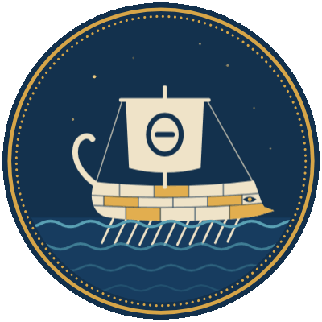
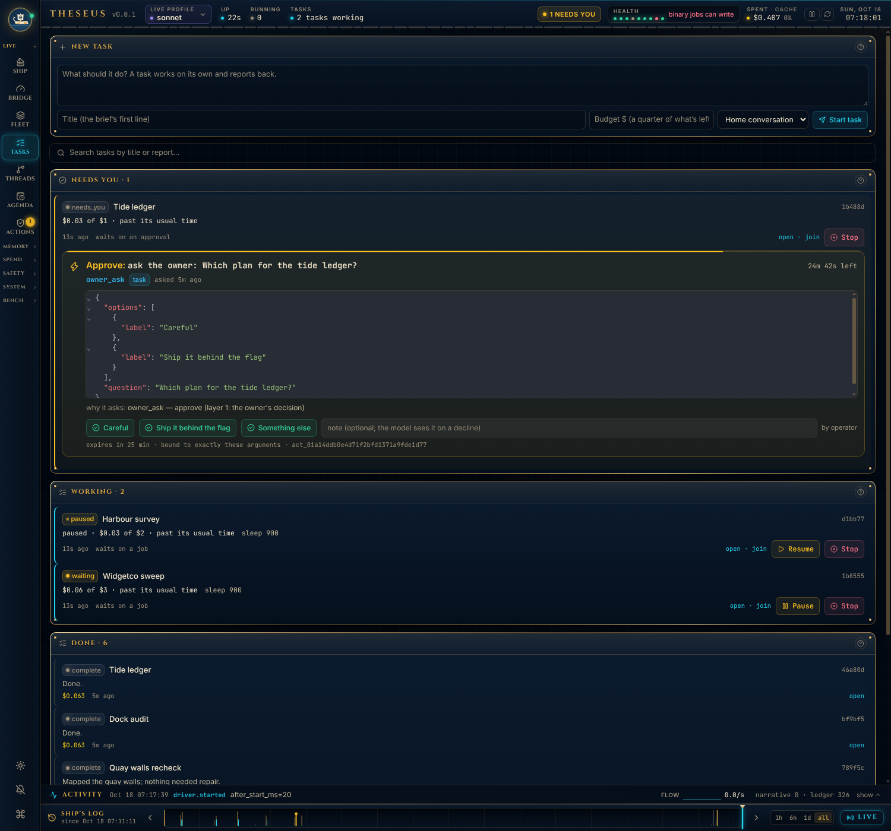

<p align="center">
  <picture>
    <source media="(prefers-reduced-motion: reduce)" srcset="docs/assets/theseus-logo.svg">
    <source srcset="docs/assets/theseus-logo-animated.svg" type="image/svg+xml">
    
  </picture>
</p>

<h1 align="center">Theseus</h1>

<p align="center">
  <strong>A fast, durable AI agent that holds thousands of tasks, lets you watch, answer and steer each one from
  wherever you are, and remembers everything it has done.</strong>
</p>

<p align="center">
  
  
  
  
</p>

<p align="center">
  <a href="docs/features/README.md">The features, one page each</a> ·
  <a href="docs/status.md">Status and roadmap</a> ·
  <a href="docs/benchmarks/omnibus.md">Benchmarks</a> ·
  <a href="docs/the-ship-of-theseus.md">The design document</a> ·
  <a href="#set-it-up">Set it up</a>
</p>

Theseus is an AI agent for one person or a small team. You talk to it in Discord, in a voice call, in a terminal, or
in your browser, and it does real work with real tools: it edits code, runs commands, reads the web, and runs long
jobs in the background. It is one Rust daemon and a small client. It calls Anthropic's Claude models directly, and
any model served through the same API.

Nine things set it apart. Each one below says what you see and how we know it works, and links to a page that says
how it is built, what is measured, where it is still rough, and what is coming. The task system comes first because
it is the thing we would show you first.

<p align="center"></p>

## 1. Durable tasks you can watch, answer and steer from anywhere

**What you see.** Ask for something long, and it becomes a task with a place of its own: a Discord forum post with a
live card, a pinned board that moves from *working* to *needs you* to *done*, and the same task in the terminal, the
web cockpit, and a voice call. When a task has a question, it shows up on every surface, and one answer, from a
button, a key, `theseus answer` or a spoken "approve", clears it everywhere. Type into a running task and it takes
your message at its next step. Pull the plug and it picks up where it was. A task with nothing to do is a record on
disk, not a process, and a task that is due later sleeps until then, so you can hold thousands. A task's home is
fixed when it is created, so a wake or a routine's run always speaks in the right place.

<p align="center"></p>

**Proof.** Killed with SIGKILL mid-task and restarted, Theseus resumed 10 of 12 trials with 0 effects done twice;
Claude Code repeated an effect in 4 of 12 (2026-10-18). With 10,000 parked sessions the idle daemon spends 0.37% of
one CPU and 117 MB. [The whole page](docs/features/durable-tasks.md).

## 2. Fast, as a contract

**What you see.** The prompt is ready in tens of milliseconds, the first words of a reply appear as the model writes
them, and restarting or upgrading it is routine.

**Proof.** Against Claude Code on the same stand-in model (2026-10-18): a ready prompt in 39 ms against 498, 10 ms of
CPU a turn against 1,655, and 70 MB idle against 360. Speed has written budgets (start 50 ms, crash and restart
150 ms, binary swap under load 200 ms), and every commit's gate fails the commit if one slips.
[The whole page](docs/features/fast-as-a-contract.md).

## 3. Jev in the core: small, fast judgments steer every message

**What you see.** Before the model answers, Theseus asks [TypeSafe](https://typesafe.ai)'s Jev a handful of small
typed questions: what kind of message this is, which model should answer and at what effort, which persona speaks,
which thread it belongs in, and what the message carries. A thank-you goes to a small model; a hard refactor to a
large one. `theseus why` says which model a turn ran on and why. If Jev is slow or down, nothing waits on it.

**Proof.** On all 89 tasks of Terminal-Bench 2.0 at high effort (2026-10-26), Jev ran 41 of 267 trials entirely on
Haiku 5.5, and the run solved 78.3%. Every judgment is recorded and replays: the new content classifier was measured
against the owner's own corrections at precision 0.956 against 0.875, recall held, and lands this week.
[The whole page](docs/features/jev-in-the-core.md).

## 4. Context compiled for each turn, not piled up

**What you see.** Each request the model gets is compiled from the store for that turn: the standing instructions and
personas, your context files, the guidance for the thread's topics, the conversation so far with a summary in place
of what no longer fits, the notes recall found in the order Jev put them, and an attached project's slice at the end.
Every request has a manifest, and `theseus why` prints it: each block, its tokens, where it came from, and what was
left out and why.

**Proof.** Tests check the layers, that sessions and threads share their first layers byte for byte so the cache
holds, and that a project's slice survives three compactions. On the owner's daemon a `theseus why` listed a slice of
177 tokens, five context files, five recalled notes with reasons, and 30 left out for the budget (2026-10-19).
[The whole page](docs/features/compiled-context.md).

## 5. It remembers everything, across sessions and tools

**What you see.** Something you said last week, in another channel, about another project, comes back when it
matters, with a link to the message it came from. Bring your history from Claude Code, Codex or OpenClaw with
`theseus import`, and it knows your past from day one.

**Proof.** Over 600 scripted turns in three sessions, Theseus answered 73.1% of recall probes against 56.9% for Pi
and 50.7% for Claude Code (2026-10-18). Two fresh seeds on the 1.0.3 build scored 68.8% and 77.8%, so about five
points of any one number is the seed (2026-10-26). [The whole page](docs/features/memory-across-sessions.md).

## 6. It fixes itself, and tells you after

**What you see.** Each night it reads its own record for what went wrong and for work it keeps repeating, fixes the
faults, turns a repeated unit of work into a tool, and in the morning says what changed, why, and what it cost. A
change that makes things worse reverts itself. A short keel still needs your yes: loosening a test or a budget,
security and permission changes, spending limits, and the off switch.

**Proof.** The nightly loop has been on since 2026-10-18. Its tests walk each step: a green self-made branch is
reviewed by a different model, joined, signed and announced once, and a regression planted after a join is found,
bisected and reverted. The keel guard fails any commit range that weakens a test without a signed, quoted yes.
[The whole page](docs/features/self-improvement.md).

## 7. Many characters, one memory; separate lines of work

**What you see.** Give it more than one persona: a name, an emoji, a voice, and a file that describes its character.
Start a message with `@name` and that persona answers, in the same conversation, with the same memory. Make a thread
for each thing you are working on, and a router places each message by the repos, branches and paths the thread
holds, asking in one line when it cannot tell.

**Proof.** Tests check that switching personas changes no byte of the cached prompt, that two threads' turns overlap
in time, and that a thread you name always wins. On 40 scripted messages the router places at least 90% and asks
about at most 10%. Five personas and five threads have been live on the owner's daemon since 2026-10-18.
[The whole page](docs/features/personas-and-threads.md).

## 8. It trusts its environment and keeps a true record

**What you see.** Theseus is built for a machine its owner set up and trusts, so its guards are light and sit at the
exits. It notifies rather than blocks: a self-started task, a long turn, a depth-ten chain of tasks all run, and you
hear about them. The stored record is raw and is never rewritten; secrets are substituted only on the copies that
leave the machine. A sensitive name or a web result raises a label you can tap away, not a refusal you cannot. A
model of China origin sees only what was judged open for that one request, and that floor has no off switch.

**Proof.** This is landing this week, in 1.0.3: nine of its eleven rows are joined on the lane, each gated green and
reviewed by a different model (2026-10-28). Earned autonomy, the old mechanism of asking less over time, goes with
it: 6,593 lines that never fired on the owner's config. [The whole page](docs/features/trusted-environment.md).

## 9. Coding at the level of the field, on its own model

**What you see.** It edits, builds, tests and fixes the way a good coding agent does, with language servers as tools
and each edit's new compiler errors in its result.

**Proof, plainly.** On all 89 tasks of Terminal-Bench 2.0 at high effort, the frozen 1.0.3 build solved 78.3% of its
trials (2026-10-26), level with the harnesses on its own model: Claude Code 75.3%, OpenClaw 74.2%, OpenHands 71.9%.
It is behind the harnesses on GPT-6 Astra: Codex 85.4% and OpenClaw 82.0%, at four to six times the cost a trial. On
the 30 hardest tasks at top effort it solved 65.6% to Codex's 86.7% (2026-10-27). And 1.0.3 costs 2.2 to 2.8 times
what the v1 build cost a trial, like for like, because a model refusal switches the rest of a turn to a fallback
model; the fix is in 1.0.4. [The whole page](docs/features/coding.md).

<p align="center"></p>

## How it works

- **One agent over one graph.** Every message, tool call, result, task, and summary is a node in one store.
  Personas are views of the same agent, and tasks and threads are sessions of their own, so nothing is copied
  between agents.
- **A durable kernel under the model.** Every action is written before it is attempted and its result when it
  settles, so a restart resumes and nothing runs twice ([feature 1](#1-durable-tasks-you-can-watch-answer-and-steer-from-anywhere)).
- **Judgment in the loop: Jev.** Small typed judgments sit inside the control loop and steer each message
  ([feature 3](#3-jev-in-the-core-small-fast-judgments-steer-every-message)).
- **Context is compiled, not piled up.** Each prompt is built from the graph, with a manifest of what went in
  ([feature 4](#4-context-compiled-for-each-turn-not-piled-up)).
- **Linux only, by design.** It is built on the kernel's own machinery (cgroups, namespaces, seccomp, pidfds), with
  no portability layer. A command can run in a sandbox with no network, no credentials, and an empty home.

## The promises it keeps

These hold whatever the model does:

| | Promise | What it means |
|---|---|---|
| 💵 | **Money is a gate.** | Every model call reserves its worst-case cost before it runs. Limits warn you; a runaway stops. |
| 🌐 | **Reading the web stops the hands.** | After a session reads web text, anything that acts on the world waits for your approval. |
| 🔑 | **Keys never reach the model.** | Secrets are substituted on everything that leaves the machine: `cat .env` shows `[redacted]`. |
| 📒 | **You can always ask why.** | Every turn, call, approval, and dollar goes into a tamper-evident ledger. |

## Where it stands

Theseus is at v1 patch2 (version 1.0.2), runs on Linux, and has one daily user. Version 1.0.3 is being closed out
this week: its last rows are the trusted-environment lane above, and it tags when they join. Version 1.0.4, the
build meant as a daily driver, is due by the end of this week with the cost fix, the scheduling tool and tasks on
the agenda; the benchmarks run again after it. **[The status page](docs/status.md)** says what works today, what is
still rough, and what comes next, and [the benchmarks](docs/benchmarks/omnibus.md) say where it loses. Those pages
change with every step; this one doesn't.

**About the name.** Plutarch's ship of Theseus was kept by replacing its planks one at a time as they wore out.
Theseus is built the same way, in small, reviewed, tested steps, by AI agents under one person's direction. Its
[design document](docs/the-ship-of-theseus.md) records every plank that was replaced.

## Set it up

One command, on Linux with systemd, from a checkout. You'll need rustup, Node.js 22 or later (for the cockpit, the
web UI), an Anthropic API key (or a key for another provider that speaks the same API), and
[1Password](https://1password.com/) with a service account, the recommended home for every secret.

```bash
git clone https://github.com/zeroaltitude/theseus && cd theseus
scripts/setup.sh --dry-run                                     # what it would do; it changes nothing
scripts/setup.sh --op-token-file ~/.config/theseus/op-token    # your service account's token, in a mode-600 file
```

It checks the machine, builds the cockpit and the binaries, installs them into `~/.local/bin`, and writes
`/etc/theseus/theseus.toml` with every secret as an `op://` reference, never a value. The first run stops once the
config is written, for you to fill in your references; run it again, and it finishes, starts the daemon as a
systemd user service, and shows its health. It is safe to rerun, and after a `git pull` it installs what changed.
[docs/setup.md](docs/setup.md) walks through each step.

Then talk to it: `theseus ask "Hello! What can you do?"`, `theseus tui`, or the cockpit at <http://127.0.0.1:7433/>.

- **The service, day to day:** `scripts/user-service.sh status`, `logs`, and `restart`
  ([docs/user-service.md](docs/user-service.md)).
- **Connect Discord:** `theseusd example-bindings` prints the bindings file's format.
- **Learn the command line:** `theseus --help`. A good first look at a session is `theseus watch`.

## Documentation

- **[docs/README.md](docs/README.md)**: where to start, and what each document is for.
- **[The features](docs/features/README.md)**: one page per feature above: how it is built, what is measured, what
  is rough, and what is coming.
- **[Status and roadmap](docs/status.md)**: what works today and what comes next.
- **[Benchmarks](docs/benchmarks/omnibus.md)**: every run, its numbers, and what it changed.
- **[The Ship of Theseus](docs/the-ship-of-theseus.md)**: the design document, both specification and record.
- **[Technical overview](docs/technical-overview.md)**: the store, the kernel, the tool loop, the protocol, and the
  command line.
- **[Design documents](docs/design/)** and **[research](docs/research/)**: how each part was designed, and what it
  was measured against.

## License

Licensed under either of

- Apache License, Version 2.0 ([LICENSE-APACHE](LICENSE-APACHE) or https://www.apache.org/licenses/LICENSE-2.0)
- MIT license ([LICENSE-MIT](LICENSE-MIT) or https://opensource.org/licenses/MIT)

at your option.

Unless you explicitly state otherwise, any contribution intentionally submitted for inclusion in this work by you,
as defined in the Apache-2.0 license, shall be dual licensed as above, without any additional terms or conditions.
