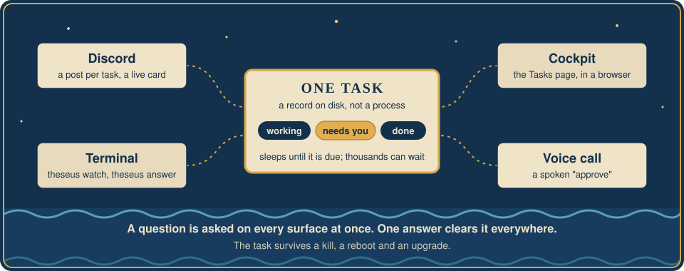
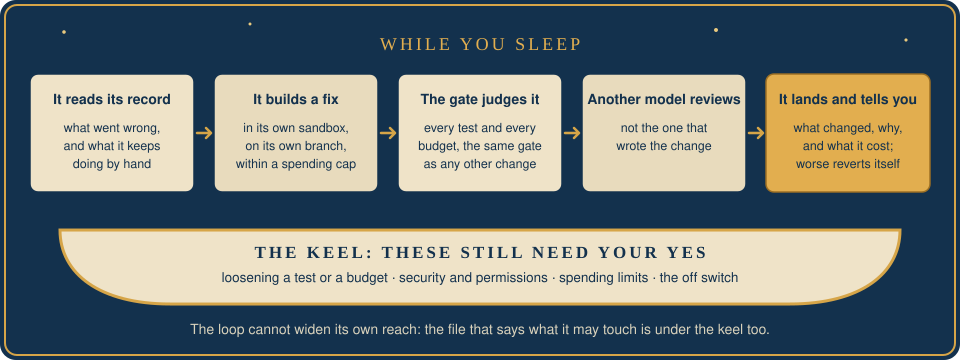
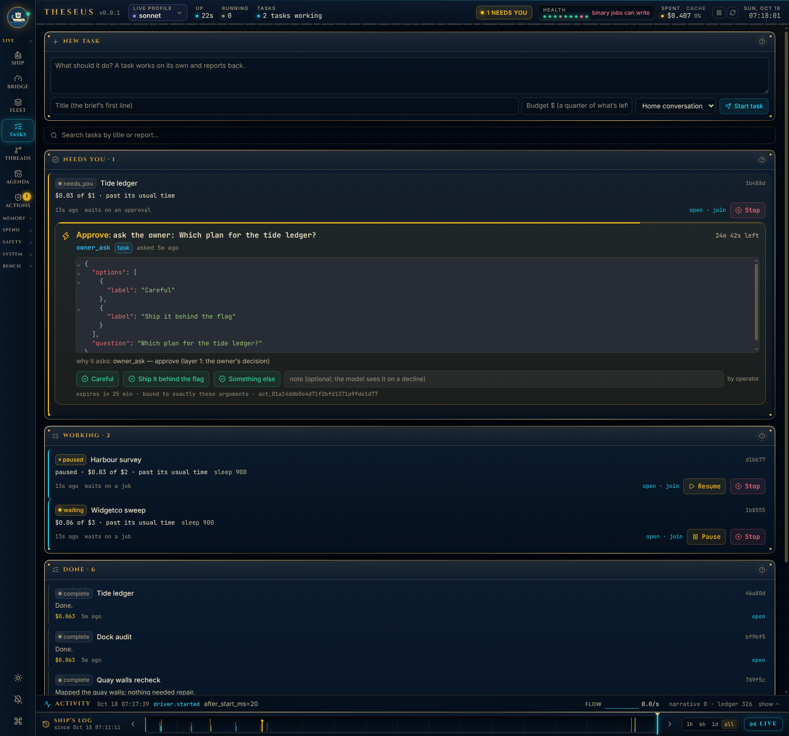
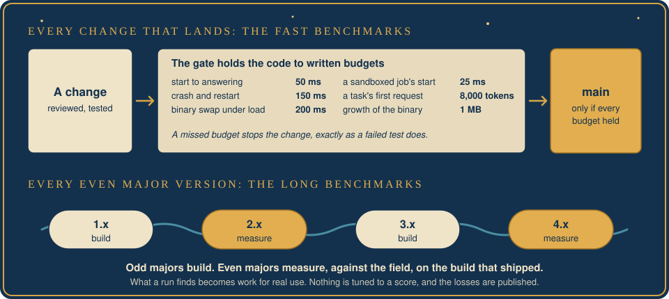
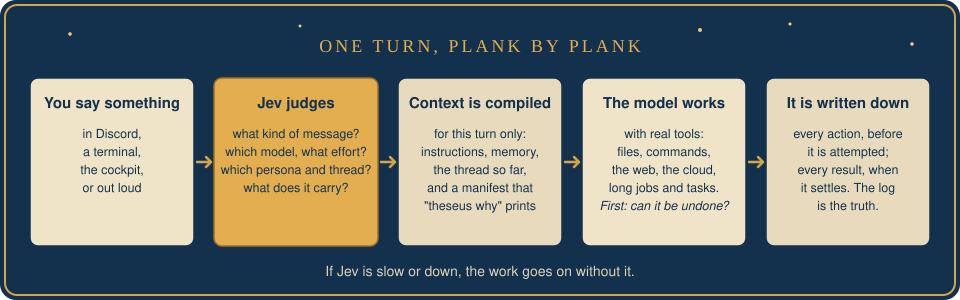

<p align="center">
  <picture>
    <source media="(prefers-reduced-motion: reduce)" srcset="docs/assets/theseus-logo.svg">
    <source srcset="docs/assets/theseus-logo-animated.svg" type="image/svg+xml">
    
  </picture>
</p>

<h1 align="center">Theseus</h1>

<p align="center">
  <strong>A quirky, fun, deeply opinionated harness for durable, long-horizon tasking.</strong>
</p>

<p align="center">
  
  
  
  
</p>

<p align="center">
  <a href="#what-we-care-about">What we care about</a> ·
  <a href="#benchmarks-in-the-loop">Benchmarks in the loop</a> ·
  <a href="docs/proof.md">Proof points</a> ·
  <a href="#set-it-up">Set it up</a> ·
  <a href="docs/status.md">Status</a> ·
  <a href="#issues-ideas-and-questions">Issues</a> ·
  <a href="docs/spec/README.md">The design document</a>
</p>

---

## What Theseus is

Theseus is a personal AI agent that lives on your own Linux machine as one small daemon. You talk to it in Discord,
in a terminal, in your browser or out loud in a voice call, and it does real work with real tools: it edits code,
runs commands, reads the web, drives AWS and Google Workspace, and keeps long jobs running in the background. It
calls Anthropic's Claude models directly, and any model served through the same API.

It is built for work that outlives a conversation: the job you start on Monday and answer from your phone on
Wednesday, the check it runs every Friday, the fault it found in itself overnight. And it has opinions. It would
rather tell you than ask you, remember than be told twice, and be measured than be believed.

That last one is a habit. The claims on this page are measured wherever they can be, with their dates and with the
places where Theseus loses. We keep the numbers off this page so that it stays readable: they are collected in
**[Proof points](docs/proof.md)**, and the raw runs are in [the benchmarks](docs/benchmarks/omnibus.md).

It is one daemon (`theseusd`), a thin command line (`theseus`), a terminal UI, and a web cockpit the daemon serves
itself. Linux only, by design: it is built on cgroups, namespaces, seccomp and pidfds, with no portability layer.

<p align="center"></p>

## What we care about

These are the things we care about most. They are also what sets Theseus apart from other attempts at a personal
agent, and each is a choice we would make again. Every section ends with a page that says how it is built, what is
still rough and what is coming.

### Work that outlives the conversation

Ask for something long and it becomes a task with a place of its own: a post in Discord with a live card, a pinned
board that moves from *working* to *needs you* to *done*, and the same task in the terminal, the cockpit and a
voice call. When a task has a question it appears on every surface at once, and one answer (a button, a key,
`theseus answer`, or a spoken "approve") clears it everywhere. Type into a running task and it takes your message
at its next step. Ask to be reminded on Friday, or for something to run every morning, and that is a task too.

A task with nothing to do is a record on disk, not a process, and a task due later sleeps until then, so you can
hold thousands of them. Pull the plug and each one picks up where it was. [Durable
tasks](docs/features/durable-tasks.md).

<p align="center"></p>

### Fast, as a promise the build keeps

The prompt is ready in tens of milliseconds, the model's first words appear as it writes them, and restarting or
upgrading the daemon is something you can do in the middle of a sentence. We wrote the speed down as budgets, and
every commit is checked against them, so Theseus cannot get slower by accident. [Fast, as a
contract](docs/features/fast-as-a-contract.md).

### Judgment in the loop

Before the model answers, Theseus asks [TypeSafe](https://typesafe.ai)'s Jev a handful of small typed questions:
what kind of message this is, which model should answer and with how much effort, which persona speaks, which
thread it belongs in, and what the message carries. A thank-you goes to a small model and a hard refactor to a
large one, and `theseus why` says which, and why. Every judgment is recorded with its probabilities and can be
replayed, so a new version of a question is measured before it decides anything. If Jev is slow or down, the work
goes on without it. [Jev in the core](docs/features/jev-in-the-core.md).

### A prompt you can read

Nothing is piled up. Each request is compiled from the store for that one turn: the standing instructions and
personas, your context files, the guidance for the thread's topics, the conversation so far with a summary in place
of what no longer fits, the notes recall found, and an attached project's slice at the end. Every request has a
manifest, and `theseus why` prints it: each block, its tokens, where it came from, and what was left out and why.
[Context compiled for each turn](docs/features/compiled-context.md).

### One memory, with receipts

Something you said last week, in another channel, about another project, comes back when it matters, with a link to
the message it came from. Bring your history from Claude Code, Codex or OpenClaw with `theseus import`, and it
knows your past from the first day. Every persona, thread and task draws on the same memory, so nothing has to be
told twice. [It remembers everything](docs/features/memory-across-sessions.md).

### It gets better while you sleep

Each night Theseus reads its own record for what went wrong and for work it keeps repeating. It fixes the faults,
turns a repeated chore into a tool, and in the morning says what changed, why, and what it cost. It acts first and
tells you afterwards, and a change that makes things worse reverts itself. Under the loop is a short keel that
still needs your yes: loosening a test or a budget, security and permission changes, spending limits, and the off
switch. [It fixes itself](docs/features/self-improvement.md).

<p align="center"></p>

### Many characters, one mind

Give it more than one persona: a name, an emoji, a voice, and a file that describes its character. Start a message
with `@name` and that persona answers, in the same conversation, with the same memory. Make a thread for each thing
you are working on, and a router places each message by the repositories, branches and paths the thread holds,
asking in one line when it cannot tell. [Personas and threads](docs/features/personas-and-threads.md).

### It trusts you, and asks only when it matters

Theseus is built for a machine its owner set up and trusts, so it does not nag. It notifies rather than blocks: a
task it started itself, a long turn, a chain of tasks ten deep all run, and you hear about them. A sensitive name
or something fetched from outside raises a label you can tap away, not a refusal you cannot.

What it does stop for is the thing that cannot be taken back. Before a tool acts, Theseus asks whether the action
could be undone. If it could, it runs. If there is a safer way to do the same work, such as keeping a copy first,
the model is sent back to do it that way. Only what is final by its nature comes to you as a question.

And the record is true. What is stored is raw and is never rewritten; secrets are swapped for their names only on
the copies that leave the machine. [It trusts its environment and keeps a true
record](docs/features/trusted-environment.md).

### Talk to it where you are

Discord is a full surface, not a place notifications go to die: a lively chat with the tool lines small and grey so
you can tell them from the answer, a home for every task, and a voice channel where it listens, talks back and lets
you interrupt. The terminal UI and the web cockpit show the same sessions and tasks, live. We keep shrinking the
list of things that need a command line: approving a held action is a button or a spoken word, and trusting a
project is a slash command. [Discord](docs/discord.md), [the command line](docs/cli.md).

<p align="center"></p>

### A real coding agent underneath

It edits, builds, tests and fixes the way a good coding agent does, with language servers as tools and each edit's
new compiler errors in its result. Coding is the floor we hold ourselves to, not the thing that sets us apart: on
its own model it is level with the field, in places it is behind, and [Proof
points](docs/proof.md#a-real-coding-agent-underneath) says where. [Coding](docs/features/coding.md).

<p align="center"></p>

## Benchmarks in the loop

We do not save the measuring for the end. It is part of how every change lands, and it runs at two speeds.

- **Fast benchmarks on every commit.** The gate that every change must pass runs the start, restart, upgrade, job
  and turn benchmarks against written budgets: 50 ms from start to answering, 150 ms for a crash and restart, 200
  ms for a binary swap under load. A missed budget fails the commit exactly as a failed test does, and raising a
  budget needs the owner's signed yes. Speed cannot wear away quietly.
- **Long benchmarks on every even major version.** Odd majors build and even majors measure. On an even major the
  long benchmarks run on the build that shipped, against the field: coding on Terminal-Bench 2.0, recall across
  sessions, kill and resume, threads, and speed and memory beside other harnesses. `2.x` is the first of these.
- **Improve, never tune.** After a run we ask what would make Theseus better for a person using it, and that
  becomes work. Nothing is tuned to a score. The losses are published beside the wins: [Proof
  points](docs/proof.md#where-theseus-loses) opens with them.

<p align="center"></p>

## How releases are numbered

Theseus numbers releases `MAJOR.MINOR.PATCH`, but the fields do not do their usual jobs, because this project ships
one build to one machine rather than a library to the world.

- **The major number is the phase, and whether it is odd or even says which kind.** Odd majors build. `1` is v1:
  the feature set that Part I of the design document specifies, built and running since 2026-10-18. Even majors
  measure: `2` is where the long benchmarks run again. `3` is the next phase of building, and its first two pieces
  are already designed: the daemon, the command line and the index each on its own machine ([remote
  runtimes](docs/design/remote-runtimes.md)), and working ahead on the likely next ask
  ([speculation](docs/design/speculation.md)).
- **The patch number is a themed release, not a bug-fix dribble.** Each `1.0.N` has a subject, is tagged
  `release-1.0.N`, and is built with the `release` profile. [The status page](docs/status.md) names each one's
  subject.
- **The minor number is unused so far.** Every release to date has been `1.0.N`.
- **The version is one number for the whole workspace**, and the store's format is a separate one: a build refuses
  a store written by a newer one.

## How it works

<p align="center"></p>

- **One agent over one graph.** Every message, tool call, result, task and summary is a node in one store. Personas
  are views of the same agent, and tasks and threads are sessions of their own, so nothing is copied between
  agents.
- **A durable kernel under the model.** Every action is written before it is attempted and its result when it
  settles, so a restart resumes and nothing runs twice. The write-ahead log of checksummed frames is the truth, and
  every index is a projection rebuilt from it.
- **Judgment in the loop.** Small typed judgments sit inside the control loop and steer each message, recorded with
  their probabilities and outcomes.
- **Context is compiled, not piled up.** Each prompt is built from the graph for that turn, with a manifest of what
  went in and what was left out.
- **Append-only.** The record only grows: compaction, supersession and forgetting are new records, not edits. The
  one receipted exception is erasing a payload on request.
- **Linux only, by design.** cgroups, namespaces, seccomp and pidfds, with no portability layer. A command can run
  in a sandbox with no network, no credentials and an empty home.

## The promises it keeps

These hold whatever the model does:

| | Promise | What it means |
|---|---|---|
| 💵 | **Money is a gate.** | Every model call reserves its worst-case cost before it runs. Limits warn you; a runaway stops. |
| 🌐 | **A label you can remove, not a refusal you can't.** | Text that tries to steer it, a name you listed, or anything fetched from outside puts a label on the session and tells you. You remove it with one tap. |
| ⚓ | **The only copy is not overwritten on a model's say-so.** | A plain write or edit to a file that nothing else holds a copy of is held, whatever the model answers. |
| 🔑 | **Its own keys are replaced on the way out.** | Every value the vault gave Theseus is replaced by its name in each request to a model and each Discord post; what is stored is never rewritten. A value of a secret the daemon no longer holds, or one a size limit cut in two, is not recognised. |
| 📒 | **You can always ask why.** | Every turn, call, approval and dollar goes into a tamper-evident ledger, and `theseus why` reads it back. |
| 🧱 | **A test does not quietly get weaker.** | Deleting a test, ignoring one, dropping an assertion or raising a budget fails the commit gate unless a signed commit carries the owner's quoted yes. |

## Where it stands

Theseus is at **version 1.0.6**, runs on Linux, and has one daily user. **[The status page](docs/status.md)** says
what works today, what is still rough and what comes next, and [Proof points](docs/proof.md) says where it loses,
including the places it loses badly. Those pages change with every step that lands. This one tries not to.

**About the name.** Plutarch's ship of Theseus was kept afloat by replacing its planks one at a time as they wore
out, until a philosopher could ask whether it was still the same ship. Theseus is built the same way: in small,
reviewed, tested steps, by AI agents working under one person's direction, each step gated and each one recorded.
Its [design document](docs/spec/README.md) is both the specification and the record of every plank replaced.

## Issues, ideas and questions

Theseus has one daily user so far, and we would like to hear from a second.

- **Something broke or surprised you.** Open an issue. Say what you asked for, what you expected and what happened,
  with the output of `theseus --version`. For a turn that went wrong, `theseus why` is the most useful thing you
  can attach; read it for anything private first.
- **An idea, or a question about how something works.** Open an issue for that too. There is no separate forum.
- **What happens to it.** We keep a small number of themed issues, each a checklist of related work labelled with
  the release it is planned for. A report that belongs with one of them is added to that list with a link back to
  yours, so one place shows everything planned for an area.
- **Before a large pull request,** open an issue and say what you have in mind. The project is built in small,
  reviewed, gated steps, and it is kinder to agree the shape first.

## Set it up

One command, on Linux with systemd, from a checkout. You'll need rustup, Node.js 22 or later (for the cockpit, the
web UI), an Anthropic API key (or a key for another provider that speaks the same API), and
[1Password](https://1password.com/) with a service account, the recommended home for every secret.

```bash
git clone https://github.com/zeroaltitude/theseus && cd theseus
scripts/setup.sh --dry-run                                     # what it would do; it changes nothing
scripts/setup.sh --op-token-file ~/.config/theseus/op-token    # your service account's token, in a mode-600 file
```

It checks the machine, builds the cockpit and the binaries, installs them into `~/.local/bin`, and writes
`/etc/theseus/theseus.toml` with every secret as an `op://` reference, never a value. The first run stops once the
config is written, for you to fill in your references; run it again and it finishes, starts the daemon as a systemd
user service, and shows its health. It is safe to rerun, and after a `git pull` it installs what changed.
[docs/setup.md](docs/setup.md) walks through each step.

Then talk to it: `theseus ask "Hello! What can you do?"`, `theseus tui`, or the cockpit at
<http://127.0.0.1:7433/>.

- **The service, day to day:** `scripts/user-service.sh status`, `logs` and `restart`
  ([docs/user-service.md](docs/user-service.md)).
- **Connect Discord:** `theseusd example-bindings` prints the bindings file's format.
- **Learn the command line:** `theseus --help`. A good first look at a session is `theseus watch`.

## Documentation

- **[docs/README.md](docs/README.md)**: where to start, and what each document is for.
- **[Proof points](docs/proof.md)**: the measurements behind this page, with their dates, and where Theseus loses.
- **[The features](docs/features/README.md)**: one page each, with how it is built, what is rough, and what is
  coming.
- **[The killer features](docs/design/killer-features.md)**: the short pitch for each, and where it stands.
- **[Status and roadmap](docs/status.md)**: what works today and what comes next.
- **[Benchmarks](docs/benchmarks/omnibus.md)**: every run, its numbers, and what it changed.
- **[The Ship of Theseus](docs/spec/README.md)**: the design document, in chapters: specification, plan and the
  as-built record.
- **[Technical overview](docs/technical-overview.md)**: the store, the kernel, the tool loop, the protocol and the
  command line, with a command to see each part work.
- **[Design documents](docs/design/)** and **[research](docs/research/)**: how each part was designed, and what it
  was measured against.
- **[AGENTS.md](AGENTS.md)**: the guide an AI agent reads before it changes this repository.

## License

Licensed under either of

- Apache License, Version 2.0 ([LICENSE-APACHE](LICENSE-APACHE) or https://www.apache.org/licenses/LICENSE-2.0)
- MIT license ([LICENSE-MIT](LICENSE-MIT) or https://opensource.org/licenses/MIT)

at your option.

Unless you explicitly state otherwise, any contribution intentionally submitted for inclusion in this work by you,
as defined in the Apache-2.0 license, shall be dual licensed as above, without any additional terms or conditions.
