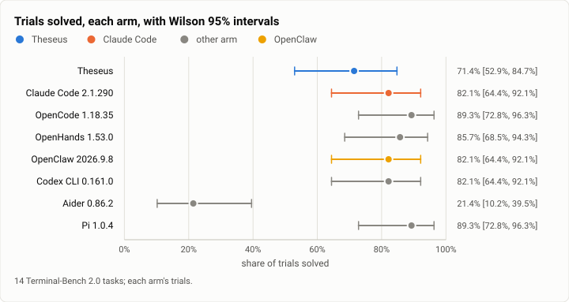
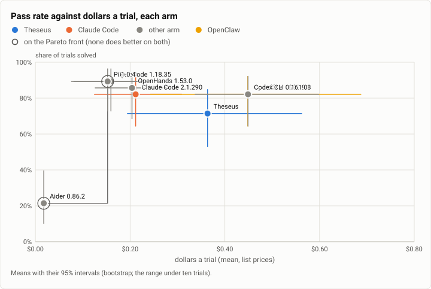
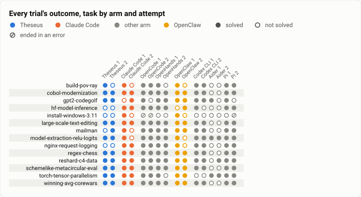
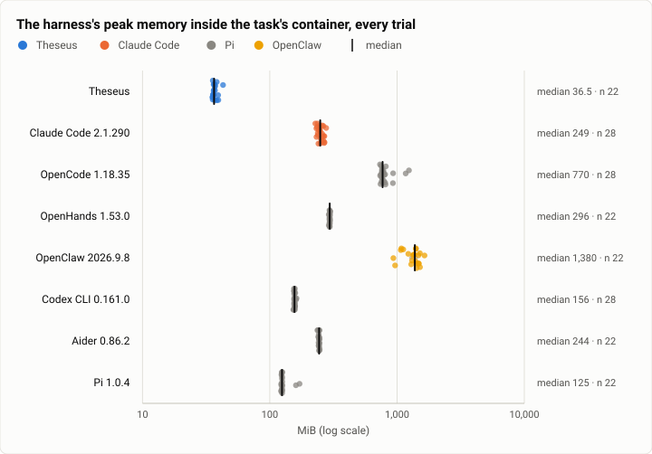
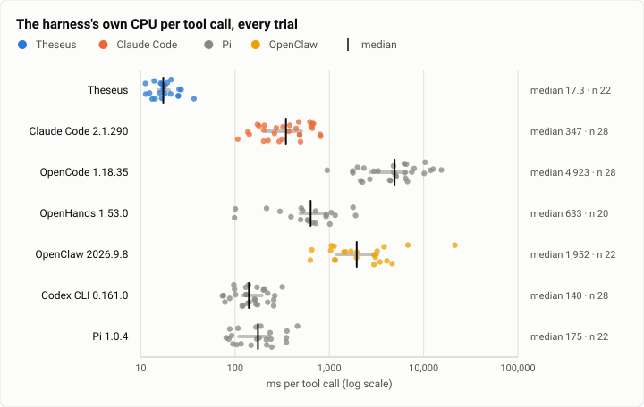
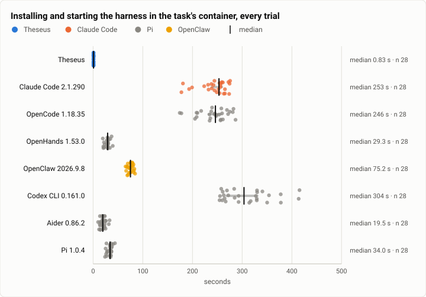

# Terminal-Bench 2.0: 8 harnesses on the same 14 tasks, the harness arms' first run

**The answer first.** Eight harnesses ran the same 14 Terminal-Bench 2.0 tasks, two attempts each, every one but
Codex CLI on Claude Sonnet 5.5 at medium effort. Pi 1.0.4 and OpenCode 1.18.35 solved the most, **25 of 28** each
(89.3%; Wilson 95% interval 72.8% to 96.3%), at **$0.15 and $0.16 a trial**. OpenHands solved 24 (85.7%) at $0.20;
Claude Code 2.1.290, OpenClaw and Codex CLI 23 each (82.1%; 64.4% to 92.1%) at $0.21, $0.45 and $0.45. Aider, which
edits files from one message and runs no commands, solved 6 (21.4%). **Theseus's arm is not a fair measure of
Theseus:** in all 28 of its trials, every `proc.run` failed to start a process (the spawn call was refused inside
the task containers with "Function not implemented", and the model saw only "(no output)"). That bug was fixed on
Oct 8, and the arm is rerun on the fixed build in its own report. As measured, Theseus solved **20 of 28** (71.4%;
52.9% to 84.7%) at **$0.36 a trial**, off the frontier: 5 trials gave up after the failed starts, 2 lost a service
that a terminal started when the terminal closed at the end, and 1 lost on the model's own choice. Every interval
but Aider's overlaps every other, so the ranking among the seven agent loops is not settled by 28 trials. What the
run teaches that the table doesn't: the cheapest arms are the ones that make the fewest model calls over the smallest
context (OpenCode's median trial read 53 thousand tokens, Pi's 27 thousand, Theseus's 221 thousand), and that cost is
the model's, not the harness's. Measured apart from the model, Theseus's own process was the lightest of the eight:
36 MiB at its peak, 17 ms of CPU per tool call and 1 s to set up, against 125 to 1,380 MiB, 140 ms to 4.9 s and 20 s
to 5 minutes for the others.

| | |
|---|---|
| Suite | Terminal-Bench 2.0 through Harbor 0.23: 14 tasks (theseus-7gir.22's held-out set), 2 attempts an arm |
| Arms | Theseus (`theseus_agent:Theseus`) · Claude Code 2.1.290 (`claude_code_agent:MeasuredClaudeCode`) · OpenCode 1.18.35 (`opencode_agent:MeasuredOpenCode`) · OpenHands 1.53.0 (`openhands_agent:MeasuredOpenHands`) · OpenClaw 2026.9.8 (`openclaw_agent:MeasuredOpenClaw`) · Codex CLI 0.161.0 (`codex_agent:MeasuredCodex`) · Aider 0.86.2 (`aider_agent:MeasuredAider`) · Pi 1.0.4 (`pi_agent:MeasuredPi`) |
| Model | Claude Sonnet 5.5 at medium effort in every arm but Codex CLI (GPT-5.6-Sol) |
| Trials | 224 |
| Dates and commits | 2026-10-07; Theseus's binaries built at `041eb8ed` |
| Cost | $55.77 at list prices |
| Data | [`2026-10-07-terminal-bench-harness-arms.json`](2026-10-07-terminal-bench-harness-arms.json), [`.csv`](2026-10-07-terminal-bench-harness-arms.csv) (one row per trial) |

## The question

Where does Theseus sit among the agent harnesses people use, when every one of them drives the same model on the
same tasks? Until this run Theseus had been measured against one harness only, Claude Code (the
[first full run](2026-10-04-terminal-bench-first-full-run.md)), so a gap could be read as Theseus's or as Claude
Code's strength. Six more harnesses give the frontier: how many trials each solves against what it spends, in
dollars and in tokens, and what each harness costs to run apart from the model (memory, CPU per tool call, setup).

The task set was theseus-7gir.22's held-out rerun: the four tasks Theseus had lost on Oct 4 to faults since fixed
(the max-tokens cut, an approval wait, an unretried transient error), and ten tasks drawn at random from those both
of Oct 4's arms solved in all four trials. So the run was also meant to check those four fixes. The spawn bug
below made that check unreadable for Theseus's arm; it moves to the rerun.

## The setup

**The conditions.**

- Every arm ran at medium effort, its version pinned, on the same tasks and attempts, one arm at a time, and every one but Codex CLI on Claude Sonnet 5.5.
- Codex CLI ran GPT-5.6-Sol, an OpenAI model, not Claude Sonnet 5.5: Codex speaks only OpenAI's Responses API, which Anthropic's API does not serve.
- Claude Code enforced the $2.00 and 200-turn caps itself and OpenHands its 200 iterations; OpenCode, OpenHands, OpenClaw, Codex CLI, Aider have no spend cap, so theirs was recorded, not enforced.
- Theseus's spend limit was $3.75, because it counts a call's reservation before the call: its real spend could reach $2.00.
- Aider answers one message with up to three reflections, editing files; it suggests shell commands but does not run them (it asks an explicit yes for each, which its --yes-always does not give), and it does not drive a loop of tool calls as the other arms do.
- Dollars are each trial's tokens at the providers' list prices, the same table for every arm.

- **Each arm's adapter** (`bench/harbor/`): Theseus: `theseus_agent:Theseus`; Claude Code: `claude_code_agent:MeasuredClaudeCode`; OpenCode: `opencode_agent:MeasuredOpenCode`; OpenHands: `openhands_agent:MeasuredOpenHands`; OpenClaw: `openclaw_agent:MeasuredOpenClaw`; Codex CLI: `codex_agent:MeasuredCodex`; Aider: `aider_agent:MeasuredAider`; Pi: `pi_agent:MeasuredPi`.
- **What a trial records**: `agent/efficiency.json` (`bench/harbor/efficiency.py`), and the sampler's harness CPU and memory, the harness named by its process (`efficiency.ARMS`).

- **The machine.** One WSL2 host, the arms one at a time, at most two Harbor jobs (four trials) at once. Theseus's
  arm ran first, 2026-10-07 18:33 to 19:34 (UTC−7); the last arm finished 2026-10-08 11:44.
- **A pause.** The run's unit was stopped at 01:29 during Codex CLI's arm and resumed at 08:02. Its two unfinished
  jobs were set aside and run again; their first tries recorded no spend.
- **Beside a build.** 20 jobs ran while a Rust build, a test run or the gate ran on the same machine: all 14 of Codex
  CLI's, 5 of Aider's and 1 of Pi's (install-windows-3.11). None of Theseus's, Claude Code's, OpenCode's, OpenHands'
  or OpenClaw's did. Contention changes wall time and the harness's CPU readings, not a trial's tokens.
- **Theseus's arm.** Every `proc.run` in all 28 trials failed with `spawn_error: Function not implemented (os error
  38)`; only the two torch-tensor-parallelism trials, which ran no command, were untouched. The model worked around
  it through the terminal tools (`term.*`) in some trials and gave up in others. The cause and fix are below.

## Results

| Arm | Trials | Solved | Pass rate (Wilson 95%) | $ a trial | $ a solve | Model calls a trial | Agent time (median) | Setup (median) | Harness memory (median) | Harness CPU a tool call (median) |
|---|---|---|---|---|---|---|---|---|---|---|
| Theseus | 28 | 20 | 71.4% [52.9%, 84.7%] | $0.36 | $0.51 | 22.5 | 95 s | 1 s | 36 MiB | 17 ms |
| Claude Code 2.1.290 | 28 | 23 | 82.1% [64.4%, 92.1%] | $0.21 | $0.26 | 11.9 | 43 s | 253 s | 249 MiB | 347 ms |
| OpenCode 1.18.35 | 28 | 25 | 89.3% [72.8%, 96.3%] | $0.16 | $0.18 | 8.4 | 54 s | 246 s | 770 MiB | 4923 ms |
| OpenHands 1.53.0 | 28 | 24 | 85.7% [68.5%, 94.3%] | $0.20 | $0.22 | 13.5 | 72 s | 29 s | 296 MiB | 633 ms |
| OpenClaw 2026.9.8 | 28 | 23 | 82.1% [64.4%, 92.1%] | $0.45 | $0.55 | 23.9 | 113 s | 75 s | 1380 MiB | 1952 ms |
| Codex CLI 0.161.0 | 28 | 23 | 82.1% [64.4%, 92.1%] | $0.45 | $0.55 | 16.8 | 154 s | 304 s | 156 MiB | 140 ms |
| Aider 0.86.2 | 28 | 6 | 21.4% [10.2%, 39.5%] | $0.018 | $0.083 | 1.1 | 19 s | 20 s | 244 MiB | – |
| Pi 1.0.4 | 28 | 25 | 89.3% [72.8%, 96.3%] | $0.15 | $0.17 | 11.1 | 46 s | 34 s | 125 MiB | 175 ms |

<picture>
  <source media="(prefers-color-scheme: dark)" srcset="img/2026-10-07-terminal-bench-harness-arms/pass-rate-dark.svg">
  
</picture>

*Figure 1. Which harness solves the most of the same tasks? Pi and OpenCode (25 of 28), but every agent loop's interval overlaps the others'; only Aider, which runs no commands, is clearly behind.*

<picture>
  <source media="(prefers-color-scheme: dark)" srcset="img/2026-10-07-terminal-bench-harness-arms/frontier-dollars-dark.svg">
  
</picture>

*Figure 2. Which harnesses are on the frontier of solving more for less? Pi and OpenCode, at the top for $0.15 to $0.16 a trial; Theseus's measured point ($0.36, 71%) is off it, in a run where none of its commands could start.*

<picture>
  <source media="(prefers-color-scheme: dark)" srcset="img/2026-10-07-terminal-bench-harness-arms/outcomes-dark.svg">
  
</picture>

*Figure 3. Where does each harness win and lose? install-windows-3.11 beat nearly everyone (2 of 14 trials solved outside Aider); Theseus's own losses sit on the tasks that need a command or a service to run (nginx-request-logging, hf-model-inference, mailman, build-pov-ray).*

<picture>
  <source media="(prefers-color-scheme: dark)" srcset="img/2026-10-07-terminal-bench-harness-arms/harness-rss-dark.svg">
  
</picture>

*Figure 4. How much memory does each harness itself hold at its peak? Theseus 36 MiB at the median trial; Pi 125, Codex CLI 156, Aider 244, Claude Code 249, OpenHands 296, OpenCode 770 and OpenClaw 1,380 MiB.*

<picture>
  <source media="(prefers-color-scheme: dark)" srcset="img/2026-10-07-terminal-bench-harness-arms/harness-cpu-per-tool-call-dark.svg">
  
</picture>

*Figure 5. How much CPU does each harness spend per tool call, apart from the commands it runs? Theseus 17 ms at the median, against 140 ms (Codex CLI) to 4.9 s (OpenCode).*

<picture>
  <source media="(prefers-color-scheme: dark)" srcset="img/2026-10-07-terminal-bench-harness-arms/setup-dark.svg">
  
</picture>

*Figure 6. How long does each harness take to set up? Theseus about 1 s (two static binaries copied in); Aider, OpenHands and Pi 20 to 34 s; OpenClaw 75 s; Claude Code, OpenCode and Codex CLI 4 to 5 minutes, most of it installing Node and the CLI in each container.*


**Paired, by task and attempt.**

- Claude Code 2.1.290 against Theseus: solved where Theseus did not 6, the reverse 3 (exact McNemar p = 0.508).
- OpenCode 1.18.35 against Theseus: solved where Theseus did not 6, the reverse 1 (exact McNemar p = 0.125).
- OpenHands 1.53.0 against Theseus: solved where Theseus did not 5, the reverse 1 (exact McNemar p = 0.219).
- OpenClaw 2026.9.8 against Theseus: solved where Theseus did not 4, the reverse 1 (exact McNemar p = 0.375).
- Codex CLI 0.161.0 against Theseus: solved where Theseus did not 5, the reverse 2 (exact McNemar p = 0.453).
- Aider 0.86.2 against Theseus: solved where Theseus did not 0, the reverse 14 (exact McNemar p = 0.000122).
- Pi 1.0.4 against Theseus: solved where Theseus did not 6, the reverse 1 (exact McNemar p = 0.125).

## Analysis

**Theseus's arm, first.** Theseus's shell tool, `proc.run`, starts each command through the kernel's sandboxed spawn
path. A change between Oct 4 and Oct 7 made that path start processes with `clone3`, which Docker's default
seccomp profile refuses with `ENOSYS`; there was no fallback, and the refusal reached the model as an empty result,
"(no output)". The other arms ran commands in the same containers without trouble; the Oct 4 run's `proc.run`
worked. The fix (theseus-f7tz, joined Oct 8) starts the process with `clone` when `clone3` is refused (and falls
back the same way for the process-handle calls), and a spawn that still fails now says why and names the terminal
tools as the way around. Its live check solved nginx-request-logging, a task Theseus lost
twice here, for $0.06. With the bug, Theseus's 8 losses were:

- **5 give-ups after 4 to 6 identical failed starts**, never trying the terminal: nginx-request-logging (both
  trials), build-pov-ray, install-windows-3.11 and mailman (one each). Every other agent loop simply ran commands
  here.
- **2 lost services** (hf-model-inference, both trials): the model started the server with `nohup … &` inside a
  terminal, checked it answered, and said it was running; the terminal's close at the end of the run killed it, so
  the grader found nothing listening. Every arm that solved the task started it from a shell tool whose children
  outlive the agent. That was a real defect of the terminals beyond the spawn bug, and it is fixed too (theseus-ggqf:
  a terminal's background processes now outlive the session, as `proc.run`'s always did).
- **1 loss on the model's choice** (install-windows-3.11): it booted the guest on a borrowed QEMU through the dynamic
  loader, which the grader's `pgrep qemu-system` cannot see. Most arms lose this task too.

The bug also set the cost. Theseus spent $10.18 on 28 trials; the same 28 attempts cost $5.33 on Oct 4's working
build. The excess sits in two long tuning tasks driven command by command through a terminal: winning-avg-corewars
($1.41 a trial against Pi's $0.03 and Claude Code's $0.28) and schemelike-metacircular-eval ($1.38 against $0.28 and
$0.84), where waiting for a command to finish meant polling the screen once a model call. A terminal can now wait for
its command in one call (theseus-ggqf's `until_idle`). Theseus's 22.5 model calls and 873 thousand tokens a trial
(221 thousand at the median) are the detour's, not a measure of its loop.

**Where each harness wins.** Six of the 14 tasks every agent loop, Theseus included, solved in both trials:
cobol-modernization, large-scale-text-editing, regex-chess, reshard-c4-data, schemelike-metacircular-eval and
winning-avg-corewars. The tasks that separate them:

- **install-windows-3.11** beat nearly everyone: Claude Code and OpenClaw solved one trial each, the five other agent
  loops none. It is also the most expensive task for most arms ($0.59 to $1.62 a trial).
- **gpt2-codegolf** (an 18-thousand-token C program written from scratch): Theseus, OpenHands, OpenClaw and Codex
  CLI solved both trials; Claude Code, OpenCode and Pi one each.
- **hf-model-inference** and **nginx-request-logging** (start a service, leave it running): every arm but Theseus
  solved at least one; Pi, OpenCode, OpenHands and Claude Code both.
- **torch-tensor-parallelism** (one file, no command): Codex CLI lost both and OpenHands one; everyone else, Aider
  included, solved both.
- **Aider's 6 solves** are the tasks a correct file edit settles alone (model-extraction-relu-logits and
  torch-tensor-parallelism twice, gpt2-codegolf and reshard-c4-data once). It never ran the tests it suggested.

**Cost against success.** Pi and OpenCode solved the most for the least: about 8 to 11 model calls a trial at a
median context of 27 to 53 thousand tokens. OpenHands and Claude Code read more per trial (152 and 123 thousand
tokens at the median) for one or two fewer solves. OpenClaw and Codex CLI cost three times as much for the same 23:
OpenClaw re-reads a large context on each of its 24 calls (419 thousand tokens at the median), and Codex CLI ran
another provider's model at that model's prices. Every arm read 93% to 98% of its input from the prompt cache, so
the differences are in how much context each call carries and how many calls a trial takes, not in cache hits.

**Harness weight against success.** None. The lightest harness (Theseus: 36 MiB, 17 ms a tool call, 1 s setup) and
the heaviest (OpenClaw: 1,380 MiB, 2 s a tool call; OpenCode 4.9 s a tool call, 4 minutes of setup) span the whole
range of pass rates. At Sonnet 5.5's pace (seconds a call) a harness's own CPU is a small share of a trial's wall
time; it matters for memory per agent and for how many agents fit on a machine, not for the score here.

**Since the last comparable run.** On Oct 4, on all 89 tasks, Claude Code 2.1.288 solved 81.5% and Theseus 71.9%.
Claude Code moved to 2.1.290. Theseus gained the four fixes theseus-7gir.18 to .21 aimed at its Oct 4 faults (the
max-tokens cut, the approval wait, the transient-error retry, the stop), but lost `proc.run` in containers to the
spawn regression, so this run measures neither the fixes nor Theseus. Claude Code's 82.1% here sits where it sat on
Oct 4.

## Threats to validity

- **Theseus's arm is invalid.** Every command failed to start (above). Read its row as a measurement of that bug,
  not of Theseus; the rerun is the measurement.
- **Small samples.** 14 tasks × 2 attempts give each arm an interval 23 to 32 points wide, and every pair of agent
  loops overlaps. Paired by task, no arm's difference from another is significant but Aider's.
- **The task set favours two arms.** Ten of the 14 tasks were drawn from those both of Oct 4's arms (Theseus and
  Claude Code) solved in all four trials, so those two arms' rates are inflated by the selection, and the four other
  tasks are ones Theseus had lost. The set says little about Terminal-Bench as a whole.
- **Codex CLI ran another model** (GPT-5.6-Sol): its row compares a harness and a model at once.
- **Caps.** Claude Code enforced the $2.00 and 200-turn caps, OpenHands its 200 iterations and Theseus its own
  limit; OpenCode, OpenClaw, Codex CLI, Aider and Pi have no spend cap, so theirs was recorded, not enforced. Three
  trials went past $2.00: OpenClaw's two (install-windows-3.11, lost; schemelike-metacircular-eval, solved at $2.18)
  and Codex CLI's one (install-windows-3.11, lost). Under an enforced cap the OpenClaw solve might have been cut.
- **Aider is a one-message harness** under Harbor: it edits files and runs nothing, so its row measures a different
  kind of tool.
- **Beside a build.** 20 jobs (all of Codex CLI's, 5 of Aider's, 1 of Pi's) ran while the machine built or tested
  Rust. That moves wall time and harness CPU readings, not tokens or outcomes, as far as we can tell.
- **Timeouts.** Ten trials ended at Harbor's agent timeout (OpenCode 3, Pi 3, Claude Code 2, OpenHands 2); 7 of them
  still earned the reward, because the grader checks what the agent left (six on schemelike-metacircular-eval, one
  on mailman). A harness that runs past the task's limit is cut the same way in every arm, and two of OpenHands'
  timed-out trials kept no token count (the two unpriced trials below).

## What it cost

$55.77 at list prices in all:
- Theseus: $10.18 (0 unpriced trials; 0 past the $2.00 cap)
- Claude Code 2.1.290: $5.93 (0 unpriced trials; 0 past the $2.00 cap)
- OpenCode 1.18.35: $4.46 (0 unpriced trials; 0 past the $2.00 cap)
- OpenHands 1.53.0: $5.30 (2 unpriced trials; 0 past the $2.00 cap)
- OpenClaw 2026.9.8: $12.56 (0 unpriced trials; 2 past the $2.00 cap)
- Codex CLI 0.161.0: $12.57 (0 unpriced trials; 1 past the $2.00 cap)
- Aider 0.86.2: $0.50 (0 unpriced trials; 0 past the $2.00 cap)
- Pi 1.0.4: $4.27 (0 unpriced trials; 0 past the $2.00 cap)

## Reproduction

```
~/reports/theseus-harness-arms/night.sh   # the driver, then this report's data
python3 make_docs.py --run RUN_DIR --tree TREE --arms theseus,claude-code,opencode,openhands,openclaw,codex,aider,pi --date 2026-10-07
```

## Data

[`2026-10-07-terminal-bench-harness-arms.json`](2026-10-07-terminal-bench-harness-arms.json) and [`2026-10-07-terminal-bench-harness-arms.csv`](2026-10-07-terminal-bench-harness-arms.csv): one row per trial, no transcripts.
