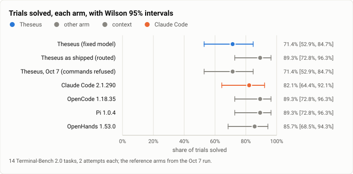
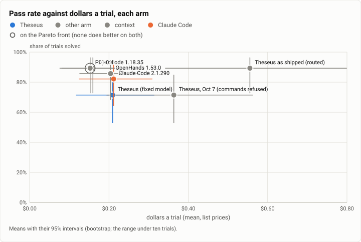
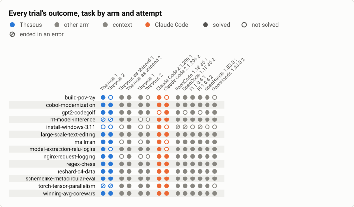
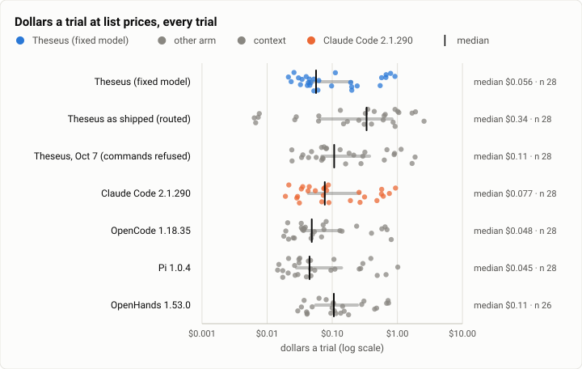
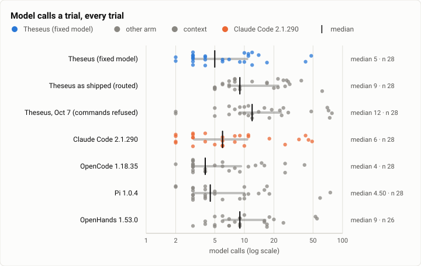

# Terminal-Bench 2.0: Theseus's arms again, with its commands working (the night set's rerun)

**The answer first.** On the Oct 7 night set (14 Terminal-Bench 2.0 tasks, two attempts each), with its commands working again,
Theseus on Claude Sonnet 5.5 at medium effort solved **20 of 28** trials as recorded (71.4%; Wilson 95% 52.9% to
84.7%) at **$0.21 a trial**, the same dollars as Claude Code. Four of its eight losses were this host's, not
Theseus's: two graders timed out while the machine ran out of memory, and two model downloads stalled on a slow hub;
run again on the recovered host, all four solved, so **24 of 28** (85.7%; 68.5% to 94.3%) with those reruns, beside
OpenHands' 24, Pi's and OpenCode's 25 and Claude Code's 23 on Oct 7. **Theseus as shipped**, with Jev choosing the
model for each task, solved **25 of 28** (89.3%; 72.8% to 96.3%) at **$0.56 a trial**: its routing table sent the
coding tasks to Opus 5.5 at high effort, which cost a median 4.8 times as much on the same tasks for one more solve.
Against its own arm of Oct 7 (20 of 28 at $0.36, every command refused), the fixes made Theseus cheaper by 42%,
with 2.4 times fewer model calls. What the table doesn't show: the dollars Theseus still spends over Pi and
OpenCode ($0.15 to $0.16) are mostly the prompt cache going cold while a long command holds the turn (16% of its
spend), a harness fix, and its remaining losses were the model's choices on three tasks.

| | |
|---|---|
| Suite | Terminal-Bench 2.0 through Harbor 0.23: the Oct 7 night run's 14 tasks, 2 attempts an arm |
| Arms | Theseus (`theseus_agent:Theseus`, Claude Sonnet 5.5 at medium effort) · Theseus as shipped (`theseus_agent:TheseusRouted`, Jev picks the model per message); beside the Oct 7 run's arms |
| Trials | 60 new: 28 an arm, and the fixed arm's 4 host-hit trials run again |
| Dates and commits | 2026-10-10; Theseus's binaries built at `2fd1f654` |
| Cost | $23.74 at list prices in all; the two arms' 56 trials $21.41 |
| Data | [`2026-10-10-terminal-bench-theseus-rerun.json`](2026-10-10-terminal-bench-theseus-rerun.json), [`.csv`](2026-10-10-terminal-bench-theseus-rerun.csv) (one row per trial) |

## The question

Where does Theseus sit among the harnesses on the Oct 7 night set now that its commands start? That run's Theseus
arm was not a measure of Theseus: every `proc.run` was refused in the task containers (the spawn bug, theseus-f7tz,
fixed Oct 8), and four fixes found in its trials (terminals that keep their background processes, `term.read`
waiting for its command, `fs.read` windows of big files, `web.search` offered only with a key) have joined since.
This run asks two things on the same 14 tasks, two attempts each: how many trials Theseus solves and at what cost
against the arms that ran them on Oct 7, and what Theseus as shipped (Jev choosing the model and effort for each
message) does beside Theseus on one fixed model. It is a diagnostic: its job is to find what still costs Theseus
trials or dollars, and every cause it names is checked against "would we change this if no benchmark existed?".

## The setup

- **Arms.** *Theseus (fixed model)*: `theseus_agent:Theseus`, Claude Sonnet 5.5 at medium effort, the bench
  profile (`bench/theseus-bench.toml`), the trial's spend limit $3.75 (it counts a call's reservation first), as on
  Oct 7. *Theseus as shipped*: `theseus_agent:TheseusRouted`, the routed profile (`bench/theseus-bench-routed.toml`):
  the judge on, Jev picking a profile (Sonnet 5.5, Opus 5.5, Fable 5.1, Haiku 5.5 at low or high effort) for each
  message from the routing table, the trial's limit $8.00, Jev's own cost added to the trial's.
- **The reference arms** are the Oct 7 run's, not rerun: Claude Code 2.1.290, OpenCode 1.18.35, Pi 1.0.4 and
  OpenHands 1.53.0, each on Sonnet 5.5 at medium effort, and Theseus's Oct 7 arm (the spawn bug), from
  [the harness arms' report](2026-10-07-terminal-bench-harness-arms.md).
- **Build.** Theseus's static bench binaries (`bench/build.sh`: release-thin, musl) of main at the run's commit,
  the same adapters, Harbor 0.23, `proc_sync_secs` 900 (the bench's), the same 14 tasks and the same driver (one arm
  at a time, at most two Harbor jobs at once).
- **Budget.** $40 for both arms. The fixed arm ran 14 × 2. Jev sent its first smoke trial to Opus 5.5 at high effort
  (six times the fixed arm's dollars on that task), so the as-shipped arm ran each task once first, then a second
  attempt for as many tasks as the budget left.
- **The machine.** One WSL2 host shared with other work: every job of both arms ran beside Rust builds and test
  runs, and from about 13:30 the host was short of memory (swap full, memory pressure "full" over 60% for minutes).
  The jobs' `beside` column names what ran beside each. Grader timeouts in that window were run again (below).

## Results

| Arm | Trials | Solved | Pass rate (Wilson 95%) | $ a trial | $ a solve | Model calls a trial | Tool calls a trial | Agent time (median) |
|---|---|---|---|---|---|---|---|---|
| Theseus (fixed model) | 28 | 20 | 71.4% [52.9%, 84.7%] | $0.21 | $0.29 | 9.2 | 10.2 | 106 s |
| Theseus (fixed), the 4 host-hit trials run again | 28 | 24 | 85.7% [68.5%, 94.3%] | $0.21 | $0.25 | 9.4 | 10.4 | 68 s |
| Theseus as shipped (routed) | 28 | 25 | 89.3% [72.8%, 96.3%] | $0.56 | $0.62 | 16.0 | 19.0 | 193 s |
| Theseus, Oct 7 (commands refused) | 28 | 20 | 71.4% [52.9%, 84.7%] | $0.36 | $0.51 | 22.5 | 35.0 | 95 s |
| Claude Code 2.1.290 | 28 | 23 | 82.1% [64.4%, 92.1%] | $0.21 | $0.26 | 11.9 | 12.0 | 43 s |
| OpenCode 1.18.35 | 28 | 25 | 89.3% [72.8%, 96.3%] | $0.16 | $0.18 | 8.4 | 7.6 | 54 s |
| Pi 1.0.4 | 28 | 25 | 89.3% [72.8%, 96.3%] | $0.15 | $0.17 | 11.1 | 12.2 | 46 s |
| OpenHands 1.53.0 | 28 | 24 | 85.7% [68.5%, 94.3%] | $0.20 | $0.22 | 13.5 | 16.4 | 72 s |

<picture>
  <source media="(prefers-color-scheme: dark)" srcset="img/2026-10-10-terminal-bench-theseus-rerun/pass-rate-dark.svg">
  
</picture>

*Figure 1. With its commands working, how many of the 14 tasks does Theseus solve now? Theseus on one model solved 20 of 28 as recorded and 24 with its host-hit trials run again; as shipped it solved 25, level with Pi and OpenCode, and every agent loop's interval overlaps the others'.*

<picture>
  <source media="(prefers-color-scheme: dark)" srcset="img/2026-10-10-terminal-bench-theseus-rerun/frontier-dollars-dark.svg">
  
</picture>

*Figure 2. Where does Theseus sit on the frontier now? On one model Theseus sits beside Claude Code at $0.21 a trial, a third above Pi and OpenCode; as shipped it solves as many as they do at three and a half times their dollars, off the frontier.*

<picture>
  <source media="(prefers-color-scheme: dark)" srcset="img/2026-10-10-terminal-bench-theseus-rerun/outcomes-dark.svg">
  
</picture>

*Figure 3. Which tasks does each arm win and lose? Theseus's remaining losses sit in install-windows-3.11 (every arm's hardest), one model choice each in build-pov-ray and model-extraction-relu-logits, and the four host-hit trials (hf-model-inference and torch-tensor-parallelism) that the reruns solved.*

<picture>
  <source media="(prefers-color-scheme: dark)" srcset="img/2026-10-10-terminal-bench-theseus-rerun/dollars-per-trial-dark.svg">
  
</picture>

*Figure 4. What does a trial cost in each arm, and how spread? On one model Theseus's trials cost a few cents to under a dollar, as the other arms' do; as shipped, its 18 Opus trials sit 1 to 30 times above the same tasks on one model.*

<picture>
  <source media="(prefers-color-scheme: dark)" srcset="img/2026-10-10-terminal-bench-theseus-rerun/model-calls-dark.svg">
  
</picture>

*Figure 5. How many model calls does a trial take in each arm? Theseus now makes about as few model calls as the leanest arms (median 5 a trial on one model, OpenCode's 4, Pi's 4.5), where on Oct 7 every command went through a polled terminal; as shipped, Opus at high effort makes more.*


**Paired, by task and attempt.**

- Theseus as shipped (routed) against Theseus (fixed model): solved where Theseus (fixed model) did not 7, the reverse 2 (exact McNemar p = 0.18).
- Theseus, Oct 7 (commands refused) against Theseus (fixed model): solved where Theseus (fixed model) did not 3, the reverse 3 (exact McNemar p = 1).
- Claude Code 2.1.290 against Theseus (fixed model): solved where Theseus (fixed model) did not 5, the reverse 2 (exact McNemar p = 0.453).
- OpenCode 1.18.35 against Theseus (fixed model): solved where Theseus (fixed model) did not 6, the reverse 1 (exact McNemar p = 0.125).
- Pi 1.0.4 against Theseus (fixed model): solved where Theseus (fixed model) did not 6, the reverse 1 (exact McNemar p = 0.125).
- OpenHands 1.53.0 against Theseus (fixed model): solved where Theseus (fixed model) did not 4, the reverse 0 (exact McNemar p = 0.125).

The second row is the first with its four host-hit trials (both hf-model-inference trials, both
torch-tensor-parallelism trials) replaced by their reruns on the recovered host; it is in the table only, flagged in
the threats, never in a figure. The routed arm's 28 trials ran in two passes of one attempt each (the `run` column of
the CSV: `rerun` and `rerun-pass2`). The reference arms are the Oct 7 run's.

## Analysis

**What the spawn fix and its four follow-ups changed.** Against Theseus's Oct 7 arm on the same 28 attempts:
nginx-request-logging 0/2 → 2/2, mailman 1/2 → 2/2; winning-avg-corewars $1.41 → $0.04 a trial and
schemelike-metacircular-eval $1.38 → $0.62 (no more driving every command through a polled terminal); model calls
22.5 → 9.2 a trial; dollars $0.36 → $0.21 a trial. hf-model-inference's services now outlive the run (the terminal
fix), and its two recorded losses here were the host's, not the harness's (below).

**The losses.** Eight of 28 recorded; four were the host's:
- torch-tensor-parallelism (both trials): the grader's own 900 s timeout while the host ran out of memory; the
  agent's part took seconds. Rerun on the recovered host: 2/2, two calls each, as on Oct 7.
- hf-model-inference (both): the model download ran past `proc_run`'s 600 s timeout with no output, twice. The same
  download took 29 s in a bare container of the task's image and 58 s through Theseus's own job wrapper on the same
  host minutes later; the trials' own files arrived minutes apart. Rerun: 2/2 at $0.06 to $0.07.
- build-pov-ray (one): the model rewrote the extracted archive in place, so the grader's checksum of one of its files
  failed (the arms that solved it built in a copy).
- install-windows-3.11 (both): Windows booted with VNC and nginx up; the grader drives QEMU through a monitor socket
  at a path the task never names. Two of the 14 agent-loop trials on Oct 7 solved it.
- model-extraction-relu-logits (one): the grader's fresh weights left one row unmatched (Claude Code lost one too).

**Where the dollars go.** Theseus's $5.86 for 28 trials sits beside Claude Code's $5.93, OpenCode's $4.46 and Pi's
$4.27. Output (43%) and cache reads (23%) are at par with them; **cache writes are 34% of Theseus's dollars against
20% to 24% of theirs**, and the difference is ten cold-cache re-writes, each on the call after a command that kept
the turn waiting 10 to 18 minutes: about $0.91, 16% of the arm. The prompt cache keeps a prefix five minutes; a
command that runs longer leaves the next call to write the whole context again. Claude Code's and Pi's commands all
ended inside five minutes on Oct 7, so they never met it (Claude Code's shell tool stops a command at two minutes
unless asked for more); OpenCode met it twice. The fix is in the harness, not
the model: keep the cache warm while a command holds the turn (a read of the prefix every few minutes costs a tenth
of a re-write). That is real-world, for any build or test suite over five minutes.

**What else the trajectories show** (each a harness change a user would want without any benchmark):
- the model has no way to wait for its own background job: one schemelike trial set a wake 10 minutes out to "check
  the background test job" and ran `sleep 600` to pass the time; a regex-chess trial slept 60 and 150 s for its own
  `&` jobs;
- tool input the model gets wrong costs a call at full context: three heredocs inside `bash -c` that came back as
  invalid JSON, one `file_text` for `content` (the name of Anthropic's own editor tool; a 4.6k-token file sent
  twice), and three calls to a tool named `bash` (Pi's and Claude Code's name for a shell);
- the bench waits up to 900 s on a command (`proc_sync_secs`), where the shipped default is 60 s and the rest comes
  back as a later turn; the long waits are what met the cache's five minutes, and both schemelike trials ran past
  Harbor's agent timeout though the grader found the work done.

**Ruled out.** Truncated tool output (no result in the rerun was cut). The system prompt's weight (Theseus's first
call is 13k tokens against Pi's 2.9k and Claude Code's 15.7k, but it makes few calls, so its cache reads are at
par). Turns cut at max tokens, confirmation waits, unretried transient errors, trials past $2.00 (none: the four
fixes of theseus-7gir.22 hold). The harness's own CPU: high in four trials that ran while the host was short of
memory (most likely the kernel's memory reclaim charged to the daemon), 0.4 s in the same tasks' reruns.

**Theseus as shipped: what routing did.** Jev classified each trial's first message and picked a profile from the
routing table: `deep_coding` to Opus 5.5 (with its effort answer, high) in 18 of the 28 trials (nine tasks),
`routine_coding` to Haiku 5.5 at high effort in 6 (build-pov-ray, hf-model-inference, nginx-request-logging), and
Sonnet 5.5 in 4 where its confidence was under the switch (install-windows-3.11, mailman). The arm solved 25 of 28
(89.3%; 72.8% to 96.3%) at $0.56 a trial, 2.6 times the fixed arm's $0.21, for one more solve than the fixed arm with
its host-hit trials run again (24). Opus solved all 18 of its trials, and cost 1.0 to 30 times the fixed arm's
dollars on the same tasks (median 4.8): winning-avg-corewars $1.28 against $0.04, cobol-modernization $0.97 against
$0.05, reshard-c4-data $0.74 against $0.06, while Sonnet solved those six trials too. Opus's tokens cost twice
Sonnet's, so most of the difference is how much more it does at high effort: 24 calls a trial on cobol-modernization
against 3, 28 against 6 on winning-avg-corewars; one trial fuzzed its own port against the COBOL original before it
stopped. Haiku cost a tenth to a third of the fixed arm's dollars and solved 5 of its 6; the sixth
(nginx-request-logging) logged a field after the user agent, which the grader reads as the line's end. Jev's own
calls cost $0.09 for all 28 trials. On these tasks, routing bought one solve for $9.7 more: a measurement of the
routing table (every coding task Jev calls deep goes to the dearest model at high effort), not of the router.

## Threats to validity

- **The host.** Every job of both arms ran beside other work's Rust builds and test runs (the `beside` column). From
  about 13:30 the host ran out of memory (swap full, memory pressure "full" over 60% for minutes, load above 100), and
  from about 14:20 to 18:25 it was unusable: Docker stopped answering, two of the as-shipped arm's jobs hung for hours
  and four more failed to start. Those six were run again once the host recovered. Four of the fixed arm's trials
  fell to the host (two grader timeouts, two downloads stalled); their reruns are reported beside the recorded
  trials, never in place of them.
- **Rerunning only what the host broke favours the arm.** The adjusted row (24 of 28) reruns four trials that failed,
  none that passed. The evidence that the four were the host's (the grader's own timeout; the same download fast
  minutes later, in and out of Theseus's job wrapper) is strong, but the row is a ceiling on what the host took, not
  a fair draw.
- **The reference arms ran on a different night,** Oct 7 on a quieter host, so wall times are not comparable;
  tokens, dollars and outcomes are.
- **Small samples.** 14 tasks × 2 attempts: the intervals of every agent loop overlap. The as-shipped arm's two
  attempts at a task ran in two passes, the first partly on the stressed host and the second on a quiet one.
- **The task set favours two arms** (ten of its 14 tasks were drawn from those Theseus and Claude Code solved on
  Oct 4), as the Oct 7 report says.
- **The bench is not the shipped config in one setting:** `proc_sync_secs` 900 against the shipped 60.
- **The as-shipped arm's dollars** for Opus and Haiku calls are Theseus's own (its catalog, at the providers' list
  prices), because the bench's price table holds Sonnet 5.5 only; Jev's own cost is added.

## What it cost

$23.74 at list prices in all, inside the run's $40:
- Theseus (fixed model): $5.86 for 28 trials; the four host-hit trials' reruns $0.20.
- Theseus as shipped: $15.55 for 28 trials, Jev's $0.09 among it; its one-trial smoke before the run $0.21; and $1.92
  that two trials spent before the host hung under them (their reruns are the trials counted).

## Reproduction

The raw outputs are kept on the build machine, not published; the CSV beside this report has every trial of both
arms (and the four host-hit trials' reruns, `run` = `rerun-retry`). To run the same configuration:

```bash
git checkout 2fd1f654         # the commit both arms ran
bench/build.sh                # the static musl theseus and theseusd (release-thin), into bench/bin
export THESEUS_BENCH_BIN_DIR=$PWD/bench/bin PYTHONPATH=$PWD/bench/harbor HARBOR_TELEMETRY=0  # and ANTHROPIC_API_KEY
TASKS="regex-chess schemelike-metacircular-eval install-windows-3.11 hf-model-inference build-pov-ray
  cobol-modernization gpt2-codegolf large-scale-text-editing mailman model-extraction-relu-logits
  nginx-request-logging reshard-c4-data torch-tensor-parallelism winning-avg-corewars"
for t in $TASKS; do
  THESEUS_BENCH_SPEND_LIMIT=3.75 harbor run -d terminal-bench@2.0 -i $t -a theseus_agent:Theseus \
    -m anthropic/claude-sonnet-5-5 -k 2 -n 2 --agent-setup-timeout-multiplier 3.0 -o jobs --job-name ${t}__theseus
  # as shipped: Jev's key as TYPESAFE_API_KEY in harbor's environment only
  THESEUS_BENCH_SPEND_LIMIT=8.0 harbor run -d terminal-bench@2.0 -i $t -a theseus_agent:TheseusRouted \
    -m anthropic/claude-sonnet-5-5 -k 2 -n 2 --agent-setup-timeout-multiplier 3.0 -o jobs --job-name ${t}__routed
done
```

The run went one arm at a time through the Oct 7 run's driver, kept outside the repository, which recorded what
ran beside each job; the as-shipped arm ran each task once, then a second time, in two passes.

## Data

[`2026-10-10-terminal-bench-theseus-rerun.json`](2026-10-10-terminal-bench-theseus-rerun.json) and [`2026-10-10-terminal-bench-theseus-rerun.csv`](2026-10-10-terminal-bench-theseus-rerun.csv): one row per trial, no transcripts.
