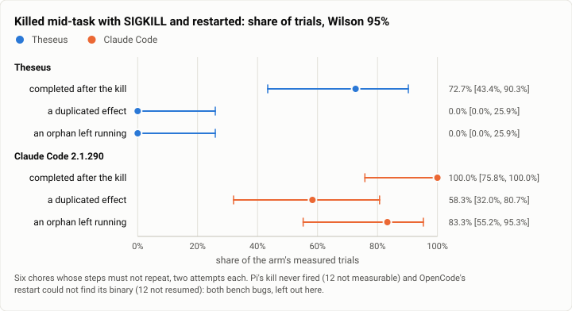

# Async: the kill -9 family, the first live run (2026-10-12)

**The answer first.** Killed with SIGKILL in the middle of a chore whose steps must not repeat (restart a service,
apply a migration, convert an export, make a worktree, build and run an app, start a service), then restarted the way
its documentation says to continue, Theseus (`026dce3f`) **resumed in every measured trial** (11 of 11) and in none of
them did anything twice, left a process running, or redid a finished step: 0 duplicated effects, 0 orphans, 0 lost work
[0%, 26%]. In three trials its job simply ran on through the daemon's death and the restarted daemon adopted it. It
completed 8 of 11 [43%, 90%]: the three it did not were task failures after a clean resume (two queried a service
before it had started, which the chore's order rule fails; one bisect tested no failing commit). Claude Code 2.1.290,
restarted with `claude --continue`, completed **all 12** [76%, 100%], but did a step's effect twice in 7 of them
[32%, 81%] (16 duplicated effects: a service restarted twice, an export converted twice, a worktree made twice) and
left a pre-kill process running in 10 [55%, 95%] (17 orphans). Pi's and OpenCode's arms could not be measured: Pi's
kill never fired, and OpenCode's restart could not find its own binary, both bugs in this bench's driver.

<picture>
  <source media="(prefers-color-scheme: dark)" srcset="img/2026-10-12-async-kill-family/kill-dark.svg">
  
</picture>

*Figure 1. Does each harness finish after a kill -9, without doing anything twice or leaving work running? Claude
Code finishes every time but repeats effects and leaves orphans in most; Theseus never does either, and finishes 8 of
11.*

| | |
|---|---|
| Suite | the async bench's kill family (`bench/async/kill-tasks`, theseus-7ajc): six chores, a SIGKILL each |
| Arms | Theseus `026dce3f` (`TheseusAsync`; restart: `theseusd` on the same state, then `theseus wait`); Claude Code 2.1.290 (`ClaudeCodeAsync`; `claude --continue --print "Continue."`); Pi 1.0.4 and OpenCode 1.18.35 (not measured: below) |
| Model | Claude Sonnet 5.5, effort medium |
| Trials | 6 chores × 2 attempts an arm (three chores killed at a seeded moment, three mid-step); the oracle 6 of 6 |
| When | 2026-10-12, 15:28 to 17:05 (UTC−7) |
| Cost | $0.78: Theseus $0.31, Claude Code $0.28, Pi $0.11, OpenCode $0.08 (as recorded; Claude Code's may undercount: below) |
| Data | [`2026-10-12-async-kill-family.json`](2026-10-12-async-kill-family.json): every trial's kill columns |

## The question

"Kill it mid-task; it finishes, and nothing runs twice" is one of Theseus's killer-feature claims (the plan's R22): the
daemon keeps every execution and job in a durable store, requeues an interrupted turn at start and adopts a job that
outlived it. This is the claim's first live measurement against other harnesses, each restarted by its own documented
way to continue a session.

## The setup

The kill family is six of the async bench's Layer 2 chores whose steps write an `effect` record that must not repeat;
the instruction is the plain chore's, word for word. At its trigger (a seeded time inside 25 to 75% of the chore's ideal
wall, or a fixed delay after a named step starts) the driver writes `kill` to the tools' hash-chained ledger, sends
SIGKILL to the harness's own processes in the task's container (Theseus: `theseusd` and the CLI, not its job wrappers;
Claude Code: the `claude` process), waits 2 s, restarts the harness by its arm's command and writes `restart`. The
verifier then reads, from the ledger and the processes still running: **completed** (the chore's reward after the
kill), **duplicated effects** (an effect line twice for one step), **orphans** (a process from before the kill still
running, or writing after the restart while its step was redone), **lost work** (a step finished before the kill and
started again after it), and **time to resume** (the kill to the first ledger line written by a process the restarted
harness started; none when a job carried on through the kill and needed no restart).

## Results

| Arm | Measured | Completed | Trials with a duplicated effect | Trials with an orphan | Trials that redid work | Median time to resume | Jobs adopted through the kill |
|---|---|---|---|---|---|---|---|
| Theseus | 11 of 12 (one failed to set up) | 8 = 72.7% [43.4, 90.3] | 0 [0, 25.9] | 0 [0, 25.9] | 0 | 9.4 s | 3 |
| Claude Code | 12 of 12 | 12 = 100% [75.8, 100] | 7 = 58.3% [32.0, 80.7]; 16 effects | 10 = 83.3% [55.2, 95.3]; 17 processes | 3 | 5.3 s | 0 |
| Pi | 0 of 12: the kill never fired | – | – | – | – | – | – |
| OpenCode | 12 killed, none resumed: `sh: opencode: not found` at the restart | (0) | – | (11 with orphans) | – | – | – |

By chore (Theseus · Claude Code, completed of 2): health-restart 2 · 2, migrations 2 · 2, csv-merge 2 · 2, pipeline 1
(one failed to set up) · 2, bisect 1 · 2, service 0 · 2. Claude Code's duplicated effects came in csv-merge (8),
bisect (3), pipeline (3) and health-restart (2); its orphans in every chore but migrations.

## Analysis

- **Theseus's claim holds where it was made.** No effect ran twice and nothing was left running in any trial: a job
  started before the kill either finished on its own and was adopted (three trials, no restart needed at all) or its
  step was not redone, because the daemon resumes the interrupted turn from its record rather than from the
  conversation. Its time to resume (9.4 s at the median, 24 to 25 s on health-restart) is the daemon's start, the
  requeued turn's first model call, and the re-check of a service the turn was watching.
- **Claude Code finishes, but by doing it again.** `--continue` resumes the conversation, and the model, not knowing
  which commands finished while it was dead, runs the chore's steps again: 16 effects done twice in 12 trials, and the
  processes it had started before the kill kept running beside the new ones (17). For a migration or a payment that is
  the difference between finished and finished twice.
- **Theseus's three failures were the model's, after a clean resume**: two `service` trials queried the service while
  it was still starting (the chore's order rule fails a dependent step begun before its prerequisite ended; Layer 2's
  controls test the same rule), and one `bisect` named no failing commit. The kill did not cause them.
- **Two arms the bench could not measure.** Pi's kill path never fired in its RPC-mode runs (no `kill` line in any of its
  ledgers: the driver found no `pi` process to kill, or the run settled first), and OpenCode's restart ran
  `opencode --continue` with a PATH that does not hold Harbor's install of it. Both are this driver's bugs; neither arm's
  numbers here say anything about the harness.

**What changed since the last comparable run.** None: this is the family's first live run (it joined on Oct 12,
theseus-7ajc).

## Threats to validity

- **Twelve trials an arm**: every rate's interval is 25 to 45 points wide; the zero counts are the sharp part.
- **Two arms unmeasured** (above), so the comparison is two harnesses, not four.
- **Theseus's trials ran with Harbor's default setup window** and one failed to set up under the host's load; Claude
  Code's first attempt failed to set up in every trial and was run again with the 3x window (the agent's clock is
  untouched by it).
- **"Continue." is one text for every CLI arm**, a user's own words when resuming; a user who tells Claude Code which
  steps already ran would see fewer repeats.

## What it cost

$0.78 as recorded: Theseus $0.31 (its ledger's calls, the killed daemon's included), Claude Code $0.28, Pi $0.11 and
OpenCode $0.08. Claude Code's record reads its last `result` event, which after a `--continue` restart may cover only
the resumed process, so its figure is a floor. Its first attempt cost nothing (setup timed out before any model
call).

## Reproduction

```bash
export THESEUS_BENCH_BIN_DIR=$PWD/bench/bin PYTHONPATH=$PWD/bench/harbor:$PWD/bench/async HARBOR_TELEMETRY=0
K="-p bench/async/kill-tasks -m anthropic/claude-sonnet-5-5 -o jobs -k 2 -n 4 --agent-setup-timeout-multiplier 3.0"
harbor run -p bench/async/kill-tasks -a oracle -o jobs --job-name kill-oracle
harbor run $K -a async_agents:TheseusAsync --job-name kill-theseus
harbor run $K -a async_agents:ClaudeCodeAsync --ak max_budget_usd=2.0 --ak max_turns=200 --job-name kill-claude
python3 bench/async/score.py theseus=jobs/kill-theseus claude-code=jobs/kill-claude --out /tmp/async-kill
```

## Data

[`2026-10-12-async-kill-family.json`](2026-10-12-async-kill-family.json): each arm's rates with their Wilson intervals,
the totals, every trial's kill columns, the two unmeasured arms' reasons, and the figure's spec.
