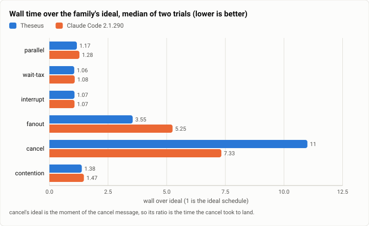
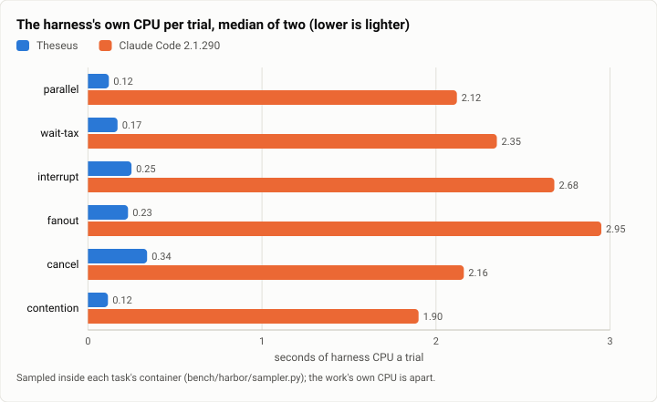

# Async: the six concurrency families, Theseus against Claude Code, the first full run (2026-10-12)

**The answer first.** On the async bench's six families (independent slow digests, a wait of unknown length, a
message mid-task, a fan-out with transient failures, a cancel, contended deposits), two trials each, both harnesses
on Claude Sonnet 5.5 at medium effort: Claude Code 2.1.290 succeeded in all 12 trials and Theseus (`026dce3f`) in all
11 that measured (one failed to set up). Theseus finished nearer the ideal schedule where the work fans out (fanout
3.55 times the ideal against 5.25; parallel 1.17 against 1.28; contention 1.38 against 1.47), on a tenth of Claude
Code's harness CPU (0.12 to 0.34 s a trial against 1.9 to 3.0) and a fifth of its memory (40 to 45 MB against 221 to
238). It lost the smokes' best result: asked a question while a long job ran, **Theseus answered in 157 s, not
Oct 6's 46 to 56**, level with Claude Code (161 s), and a cancel landed in 182 s against Claude Code's 107. The
transcripts say why: once the job moved to the background at 60 s, the model called `job.wait` on it again and again,
keeping its turn open, and Theseus does not hand a queued message to a running turn, so the question waited for the job.
No orphan, duplicated effect or lost update on Theseus's side; Claude Code left one process running after a cancel.

<picture>
  <source media="(prefers-color-scheme: dark)" srcset="img/2026-10-12-async-six-families/over-ideal-dark.svg">
  
</picture>

*Figure 1. Which arm does the simultaneous work closest to the ideal schedule? Theseus on fanout, parallel and
contention; Claude Code on cancel, where Theseus's cancel waited behind its own `job.wait`.*

| | |
|---|---|
| Suite | the async bench (`bench/async`), Layer 1's six families, through Harbor 0.23 |
| Arms | Theseus `026dce3f` (`TheseusAsync`: a daemon for the trial, `proc_sync_secs` 60, limit $3.75); Claude Code 2.1.290 (`ClaudeCodeAsync`, stream-json input, $2 and 200 turns); the oracle |
| Model | Claude Sonnet 5.5, effort medium |
| Trials | 6 families × 2 attempts an arm; the oracle once a family, 26 families (all of Layer 1 and Layer 2): every one 1 of 1 at 1.00 to 1.06 times its ideal |
| When | 2026-10-12: Theseus 15:11 to 15:41, Claude Code 16:13 to 16:41 (UTC−7) |
| Cost | $1.45 (Theseus $1.13, Claude Code $0.32) |
| Data | [`2026-10-12-async-six-families.json`](2026-10-12-async-six-families.json), [`2026-10-12-async-six-families.csv`](2026-10-12-async-six-families.csv) |

## The question

Concurrency is where an agent harness should beat a chat loop: running independent slow work at once, not paying
model calls to wait, answering a person while a job runs, cancelling cleanly, and not losing an update when two pieces
of work touch the same account. The Oct 6 smokes (six trials) suggested Theseus answered a mid-task message three
times sooner than Claude Code; this is the full run of the six families on the stopping point's build.

## The setup

Each family is a local Harbor task (a `python:3.12-slim` image with the family's tools, an oracle, a verifier that
checks the tools' hash-chained ledger). An instruction states the task, never how to run it. The driver sends
`interrupt` and `cancel` a second message mid-trial (20 s and 15 s after the long job starts). Theseus keeps a daemon
for the trial, its commands moving to the background after the shipped 60 s, and the trial ends when nothing runs or
waits; Claude Code reads the message through its stream-json input. Both arms' harness CPU and memory are sampled
inside the container. Claude Code's first attempt timed out installing Node and its CLI in Harbor's default 360 s
setup (every trial); it ran again with the 3x setup multiplier the Terminal-Bench runs use, and those trials are the
ones here.

## Results

| Family | Success (Theseus · Claude Code) | Wall over ideal | Responsiveness (the message to its answer) | Model calls while waiting | Harness CPU a trial | Harness RSS | Cost a trial |
|---|---|---|---|---|---|---|---|
| parallel | 2/2 · 2/2 | 1.17 · 1.28 | – | 0 · 0 | 0.12 · 2.12 s | 40 · 236 MB | $0.032 · $0.025 |
| wait-tax | 2/2 · 2/2 | 1.06 · 1.08 | – | 1.5 · 0 | 0.17 · 2.35 s | 40 · 221 MB | $0.018 · $0.020 |
| interrupt | 2/2 · 2/2 | 1.07 · 1.07 | **157 · 161 s** | 3 · 0 | 0.25 · 2.68 s | 44 · 229 MB | $0.036 · $0.025 |
| fanout | 2/2 · 2/2 | 3.55 · 5.25 | – | 3 · 1.5 | 0.23 · 2.95 s | 41 · 234 MB | $0.046 · $0.031 |
| cancel | 1/1 (1 failed to set up) · 2/2 | 11 · 7.33 | **182 · 107 s** | 0 · 0 | 0.34 · 2.16 s | 45 · 238 MB | $0.070 · $0.035 |
| contention | 2/2 · 2/2 | 1.38 · 1.47 | – | 0 · 0 | 0.12 · 1.90 s | 40 · 237 MB | $0.017 · $0.026 |

Medians over each family's trials; orphans: Theseus 0, Claude Code 1 (a cancel); duplicated effects and order
violations: none.

<picture>
  <source media="(prefers-color-scheme: dark)" srcset="img/2026-10-12-async-six-families/harness-cpu-dark.svg">
  
</picture>

*Figure 2. What does each harness cost the machine while the work runs? Theseus 0.12 to 0.34 s a trial, Claude Code
1.9 to 3.0 s.*

## Analysis

- **The mid-task message waited for the job.** In `interrupt` the question arrived 20 s into a 187 s training run; the
  training moved to the background at 60 s, and the model then called `job.wait` on it again (each returning after
  60 s) until it ended; only then did the turn end and the queued question get its turn, at 191 s. The Oct 6 smokes
  answered in 46 to 56 s because that build's model let the turn end once the job was in the background. A person's
  message should not wait for a model's choice to block: either the queued message reaches the running turn at its next
  loop boundary (as Pi's "steer" does), or `job.wait` returns as soon as a person has spoken.
- **Cancel, the same cause.** The cancel message waited behind the same `job.wait`; when it arrived it stopped the
  migration and left nothing running (Claude Code left one migration process alive).
- **Fan-out and contention favour the daemon.** Grouped calls and background jobs put Theseus nearer the ideal on
  fanout (3.55 against 5.25) and contention, at three model calls while waiting on fanout against Claude Code's 1.5.
- **The harness itself** stays light: about a tenth of Claude Code's CPU and a fifth of its memory, in every family.

**What changed since the last comparable run** (Oct 6, six smoke trials): Theseus's response to a mid-task message
46 to 56 s → 157 s (the model's `job.wait`, above); Claude Code's 147 and 163 s → 161 s; this run adds four families
and a second attempt each.

## Threats to validity

- **Two trials a family**; a family's median is two values.
- **Claude Code's first attempt** failed to set up in every trial (Harbor's 360 s default); the rerun used a 3x setup
  window, which does not touch the agent's own clock. Theseus's trials ran with the default window, and one cancel trial
  failed to set up under the host's load.
- **One model, one build each**; the `job.wait` behaviour is the model's choice on this build's tool descriptions.
- **The host** ran the recall bench, the kill family and other work beside these trials (sleep-based tools, so the walls
  hold; CPU is per process).

## What it cost

$1.45: Theseus $1.13, Claude Code $0.32, at list prices (medians a trial are in the table; a few Theseus trials were dearer, its cut calls counted at their estimate). Claude Code's failed first attempt cost nothing: setup timed out before any model call.

## Reproduction

```bash
export THESEUS_BENCH_BIN_DIR=$PWD/bench/bin PYTHONPATH=$PWD/bench/harbor:$PWD/bench/async HARBOR_TELEMETRY=0
L2="-x advisories -x api-summary -x bench-settings -x bisect -x build-configs -x ci-checks -x config-diff -x csv-merge \
  -x doc-questions -x edit-test -x health-restart -x host-logs -x link -x migrations -x pipeline -x rename \
  -x repos-behind -x scaffold -x service -x suites"
harbor run -p bench/async/tasks -a oracle -o jobs --job-name async-oracle
harbor run -p bench/async/tasks $L2 -a async_agents:TheseusAsync -m anthropic/claude-sonnet-5-5 -k 2 -n 4 \
  --agent-setup-timeout-multiplier 3.0 -o jobs --job-name async6-theseus
harbor run -p bench/async/tasks $L2 -a async_agents:ClaudeCodeAsync -m anthropic/claude-sonnet-5-5 -k 2 -n 4 \
  --agent-setup-timeout-multiplier 3.0 --ak max_budget_usd=2.0 --ak max_turns=200 -o jobs --job-name async6-claude
python3 bench/async/score.py theseus=jobs/async6-theseus claude-code=jobs/async6-claude --out /tmp/async
```

## Data

[`2026-10-12-async-six-families.json`](2026-10-12-async-six-families.json): each family's row per arm and the oracle's,
and both figures' specs; [`2026-10-12-async-six-families.csv`](2026-10-12-async-six-families.csv): one row per trial.
