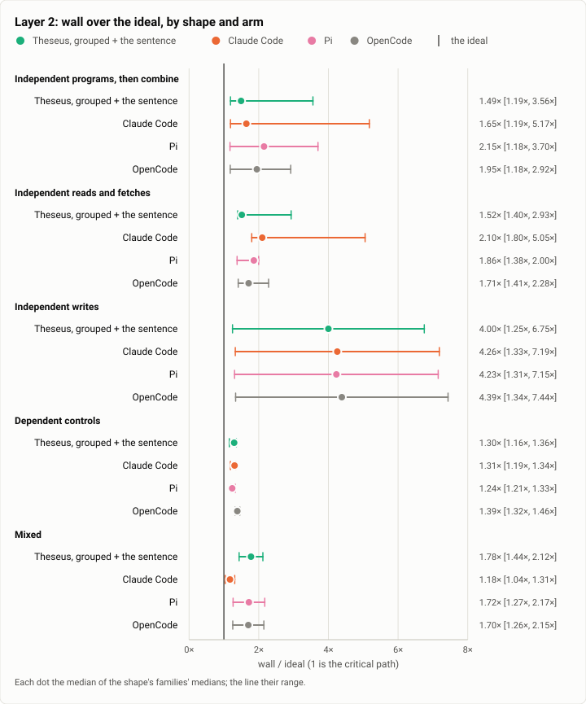
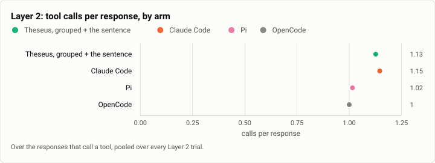
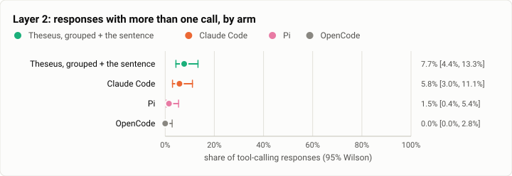

# Async: parallel tool calls, Theseus against Claude Code, Pi and OpenCode, the first full run (2026-10-12)

**The answer first.** On Layer 2's twenty chores (the slow sub-steps of each drawn 10 to 45 s, so only scheduling
moves the wall), the stopping point's Theseus (`026dce3f`, calls of one response grouped and run together) finished
nearest the ideal on the independent chores: **2.10 times the ideal** [1.67, 2.63], against OpenCode 2.19, Pi 2.30 and
Claude Code 2.49, with the highest share of responses holding several calls (7.7%; Claude Code 5.8%, Pi 1.5%,
OpenCode 0). It solved 38 of 40 (Claude Code 38, Pi and OpenCode 40): both losses are the `service` control, where it
queried the service in the same response as starting it, and the grouped calls ran together, so the query began
before the start had ended (8 order violations, reward 0); no other arm violated an order rule. On Layer 1's stand-in,
one response's calls run together up to 8 (2.6 s for eight `sleep 2`, as Pi's 2.5 and Claude Code's 3.1) but 16
take two waves (5.0 s, where Pi and Claude Code stay at 2.5 and 3.0). The gains are real and small: the design's own
projection puts grouping at about 0.2% of tool time on Terminal-Bench.

| | |
|---|---|
| Suite | the async bench's Layer 1 and Layer 2 (`bench/async`, theseus-2wxa) |
| Arms | Theseus, grouped + the sentence; Claude Code; Pi; OpenCode |
| Model | Claude Sonnet 5.5 at effort medium; $2 and 200 calls a trial; two attempts |
| Families | 20: 8 programs, 4 reads, 2 writes, 4 control, 2 mixed |
| Trials | 160 |
| Data | [`2026-10-12-asyncbench-parallel-calls.json`](2026-10-12-asyncbench-parallel-calls.json), [`2026-10-12-asyncbench-parallel-calls.csv`](2026-10-12-asyncbench-parallel-calls.csv) |

## The question

Theseus now groups the calls of one response by class and runs each group together (theseus-d1hi), and tells the model so in one sentence (theseus-da46). Does it finish chores with independent slow steps nearer their critical path, without breaking the ones whose steps depend on each other, and how does it compare with Claude Code, Pi and OpenCode on the same tasks?

When a model asks for several independent things in one response (four test suites, six hosts' logs), a harness
that runs them together finishes in the longest one's time, and one that runs them in turn in their sum. Theseus
groups one response's calls by class and runs them together (theseus-d1hi) and tells the model it can (theseus-da46);
this run measures that against three other harnesses on chores built to hold such calls, and on controls whose
dependent steps punish running things together. It is the async bench's parallel-calls run (theseus-2wxa), owed to the
rerun since Oct 9.

## The setup

Layer 1: `theseus-sim fake-model --rules` asks each harness for N calls of `sleep 2` in one response (N in 1, 2, 4, 8, 16), and the wall is timed around its CLI (`bench/async/layer1.py`). Layer 2: 20 Harbor tasks whose slow sub-steps sleep a drawn 10 to 45 s, graded by script from what the task left and a hash-chained ledger of every step; a fifth are controls whose dependent steps punish batching (bench/async/README.md).

## Results

### Layer 1: N calls in one response

| Harness | N=1 | N=2 | N=4 | N=8 | N=16 | |
|---|---|---|---|---|---|---|
| Theseus, grouped + the sentence | 2.49 s | 2.48 s | 2.53 s | 2.60 s | 5.05 s |  |
| Claude Code | 7.74 s | 7.71 s | 2.87 s | 3.06 s | 2.99 s |  |
| Pi | 2.56 s | 2.56 s | 2.46 s | 2.48 s | 2.49 s |  |
| OpenCode | 7.64 s | 12.15 s | not measurable | not measurable | not measurable | why: ! permission requested: doom_loop (bash); auto-rejecting |

<picture>
  <source media="(prefers-color-scheme: dark)" srcset="img/2026-10-12-asyncbench-parallel-calls/layer1-wall-dark.svg">
  
</picture>

*Figure 1. Does each harness run one response's independent calls together? Pi and Claude Code run all sixteen together; Theseus runs eight at a time, so sixteen take two waves; OpenCode's own guard refuses repeated identical calls from four on.*

### Layer 2: by arm

| Arm | Trials | Solved | Wall / ideal, independent | Wall / ideal, controls | Overlap, independent | Calls / response | Multi-call share | Round trips / solved | $ / solved |
|---|---|---|---|---|---|---|---|---|---|
| Theseus, grouped + the sentence | 40 | 38 (95.0%) | 2.10× (95% CI 1.67× to 2.63×; n 32) | 1.28× (range 1.15× to 1.41×; n 8) | 2.35 | 1.13 | 7.7% | 4.79 | $0.033 |
| Claude Code | 40 | 38 (95.0%) | 2.49× (95% CI 1.90× to 3.16×; n 32) | 1.29× (range 1.17× to 1.40×; n 8) | 2.48 | 1.15 | 5.8% | 4.66 | $0.033 |
| Pi | 40 | 40 (100.0%) | 2.30× (95% CI 1.86× to 2.85×; n 32) | 1.25× (range 1.18× to 1.42×; n 8) | 2.12 | 1.02 | 1.5% | 4.25 | $0.011 |
| OpenCode | 40 | 40 (100.0%) | 2.19× (95% CI 1.76× to 2.76×; n 32) | 1.39× (range 1.26× to 1.60×; n 8) | 2.28 | 1 | 0.0% | 4.28 | $0.019 |

<picture>
  <source media="(prefers-color-scheme: dark)" srcset="img/2026-10-12-asyncbench-parallel-calls/over-ideal-dark.svg">
  
</picture>

*Figure 2. How close to the work's own critical path does each arm finish? Theseus finishes nearest the critical path on the independent chores (2.10×), all four arms within 1.25× to 1.39× on the controls.*

<picture>
  <source media="(prefers-color-scheme: dark)" srcset="img/2026-10-12-asyncbench-parallel-calls/calls-per-response-dark.svg">
  
</picture>

*Figure 3. How many calls does each arm put in one model response? About one call a response for every arm (1.00 to 1.15): the model rarely asks for several at once.*

<picture>
  <source media="(prefers-color-scheme: dark)" srcset="img/2026-10-12-asyncbench-parallel-calls/multi-call-share-dark.svg">
  
</picture>

*Figure 4. How often does each arm batch? Theseus most often (7.7% of responses), then Claude Code (5.8%), Pi (1.5%) and OpenCode (never).*

### Wall over the ideal, by family and arm

Each cell the median of its trials (solved/trials).

| Family | Shape | Theseus, grouped + the sentence | Claude Code | Pi | OpenCode |
|---|---|---|---|---|---|
| `suites` | programs | 1.19× (2/2) | 1.19× (2/2) | 2.39× (2/2) | 1.66× (2/2) |
| `ci-checks` | programs | 1.48× (2/2) | 1.44× (1/2) | 2.12× (2/2) | 2.29× (2/2) |
| `build-configs` | programs | 2.18× (2/2) | 2.89× (2/2) | 2.58× (2/2) | 2.20× (2/2) |
| `bench-settings` | programs | 3.56× (2/2) | 5.17× (2/2) | 3.70× (2/2) | 2.92× (2/2) |
| `host-logs` | programs | 2.20× (2/2) | 2.55× (2/2) | 1.58× (2/2) | 1.82× (2/2) |
| `repos-behind` | programs | 1.50× (2/2) | 1.74× (2/2) | 2.18× (2/2) | 1.66× (2/2) |
| `csv-merge` | programs | 1.36× (2/2) | 1.38× (2/2) | 2.04× (2/2) | 2.07× (2/2) |
| `health-restart` | programs | 1.21× (2/2) | 1.55× (2/2) | 1.18× (2/2) | 1.18× (2/2) |
| `doc-questions` | reads | 1.40× (2/2) | 1.80× (2/2) | 1.78× (2/2) | 1.93× (2/2) |
| `api-summary` | reads | 2.93× (2/2) | 5.05× (2/2) | 2.00× (2/2) | 1.49× (2/2) |
| `advisories` | reads | 1.58× (2/2) | 2.17× (2/2) | 1.94× (2/2) | 2.28× (2/2) |
| `config-diff` | reads | 1.46× (2/2) | 2.04× (2/2) | 1.38× (2/2) | 1.41× (2/2) |
| `scaffold` | writes | 6.75× (2/2) | 7.19× (2/2) | 7.15× (2/2) | 7.44× (2/2) |
| `rename` | writes | 1.25× (2/2) | 1.33× (2/2) | 1.31× (2/2) | 1.34× (2/2) |
| `pipeline` | control | 1.16× (2/2) | 1.19× (2/2) | 1.22× (2/2) | 1.36× (2/2) |
| `service` | control | 1.35× (0/2) | 1.33× (2/2) | 1.33× (2/2) | 1.41× (2/2) |
| `migrations` | control | 1.25× (2/2) | 1.28× (2/2) | 1.21× (2/2) | 1.32× (2/2) |
| `edit-test` | control | 1.36× (2/2) | 1.34× (2/2) | 1.25× (2/2) | 1.46× (2/2) |
| `link` | mixed | 1.44× (2/2) | 1.04× (1/2) | 1.27× (2/2) | 1.26× (2/2) |
| `bisect` | mixed | 2.12× (2/2) | 1.31× (2/2) | 2.17× (2/2) | 2.15× (2/2) |

### The controls' order violations

A dependent step started before its prerequisite ended: reward 0 whatever the answer. Each cell the violations of its trials.

| Family | Theseus, grouped + the sentence | Claude Code | Pi | OpenCode |
|---|---|---|---|---|
| `pipeline` (control) | 0 (2/2 solved) | 0 (2/2 solved) | 0 (2/2 solved) | 0 (2/2 solved) |
| `service` (control) | 8 (0/2 solved) | 0 (2/2 solved) | 0 (2/2 solved) | 0 (2/2 solved) |
| `migrations` (control) | 0 (2/2 solved) | 0 (2/2 solved) | 0 (2/2 solved) | 0 (2/2 solved) |
| `edit-test` (control) | 0 (2/2 solved) | 0 (2/2 solved) | 0 (2/2 solved) | 0 (2/2 solved) |
| `link` | 0 (2/2 solved) | 0 (1/2 solved) | 0 (2/2 solved) | 0 (2/2 solved) |
| `bisect` | 0 (2/2 solved) | 0 (2/2 solved) | 0 (2/2 solved) | 0 (2/2 solved) |

## Analysis

### The projection to Terminal-Bench

The design's finding: on Terminal-Bench work, grouping a response's calls is worth about 0.2% of tool time, since its responses seldom hold independent slow calls. Layer 2's chores are built to hold them, so its gain is a ceiling, not a forecast. _The analysis: where each arm wins and loses, by family._

### Where each arm wins and loses

- **Independent chores:** Theseus 2.10× the ideal, OpenCode 2.19×, Pi 2.30×, Claude Code 2.49×; the intervals overlap,
  so the order is a shape. Theseus's overlap (how many slow steps ran at once, 2.35) is no higher than Claude Code's
  (2.48): its edge comes from fewer round trips between the steps, not from more of them at once.
- **The controls:** every arm but Theseus kept each dependent step after its prerequisite. Theseus's `service` trials
  started the service and queried it in one response; grouping ran both at once, the query was refused while the
  service started, and the chore's rule failed the trial. The same happened in the kill family's `service`. Grouping
  should not run a call that names the same resource as an earlier call of its response before that call ends, or the
  model should be told which of its calls run together.
- **Layer 1's cap:** eight calls run together and sixteen take two waves; the other harnesses run sixteen at once.
- **Cost:** Pi $0.011 a solved chore, OpenCode $0.019, Theseus and Claude Code $0.033: Theseus's longer prompt again.

**What changed since the last comparable run.** No full parallel-calls run was published before; the design's
estimates (before and after d1hi) were on the stand-in alone. This run has one Theseus arm, the build under test
(grouped calls and the sentence), not the design's three builds.

## Threats to validity

- **Sleep-based durations.** Every slow step sleeps a drawn time, so the walls measure scheduling, not work: a
  harness that runs real work together would also contend for CPU and disk, which these steps never do. The ideal is
  the critical path of those draws, a floor no arm can beat.
- **One model.** Every arm drives Claude Sonnet 5.5 at effort medium; whether a response holds several calls is the
  model's choice as much as the harness's, and another model may batch more or less.
- **Two attempts.** Each family has two trials an arm, so a family's number is two draws; the shapes' and the arms'
  pooled numbers carry the weight.
- **Each arm's own tools.** The harnesses call the same programs through their own shell tools; how a harness reads a
  long output (the notes, the logs) differs, and so do its round trips.
- **Layer 1 is a stand-in.** A harness that sends side requests, or reads the stand-in's answers differently, may be
  timed with work that is not the calls' own; a count whose runs failed reads "not measurable", never a number.

- **One Theseus build.** The design's before and after arms (theseus-d1hi) were not rebuilt; the report key
  `theseus-after` names this build, which has both changes.
- **Claude Code's and Pi's installs** took Harbor's whole default setup window under the host's load on a first attempt
  (every Claude Code trial failed to set up); these trials ran with the 3x setup window, which does not touch the
  agent's clock.

## What it cost

| Arm | Model spend |
|---|---|
| Theseus, grouped + the sentence | $1.25 |
| Claude Code | $1.26 |
| Pi | $0.44 |
| OpenCode | $0.78 |

## Reproduction

```bash
# bench/async/README.md, "The parallel-calls run" and "Layer 1", then:
python3 bench/report/parallel.py --date 2026-10-12 --arm KEY=JOBS ... --layer1 KEY=FILE ...
```

## Data

[`2026-10-12-asyncbench-parallel-calls.json`](2026-10-12-asyncbench-parallel-calls.json): every number, the figures' specs and the omnibus's row; [`2026-10-12-asyncbench-parallel-calls.csv`](2026-10-12-asyncbench-parallel-calls.csv): one row per trial.
