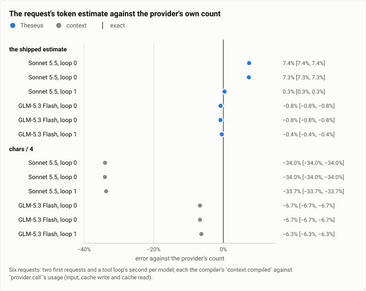

# Context: the token estimate against the provider's count, at the stopping point (2026-10-12)

**The answer first.** On the stopping point's build (`026dce3f`, 32 tools in the request) the context compiler's
estimate of a request's size reads Claude Sonnet 5.5's first requests at **+7.3% and +7.4%** of the provider's own count
(14,790 and 14,820 tokens), and a tool loop's second request at +0.3%; GLM-5.3 Flash's at −0.8%, −0.8% and −0.4%.
chars/4 still reads Sonnet's at 66% of the count and GLM's at 93%. Against Oct 1 (first requests +1.9% to +4.3%,
later ones within 1.7%), the Sonnet first-request estimate has drifted to the high side by about 3 to 5 points as the
tool set grew; it errs safe (the compiler reserves more than it needs), and it costs headroom, not correctness.

<picture>
  <source media="(prefers-color-scheme: dark)" srcset="img/2026-10-12-context-token-estimate/estimate-error-dark.svg">
  
</picture>

*Figure 1. How far off is the compiler's estimate of a request's size, and chars/4's? The compiler's within 1% but
Sonnet's first requests (+7%); chars/4 a third short on Sonnet.*

| | |
|---|---|
| Suite | `context`: the compiler's `context.compiled` estimate against `provider.call`'s usage |
| Arms | the shipped estimate (the class rates and the margin) · chars/4 |
| Models | Claude Sonnet 5.5 · GLM-5.3 Flash |
| Requests | 6: per model, a plain first request, a tool loop's first and its second (after an `fs_read`) |
| When, commit | 2026-10-12, 15:20 (UTC−7); `026dce3f` |
| Cost | about $0.12 |
| Data | [`2026-10-12-context-token-estimate.json`](2026-10-12-context-token-estimate.json) |

## The question

The compiler decides what fits a model's window, and when to compact, from its own estimate of a request's tokens; an
estimate that reads low overflows the window, one that reads high compacts early. The Oct 1 report fitted the
estimate's class rates to recorded first requests; this checks them on the stopping point's build, whose request
carries a week more of tools and context.

## The setup

A scratch daemon from `theseusd example-config` with two profiles (Sonnet 5.5 and GLM-5.3 Flash, `max_loops = 3`), one
small context file, memory off, a project directory with one source file; per profile `theseus ask "Reply with the
single word ok."` and `theseus ask "Use the fs_read tool to read <file>, then reply with the single word read."`; then
each loop's `context.compiled` (`est_tokens`, and the bytes chars/4 divides) against its `provider.call` usage (input +
cache write + cache read).

## Results

| Model, request | The provider's count | The estimate | Error | chars/4 | chars/4 error |
|---|---|---|---|---|---|
| Sonnet 5.5, first (plain) | 14,790 | 15,885 | +7.4% | 9,765 | −34.0% |
| Sonnet 5.5, first (the tool turn) | 14,820 | 15,906 | +7.3% | 9,782 | −34.0% |
| Sonnet 5.5, after the read | 15,671 | 15,723 | +0.3% | 10,396 | −33.7% |
| GLM-5.3 Flash, first (plain) | 10,467 | 10,385 | −0.8% | 9,765 | −6.7% |
| GLM-5.3 Flash, first (the tool turn) | 10,486 | 10,401 | −0.8% | 9,782 | −6.7% |
| GLM-5.3 Flash, after the read | 11,132 | 11,084 | −0.4% | 10,428 | −6.3% |

## Analysis

- **Later requests are near exact** on both models (+0.3%, −0.4%): the compiler's census corrects itself from the
  previous call's counted usage.
- **Sonnet's first request reads 7% high.** It is the one request the census cannot calibrate (nothing has been
  counted yet), so it rests on the class rates alone, and the request's JSON (32 tool schemas, 36,287 of its 39,061
  bytes) is where they were fitted; the week's added tools (wakes, standing orders, fact retraction, the MCP and
  memory tools) shifted the mix. An overestimate is the safe side: a first request is never cut for not fitting.
- **chars/4 stays the wrong rule for Sonnet** (a third short) and nearly right for GLM, as on Oct 1.

**What changed since the last comparable run** (Oct 1): Sonnet's first requests +1.9% to +4.3% → +7.3% to +7.4%; later
requests within 1.7% → 0.3%; chars/4 on Sonnet 65.6% to 70.6% → 66.0% to 66.3% of the count, and on GLM 97.4% to
102.2% → 93.3% to 93.7%.

## Threats to validity

- **Six requests.** A shape check, not a fit; the Oct 1 report's test (`the_figures_hold_for_recorded_first_requests`)
  holds the figures on eight recorded requests in the repository.
- **One configuration** (the example config's tools and one context file); a real config's request differs in size.

## What it cost

About $0.12: three Sonnet 5.5 calls (about $0.037 each, mostly the first request's cache write) and three GLM-5.3 Flash
calls.

## Reproduction

```bash
cargo test -p theseus-core the_figures_hold_for_recorded_first_requests
theseusd example-config > <scratch>/config.toml   # two profiles, one per model, max_loops = 3; one [context] file
theseusd --config <scratch>/config.toml --socket <scratch>/sock --state-dir <scratch>/state &
theseus --socket <scratch>/sock ask -P <profile> "Reply with the single word ok."
theseus --socket <scratch>/sock ask -P <profile> "Use the fs_read tool to read <file>, then reply with the single word read."
theseus --socket <scratch>/sock --json ledger -n 200 -k context.compiled
theseus --socket <scratch>/sock --json ledger -n 200 -k provider.call
```

## Data

[`2026-10-12-context-token-estimate.json`](2026-10-12-context-token-estimate.json): each request's count, estimate and
chars/4, and the figure's spec.
