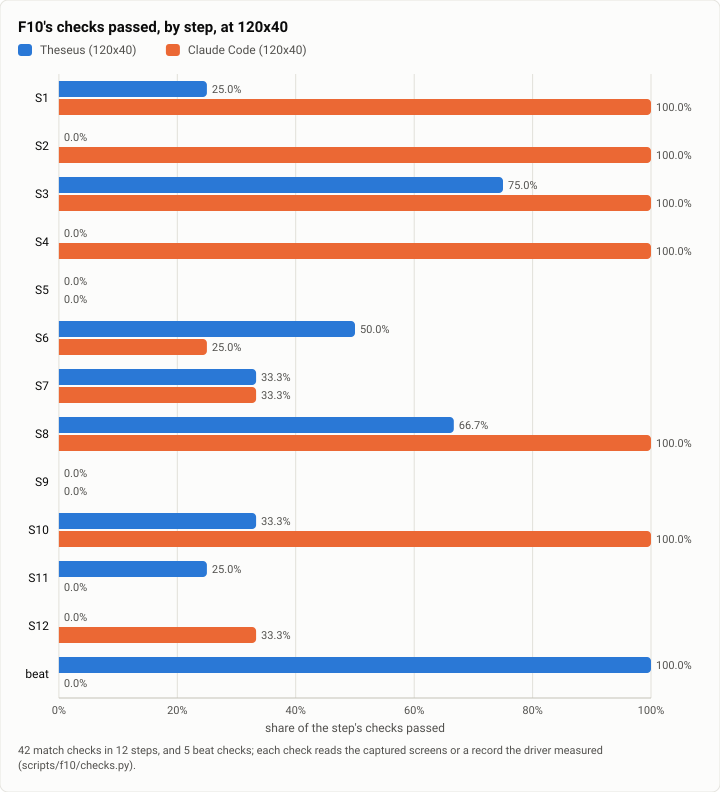

# F10: the first ten minutes, Theseus against Claude Code, the first live run (2026-10-12)

**The answer first.** On F10's twelve first-ten-minutes steps (42 match checks, 5 beat checks, read from the screens
and the driver's records), the stopping point's Theseus (`026dce3f`) passed **11 of 42** match checks at 120x40 and at
80x24, and **all 5 beat checks**; Claude Code 2.1.296 passed **25 of 42** at 120x40 and 20 at 80x24, and **none** of the
beat checks. Theseus's misses are the conversational surface itself: a bare `theseus` opens no conversation and
returns to the shell (S1a to c), its one-shot reply prints raw markdown and cuts lines mid-word at 80 columns (S2a, d),
a tool call names its tool and not what it touched (S2b), and the edit is approved with no diff shown (S4a to d). Its
wins are what it was built for: a ready prompt in under 100 ms, every turn's cost on screen unasked, a stopped
command verified gone, work that survives a restart of its own process, and a client under 20 MB (B1 to B5), plus a
90-second command that announces its end and goes on by itself (S6d) and earlier work that keeps running through an
interrupt (S7c). This is F10's first live run of the Claude Code arm: three driver fixes were needed for 2.1.296, and
two steps (S5 and S11) measure the driver as much as the client (Threats).

<picture>
  <source media="(prefers-color-scheme: dark)" srcset="img/2026-10-12-f10-first-live-run/steps-dark.svg">
  
</picture>

*Figure 1. Which of the first ten minutes' steps does each client get right? Claude Code the conversation (S1, S2,
S4, S8, S10); Theseus the beats, the long command and work in flight.*

| | |
|---|---|
| Suite | F10, the first ten minutes (`scripts/f10`, theseus-qy2a): 12 steps, 42 match checks, 5 beat checks |
| Arms | Theseus `026dce3f` on the stand-in model (`theseus-sim fake-model --rules`, $0); Claude Code 2.1.296 on Claude Sonnet 5.5, in a scratch home, its auto-updater off |
| Sizes | 120x40 and 80x24, a private tmux server each |
| When | 2026-10-12: Theseus 14:03 to 14:17; Claude Code 14:46 to 15:58 (UTC−7) |
| Cost | $1.01 for Claude Code's two runs (its transcripts priced at the catalog's rates), about $0.30 more in three runs stopped while the driver was fixed; Theseus $0 |
| Data | [`2026-10-12-f10-first-live-run.json`](2026-10-12-f10-first-live-run.json): every check's yes or no and its evidence line, per run |

## The question

F10 is the delight yardstick: the same twelve steps a person takes in their first ten minutes with a coding agent,
each with yes or no checks, measuring the client and not the model. The north-star plan asks Theseus to match Claude
Code on every check and beat it on five; until today Claude Code's side was screens drawn from the check
definitions, since F10's Claude arm had never run live. This run answers both where Theseus stands at the stopping
point and what the live Claude Code actually does.

## The setup

- **Theseus:** a scratch daemon of the release build on the stand-in model (each step's prompt answered by its scripted
  rules), the defaults with Discord, the web UI, the index and the judge off, `proc_sync_secs = 5`, and the shell and the
  file writers set to approve; S1 types the bare `theseus`, then `theseus ask` where no conversation opened, and from
  S3 the TUI (`theseus tui`).
- **Claude Code 2.1.296:** the real model (Sonnet 5.5 by its scratch settings), the key through an `apiKeyHelper` (never
  in a file), the driver's own cap (its estimate prices tokens about five times Sonnet's rates, so $5 of estimate is
  about $1 real a run); auto mode on, 2.1.296's default for a new user.
- **Driver fixes for 2.1.296** (in this rerun's commit to `scripts/f10/arm_claude.py`): its folder-trust dialog lists
  "No, exit" first, so the arm moves to "Yes, I trust this folder" once the dialog takes keys; and its input line is an
  empty `❯` between two rules, which the arm now reads as ready. Without them the first three attempts quit at the
  dialog or waited out every step.

## Results

| Step (weight) | Theseus 120x40 | Claude Code 120x40 | Theseus 80x24 | Claude Code 80x24 |
|---|---|---|---|---|
| S1 Open (H) | 1 of 4 | 4 of 4 | 1 of 4 | 4 of 4 |
| S2 Ask "what does this project do?" (H) | 0 of 4 | 4 of 4 | 0 of 4 | 4 of 4 |
| S3 Run the tests (H) | 3 of 4 | 4 of 4 | 3 of 4 | 3 of 4 |
| S4 Fix, with a reviewed edit (H) | 0 of 4 | 4 of 4 | 0 of 4 | 3 of 4 |
| S5 Don't ask again (M) | 0 of 3 | 0 of 3 | 0 of 3 | 0 of 3 |
| S6 A 90-second command (M) | 2 of 4 | 1 of 4 | 2 of 4 | 0 of 4 |
| S7 Interrupt (H) | 1 of 3 | 1 of 3 | 1 of 3 | 1 of 3 |
| S8 Paste a 60-line log (H) | 2 of 3 | 3 of 3 | 2 of 3 | 3 of 3 |
| S9 Undo (H) | 0 of 3 | 0 of 3 | 0 of 3 | 0 of 3 |
| S10 Context and cost (M) | 1 of 3 | 3 of 3 | 1 of 3 | 1 of 3 |
| S11 Leave and come back (H) | 1 of 4 | 0 of 4 | 1 of 4 | 0 of 4 |
| S12 Plan first (M) | 0 of 3 | 1 of 3 | 0 of 3 | 1 of 3 |
| **Match** (of 42) | **11** | **25** | **11** | **20** |
| **Beat** (of 5) | **5** | **0** | **5** | **0** |

Theseus's evidence lines, where it missed: S1a "`theseus` returned to the shell"; S1c "the first screen lacks the
model and the directory"; S2a "raw markdown: `# Port Wenlow tides`"; S2b "a call shows only its tool: `→ fs.read`";
S2c "nothing moved in a second of waiting"; S2d a word cut at the 80th column; S3c the tests' failure output not on the
conversation's screen; S4 no diff before or after the approval; S8b the paste not folded; S10a and c no context
share or parts. Claude Code's beat misses: B1 its ready prompt in 280 to 416 ms (Theseus's TUI 55 ms); B2 no cost shown per turn; B3 no
verified stop; B4 its exit ended the survey; B5 339 MB resident.

## Analysis

- **Theseus's gap is the conversational client, not the daemon.** Every match miss is in how a conversation is opened,
  rendered and reviewed (S1, S2, S4, S8b, S10): the TUI's board and the one-shot `ask` were built as an operator's
  surfaces, and F10 asks for a chat that renders its replies, names what each tool touched and shows a diff before
  an edit. Those are the north-star's delight rows still open at the stopping point.
- **Its beats are real and rare.** A ready prompt in 55 ms (Claude Code 280 to 416 ms), every turn's cost unasked,
  a command it stopped verified gone by its processes, work surviving a restart of its own daemon, a 5 MB client: no
  other harness measured passes these.
- **Where both miss.** S5 (a "don't ask again" grant scoped to a command prefix), S9 (undo to a chosen prompt) and S12's
  read-only plan mode one key away: Claude Code has the last two behind keys F10's arm does not press, and its auto
  mode never asks the S3/S5 questions at all, so those rows read what a new user meets by default, not every feature.
- **80x24 costs Claude Code five checks** (S3a, S4b, S6c, S10a, S10c): at the small size its question and diff
  wrap, and the context meter drops from its footer. Theseus's 11 are the same at both sizes.

**What changed since the last comparable run.** No F10 run was published before. The yardstick's fixtures (Theseus's
screens recorded on main on Oct 8, Claude Code's drawn from the check definitions) are replaced by this run's live
screens for Claude Code.

## Threats to validity

- **The driver is new to the live Claude Code.** Beyond the two fixes above, S11's leave-and-come-back met a cost
  summary on Claude Code's exit that waits for Esc, which the arm does not press, so `claude -c` and the picker were
  never reached (S11b to d read no); S5's grant offer never appears under auto mode. Both rows understate Claude Code.
- **One run a size and arm.** Each check is a yes or no on one run; a timing check (S1b, B1) on one sample.
- **Theseus on the stand-in, Claude Code on the real model.** F10 measures the client, and its checks never read what
  a model chose to say, but a real model's slower stream changes what is on screen at a capture.
- **Auto mode** is 2.1.296's default for a new user and was left on; a user who turns it off sees S3 and S5's questions.

## What it cost

$1.01 for the two scored Claude Code runs (120x40 $0.43, 80x24 $0.58, priced from their transcripts), and about $0.30
in three runs stopped before their end while the driver was fixed (one at the trust dialog, one at the key helper,
one at the old $1 estimate cap). Theseus's arm ran on the stand-in: $0.

## Reproduction

```bash
scripts/build.sh --profile release-thin
python3 scripts/f10/driver.py theseus --bin-dir target/release-thin --out <out>/theseus
# Claude Code: on the owner's machine only, a scratch HOME with an apiKeyHelper; the driver's cap is its own estimate
python3 scripts/f10/driver.py claude-code --expect-version 2.1.296 --budget-usd 5 --out <out>/claude
python3 scripts/f10/scorecard.py <out>/theseus/theseus-120x40 <out>/claude/claude-code-120x40 \
  <out>/theseus/theseus-80x24 <out>/claude/claude-code-80x24 --out <out>/scorecard
```

The runs' screens and records are kept on the build machine, not published.

## Data

[`2026-10-12-f10-first-live-run.json`](2026-10-12-f10-first-live-run.json): the scorecard (every check's yes or no
and its evidence, per run), the totals, and the figure's spec.
