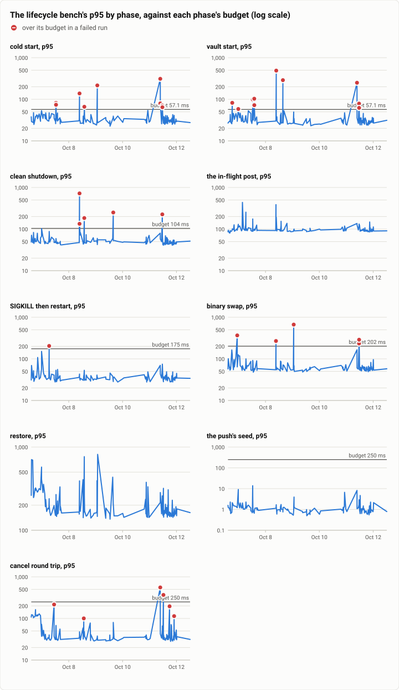
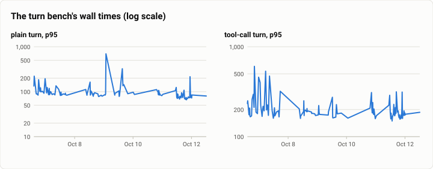
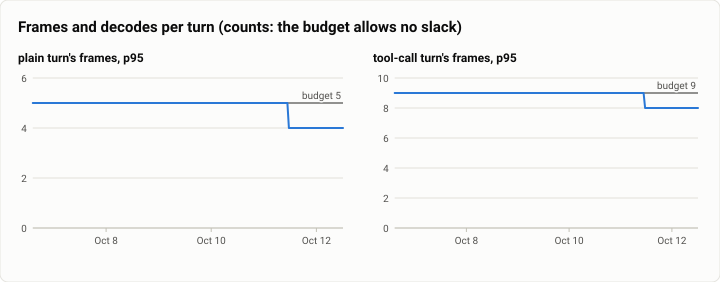
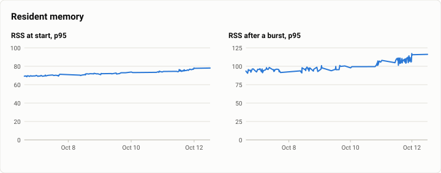

# Gate bench: FAST's history again, the gate's speed benches from Oct 6 to Oct 12 (2026-10-12)

**The answer first.** In 127 gates on `main` between the last history report (Oct 6, 14:32) and the stopping
point's install (Oct 12, 12:10), every lifecycle phase's median stayed far inside its budget: a cold start's p50 was
25.3 ms against 50 ms, a clean shutdown's 35.5 ms against 100, a SIGKILL's restart 29.6 ms against 150 (6 ms faster
than the week before), and a binary swap 51.0 ms against 200. As before, the tail and not the budgets made the gate
miss: in 22 of the 127 gates (17.3%, Wilson 95% interval 11.7% to 24.8%) the slowest of ten runs crossed a limit on
the first try, against 13.3% [9.6, 18.2] for Oct 1 to 6, an overlap that does not show a change. The phase that missed
most was a new one, the cancel round trip (8 of the 22 misses, each 1.0 to 5.6 times its 100 ms), then the vault start
(7) and the cold start (5). One join moved a count for good: an input's admission now rides its input's frame
(theseus-2uby, Oct 11), so a plain turn writes 4 frames instead of 5 and a tool-call turn 8 instead of 9, and the
daily median of a plain turn's p95 fell from about 90 ms to 75 to 80 ms. One number moved with no join to blame: the
daemon's resident memory at the turn bench's start grew from 69 to 78 MB over the six days (+12%), and after a burst
of turns from 94 to 116 MB (+22%), a step of a few MB at a time across about twenty joins of new features, with no
budget to stop it.

| | |
|---|---|
| Suite | the gate's speed benches (`theseus-sim bench`: lifecycle, turn, idle, size) |
| Span | 2026-10-06T14:32:17-07:00 to 2026-10-12T12:10:06-07:00, 275 runs on `main` |
| Runs that failed (a miss before its rerun, or a red gate) | 28 |
| Data | [`2026-10-12-gate-bench-fast-history.json`](2026-10-12-gate-bench-fast-history.json), [`2026-10-12-gate-bench-fast-history.csv`](2026-10-12-gate-bench-fast-history.csv) |

## The question

Did the week of joins before the stopping point (about 130 merges: turn admission, keep-warm, the money limits,
standing orders, commitments, the MCP memory server, the kill family) cost the daemon any of its speed budgets, and
does the gate's miss rate still say "the machine" rather than "the code"? The Oct 6 report answered both for the week
before; this is the same reading over the next six days, up to the build the rerun measures (`026dce3f`).

## The setup

- **The bench:** each join's gate runs `theseus-sim bench lifecycle --runs 10 --check` and `bench turn --check` on the
  debug build of the merged tree, an empty store, and records every run to the bench history; a gate takes the gate's
  lock, waits for a quiet machine (`settle()`: IO pressure under 10%, CPU under 20%, up to 10 minutes), reruns a phase
  that misses once, and passes a miss within the busy allowance.
- **The span:** 2026-10-06 14:32 to 2026-10-12 12:10 (UTC-7), 275 history rows on `main`: 151 lifecycle runs in 127
  gates (a gate's first run is its first row under its commit's label) and 124 turn benches.
- **The machine:** the shared 16-core WSL2 VM, with the lanes' builds, the cloud joins and on Oct 10 a Terminal-Bench
  run beside it. The 1-minute load at a run's start averaged 5.8 [5.5, 6.2] (median 4.7).
- **Numbers are debug builds**, the gate's own; the release build's numbers of record are in the stopping point's
  gate-bench report of the same day.

## Results

| Phase | Budget | p50, median | p95, median | p95, 90th pct | p95, worst | Latest p95 |
|---|---|---|---|---|---|---|
| cold start | 57.1 ms | 25.3 ms | 32.2 ms | 47.5 ms | 311 ms | 27.5 ms |
| vault start | 57.1 ms | 25.6 ms | 29.9 ms | 49.5 ms | 489 ms | 31.2 ms |
| clean shutdown | 104 ms | 35.5 ms | 49.2 ms | 70.5 ms | 719 ms | 51.3 ms |
| the in-flight post | – | 86.0 ms | 93.9 ms | 125 ms | 438 ms | 90.8 ms |
| SIGKILL then restart | 175 ms | 29.6 ms | 34.7 ms | 48.8 ms | 205 ms | 34.0 ms |
| binary swap | 202 ms | 51.0 ms | 58.4 ms | 96.1 ms | 666 ms | 57.7 ms |
| restore | – | 146 ms | 166 ms | 323 ms | 817 ms | 163 ms |
| the push's seed | 250 ms | 0.61 ms | 1.03 ms | 2.05 ms | 13.9 ms | 0.79 ms |
| cancel round trip | 100 ms | 27.6 ms | 34.5 ms | 111 ms | 557 ms | 31.4 ms |
| plain turn | – | 77.2 ms | 86.1 ms | 124 ms | 697 ms | 80.1 ms |
| tool-call turn | – | 161 ms | 183 ms | 258 ms | 606 ms | 186 ms |
| plain turn's frames | 4 | 5 | 5 | 5 | 5 | 4 |
| tool-call turn's frames | 8 | 9 | 9 | 9 | 9 | 8 |
| RSS at start | – | 72.3 MB | 72.3 MB | 76.4 MB | 78.1 MB | 78.1 MB |
| RSS after a burst | – | 98.5 MB | 98.5 MB | 110 MB | 117 MB | 116 MB |
| turn_batch | – | 2,215 | 2,229 | 2,268 | 3,096 | 2,222 |
| health | 5 | 2.30 | 3.27 | 4.01 | 5.89 | 2.97 |
| syncs_plain | 2 | 2 | 2 | 2 | 2 | 2 |
| frames_batch | 14 | 14 | 14 | 15 | 15 | 14 |

<picture>
  <source media="(prefers-color-scheme: dark)" srcset="img/2026-10-12-gate-bench-fast-history/lifecycle-dark.svg">
  
</picture>

*Figure 1. Has each lifecycle number held its budget across the span, and which joins moved it? Yes: every phase's daily median p95 sat well inside its budget all week; the spikes are single runs, and none repeats in the next gate.*

<picture>
  <source media="(prefers-color-scheme: dark)" srcset="img/2026-10-12-gate-bench-fast-history/turn-dark.svg">
  
</picture>

*Figure 2. Has each turn number held its budget across the span, and which joins moved it? Yes, and better at the end: a plain turn's p95 fell from about 90 ms to 75 to 80 ms when turn-one-frame joined (Oct 11).*

<picture>
  <source media="(prefers-color-scheme: dark)" srcset="img/2026-10-12-gate-bench-fast-history/frames-dark.svg">
  
</picture>

*Figure 3. Has each frames number held its budget across the span, and which joins moved it? Yes: the counts are exact, and theseus-2uby lowered both budgets by one frame on Oct 11 (plain 5 to 4, tool call 9 to 8, a batch 15 to 14).*

<picture>
  <source media="(prefers-color-scheme: dark)" srcset="img/2026-10-12-gate-bench-fast-history/memory-dark.svg">
  
</picture>

*Figure 4. Has each memory number held its budget across the span, and which joins moved it? No budget holds it: the daemon's memory at the bench's start rose from 69 to 78 MB and after a burst from 94 to 116 MB, a few MB at a time.*

## Analysis

**Every daily median against its budget** (the median over each day's gates of the phase's p95, ms):

| Phase (budget) | Oct 6 | Oct 7 | Oct 8 | Oct 9 | Oct 10 | Oct 11 | Oct 12 |
|---|---|---|---|---|---|---|---|
| cold start (57.1) | 36.1 | 34.5 | 30.2 | 31.0 | 32.0 | 30.0 | 29.1 |
| clean shutdown (104) | 52.6 | 48.0 | 48.3 | 52.2 | 49.8 | 46.2 | 49.4 |
| SIGKILL, restart (175) | 36.0 | 34.3 | 33.1 | 33.3 | 34.8 | 34.0 | 34.7 |
| binary swap (202) | 80.1 | 58.6 | 58.8 | 56.6 | 56.5 | 56.4 | 57.7 |
| plain turn (none) | 102.0 | 89.2 | 87.5 | 90.0 | 90.3 | 74.8 | 80.1 |
| tool-call turn (none) | 210.0 | 193.8 | 189.5 | 179.5 | 192.1 | 175.1 | 177.5 |
| RSS at start, MB (none) | 69.4 | 70.0 | 71.6 | 72.1 | 73.9 | 75.6 | 77.9 |
| RSS after a burst, MB (none) | 94.4 | 95.5 | 95.5 | 96.4 | 102.3 | 108.1 | 115.6 |

**The misses.** 22 first runs crossed a limit, by phase (a run can cross more than one; the limits are each phase's
latest, with its margin): the cancel round trip 8 (1.0 to 5.6 times its limit, median 2.0), the vault start 7 (1.0 to
8.6), the cold start 5 (1.2 to 5.5), the binary swap 4 and the clean shutdown 4 (1.8 to 6.9), the SIGKILL restart 1;
two missed a turn-side check only. By the 1-minute load at the run: under 4, 5 of 40 (12.5% [5.5, 26.1]); 4 to 8, 12
of 66 (18.2% [10.7, 29.1]); 8 to 12, 3 of 12; above 12, 2 of 9. The rise with load that the Oct 6 report saw is there
again, more weakly: this week's busiest gates were rarer (the lanes went to the cloud after Oct 10's overload).

- **The cancel round trip is the newest phase and the most-missed.** Its median p95 (34.5 ms) is a third of its limit,
  but its 90th percentile is 111 ms, past the limit: the one phase whose ordinary tail reaches its budget. A cancel
  waits for a running job's stop and the frames that record it, so it pays the disk twice, and on a busy disk that is
  where the tail comes from. It is the first budget to watch.
- **The vault start's worst runs are the largest misses** (8.6 times its limit once). It starts from the config's copy
  and must not wait for the vault; a run that waits 400 ms is the copy's read stalling on a busy disk, not the vault.
- **Memory grew with the features.** No single join moved it: the steps of 3 to 10 MB in the burst figure line up with
  ordinary feature joins (keep-warm, money, standing orders, commitments, the MCP memory server), each adding state the
  daemon keeps. 22% in six days with no budget is the kind of drift the Oct 6 report flagged (45 to 68 MB then); it
  is now 116 MB after a burst. A budget, or at least a line in the gate, is the fix the history asks for.
- **The turn bench's lone slow run** (a p95 more than twice the median) appeared in 10 of 124 turn benches (8.1%
  [4.4, 14.2]), as in the week before (8.4%), 2 to 8 times the median, still with no budget.

**What changed since Oct 6.** The swap's daily median fell from 80 to 57 ms on Oct 7 and stayed there; a SIGKILL's
restart is 6 ms faster at the median; a plain turn writes one frame fewer since Oct 11 (theseus-2uby); the gate's
first-run miss rate did not move beyond its interval (17.3% [11.7, 24.8] against 13.3% [9.6, 18.2]); and the
daemon's memory kept growing, now by a fifth in six days.

## Threats to validity

- **Debug builds on a shared machine.** Every number is the gate's debug build beside other work; a phase's p95 is
  the slowest of ten runs, so it measures the machine's worst moment as much as the code. The release numbers of
  record are in the stopping point's gate-bench report.
- **Budgets moved inside the span.** Turn-one-frame lowered two frame budgets, and the miss count above uses each
  phase's latest limit, so a miss under an earlier margin may be counted against today's.
- **A gate's first run** is its first history row under its label; a gate rerun on the same commit after a red is
  not a new gate. Lane gates and manual runs are left out (`--branch main`).
- **Load is the 1-minute load at the run's start**, a coarse proxy for what ran beside it.

## What it cost

Nothing beyond the gates' own time: no model is called.

## Reproduction

```bash
# Each gate appends its runs to the bench history ($THESEUS_BENCH_HISTORY):
target/debug/theseus-sim bench history --last 20
python3 bench/report/draft.py history --date 2026-10-12 --slug fast-history --branch main \
    --since 2026-10-06T13:56 --until 2026-10-12T12:12
```

## Data

[`2026-10-12-gate-bench-fast-history.json`](2026-10-12-gate-bench-fast-history.json) holds each phase's summary and the figures' specs; [`2026-10-12-gate-bench-fast-history.csv`](2026-10-12-gate-bench-fast-history.csv) one row per bench run (time, label, load, passed, each p95).
