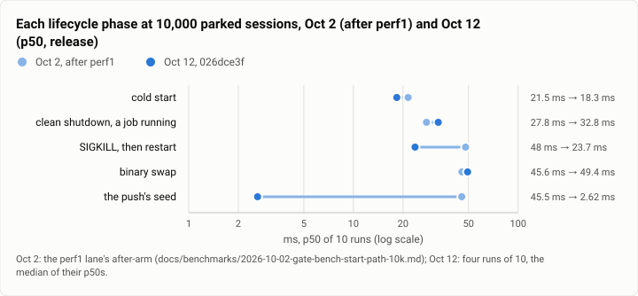
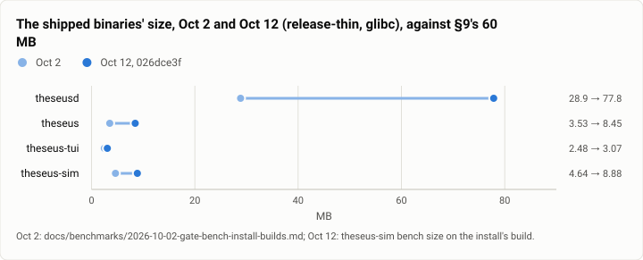
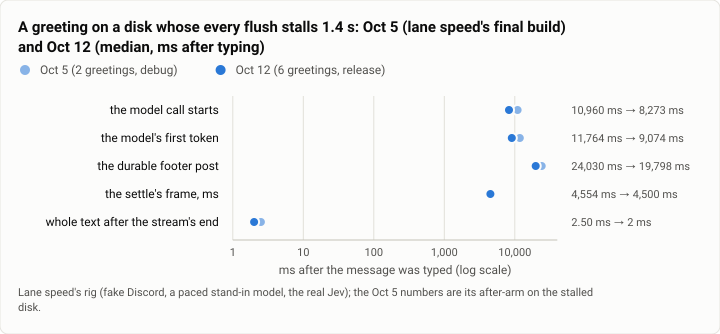

# Gate bench: the stopping point's release build, every speed bench once more (2026-10-12)

**The answer first.** On the release build the stopping point installed (`026dce3f`), every lifecycle budget holds
with room to spare, in four runs of ten on an empty store and four on 10,000 parked sessions: a cold start's p50 is
18.1 ms against 50 (18.3 ms at 10,000 sessions, against 250), a clean shutdown with a job running 37.0 ms against 100,
a SIGKILL's restart 22.2 ms against 150, and a binary swap 48.2 ms against 200. Against the perf1 lane's numbers of
Oct 2 on the same 10,000 sessions, the SIGKILL restart is twice as fast (48.0 to 23.7 ms) and the push's first board
17 times faster (45.5 to 2.6 ms); the swap and the clean stop are 4 to 5 ms slower. A plain turn costs 57 ms of wall
and 4 frames, a tool-call turn 134 ms and 8 frames, and the daemon's reads stay at 3.6 to 9.3 ms on a 424 MB store
of 470,000 ledger rows. On lane speed's IO-stall rig a greeting's whole reply reaches Discord 1 to 12 ms after the
model's stream ends, and on a disk whose every flush stalls 1.4 s the model call now starts 8.3 s after the message
instead of 11.0 s (Oct 5). Two numbers fail what the spec asks: **`theseusd` is 77.8 MB against §9's 60 MB**, 2.7
times its size on Oct 2 (28.9 MB), and `theseus status --short` took 8.1 to 8.4 ms at its p90 against a 5 ms
check, on a quiet machine as on a busy one. The static musl build every Harbor trial runs is 17% slower on a
tool-call turn than the install's glibc build, and 9% leaner.

<picture>
  <source media="(prefers-color-scheme: dark)" srcset="img/2026-10-12-gate-bench-stop-point/start-path-10k-dark.svg">
  
</picture>

*Figure 1. Has the start path at 10,000 sessions held what lane perf1 won? Yes: a cold start and a SIGKILL's restart
are faster than on Oct 2, the push's seed 17 times faster; the stop and the swap gave back 4 to 5 ms each.*

| | |
|---|---|
| Suite | `gate-bench`: `theseus-sim bench` lifecycle, turn, jobs, idle, status, size; a reads probe; lane speed's IO-stall rig |
| Arms | Theseus, the release build (`release-thin`, glibc) the stopping point installed |
| Commit | `026dce3f` (install #25), binaries frozen in a directory of their own for the run |
| Runs | lifecycle 4 × 10 (empty store) and 4 × 10 (10,000 sessions); turn 2 × 20 plus a burst of 30; jobs 2 × 40 a class; idle 30 s and 20 s; status 2 × 300; 7 + 7 greetings on the rig; a glibc/musl A/B (lifecycle 4 + 4, turn 2 + 2, idle) |
| When | 2026-10-12, 12:12 to 13:19 (UTC−7), between three joins' gates |
| Cost | $0.004 of Jev (the rig's 13 routing verdicts); no model |
| Data | [`2026-10-12-gate-bench-stop-point.json`](2026-10-12-gate-bench-stop-point.json) |

## The question

The stopping point (epic theseus-6rui) closed with every known speed fix joined. Before the paid benchmarks rerun, the
speed benches answer two things on the build that runs them: does every §9 budget hold on the release build, and did
the week's features (about 300 merges since the last release numbers of record, Oct 2 to 5) give back any of what the
speed lanes won? The gate measures debug builds on every join (the history report of the same day); the release
numbers are what a person runs.

## The setup

- **The build:** the install's `release-thin` glibc binaries of `026dce3f`, copied out of the target before the run
  (`theseusd` the install's, the four others unchanged since `7005d130`, whose sources were the same), and driven by
  that build's own `theseus-sim`.
- **The benches:** `theseus-sim bench lifecycle --runs 10` four times (every phase), and four times with
  `--sessions 10000` (cold, shutdown, kill, swap, seed, health); `bench turn --runs 20 --burst 0` twice and once with
  a burst of 30; `bench jobs --class l0,l1 --runs 40` twice (the bench in a systemd unit with `Delegate=yes`, as L1
  needs); `bench idle` for 30 s on an empty store and 20 s on 10,000 sessions; `bench status` (300 runs at 1,000
  sessions); `bench size`.
- **Reads:** a synthetic store of 10,000 sessions and 470,000 ledger rows (`theseus-sim synth-store`, 424 MB), a
  scratch daemon on it, and each CLI read timed as a person runs it, one process each: three warm, twelve timed.
- **The IO-stall rig** (lane speed, 2026-10-05; `docs/benchmarks/2026-10-05-gate-bench-speed-io-stalls.md`): the
  fake Discord, a stand-in model that answers 800 ms after the request in 12 deltas 25 ms apart, the real Jev for
  routing, and a scratch daemon with Discord, the judge, routing and memory on, as the owner runs it; seven greetings
  typed through the fake gateway (the sixth after 100 s idle, the seventh after 205 s). Once on the normal disk, once
  with the state dir on device-mapper's `delay` target over a loop file, every flush delayed 1,400 ms (an
  `fdatasync` measured 1,421 to 1,426 ms). Root steps through a one-command sudo wrapper; the block devices, maps and
  mounts were snapshotted before and after and diffed identical.
- **Quiet:** every step waited for no Rust tree compiling, no open join or install lock, the gate's lock free, and
  CPU pressure under 20% and IO under 10% at avg10. A join's build interrupted the first pass at 12:18; the
  10,000-session runs were taken again whole once it and the install after it had finished (12:35). The 1-minute load
  was 4.3 to 8.6 through the runs, from work that was not compiling.

## Results

**The lifecycle, empty store** (release, four runs of ten; the median of the four runs' p50s, the median and the worst
of their p95s; the budget is §9's, the gate's margin aside):

| Phase | p50 | p95 (median) | p95 (worst run) | Budget |
|---|---|---|---|---|
| cold start | 18.1 ms | 32.9 ms | 49.2 ms | 50 ms |
| cold start from the config's copy | 18.2 ms | 19.9 ms | 24.5 ms | 50 ms |
| clean shutdown, executions waiting and a job running | 37.0 ms | 45.2 ms | 87.2 ms | 100 ms |
| SIGKILL, then restart | 22.2 ms | 31.6 ms | 36.8 ms | 150 ms |
| binary swap | 48.2 ms | 63.7 ms | 120.5 ms | 200 ms |
| the push's seed | 0.32 ms | 0.55 ms | 0.64 ms | 250 ms |
| health | 0.81 ms | 1.32 ms | 2.21 ms | 5 ms |
| execution.cancel of a running job | 26.7 ms | 35.1 ms | 69.1 ms | 100 ms |
| restore (no budget) | 146 ms | 187 ms | 245 ms | – |
| a DM's first message to its reply's post (no budget) | 1,411 to 1,448 ms; later ones p50 1,353 to 1,358 ms | | | – |

Every run printed `LIFECYCLE OK`. The daemon's own clock over 51 starts puts serving at 16.6 ms (p50), of which the
store's open is 4.1 and the kernel 7.8 (its `accepting` step 7.1).

**At 10,000 parked sessions** (four runs of ten): a cold start 18.3 ms (p95 29.2, budget 250), a clean shutdown 32.8
(51.1), a SIGKILL's restart 23.7 (26.4, budget 350), a binary swap 49.4 (55.5; one run's 139.4), the push's seed 2.6
(4.3), health 0.87 (1.68).

**A turn** (two runs of twenty, on the stand-in; each kind's own frames):

| Kind | Wall p50 | Wall p90 | Worst | The daemon's p50 | Frames |
|---|---|---|---|---|---|
| plain | 57.4 ms | 94.7 ms | 153.4 ms | 43.5 ms | 4 every turn |
| one tool call | 134.1 ms | 223.4 ms | 279.1 ms | 129.0 ms | 8 every turn |
| a batch of calls | 2,189 ms | 2,247 ms | 2,265 ms | 2,187 ms | 14 every turn |

This disk's `fdatasync` read 6.8 and 6.7 ms at the p50. The daemon held 40.4 MB after its start and 68.1 MB after a
burst of 30 turns over 6 sessions (88 ms a turn).

**A job's start:** at L0 `/bin/true` through the job wrapper is noticed in 10.7 ms (p50; p95 12.3); at L1 its start is
5.2 ms (p95 5.8, target 25) and the whole job 15.8 ms. A second pass at a load of 7.7 read L0 14.9 and L1's start
7.4 with a p95 of 28.7 ms, past its 25: the one bench of the day that missed a target, beside unrelated load.

**Idle:** on an empty store the daemon used 0.009% of a core over 30 s, 1.7 wakeups a second, no frame, 41 MB; on
10,000 parked sessions 0.45% of a core, 4 wakeups a second, no frame, 112 MB (its index tender 72 MB of it).

**Reads at 10,000 sessions and 470,000 ledger rows** (the CLI's wall, spawn to exit, p50 of twelve): `ledger` (20
rows) 3.6 ms, `ledger -n 200 --json` 4.1 ms (40 KB), `ledger -n 1000 --json` 9.3 ms (187 KB), `ledger -k turn.ended
-n 50` 3.3 ms, `sessions` 3.9 ms, `executions` 3.6 ms, `status --short` 3.7 ms, `health` 3.6 ms. The store took
24.5 s to write and the daemon answered 209 ms after its spawn.

**`theseus status --short` at 1,000 sessions** (300 runs): p50 5.4 ms, p90 8.4 ms, worst 34.5 ms, against the bench's
5 ms check at the p90: a miss, at a 1-minute load of 7.5. Run again at 13:12 with CPU and IO pressure at 0: p50 5.3 ms,
p90 8.1 ms, worst 12.7 ms, a miss again. (The reads probe's `status --short`, on a store of 10,000 sessions and its own
config, read 3.7 ms at the p50.)

**The install's build against the bench containers' build** (static musl, `bench/build.sh`, the same commit; the same
`theseus-sim` drives both; lifecycle four runs of ten an arm in palindrome order, turn two runs of twenty, idle 30 s;
13:12 to 13:19, at a 1-minute load of 10 to 14 from a neighbour's lint and test run, so the stop-side phases read about
twice the earlier pass's, both arms alike):

| | glibc (the install) | static musl (Harbor) | musl / glibc |
|---|---|---|---|
| cold start, p50 (median of 4) | 28.8 ms | 31.3 ms | 1.09 |
| clean shutdown | 90.6 ms | 92.0 ms | 1.02 |
| SIGKILL, then restart | 43.1 ms | 44.5 ms | 1.03 |
| binary swap | 117.7 ms | 124.3 ms | 1.06 |
| plain turn, wall p50 (2 runs) | 73.3, 59.4 ms | 66.2, 70.2 ms | about 1 |
| tool-call turn, wall p50 | 153.7, 144.4 ms | 173.0, 173.4 ms | 1.17 |
| tool-call turn, the daemon's p50 | 135, 124 ms | 151, 153 ms | 1.17 |
| idle: CPU, wakeups, RSS | 0.014%, 2.8/s, 40.7 MB | 0.017%, 3.5/s, 37.2 MB | RSS 0.91 |

The static build is slower where the daemon computes (a tool-call turn 17% at the daemon's own clock) and leaner in
memory (9% less resident), as Oct 2 found (28% to 67% more CPU in every pair, 16% to 25% less memory). Every Harbor
trial of the rerun runs this build, so its CPU numbers per tool call carry that tax against an install.

**The binaries' size:**

<picture>
  <source media="(prefers-color-scheme: dark)" srcset="img/2026-10-12-gate-bench-stop-point/binary-size-dark.svg">
  
</picture>

*Figure 2. Do the shipped binaries still fit §9's 60 MB each? Three do; `theseusd` does not: 77.8 MB, from 28.9 on
Oct 2.*

| Binary | Oct 2 | Oct 12 | §9 |
|---|---|---|---|
| `theseusd` | 28.86 MB | 77.85 MB | 60 MB |
| `theseus` | 3.53 MB | 8.45 MB | 60 MB |
| `theseus-tui` | 2.48 MB | 3.07 MB | 60 MB |
| `theseus-sim` | 4.64 MB | 8.88 MB | 60 MB |

**The IO-stall rig** (ms after the greeting was typed; medians, the range beside):

| | Normal disk (7) | Oct 5, normal (7, debug) | Stalled disk (6) | Oct 5, stalled (2, debug) |
|---|---|---|---|---|
| the turn starts (the message's own frame) | 19 (15 to 82) | 20 to 460 | 2,514 (1,463 to 7,185) | 1,480 and 2,850 |
| the model call starts | 180 (155 to 280) | 184 to 1,248 | 8,273 (7,223 to 15,830) | 10,296 and 11,625 |
| the first text after the model's first token | 1 (1 to 2) | 2 to 11 | 1 (1 to 3) | 2 and 2 |
| the whole text after the stream's end | 3 (1 to 12) | 2 to 8 | 2 (1 to 3) | 2 and 3 |
| the durable footer post | 1,622 (1,565 to 1,677) | 1,491 to 3,243 | 19,798 (18,743 to 33,109) | 21,975 and 26,085 |
| the settle's frame | 13 | 12 to 380 | 4,501 | 4,603 and 4,504 |

<picture>
  <source media="(prefers-color-scheme: dark)" srcset="img/2026-10-12-gate-bench-stop-point/io-stall-dark.svg">
  
</picture>

*Figure 3. How long does a person wait for a greeting's reply when the disk stalls? The reply's text still follows the
model within 3 ms; the model call starts about 2.7 s sooner than on Oct 5, one 1.4 s sync and a little fewer.*

Every greeting was routed to the `haiku` profile as trivial (0.75 to 1.0), and on the normal disk routing waited 0 to
124 ms for Jev. On the stalled disk the daemon took 24 s from its start to Discord's gateway being ready (the binding
and the store's first writes, each 1.4 s), and the first greeting, typed 5 s after the daemon answered health, was
never received: it is left out above, and the "first after the start" row the Oct 5 table has is missing here.

## Analysis

**What held.** Every lifecycle budget, at both store sizes, with the p50 at a fifth to a half of its limit, the same
margin as the gate's debug numbers. The start path at 10,000 sessions, which lane perf1 cut from 119 to 21.5 ms on
Oct 2, now reads 18.3. The push's first board at 10,000 sessions fell from 45.5 to 2.6 ms: the seed is paged since
cli-pages (theseus-0jet's daemon side), so it no longer grows with the store. Reads of the ledger and the lists do not
grow with the store either: 3.6 ms on a 424 MB store, as on a tiny one.

**What moved, and why.**
- **A plain turn writes 4 frames and a tool-call turn 8**, one fewer each since turn-one-frame (theseus-2uby, Oct 11):
  an input's admission rides the input's own frame. On the stalled disk that is one 1.4 s sync off the path before
  the model call (11.0 s to 8.3 s at the median), and on the normal disk the call now starts 155 to 280 ms after a
  greeting, where Oct 5's after-arm had one at 1,248 ms.
- **The model call on a stalled disk still waits five to six syncs** (8.3 s of 1.4 s flushes): the message's own
  frame, the judge's state, the turn's plan and dispatch, and the binding's writes share the store's one writer. The
  Oct 5 report named this ("the store-write question"); one sync came off, the rest are still there.
- **The swap and the clean stop gave back 4 to 5 ms at 10,000 sessions** against Oct 2. Each new feature that keeps
  state (keep-warm, money, standing orders, commitments) adds a little to what a stop saves and a swap reopens; both
  are still at a quarter to a third of their budgets.

**What failed.**
- **`theseusd` is 77.8 MB, past §9's 60 MB.** It was 28.9 MB on Oct 2. No bench in the gate checks the size, so it
  crossed the line without a red: `bench size --check` would fail. The likely mass is what the week linked in (the
  voice stack and its vendored songbird, the AWS SDK's crates, the cockpit's embedded bundle, the embedding engine);
  a size budget in the gate and a per-crate breakdown (`cargo bloat` on the release profile) are the next steps.
- **`status --short`'s p90 missed its 5 ms check twice**, at a load of 7.5 and again with the machine's pressure at 0
  (p50 5.3, p90 8.1 ms). It is the prompt's status line, run on every prompt; the bench is not in the gate, so nothing
  caught the drift. On the reads probe's store it read 3.7 ms, so what the bench's synthetic store and config add (its
  1,000 sessions' listing, or a check the line now makes) is the first thing to look at.
- **On a stalled disk the daemon is not ready for 24 s.** A message typed in that window (here, 5 s after health
  answered) was never received. On real Discord a message sent while the gateway reconnects is replayed only if the
  daemon asks for what it missed.

**What changed since the last comparable runs.** Oct 2 (perf1, 10,000 sessions): a cold start 21.5 to 18.3 ms, a
SIGKILL's restart 48.0 to 23.7, the seed 45.5 to 2.6, a swap 45.6 to 49.4, a clean stop 27.8 to 32.8. Oct 3 (ledger
reads, 470,000 rows): every read under 10 ms. Oct 4 (one sync per job): a job's completion noticed in 10.7 ms at L0
(10.3 then). Oct 5 (IO stalls): the reply's text still follows the model within 3 ms; the model call starts 2.7 s
sooner on the stalled disk. Oct 2 (sizes): `theseusd` 28.9 to 77.8 MB.

## Threats to validity

- **One machine, shared.** The runs waited for no compiling tree and no open join, but the 1-minute load stayed at 4
  to 8 from other work, and the jobs bench's second pass and the status bench show it. Each lifecycle phase is the
  median over four runs of ten, which absorbs a single slow run; a p95 is still the slowest of ten.
- **Debug against release.** The Oct 5 rig's numbers were debug builds and today's are release, so part of the
  normal disk's gain is the build; on the stalled disk, where syncs dominate, the build matters little.
- **The rig's config is Oct 5's.** It runs the owner's settings of that day (route.v1's words in its table, which
  today's daemon answers with route.v4), with memory live by today's default; the comparison is of the turn's path,
  not of routing.
- **Six greetings on the stalled disk, two on Oct 5.** The medians compare shapes, not distributions.
- **Sizes** are the install's binaries, which embed the cockpit's bundle; Oct 2's did too.

## What it cost

$0.004: thirteen routing verdicts from Jev on the IO-stall rig. Everything else ran on stand-ins.

## Reproduction

```bash
scripts/build.sh --profile release-thin            # the install's build; copy the binaries out of the target first
B=target/release-thin
$B/theseus-sim bench lifecycle --theseusd $B/theseusd --runs 10
$B/theseus-sim bench lifecycle --theseusd $B/theseusd --runs 10 --sessions 10000 --phases cold,shutdown,kill,swap,seed,health
systemd-run --user --wait -p Delegate=yes $B/theseus-sim bench jobs --theseusd $B/theseusd --class l0,l1 --runs 40
$B/theseus-sim bench turn --theseusd $B/theseusd --runs 20 --burst 0
$B/theseus-sim bench turn --theseusd $B/theseusd --runs 10 --burst 30
$B/theseus-sim bench idle --theseusd $B/theseusd --seconds 30
$B/theseus-sim bench idle --theseusd $B/theseusd --seconds 20 --sessions 10000
$B/theseus-sim bench status --theseusd $B/theseusd --theseus $B/theseus
$B/theseus-sim bench size --dir $B --check
$B/theseus-sim synth-store --dir <state>/store --sessions 10000 --ledger-rows 470000   # then time the CLI's reads
```

The reads probe, the IO-stall rig (lane speed's: the fake Discord, the paced stand-in, the drive and table scripts,
the slow-disk helper) and every run's output are kept on the build machine, not published.

## Data

[`2026-10-12-gate-bench-stop-point.json`](2026-10-12-gate-bench-stop-point.json): each phase's pooled numbers at both
store sizes, the turn, jobs, idle, status, size and reads results, the IO-stall rig's medians and ranges, and the three
figures' specs.
