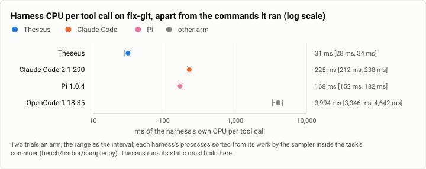
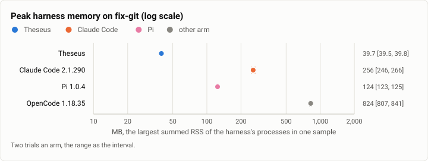
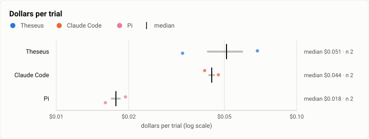

# Harbor: what each harness costs to run, apart from the model, at the stopping point (2026-10-12)

**The answer first.** On Terminal-Bench's `fix-git`, two sampled trials an arm, every harness solved both trials, and
the harness's own cost to the machine still separates them by orders of magnitude. Theseus (`026dce3f`, its static
musl build) spent **31 ms of its own CPU per tool call** [28, 34] and held **40 MB** at its peak; Claude Code 2.1.290
225 ms and 256 MB; Pi 1.0.4 168 ms and 124 MB; OpenCode 1.18.35 3,994 ms and 824 MB. Against the Oct 6 checks,
Theseus's own cost rose (16 to 25 ms a call and 24 to 28 MB then): part is the static build every Harbor trial runs (17%
slower on a tool-call turn than the install's, in the stopping point's gate-bench A/B), part the daemon's growth with the
week's features (its memory grew by a fifth in six days in the gate's history). Pi was the cheapest in model dollars
($0.018 a trial against Theseus's $0.051 and Claude Code's $0.044): Theseus wrote 3.5 times Pi's prompt to the cache
per trial (9,534 tokens against 2,706), a larger system prompt and tool set paid for on a task this short.

<picture>
  <source media="(prefers-color-scheme: dark)" srcset="img/2026-10-12-harbor-efficiency/harness-cpu-dark.svg">
  
</picture>

*Figure 1. What does each harness itself cost the machine for each tool call? Theseus 31 ms; Pi 168; Claude Code
225; OpenCode about 4 s (its own process, apart from the commands it ran).*

| | |
|---|---|
| Suite | `harbor`: Terminal-Bench 2.0's `fix-git`, the efficiency check (the Oct 6 report's) |
| Arms | Theseus `026dce3f` (static musl); Claude Code 2.1.290 (`MeasuredClaudeCode`); Pi 1.0.4 (`MeasuredPi`); OpenCode 1.18.35 (`MeasuredOpenCode`) |
| Model | Claude Sonnet 5.5, effort medium, every arm |
| Tasks × attempts | 1 × 2 an arm, one trial at a time |
| When | 2026-10-12, 14:30 to 14:53 (UTC−7) |
| Cost | $0.27 |
| Data | [`2026-10-12-harbor-efficiency.json`](2026-10-12-harbor-efficiency.json), [`2026-10-12-harbor-efficiency.csv`](2026-10-12-harbor-efficiency.csv) |

## The question

A benchmark's score hides what the harness itself costs to run: its CPU, its memory, its start. The Oct 6 checks
measured that per tool call with a sampler inside each task's container; this rerun asks whether the stopping point's
build kept its lead, and adds OpenCode, which tied Pi for the most solves in the Oct 7 harness-arms run. It is also the
rerun's smoke of every Harbor arm before the Terminal-Bench runs: each arm installs, runs, records and is graded.

## The setup

- **Theseus** (`theseus_agent:Theseus`): the static musl `theseus` and `theseusd` of `026dce3f` (`bench/build.sh`),
  the bench profile, the trial limit $3.75 (the $2.00 budget plus one maximum reservation), 200 loops, and the owner's
  decisions for the rerun: the shipped `proc_run` wait (60 s, not the bench's 900) and the follow bounded by the task's
  agent timeout less 30 s, so a command moved to the background comes back inside the trial.
- **Claude Code** (`claude_code_agent:MeasuredClaudeCode`): Harbor's adapter, pinned at 2.1.290, `--effort medium`,
  `max_budget_usd=2.0`, `max_turns=200`.
- **Pi** (`pi_agent:MeasuredPi`): Harbor's adapter, pinned at 1.0.4, offline catalog, thinking medium; caps recorded,
  not enforced (Pi has none).
- **OpenCode** (`opencode_agent:MeasuredOpenCode`): Harbor's adapter, pinned at 1.18.35, variant medium; caps recorded.
- **Every arm:** the same model, the task's agent timeout, the harness sampler at 250 ms (`bench/harbor/sampler.py`),
  sorting each process into harness or work; Harbor 0.23.0, one trial at a time, no other trial on the host (overlap 0).
- **The machine:** the shared 16-core WSL2 VM, while the memory exam and F10 ran beside it (no compiling tree).

## Results

| | Theseus | Claude Code | Pi | OpenCode |
|---|---|---|---|---|
| Trials solved | 2 of 2 | 2 of 2 | 2 of 2 | 2 of 2 |
| Dollars a trial (mean; the two) | $0.051 ($0.034, $0.069) | $0.044 | $0.018 | $0.037 |
| Model calls / tool calls a trial | 6.0 / 5.0 | 6.5 / 5.5 | 5.0 / 4.0 | 5.5 / 4.5 |
| Tokens a trial: cache read / cache write / output | 85,099 / 9,534 / 1,016 | 103,669 / 5,366 / 1,012 | 15,150 / 2,706 / 787 | 56,163 / 7,480 / 678 |
| Input read from the cache | 89.9% | 95.1% | 84.8% | 88.2% |
| Agent time a trial | 24 s | 15 s | 15 s | 25 s |
| **Harness CPU per tool call** | **31.0 ms** [28, 34] | 224.8 ms [212, 238] | 167.5 ms [152, 182] | 3,994 ms [3,346, 4,642] |
| Harness CPU a trial | 0.16 s | 1.23 s | 0.67 s | 17.65 s |
| **Peak harness RSS** | **39.7 MB** | 256.2 MB | 124.2 MB | 823.8 MB |
| The work's CPU a trial (the commands) | 0.11 s | 0.41 s | 0.22 s | 0.82 s |

<picture>
  <source media="(prefers-color-scheme: dark)" srcset="img/2026-10-12-harbor-efficiency/harness-rss-dark.svg">
  
</picture>

*Figure 2. How much memory does each harness hold while it works? Theseus 40 MB, a third of Pi's and a sixth of
Claude Code's.*

<picture>
  <source media="(prefers-color-scheme: dark)" srcset="img/2026-10-12-harbor-efficiency/cost-per-trial-dark.svg">
  
</picture>

*Figure 3. What does a trial cost in model dollars? Pi least, then Claude Code and Theseus, whose first trial wrote
17,062 tokens to the cache and its second 2,005.*

## Analysis

- **The harness's own cost.** Theseus's daemon and client stay the lightest by a factor of 5 to 7 in CPU per tool
  call and 3 to 6 in memory against the two arms nearest it, and two orders of magnitude against OpenCode, whose own
  process spends about 4 s of CPU a tool call.
- **Theseus's own numbers grew since Oct 6** (16 to 25 ms then, 31 now; 24 to 28 MB then, 40 now). Two causes are
  measured elsewhere in this rerun: the static musl build (17% slower on a tool-call turn and 9% leaner than the
  install's glibc build) and the daemon's growth with features (the gate's resident memory up a fifth in six days).
  The first is the bench's build, not the product's; the second is the product's, and has no budget.
- **Model dollars.** On a five-call task the prompt's size decides the bill: Theseus's first call writes its system
  prompt and tools to the cache (17,062 tokens in its first trial), Pi's about 2,700. Over a long task the write is
  amortized (the Oct 7 run had Theseus's dollars dominated by long commands' cold re-writes instead).
- **Every arm ran and was graded** on this build's adapters: the Terminal-Bench runs' smoke passed for all four arms.

**What changed since the last comparable run** (Oct 6, the efficiency checks; Claude Code was 2.1.288 then, capped at
$1): Theseus's CPU per call 16 to 25 ms → 31 ms and its memory 24 to 28 → 40 MB; Claude Code 175 to 394 ms → 225 ms and
209 to 430 → 256 MB; Pi 108 → 168 ms, 125 → 124 MB; OpenCode is new here. Every arm still solves `fix-git`.

## Threats to validity

- **Two trials of one easy task an arm.** These are per-call harness costs, not success rates; a five-call task
  favours a small prompt, and a long task a fast tool loop.
- **The sampler** counts the harness's processes by name and puts their children's CPU in the work; a harness that does
  its work in-process (OpenCode's file edits) carries it in its own number.
- **The static musl build** is what every Theseus Harbor trial runs; an install runs glibc (see the gate-bench report's
  A/B).
- **Neighbour work**: the memory exam and F10 ran on the host meanwhile (CPU time is measured per process, so the
  numbers are the harness's own; wall time is not).

## What it cost

$0.27: Theseus $0.10, Claude Code $0.089, Pi $0.035, OpenCode $0.073.

## Reproduction

```bash
bench/build.sh                                    # the static theseus and theseusd, into bench/bin
export THESEUS_BENCH_BIN_DIR=$PWD/bench/bin PYTHONPATH=$PWD/bench/harbor HARBOR_TELEMETRY=0   # and ANTHROPIC_API_KEY
export THESEUS_BENCH_SPEND_LIMIT=3.75 THESEUS_BENCH_PROC_SYNC=60 THESEUS_BENCH_FOLLOW_FOR=870
harbor run -d terminal-bench@2.0 -i fix-git -k 2 -n 1 -a theseus_agent:Theseus -m anthropic/claude-sonnet-5-5 -o jobs --job-name eff-theseus
for a in claude_code_agent:MeasuredClaudeCode pi_agent:MeasuredPi opencode_agent:MeasuredOpenCode; do
  harbor run -d terminal-bench@2.0 -i fix-git -k 2 -n 1 -a $a -m anthropic/claude-sonnet-5-5 \
    --ak max_budget_usd=2.0 --ak max_turns=200 -o jobs --job-name eff-${a%%_*}
done
python3 bench/report/efficiency.py --arm theseus=jobs/eff-theseus --arm claude-code=jobs/eff-claude \
  --arm pi=jobs/eff-pi --arm opencode=jobs/eff-opencode --out /tmp/eff
```

## Data

[`2026-10-12-harbor-efficiency.json`](2026-10-12-harbor-efficiency.json): every arm's numbers (`summary.four_arms`),
the three-arm draft's statistics, and the figures' specs; [`2026-10-12-harbor-efficiency.csv`](2026-10-12-harbor-efficiency.csv):
one row per trial of the three registry arms (OpenCode's two trials are in the data file's summary).
