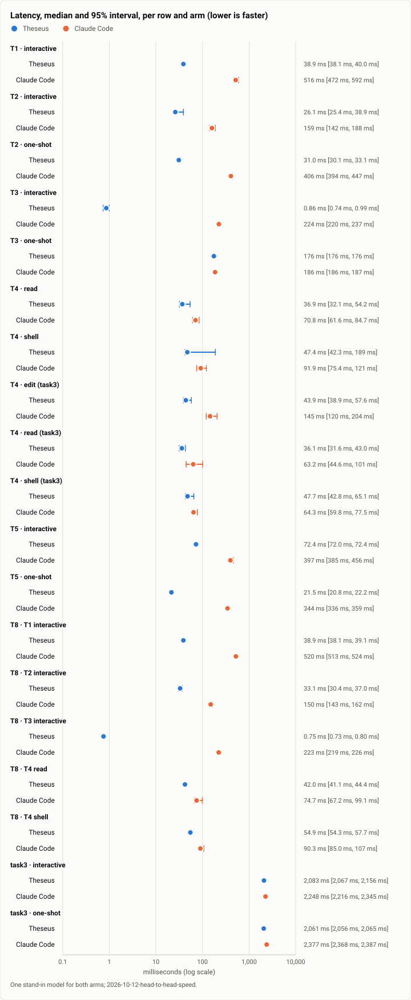
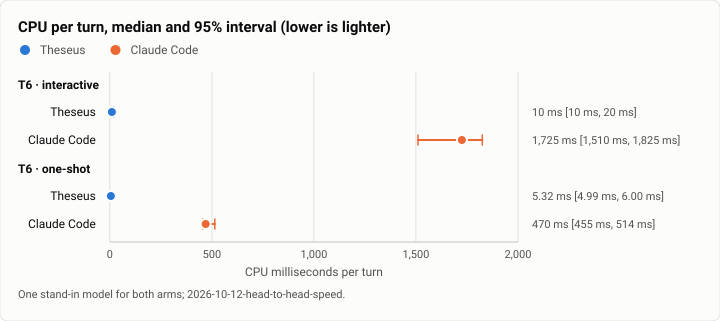
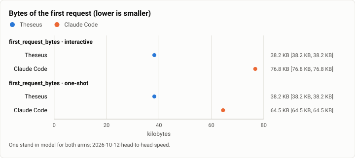
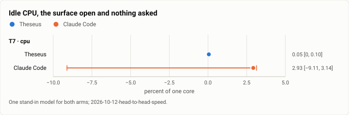
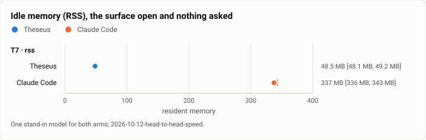

# Head-to-head speed: Theseus and Claude Code on one stand-in model, the first published run (2026-10-12)

**The answer first.** With the model's time held equal (a stand-in that answers every request the same way), Theseus's
release build was faster or lighter than Claude Code 2.1.296 on 22 of the 25 rows both arms measured, by its 95%
interval, and Claude Code on none; the other 3 overlap. A ready prompt: 38.9 ms against 516 (13×). A typed prompt to
the request leaving: 26 ms against 159. The model's first byte to text on screen: 0.9 ms against 224 (Claude Code's
REPL drew this reply only once its stream ended). A tool call's turnaround: 37 against 71 ms for a read, 44 against 145
for an edit. Resuming a 50-turn session: 72 against 397 ms. CPU for a turn: 10 ms against 1,725 (interactive) and 5
against 470 (one-shot). Idle with the surface open: 49 MB against 337. Its first request is half the bytes (38 KB
against 77). A three-tool task end to end, where the model's own time dominates, came out 7% to 13% faster (2,083
against 2,248 ms). The two rows inside the noise are shell calls, whose spread on Theseus's side reaches 189 ms: a
command's process start on this disk.

| | |
|---|---|
| Suite | `h2h` (bench/h2h, theseus-7gir.13): ten rows of harness speed, interactive and one-shot |
| Arms | Theseus, release `026dce3f` (its TUI, CLI and a scratch daemon); Claude Code 2.1.296, the bench's pin |
| Model | `theseus-sim fake-model`: 300 ms to the first byte, 8 chunks 25 ms apart, for both arms |
| Runs | 10 a row and arm, A/B interleaved (ABBA by pairs); 498 samples, 2 without a value |
| When | 2026-10-12, 13:31 to 13:41 (UTC−7) |
| Cost | $0: no real model |
| Data | [`2026-10-12-head-to-head-speed.json`](2026-10-12-head-to-head-speed.json) |

## The question

How much of a person's wait, and of the machine, is the harness itself? A coding benchmark mixes the harness's cost
with the model's, and the model's dominates; this bench takes the model out (the same scripted stand-in for both) and
times what is left on each surface a person touches: opening it, typing, seeing the first words, a tool call's
turnaround, resuming a long session, and the CPU and memory it holds. It is the north-star's speed half ("match or
beat Claude Code"), and the stopping point's rerun is its first published run.

## Results

| Row | What | Kind | Theseus | Claude Code | Difference |
|---|---|---|---|---|---|
| T1 | Start to a ready prompt | interactive | 38.9 ms (95% CI 38.1 ms to 40.0 ms; n 10) | 516 ms (95% CI 472 ms to 592 ms; n 10) | Theseus by 477 ms |
| T2 | Typed prompt to the request leaving | interactive | 26.1 ms (95% CI 25.4 ms to 38.9 ms; n 10) | 159 ms (95% CI 142 ms to 188 ms; n 10) | Theseus by 133 ms |
| T2 | Typed prompt to the request leaving | one-shot | 31.0 ms (95% CI 30.1 ms to 33.1 ms; n 10) | 406 ms (95% CI 394 ms to 447 ms; n 10) | Theseus by 375 ms |
| T3 | Model's first byte to the first text on screen | interactive | 0.86 ms (95% CI 0.74 ms to 0.99 ms; n 10) | 224 ms (95% CI 220 ms to 237 ms; n 10) | Theseus by 223 ms |
| T3 | Model's first byte to the first text on screen | one-shot | 176 ms (95% CI 176 ms to 176 ms; n 10) | 186 ms (95% CI 186 ms to 187 ms; n 10) | Theseus by 10.4 ms |
| T4 | Per tool call: the response's last byte to the next request | read | 36.9 ms (95% CI 32.1 ms to 54.2 ms; n 10) | 70.8 ms (95% CI 61.6 ms to 84.7 ms; n 10) | Theseus by 33.9 ms |
| T4 | Per tool call: the response's last byte to the next request | shell | 47.4 ms (95% CI 42.3 ms to 189 ms; n 10) | 91.9 ms (95% CI 75.4 ms to 121 ms; n 10) | Theseus by 44.6 ms (noise) |
| T4 | Per tool call: the response's last byte to the next request | edit (task3) | 43.9 ms (95% CI 38.9 ms to 57.6 ms; n 10) | 145 ms (95% CI 120 ms to 204 ms; n 10) | Theseus by 102 ms |
| T4 | Per tool call: the response's last byte to the next request | read (task3) | 36.1 ms (95% CI 31.6 ms to 43.0 ms; n 10) | 63.2 ms (95% CI 44.6 ms to 101 ms; n 10) | Theseus by 27.1 ms |
| T4 | Per tool call: the response's last byte to the next request | shell (task3) | 47.7 ms (95% CI 42.8 ms to 65.1 ms; n 10) | 64.3 ms (95% CI 59.8 ms to 77.5 ms; n 10) | Theseus by 16.6 ms (noise) |
| T5 | Resume of a long session | interactive | 72.4 ms (95% CI 72.0 ms to 72.4 ms; n 9) | 397 ms (95% CI 385 ms to 456 ms; n 9) | Theseus by 324 ms |
| T5 | Resume of a long session | one-shot | 21.5 ms (95% CI 20.8 ms to 22.2 ms; n 10) | 344 ms (95% CI 336 ms to 359 ms; n 10) | Theseus by 323 ms |
| T6 | CPU per turn | interactive | 10 ms (95% CI 10 ms to 20 ms; n 10) | 1,725 ms (95% CI 1,510 ms to 1,825 ms; n 10) | Theseus by 1,715 ms |
| T6 | CPU per turn | one-shot | 5.32 ms (95% CI 4.99 ms to 6.00 ms; n 10) | 470 ms (95% CI 455 ms to 514 ms; n 10) | Theseus by 465 ms |
| T7 | Idle, the surface open | cpu | 0.05% of a core (95% CI 0.00% of a core to 0.10% of a core; n 10) | 2.93% of a core (95% CI -9.11% of a core to 3.14% of a core; n 10) | Theseus by 2.87% of a core (noise) |
| T7 | Idle, the surface open | rss | 48.5 MB (95% CI 48.1 MB to 49.2 MB; n 10) | 337 MB (95% CI 336 MB to 343 MB; n 10) | Theseus by 289 MB |
| T8 | Under neighbour IO (a dd and fsync loop beside) | T1 interactive | 38.9 ms (95% CI 38.1 ms to 39.1 ms; n 10) | 520 ms (95% CI 513 ms to 524 ms; n 10) | Theseus by 481 ms |
| T8 | Under neighbour IO (a dd and fsync loop beside) | T2 interactive | 33.1 ms (95% CI 30.4 ms to 37.0 ms; n 10) | 150 ms (95% CI 143 ms to 162 ms; n 10) | Theseus by 117 ms |
| T8 | Under neighbour IO (a dd and fsync loop beside) | T3 interactive | 0.75 ms (95% CI 0.73 ms to 0.80 ms; n 10) | 223 ms (95% CI 219 ms to 226 ms; n 10) | Theseus by 222 ms |
| T8 | Under neighbour IO (a dd and fsync loop beside) | T4 read | 42.0 ms (95% CI 41.1 ms to 44.4 ms; n 10) | 74.7 ms (95% CI 67.2 ms to 99.1 ms; n 10) | Theseus by 32.7 ms |
| T8 | Under neighbour IO (a dd and fsync loop beside) | T4 shell | 54.9 ms (95% CI 54.3 ms to 57.7 ms; n 10) | 90.3 ms (95% CI 85.0 ms to 107 ms; n 10) | Theseus by 35.4 ms |
| task3 | A three-tool coding task, end to end | interactive | 2,083 ms (95% CI 2,067 ms to 2,156 ms; n 10) | 2,248 ms (95% CI 2,216 ms to 2,345 ms; n 10) | Theseus by 165 ms |
| task3 | A three-tool coding task, end to end | one-shot | 2,061 ms (95% CI 2,056 ms to 2,065 ms; n 10) | 2,377 ms (95% CI 2,368 ms to 2,387 ms; n 10) | Theseus by 316 ms |
| first_request_bytes | Bytes of the first request | interactive | 38.2 KB (95% CI 38.2 KB to 38.2 KB; n 10) | 76.8 KB (95% CI 76.8 KB to 76.8 KB; n 10) | Theseus by 38.5 KB |
| first_request_bytes | Bytes of the first request | one-shot | 38.2 KB (95% CI 38.2 KB to 38.2 KB; n 10) | 64.5 KB (95% CI 64.5 KB to 64.5 KB; n 10) | Theseus by 26.2 KB |

Lower is better on every row. An interval is a seeded bootstrap of the median (95%) from five values up, else the range; "(noise)" marks a difference whose intervals overlap.

2 attempts gave no value (a marker that never showed, a request never logged); they are left out, never filled in: T5 interactive (Claude Code), T5 interactive (Theseus).

## Figures

<picture>
  <source media="(prefers-color-scheme: dark)" srcset="img/2026-10-12-head-to-head-speed/latency-dark.svg">
  
</picture>

*Figure 1. Which harness takes less on each row: latency? Theseus, on every latency row but the two shell calls, where the intervals overlap.*

<picture>
  <source media="(prefers-color-scheme: dark)" srcset="img/2026-10-12-head-to-head-speed/cpu-per-turn-dark.svg">
  
</picture>

*Figure 2. Which harness takes less CPU per turn? Theseus, by 88× one-shot and 172× interactive.*

<picture>
  <source media="(prefers-color-scheme: dark)" srcset="img/2026-10-12-head-to-head-speed/first-request-bytes-dark.svg">
  
</picture>

*Figure 3. Which harness sends the smaller first request? Theseus: 38 KB against 65 to 77 KB.*

<picture>
  <source media="(prefers-color-scheme: dark)" srcset="img/2026-10-12-head-to-head-speed/idle-cpu-dark.svg">
  
</picture>

*Figure 4. Which harness takes less CPU idle? Theseus by its median (0.05% of a core against 2.9%), with Claude Code's interval too wide to call.*

<picture>
  <source media="(prefers-color-scheme: dark)" srcset="img/2026-10-12-head-to-head-speed/idle-memory-dark.svg">
  
</picture>

*Figure 5. Which harness holds less memory idle? Theseus: 49 MB against 337.*

## Analysis

- **Where the gap is largest, the harness is a process start or a redraw.** T1 (13×), T5's resume (5× to 16×) and T2's
  one-shot (13×) are Claude Code's Node start and its session load against a Rust CLI talking to a daemon that is
  already serving; T3 interactive (260×) is a screen that paints each delta as it lands against one that paints the
  reply when the stream ends.
- **The CPU rows are the largest ratios and the most practical.** 10 ms against 1,725 ms a turn is a laptop's battery
  and the fan; 49 against 337 MB idle is what stays resident in a terminal left open all day.
- **Where the model's time dominates, the gap shrinks to a tenth.** task3's three tool calls and three model calls end
  to end are 7% to 13% apart: the harness's share of a real turn is small next to a model's seconds, and that is the
  honest framing of every row above.
- **The shell row is Theseus's weakest.** A shell call's turnaround (47 ms median) is Theseus's slowest tool, and its
  interval reaches 189 ms: each command is a job through the job wrapper with its frames synced. On the scale
  investigator's quiet-machine reruns of Oct 8 the same call was 46 ms against Claude Code's 28 ms in a loop; here, by
  the next request's arrival, Claude Code's own turnaround is larger (92 ms), so the two methods disagree on who
  wins this row, and its intervals overlap. It is the row to improve.
- **Under neighbour IO** (T8: a 64 MiB write with fsync looping beside), Theseus's rows moved by 0 to 8 ms and Claude
  Code's by up to 9 ms either way. Neither harness's interactive path waits on the disk much at this load.

**What changed since the last comparable run.** No earlier run of this bench was published. The scale investigator's
unpublished measurements of Oct 8 (on the installed build of Oct 7, by hand-driven terminals) put Claude Code's REPL
ready at 408 to 497 ms and Theseus's `watch` at 5 to 6 ms, a reply's first text 216 ms after the model's last byte in
Claude Code and 1.5 ms after the first byte in Theseus, and CPU per turn 220 to 620 ms against 10: the same shape as
today's rows, measured a different way.

## Method

Both arms ran on one machine against one stand-in model (`theseus-sim fake-model`), which answers every request after 300 ms to its first byte, in 8 chunks 25 ms apart, and logs each request's arrival, first byte and last byte on CLOCK_MONOTONIC, the bench's own clock. The model's time is the same for both, so what differs is the harness. Both ran the same work in their own tools (read `notes.txt`, edit a line, run `cat` or `wc -l`), with every tool open: Theseus's policy open, Claude Code with its permissions skipped.

Theseus theseusd 0.0.1 ran as a scratch daemon of a release build per run (its own state dir, socket and config; memory, the judge, the index, the language servers, Discord and the web UI off), its surface the terminal UI (`theseus-tui`) and its one-shot `theseus ask`. Claude Code 2.1.296 ran in a scratch home per run, onboarded, its project trusted, with updates, telemetry, error reports and nonessential traffic off; interactive with `--dangerously-skip-permissions`, one-shot with `-p`. T1 for Theseus is the TUI's start with its daemon serving, as Theseus runs (the daemon is a service); the scratch daemon's own start to its first health answer, not counted in T1, was 69.2 ms (95% CI 62.7 ms to 87.4 ms; n 31).

The interactive surfaces ran on a 120×40 pseudo-terminal, typed at by the bench; every read of the screen was stamped as it arrived, and a row's end is the first appearance of its marker (each reply is `<word>-<marker> … end-<marker>`). The arms alternated run by run, ABBA by pairs, 10 runs each. T5's session was 50 turns long; T7 sampled `/proc` for 10 s; T8 repeated T1 to T4 beside a loop writing 64 MiB with fsync.

## Threats to validity

- **One machine**: 16 CPUs (12th Gen Intel(R) Core(TM) i5-12600K), kernel 6.18.40.1-microsoft-standard-WSL2. Another machine moves every number; the comparison holds only on this one.
- **Load during the run**: load averages 10.78 / 11.24 / 11.49 before and 10.14 / 10.77 / 11.16 after. Other work on the machine lands in both arms' numbers.
- **The stand-in's timing**: a real model's first byte varies by seconds; the stand-in's is fixed, so these rows are the harness's own cost and not a user's whole wait. Its streaming (chunk count and spacing) shapes T3 and the turn's end.
- **Markers on a screen**: a surface that draws a word in pieces, or redraws it, is stamped when the word first stands whole in its output; a terminal's own paint time is not counted.
- **The TUI is not Claude Code's REPL**: Theseus's interactive surface is a board of sessions; its T1 counts the board with the session on it, and opening the session is not timed.
- **T5's one-shot resume adds a turn each run**, so its session grows by one turn a run.

## What it cost

Nothing: both arms talked only to the stand-in on 127.0.0.1, Claude Code with a dummy key.

## Reproduction

```bash
scripts/build.sh --profile release-thin
# Claude Code at the bench's pinned version (CLAUDE_CODE_VERSION in bench/h2h/claude_code.py), on PATH or --claude
python3 bench/h2h/run.py --bin-dir target/release-thin --runs 10 --out <run dir>
python3 bench/h2h/report.py <run dir>/run.json
```

## Data

`2026-10-12-head-to-head-speed.json` holds every cell's numbers and each figure's spec; the raw samples stay in the run's `run.json`, off the repository.
