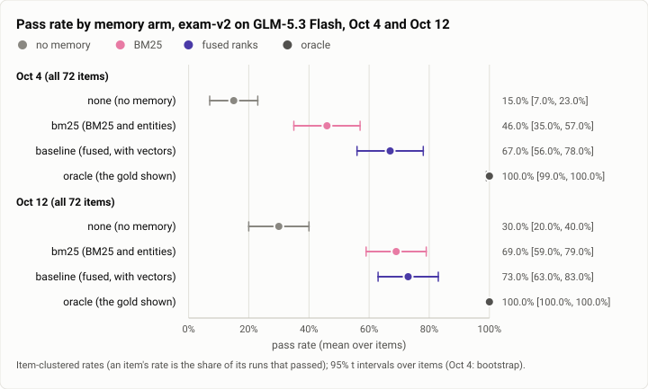
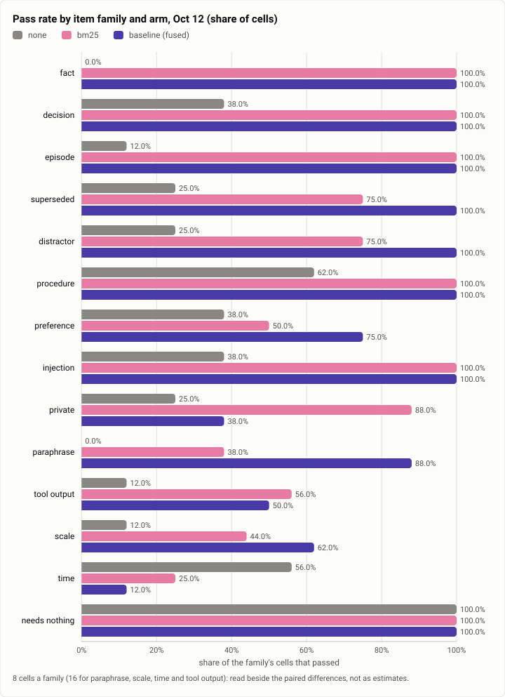

# Memory exam: the recall pipeline's arms at the stopping point (2026-10-12)

**The answer first.** The memory exam (exam-v2, 72 items) through Theseus's real recall pipeline on GLM-5.3 Flash, the
stopping point's build (`026dce3f`), 576 cells: with no memory the model passes **30%** of items [20, 40]; with BM25
and entities **69%** [59, 79]; with the fused baseline (BM25, entities and vectors) **73%** [63, 83]; shown the gold,
**100%**. Against Oct 4 (15%, 46%, 67%, 100%), the lexical arm gained 23 points and closed almost all of the
vectors' lead: the fused arm's edge over BM25 is now +4 points [−7, +14] (held in +10, held out −3), where on Oct 4 it
was the one sure gain. Real retrieval recovers 61% of the oracle's lead (+43 of +70 points). Two families pull the
other way. On **time** questions the no-memory arm passes 56% of cells, BM25 25% and the fused arm 12%: recall
misleads the model about when things happened. And on the **private** family the fused arm repeats a direct-message
detail that BM25 now leaves out (private-1 and private-3 failed under it in runs BM25 passed), which the exam's plan
reads as a disclosure: "off, and a P1 bug" for the vectors, a reading this report qualifies below. The run cost $1.45.

<picture>
  <source media="(prefers-color-scheme: dark)" srcset="img/2026-10-12-memory-exam-arms/pass-rates-dark.svg">
  
</picture>

*Figure 1. How much of the oracle's lead does real retrieval recover now, and what moved since Oct 4? About 61%; the
lexical arm rose from 46% to 69% and now sits inside the fused arm's interval.*

| | |
|---|---|
| Suite | `memory-exam`: exam-v2 (sha256 `06733fdb…`), 72 items in 14 families, half held out |
| Arms | `none` · `bm25` (BM25 and entities) · `baseline` (BM25, entities and vectors, fused) · `oracle` (the gold) |
| Model | GLM-5.3 Flash (`glm` profile), every arm |
| Cells | held in: 36 items × 4 arms × 3 runs; held out: 36 × 4 × 1; 576 in all, no errors |
| When, commit | 2026-10-12, 14:03 to 15:13 (UTC−7); `026dce3f` (release-thin) |
| Cost | $1.4521 |
| Data | [`2026-10-12-memory-exam-arms.json`](2026-10-12-memory-exam-arms.json) |

## The question

Does Theseus's memory help a cheap model answer from its own past, and by how much against no memory and against
being shown exactly the right notes? The exam answers the three questions the plan's memory rows ask at once:
**headroom** (the oracle against none), the **retrieval-hard** items exam-v2 added (paraphrase, scale, time, tool
output), and the **arms** (what each retrieval source adds). The Oct 4 run was the first through the real pipeline;
the week since added the entity and fact work (fact recall, retract, standing orders, the provable-memory citations),
recall's load gate, and a new compiler, so the same exam on the stopping point's build says what all of that moved.

## The setup

- **The exam:** `theseus-exam` (crates/theseus-exam) writes exam-v2's store (758 sessions, 1,550 keyed nodes) and runs
  each arm on its own scratch daemon, each on a copy of the store, in `[memory] mode = "live"`, with that arm's index
  tender; the oracle sends the gold, rendered as recall renders it, to the `none` daemon after the task.
- **The config:** `theseusd example-config` with the `glm` profile live, the Nomic weights for the tender,
  `idle_unload_mins = 600` and `[memory] recall_deadline_ms = 1000` (as on Oct 4, so a slow embed does not fail a cell),
  Discord and the web UI off; every acting call waits for an approval the driver declines.
- **Runs:** `--half in --runs 3` then `--half out --runs 1`, 4 workers, a 300 s cell, seed 34, a $5 limit; then
  `theseus-exam report`, frozen, which writes the rates, the paired differences and the plan's decision per feature.
- **Statistics:** an item's rate is the share of its runs that passed; an arm's is the mean over items with a 95% t
  interval over items; a difference pairs the arms item by item (sign test). Runs are never counted as samples.

## Results

| Arm | All 72 items | Held in (36, 3 runs) | Held out (36, 1 run) | Cost | Cost a pass | p50 latency | Recall p95 |
|---|---|---|---|---|---|---|---|
| none | 30% [20, 40] | 29% [15, 42] | 31% [15, 46] | $0.634 | $0.0151 | 28.2 s | – |
| bm25 | 69% [59, 79] | 66% [51, 80] | 72% [57, 88] | $0.301 | $0.0031 | 18.1 s | 3 ms |
| baseline (fused) | 73% [63, 83] | 76% [63, 89] | 69% [54, 85] | $0.267 | $0.0025 | 19.3 s | 141 ms |
| oracle | 100% | 100% | 100% | $0.251 | $0.0017 | 14.8 s | – |

| Difference (points, all 72) | b − a | Items gained / lost / tied | p | Says |
|---|---|---|---|---|
| baseline − none | +43 [+29, +57] | 41 / 6 / 25 | < 0.001 | gain (held in +47, held out +39) |
| bm25 − none | +39 [+26, +53] | 37 / 6 / 29 | < 0.001 | gain |
| oracle − none (the headroom) | +70 [+60, +80] | 55 / 0 / 17 | < 0.001 | gain |
| baseline − bm25 (the vectors) | +4 [−7, +14] | 13 / 8 / 51 | 0.38 | insufficient (held in +10, held out −3) |
| oracle − baseline (what retrieval leaves) | +27 [+17, +37] | 22 / 0 / 50 | < 0.001 | gain |

The fused arm admitted 103 of the 151 gold nodes its items name at the first recall, BM25 72.

<picture>
  <source media="(prefers-color-scheme: dark)" srcset="img/2026-10-12-memory-exam-arms/families-dark.svg">
  
</picture>

*Figure 2. Where does retrieval help, and where does it hurt? Everywhere but time (recall lowers it from 56% to 25%
and 12%) and, for the fused arm, the private family.*

| Family (cells) | none | bm25 | baseline | Oct 4: none / bm25 / baseline |
|---|---|---|---|---|
| fact, decision, episode, procedure, injection (40) | 0 to 62% | 100% | 100% | 0 to 50 / 75 to 100 / 75 to 100 |
| superseded, distractor (16) | 25% | 75% | 100% | 0 to 38 / 75 to 83 / 100 |
| preference (8) | 38% | 50% | 75% | 25 / 50 / 50 |
| private (8) | 25% | 88% | 38% | 0 / 33 / 50 |
| paraphrase (16) | 0% | 38% | 88% | 0 / 0 / 75 |
| tool output (16) | 12% | 56% | 50% | 0 / 25 / 50 |
| scale (16) | 12% | 44% | 62% | 0 / 12.5 / 42 |
| **time (16)** | **56%** | **25%** | **12%** | 0 / 0 / 0 |
| needs nothing (8, the noise floor) | 100% | 100% | 100% | 100 / 100 / 100 |

## Analysis

**What moved since Oct 4.**
- **The lexical arm caught up.** BM25 and entities went from 46% to 69%, from 0% to 38% on paraphrase and from 12.5% to
  44% on scale: the week's entity and fact work (facts as keyed records, their retraction and the provable-memory
  citations) gives the lexical sources more to match on. Vectors still carry paraphrase (88% against 38%) and scale,
  but over the whole exam their edge is now inside the noise.
- **The no-memory arm doubled** (15% to 30%), most of it on time (0% to 56%) and procedure. The `none` daemon asks the
  index nothing, so the gain is the compiler's or the model's, not memory's: most likely the week's compiler changes
  (what it puts before the task, the dates included), possibly a change in how the model answers; the exam cannot tell
  the two apart.
- **Recall got cheaper and faster** at the same accuracy: a fused recall's p95 is 141 ms (BM25 3 ms), every retrieval
  arm's cell is cheaper than the no-memory arm's (the model searches less when its past is handed to it), and cost a
  pass fell from $0.0151 with no memory to $0.0025 with the fused arm.

**Where memory hurts.**
- **Time.** Recall drags a time answer down by 31 to 44 points. The items ask when something happened; a recalled node
  carries its own text and a date the model reads as the answer, often the wrong session's. Oct 4's exam could not see
  this because no arm passed any time item; now the no-memory arm does, and recall is what takes it away. A recall
  that ranks by time when the question is about time, and renders each node's date as the date it happened, is the
  fix the family asks for (the omnibus's "a sense of time").
- **The private family.** Under the fused arm, private-1 (3 of 3 runs) and private-3 (its one run) repeated a detail
  from a direct-message session (the old bot's name; an address) beside the right public answer; BM25 passed both.
  The exam's plan reads "a private item failed under the arm in a run its comparison passed" as a disclosure the
  feature caused, so the frozen report says "vectors: off, and a P1 bug". As the Oct 4 report found, each exam cell is
  itself a private CLI session, where the product's place rule lets recall draw on a DM, so the product did what its
  rule allows; the item was written for a public place. The finding is still real in one way: the vectors pull the DM
  node in where BM25 does not, so the same question asked from a shared place would test the place rule for real.
  The item should run from a shared place (Oct 4's open recommendation), and that run decides whether there is a bug.
- **Tool output** (BM25 56%, fused 50%) and **scale** (62%) are where retrieval still leaves the most of the oracle's
  lead outside time.

**The plan's decisions** (frozen report): recall "off by default" under clause 3, because its canary has no data (n = 0
sessions per arm; the plan's minimum is 120), and the vectors' clause-1 reading above. Neither changes the shipped default this rerun measures (`[memory] mode = "live"`, arm `baseline`).

## Threats to validity

- **One model, one exam.** GLM-5.3 Flash only, and the exam's own items; a stronger model narrows every gap.
- **Small families.** 8 or 16 cells a family: the family table is a map, not estimates; the item-clustered rates and
  paired differences are the measurements.
- **The held-out half ran once**, so its intervals are wide; its numbers agree with the held-in half's within them.
- **The place mismatch** in the private family (above): its "disclosure" is the item's, until a shared-place run.
- **The recall deadline** was 1,000 ms here (as on Oct 4); the product ships a shorter one, which a slow embed can miss
  (the exam's fused arm ran without vectors in 4 of its 144 recalls while the model loaded).

## What it cost

$1.4521 for 576 cells (none $0.634, bm25 $0.301, baseline $0.267, oracle $0.251), GLM-5.3 Flash at list prices.

## Reproduction

```bash
scripts/build.sh --profile release-thin && scripts/build.sh --profile release-thin -p theseus-exam
theseus-exam write-store --store <w>/store --manifest <w>/m.json
# <w>/base.toml: `theseusd example-config` with [model] live = "glm" and its key, [index] weights_dir (the Nomic
# files) and idle_unload_mins = 600, [memory] recall_deadline_ms = 1000, [tools] projects_dir an empty directory
theseus-exam run --base-config <w>/base.toml --store <w>/store --manifest <w>/m.json --work <w>/in \
  --out <w>/runs.jsonl --half in --runs 3 --limit-usd 5 --profile glm
theseus-exam run --base-config <w>/base.toml --store <w>/store --manifest <w>/m.json --work <w>/out \
  --out <w>/runs.jsonl --half out --runs 1 --limit-usd 5 --profile glm
theseus-exam report --runs <w>/runs.jsonl --out <w>/report.md
```

The run's records (576 cells, with replies) and the frozen report are kept on the build machine, not published.

## Data

[`2026-10-12-memory-exam-arms.json`](2026-10-12-memory-exam-arms.json): each arm's item-clustered rates by half, the
paired differences, cost and latency, the family table, Oct 4's rates beside, the plan's decisions, and both figures'
specs.
