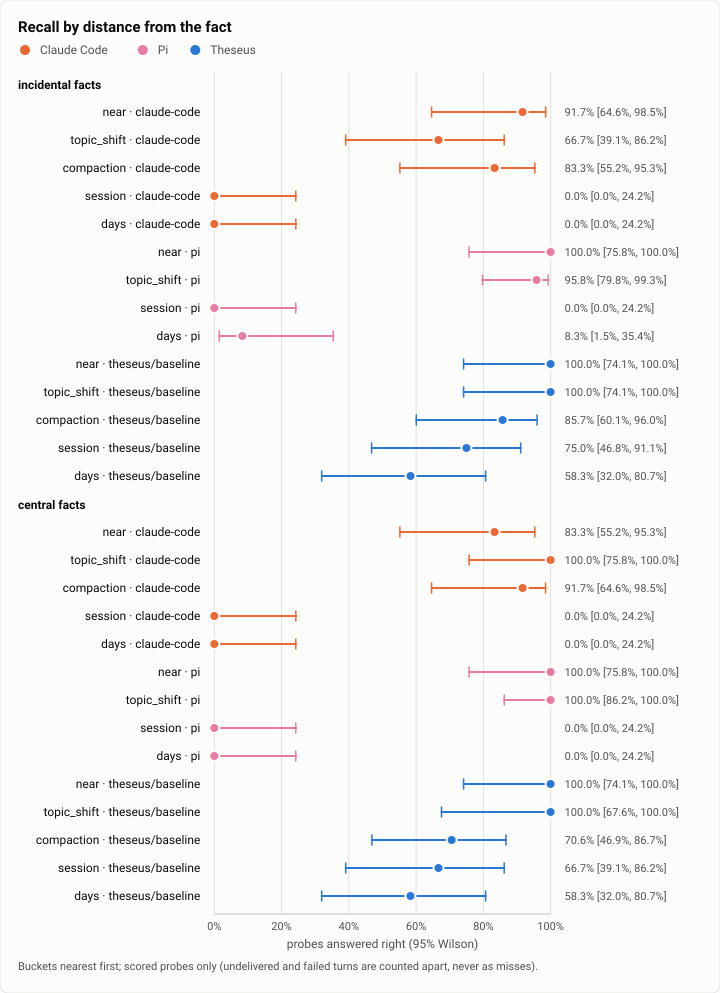

# Recall: the recall bench's first full run, Theseus against Claude Code and Pi over 600 turns (2026-10-12)

**The answer first.** Over one scripted progression of 600 turns (three sessions, the third nine days after the
second; 228 facts, 204 probes), Theseus with its memory (arm `baseline`, the stopping point's build `026dce3f`)
answered **73.6%** of the recall probes right [65.9, 80.1], Pi 1.0.4 56.9% [48.8, 64.7] and Claude Code 2.1.296 50.7%
[42.6, 58.7] (all on Claude Sonnet 5.5 at effort medium). Paired on the same probes Theseus was right where Claude Code
was wrong 40 times and the reverse 7 (exact McNemar p < 0.0001; against Pi 32 and 8, p = 0.0002). **All of that lead
is across sessions:** within a session the three arms recall alike (Theseus 75 of 96, Claude Code 73, Pi 81); in a
later session or days later Theseus answered 31 of 48 and the others 0 or 1, since neither carries anything from one
session to the next. Theseus's recall had not fallen to half its nearest bucket's by the end (its half-life was not
reached; Claude Code's 143 turns, Pi's 130). Theseus is worse at **abstaining**: asked about something never said,
beside a same-kind distractor, it gave a value instead of "I don't know" in 35 of 60 (Claude Code 22, Pi 24;
paired p = 0.01). It cost the most per turn ($0.026, Pi $0.015, Claude Code $0.009): its system prompt and tools
are 15,835 tokens against Pi's 2,431, and it compacted 13 times to Claude Code's 3. The run cost $30.09.

| | |
|---|---|
| Suite | the incidental-recall bench (`bench/recall`), size `full`, seed 7 |
| Arms | Theseus `026dce3f`, memory arm `baseline`; Claude Code 2.1.296 (compacting at the progression's marks); Pi 1.0.4 |
| Model | Claude Sonnet 5.5, effort medium, every arm |
| Progression | 600 turns in 3 sessions (two on one day, the third nine days later), 228 facts, 204 probes, a 96,000-token window planned at Theseus's measured overhead (15,835 tokens); digest `2d29cb78…` |
| When | 2026-10-12, 14:40 to 15:25 (UTC−7), the three arms side by side, each in a throwaway container |
| Cost | $30.09 (Theseus $15.81, Pi $8.73, Claude Code $5.55) |
| Scoring | stale rule `strict` |
| Data | [`2026-10-12-recall-full-run.json`](2026-10-12-recall-full-run.json), [`2026-10-12-recall-full-run.csv`](2026-10-12-recall-full-run.csv) |

## The question

Does an agent remember what it learned in its own work: a port printed once in a script's output, a decision
mentioned in passing, the topic of a morning, and does it say "I don't know" about what was never said? The memory exam
measures Theseus's memory alone from written stores; this bench drives each harness live through its own CLI on the
same 600 turns, so the harnesses compare. Three smokes ran on Oct 5 (8 probes each, Theseus only); this is the first
full run and the first with the Claude Code and Pi arms live.

## The setup

- **The progression** (`bench/recall/generate.py`, seed 7, `full`): three sessions of 200 turns, ten topic blocks
  each, facts said once in passing (in a script's output, an error, an aside) or as the topic of the moment, each
  probed once at a planned distance: near, after a topic shift, after a compaction, in a later session, days later, and
  after it was superseded; abstention probes ask about a subject never said, near a same-kind distractor. The world
  moves on: a script that showed a value is rewritten before the next turn.
- **Theseus:** a scratch daemon of the release build with its index tender (the Nomic weights mounted), memory live on
  the `baseline` arm, the bench profile, effort medium, a $40 run limit; the driver first measured the daemon's system
  prompt and tools (15,835 tokens) and planned the progression's window and bulk reads at it.
- **Claude Code 2.1.296** (`claude -p --resume`, `/compact` after each mark) and **Pi 1.0.4** (`pi --print`, its own
  compaction at its threshold) replayed the same progression, each in its own container, effort medium.
- **Each arm** ran in a throwaway `python:3.12-slim` container as an unprivileged user, the key in its environment only.

## Results

| | claude-code | pi | theseus/baseline |
|---|---|---|---|
| Probes, scored / all | 204 / 204 | 204 / 204 | 204 / 204 |
| Recall accuracy | 50.7% | 56.9% | 73.6% |
| Abstention accuracy | 63.3% | 60.0% | 41.7% |
| Confident-wrong | 12 | 10 | 5 |
| Stale (of superseded) | 13 of 24 | 14 of 24 | 13 of 24 |
| Half-life, incidental (turns) | 142.9 | 130.4 | not reached |
| Dollars per probe | $0.009 (the scorer read $1.06: see Threats) | $0.017 | $0.028 |
| Undelivered / failed | 0 / 0 | 0 / 0 | 0 / 0 |
| System prompt and tools, measured / planned (tokens) | – | 2,431 / 2,431 | 15,835 / 15,835 |

<picture>
  <source media="(prefers-color-scheme: dark)" srcset="img/2026-10-12-recall-full-run/curve-dark.svg">
  
</picture>

*Figure 1. How fast does recall fall as the fact recedes, for each arm and salience? Alike within a session; at a later session or days later Theseus keeps 58 to 75% and the others fall to 0.*

## Analysis

**Where each arm wins.**

| | Theseus | Claude Code | Pi |
|---|---|---|---|
| Recall probes right (Wilson 95%) | 106 of 144 = 73.6% [65.9, 80.1] | 73 = 50.7% [42.6, 58.7] | 82 = 56.9% [48.8, 64.7] |
| Within a session (near, topic shift, compaction, supersession) | 75 of 96 | 73 of 96 | 81 of 96 |
| A later session, or days later | 31 of 48 | 0 of 48 | 1 of 48 |
| Abstention right | 25 of 60 = 41.7% [30.1, 54.3] | 38 = 63.3% [50.7, 74.4] | 36 = 60.0% [47.4, 71.4] |
| Confident and wrong | 5 | 12 | 10 |
| Compactions | 13 | 3 (at the marks) | none |

- **Memory across sessions is the whole difference.** Each harness opens a session on the progression's session
  boundaries as a person would; Claude Code's and Pi's new sessions start empty, so every later-session and days probe
  is a guess for them. Theseus's recall brings the earlier sessions' nodes back.
- **Within a session the harnesses are equal**, and Pi, which never compacted in a 96,000-token window and keeps its
  short system prompt, is best there (81 of 96). Theseus compacted 13 times, from turn 136 on and every 13 to 30 turns
  after turn 450, because its own prompt and tools take 15,835 tokens of the window and recall adds its pack to every
  turn; compaction is where it lost within-session facts (86% at the compaction bucket against Pi's never needing it).
- **Theseus says a value where it should abstain.** Its recall surfaces the same-kind distractor the abstention probe is
  built beside, and the model answers with it: 35 of 60 abstention probes got a value (paired against Claude Code: 18
  probes Claude Code abstained on and Theseus did not, 5 the reverse, p = 0.01). That is recall's precision problem, the
  same shape as the memory exam's time and private findings: what recall brings in, the model treats as an answer.
- **Superseded values:** every arm gave the old value in about half of the superseded probes (13, 13 and 14 of 24),
  so recall did not help Theseus with "the world moved on".
- **Cost.** Theseus $0.026 a turn against Pi's $0.015 and Claude Code's $0.009: a 15,835-token prompt cached per turn,
  recall's pack, and 13 compactions, each a summary call; Claude Code's small per-turn context (26,000 to 85,000 tokens
  of cache read) after each compaction kept it cheapest.

**What changed since the last comparable run** (Oct 5, three smokes of 8 probes on the Theseus arm): this is the first
full run and the first live run of the Claude Code and Pi arms; the smokes' four bench flaws (plan overage, strict
abstention, the retracted-stale rule, overhead margins) are fixed in the bench this run used.

## Threats to validity

- **Two bench bugs, found by this run and corrected here.** (1) The driver reads each Theseus session's history with
  one `theseus history --full SESSION`, which since cli-pages returns the newest 200 nodes; the sessions had 804 to
  1,002, so the driver counted only 152 of 228 facts delivered, and the scorer would have left 76 probes out as
  "undelivered". The run's saved store was served again and every node read page by page: all 228 facts were
  delivered, and every number here uses that delivery (the driver's own file is kept beside it). (2) The driver records
  Claude Code's `total_cost_usd` as each turn's cost, but `claude -p --resume` reports the session's running total, so
  the scorer's $1.06 a probe is the sum of running totals; the real cost is $0.0092 a probe (each turn's increase).
- **One progression, one seed.** 204 probes; the bucket × salience cells hold 3 to 12 probes each.
- **Different compaction regimes.** Claude Code compacted at the marks (its `/compact`), Pi at its own threshold (never
  reached), Theseus by its compiler; the scorer measures buckets by where each arm actually compacted.
- **Sessions are the harness's own boundaries.** The cross-session result measures memory that persists across
  sessions, which only Theseus has; a Claude Code user with a project memory file would close part of it.
- **The arms ran side by side** with the memory exam, F10 and the async bench on the host; latency per probe (3.5 to
  4.0 s) carries that load, recall does not.

## What it cost

$30.09: Theseus $15.81 (600 turns and its probe turn), Pi $8.73, Claude Code $5.55 (each session's final running total).

## Reproduction

```bash
python3 bench/recall/drive.py --arm theseus --memory-arm baseline --bin-dir target/release-thin \
  --model anthropic/claude-sonnet-5-5 --effort medium --seed 7 --size full --out <run>/rc-th --spend-limit 40
python3 bench/recall/drive.py --arm claude-code --model anthropic/claude-sonnet-5-5 --effort medium \
  --progression <run>/rc-th --out <run>/rc-cc
python3 bench/recall/drive.py --arm pi --model anthropic/claude-sonnet-5-5 --effort medium \
  --progression <run>/rc-th --out <run>/rc-pi
python3 bench/recall/score.py <run>/rc-th <run>/rc-cc <run>/rc-pi --out <scores>
python3 bench/report/draft.py recall --scores <scores>/scores.json --date 2026-10-12 --slug full-run
```

Each arm in a throwaway container (the bench's tools are not confined on a bare host). The run directories (every
turn's reply, the transcripts, the daemon's store) are kept on the build machine, not published.

## Data

[`2026-10-12-recall-full-run.json`](2026-10-12-recall-full-run.json): each arm's summary and curve, and the figures' specs; [`2026-10-12-recall-full-run.csv`](2026-10-12-recall-full-run.csv): one row per probe, no transcript.
