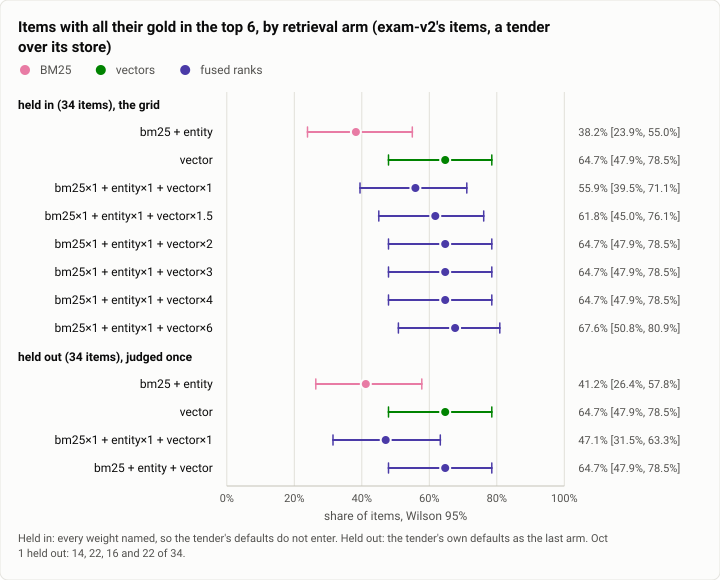

# Retrieval: BM25, entities, vectors and their fusion on the exam's items, at the stopping point (2026-10-12)

**The answer first.** Asked of a tender over exam-v2's store, the stopping point's index (`026dce3f`; candle 0.11,
nomic-embed-text-v1.5) ranks exactly as it did on Oct 1. Held out, vectors alone put all the gold in the top 6 for
**22 of 34 items** [48%, 79%], BM25 and entities for 14, equal-weight fusion for 16, and the tender's own defaults
(vectors weighted 6) for 22: the same four numbers as the Oct 1 report's. Held in, the grid's best is still the vector
weight 6 (23 of 34). What did change is the query's speed: a warm query embedding takes **183 ms** (p50, the client's
wall), against 351 to 364 ms an embed on Oct 1, and a whole k = 40 query 100 ms, so a recall query now fits recall's
250 ms deadline where on Oct 1 it could not. Read beside the memory exam of the same day: BM25's pass rate rose from
46% to 69% while its ranking did not move, so that gain came after retrieval, in what recall packs and how the
compiler renders it.

<picture>
  <source media="(prefers-color-scheme: dark)" srcset="img/2026-10-12-retrieval-fusion/top6-dark.svg">
  
</picture>

*Figure 1. Which retrieval arm finds the gold, and did anything move since Oct 1? Vectors and vector-weighted fusion
(22 to 23 of 34); nothing moved: the held-out counts are Oct 1's.*

| | |
|---|---|
| Suite | `retrieval`: `theseus-exam probe` over exam-v2's items with gold (34 held in, 34 held out), k = 100 |
| Arms | BM25 + entities · vectors · fusion at vector weights 1, 1.5, 2, 3, 4 and 6 (held in) · the tender's defaults (held out) |
| Index | `theseus-index` of `026dce3f`: 1,584 nodes, 1,584 chunks, 1,584 vectors, hybrid mode |
| When | 2026-10-12, 15:13 to 15:17 (UTC−7) |
| Cost | $0 (no model) |
| Data | [`2026-10-12-retrieval-fusion.json`](2026-10-12-retrieval-fusion.json) |

## The question

Did the week's changes to the index (recall's query pool and load gate, the entity and fact work) move how well each
source ranks the gold, and is a recall query now inside its deadline? The Oct 1 fusion report chose the vector weight
by a rule written first, on the held-in half, and judged it once on the held-out half; this reruns both halves as
written.

## The setup

`theseus-exam write-store` wrote exam-v2's store (the memory exam's, the same day), `theseus-index serve` built an index
over it with the Nomic weights on one thread, and `theseus-exam probe` asked the tender each item's question under
each arm (every weight named on the held-in grid; the tender's defaults as the held-out's last arm), counting the
items whose gold all ranks at or above k. Then twenty warm calls each of `theseus-index embed --task search_query`
and `theseus-index query` (k = 40), one process a call, timed at the client.

## Results

| Arm | Held in, all gold @6 | Held out, @6 | Oct 1, held out @6 |
|---|---|---|---|
| BM25 + entities | 13 of 34 | 14 of 34 | 14 |
| vectors | 22 | 22 | 22 |
| fusion 1 : 1 : 1 | 19 | 16 | 16 |
| fusion, vectors × 1.5 / 2 / 3 / 4 | 21 / 22 / 22 / 22 | – | – |
| fusion, vectors × 6 (the tender's default) | 23 | 22 | 22 |

By family (held out, @6): every arm finds the gold for procedure, private and distractor items; vectors carry
paraphrase (3 of 4 against BM25's 0) and scale (2 of 4); **no arm puts a time item's gold in the top 6** (one at @20).

| Timing (warm, 20 calls, client wall) | p50 | p90 | min | max |
|---|---|---|---|---|
| `embed --task search_query` (one short query) | 183 ms | 207 ms | 137 ms | 218 ms |
| `query`, k = 40 (BM25, entities and vectors fused) | 100 ms | 109 ms | 79 ms | 114 ms |

## Analysis

- **Ranking is unchanged**, to the item, on the held-out half. The week's index changes were about when and how fast
  a query runs (a pool of four threads, a load gate), not what it ranks.
- **Speed is the change.** An embedding is about twice as fast as Oct 1's single-thread figure, and a fused query
  answers in 100 ms, inside recall's 250 ms; the memory exam's fused recall p95 was 141 ms.
- **Time is retrieval's blind spot.** No arm ranks a time item's gold in the top 6, which is the ranking half of the
  memory exam's finding that recall hurts time questions: the right node is not found, and a wrong-dated one is.
- **The exam's BM25 gain is not here.** With ranking unchanged, the memory exam's +23 points for BM25 come from what
  recall does with what it ranks (its packing and admission, 72 of 151 gold nodes admitted) and the compiler.

**What changed since the last comparable runs** (Oct 1, the fusion and engine reports): the held-out counts are the
same; an embedding 351 to 364 ms → 183 ms (different measures: Oct 1 timed a 128-token chunk inside the engine, this
times a short query through the tender's socket, one process a call).

## Threats to validity

- **34 items a half**: every count here has an interval about 30 points wide.
- **One store and one exam**, written by the exam's generator; a real store is larger and noisier.
- **The timing** ran beside the memory exam's daemons, the recall bench's containers and the async bench (a 1-minute
  load of about 7), and counts a CLI process's start in each call.

## What it cost

Nothing: no model is called.

## Reproduction

```bash
cargo build --release -p theseus-index -p theseus-exam
theseus-exam write-store --store <state>/store --manifest <state>/manifest.json
theseus-index serve --store <state>/store --index <state>/index --weights-dir <weights dir> --threads 1 &
theseus-exam probe --tender <state>/index/sock --manifest <state>/manifest.json --half in --k 100 --items \
  --arm bm25,entity --arm vector --arm bm25:1,entity:1,vector:1 --arm bm25:1,entity:1,vector:1.5 \
  --arm bm25:1,entity:1,vector:2 --arm bm25:1,entity:1,vector:3 --arm bm25:1,entity:1,vector:4 \
  --arm bm25:1,entity:1,vector:6 --json grid-held-in.json
theseus-exam probe --tender <state>/index/sock --manifest <state>/manifest.json --half out --k 100 --items \
  --arm bm25,entity --arm vector --arm bm25:1,entity:1,vector:1 --arm bm25,entity,vector --json judge-held-out.json
theseus-index embed --socket <state>/index/sock --task search_query "a short query"
theseus-index query --socket <state>/index/sock --wait-ms 5000 --json "a short query"
```

## Data

[`2026-10-12-retrieval-fusion.json`](2026-10-12-retrieval-fusion.json): each arm's @6 counts on both halves, the
timings, Oct 1's held-out counts, and the figure's spec.
