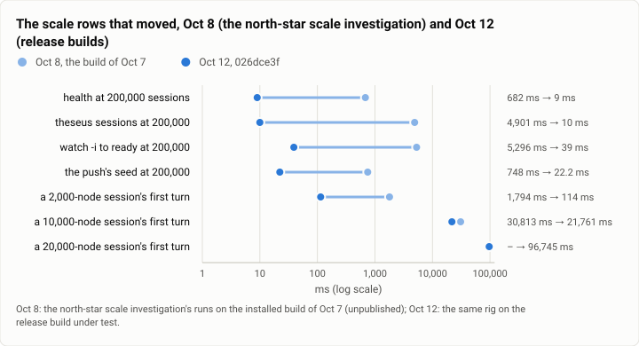
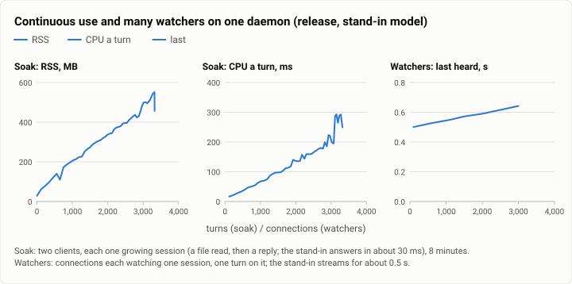

# Scale: the north-star's scale rows on the stopping point's release build (2026-10-12)

**The answer first.** The north-star scale investigation (Oct 8, on the build of Oct 7) found Theseus fast at 10× its
load in most rows but failing seven of them; on the stopping point's release build (`026dce3f`) four of those are
fixed outright and two are better without being fixed. At 200,000 parked sessions a `health` call takes 9 ms (682 on
Oct 8), `theseus sessions` 10 ms (4,901), `watch -i` is ready in 39 ms (5,296) and the push seeds its board in 22 ms
(748): the CLI and the push ask for a page now, not the whole list. One daemon served **3,000** watching connections,
every one hearing the reply 0.51 to 0.64 s after the turn started, where on Oct 8 it exited at 1,017 (`Too many open
files`). Turns waiting for admission now run in the order they came (55 of 3,160 pairs out of order at 80 at once,
against 1,313 on Oct 8). What did not move: **a long session's first turn after a start is still slow and grows
faster than its length**: 114 ms at 2,000 nodes (1.8 s on Oct 8), 21.8 s at 10,000 (30.8 s; the north-star's target
is under 1 s), and 96.7 s at 20,000 (on Oct 8 that bench failed). And **a session's turns cost more the longer it
grows**: in an 8-minute soak of two growing sessions, CPU a turn rose from 17 to about 290 ms and the daemon's memory
from 29 to 557 MB, about 150 MB per thousand turns, as on Oct 8; the last minute had 13 failed turns. A 200-job
burst launches in 30 s with every job running and the daemon answering health in 5 to 6 ms, as on Oct 8; its
completions still cost 37 ms of daemon CPU each.

<picture>
  <source media="(prefers-color-scheme: dark)" srcset="img/2026-10-12-scale/scale-then-now-dark.svg">
  
</picture>

*Figure 1. Which of the north-star's scale failures did the stopping point fix? The sessions axis (health, the list,
`watch`, the seed: 17 to 490 times faster); a long session's first turn improved but still takes 21.8 s at 10,000
nodes and 96.7 s at 20,000.*

| | |
|---|---|
| Suite | `gate-bench` (scale): the north-star scale investigation's rig, run again |
| Arms | Theseus, the release build (`release-thin`, glibc) of `026dce3f`, as scratch daemons; never the owner's |
| Model | a scripted stand-in on 127.0.0.1 (each rule's own timing: 2 s holds for admission, about 30 ms for the soak) |
| Runs | admission at 8, 16, 32 and 80 turns at once; watchers at 100 to 3,000 connections; a 50- and a 200-job burst; the sessions axis at 100,000 and 200,000; a 2,000-, 10,000- and 20,000-node session (5 turns each); an 8-minute soak |
| When | 2026-10-12, 13:42 to 13:59 (UTC−7) |
| Cost | $0 |
| Data | [`2026-10-12-scale.json`](2026-10-12-scale.json) |

## The question

The north-star plan's scale row asks that every speed row hold at ten times today's load:
200,000 sessions, many connections, bursts of jobs, long sessions, hours of use. On Oct 8 an investigation measured
that and found seven failures (the sessions axis's whole lists, the fd limit at 1,017 connections, superlinear job
completions with no cap, admission out of order, a 10,000-node session's 30.8 s first turn, turns that cost more as
a session grows, and memory that grows with use). The stopping point took the fixes it could (cli-pages, the turn
admission rows, the unit's limits); this run asks which of the seven are gone on the build the rerun measures.

## The setup

- **The rig** is the Oct 8 investigation's, copied and pointed at the frozen release binaries: a stand-in for the
  Messages API on 127.0.0.1 (one rule per experiment), and scratch daemons as transient user units with
  `Delegate=yes`, each on its own state dir and socket; the config has Discord, the web UI, the judge, the index and
  the language servers off and the policy open.
- **Admission:** M `theseus ask` turns started together (each a new session), the stand-in holding each call 2 s, then
  one more 0.5 s later (the "person"); the admission ceiling is the default 8.
- **Watchers:** N connections each `session.watch`ing one session, one turn on it, and the time each heard the reply's
  end; connections stay open as N grows (100, 600, 1,100, 1,500, 2,000, 3,000). The daemon's soft open-file limit was
  65,536.
- **Jobs:** a daemon with `proc_sync_secs = 1`; J turns each start a command that waits on a file, so every job runs at
  once; then the file appears and all end together.
- **The sessions axis:** `theseus-sim synth-store` at N parked sessions (730 MB of WAL at 200,000), a daemon on it, and
  each read timed as a person runs it.
- **Long sessions:** `theseus-sim bench turn --session-nodes N` (8 KB tool results), five turns in a session of N nodes
  written before the daemon starts; the first is the cold one.
- **Soak:** two clients, each one session, turns back to back (a file read, then a reply) for 8 minutes; every 10 s the
  daemon's RSS, CPU, threads, fds and the store's size.
- **Quiet:** the run waited for no compiling tree and no open join; the 1-minute load was 3 to 10 from other work.

## Results

**Admission** (the stand-in holds each call 2 s; the ceiling is 8):

| At once | All done | Turn wall p50 | Turn wall max | The person (0.5 s later) | Out of order | Daemon RSS peak | Daemon CPU |
|---|---|---|---|---|---|---|---|
| 8 | 4.47 s | 2.25 s | 2.25 s | 3.93 s, 9th of 9 | 1 of 28 pairs | 47 MB | 80 ms |
| 16 | 6.71 s | 4.44 s | 4.47 s | 6.13 s, 17th of 17 | 3 of 120 | 54 MB | 130 ms |
| 32 | 11.15 s | 6.61 s | 8.88 s | 10.48 s, 33rd of 33 | 8 of 496 | 59 MB | 270 ms |
| 80 | 24.69 s | 13.43 s | 22.29 s | 23.76 s, 81st of 81 | 55 of 3,160 | 67 MB | 690 ms |

**Watchers** (one turn, each connection watching its session):

| Connections | Heard | First / median / last | Daemon CPU for the turn | Daemon RSS | Daemon fds |
|---|---|---|---|---|---|
| 100 | 100 | 0.499 / 0.500 / 0.501 s | 30 ms | 41 MB | 115 |
| 600 | 600 | 0.506 / 0.515 / 0.527 s | 100 ms | 51 MB | 615 |
| 1,100 | 1,100 | 0.505 / 0.527 / 0.549 s | 160 ms | 63 MB | 1,115 |
| 1,500 | 1,500 | 0.506 / 0.541 / 0.572 s | 220 ms | 72 MB | 1,515 |
| 2,000 | 2,000 | 0.512 / 0.552 / 0.590 s | 280 ms | 84 MB | 2,015 |
| 3,000 | 3,000 | 0.514 / 0.584 / 0.642 s | 430 ms | 104 MB | 3,015 |

About 7 KB of daemon memory and 0.14 ms of its CPU per watcher. The daemon answered health after every level.

**A job burst** (J commands running at once, then ending together):

| J | Launch | Daemon CPU to launch | Processes in the unit | A wrapper's private memory | Health while running | Settled after the end | Daemon CPU for the completions |
|---|---|---|---|---|---|---|---|
| 50 | 8.3 s | 0.64 s (12.8 ms a job) | 151 | 1.86 MB | 3.5 to 4.7 ms | 6.1 s | 1.01 s (20 ms each) |
| 200 | 30.1 s | 3.25 s (16.3 ms a job) | 601 | 1.86 MB | 5.1 to 6.1 ms | 6.1 s | 7.43 s (37 ms each) |

**The sessions axis:**

| | 100,000 sessions | 200,000 sessions | Oct 8, 200,000 |
|---|---|---|---|
| the synthetic store | 365 MB of WAL | 730 MB, written in 31 s | 730 MB |
| start to serving (the daemon's clock) | 21.3 ms | 16.4 ms | 20.0 ms |
| RSS after the start | 93 MB | 94 MB | 276 MB |
| `health` | 9 ms | 9 ms | 682 ms |
| `theseus sessions` (the CLI's list) | 6 ms, 5.8 KB | 10 ms, 5.9 KB | 4,901 ms, 22 MB |
| `session.list {n: 50}` | 9 ms | 9 ms | 6 ms |
| `session.list {}` (the whole list, raw) | 4,280 ms, 79 MB | 6,013 ms, 157 MB | 5,828 ms, 153 MB |
| `watch -i` to a ready prompt | 51 ms | 39 ms | 5,296 ms |
| the push's seed | 33.5 ms (board 1,000) | 22.2 ms (board 1,000) | 747.5 ms (board 200,000) |
| RSS at the end | 1,266 MB | 61 MB after the raw lists' 3,745 MB was freed | 5,645 MB |

**Long sessions** (five turns each; the first is the session's first after the daemon's start):

| Nodes | WAL | First turn | Later turns, p50 | Oct 8, first turn |
|---|---|---|---|---|
| 2,000 | 4.5 MB | 114 ms | 78 ms | 1,794 ms |
| 10,000 | 22.6 MB | 21,761 ms | 104 ms | 30,813 ms |
| 20,000 | 45.2 MB | 96,745 ms | 123 ms | failed (os error 11) |

**Soak** (two growing sessions, 8 minutes, 3,324 turns):

<picture>
  <source media="(prefers-color-scheme: dark)" srcset="img/2026-10-12-scale/soak-and-watchers-dark.svg">
  
</picture>

*Figure 2. What grows with use, and how many watchers can one daemon serve? Memory and CPU a turn grow in step with
the sessions' length; the watchers' last reply grows by 0.14 s from 100 to 3,000 connections.*

| Minute | Turns so far | Turns that minute | CPU a turn | RSS | Store |
|---|---|---|---|---|---|
| 1 | 650 | 650 | 17 to 30 ms | 110 MB | 39 MB |
| 3 | 1,650 | 459 | about 90 ms | 297 MB | 124 MB |
| 5 | 2,422 | 368 | about 150 ms | 392 MB | 153 MB |
| 8 | 3,322 | 250 | about 280 ms | 552 MB (peak 557) | 259 MB at the end |

13 turns failed in the last minute (the client's own wait, at about 1,650 turns a session); none before.

## Analysis

**Fixed since Oct 8.**
- **The sessions axis.** Every person-facing read at 200,000 sessions is now a page: `health`, the CLI's list,
  `watch -i` and the push's board each answer in 9 to 39 ms (cli-pages, theseus-0jet's daemon side, and the board's
  1,000-row cap). The daemon no longer holds 5.6 GB at the end of the run.
- **The fd limit.** 3,000 watchers on one daemon, where Oct 8's died at 1,017 (its soft limit was 1,024 and the accept
  loop exited on EMFILE). The daemon now raises its own soft open-file limit to the hard one at start
  (`conns::raise_nofile`), so even a transient unit with the system's default soft limit reads 65,536.
- **Admission order.** Turns waiting for a slot now run first come, first served (1.7% of pairs out of order at 80, a
  few milliseconds' race at submission, against 42%). The person who asked last finishes last, as order requires;
  Oct 8's person sometimes jumped the queue, and so did everyone else.
- **A small session's first turn.** 2,000 nodes now load in 114 ms, not 1.8 s.

**Not fixed.**
- **A long session's cold first turn is superlinear in its length.** 10,000 nodes 21.8 s, 20,000 nodes 96.7 s: twice
  the nodes, 4.4 times the wait. Later turns in the same session are 100 to 125 ms, so the cost is the first decode of
  the session after a start (Oct 8's investigation saw it decode 8,003 of 10,000 nodes), not the turn. A person
  resuming a months-long session after a restart waits minutes. The north-star row ("under 1 s") is open.
- **A turn costs more as its session grows.** The soak's CPU a turn rose linearly with the session's length (17 ms at
  about 60 turns a session, about 280 ms at 1,650), so a session's total cost is quadratic in its turns, and the
  throughput fell from 650 to 250 turns a minute. Memory grew about 150 MB per thousand turns and did not come back
  between turns. Oct 8 measured the same slope (102 to 304 MB over 1,472 turns).
- **Job completions** still cost the daemon 20 ms each at 50 and 37 ms each at 200: superlinear, as on Oct 8 (22 and
  39 ms). Launching got cheaper (16.3 ms a job against 23.6).
- **The raw whole list** (`session.list` with no page) is still 6 s and 157 MB at 200,000, and the daemon's RSS rose
  to 3.7 GB while it answered; nothing the person's surfaces call asks for it any more, but any client can.

**What changed since the last comparable run** (Oct 8, the north-star scale investigation; its report is not
published): the four fixes above; the long session's first turn 1.8 s to 114 ms at 2,000 nodes and 30.8 to 21.8 s at
10,000; job launch 23.6 to 16.3 ms a job; everything else within its noise.

## Threats to validity

- **The rig is not the repository's.** It is the Oct 8 investigation's scripts, copied and pointed at the release
  build; two needed fixes this run, both in the rig: the job burst's turns must run inside the workspace root (since Oct
  8 a command outside the roots asks for approval even under an open policy, so every launch parked), and the
  watchers' client used `select()`, which cannot take a descriptor above 1,023 (it now uses epoll). Both were run
  again after the fix; the first, invalid attempts are kept on the build machine.
- **The admission run's state dir** carried 140 parked sessions from an aborted first attempt (the stand-in's script
  was the wrong one); the daemon had no queue, so nothing waited on them.
- **A stand-in model**: each turn's model time is fixed by its rule, so every number here is the daemon's own cost.
- **One machine, shared**, at a 1-minute load of 3 to 10 from work that was not compiling; the soak's throughput and
  CPU a turn read the daemon's own clock and `/proc`.
- **Oct 8's numbers** came from the build installed then, on the same rig; its report is the investigation's own,
  kept on the build machine.

## What it cost

Nothing: every model call went to the stand-in.

## Reproduction

```bash
scripts/build.sh --profile release-thin
theseus-sim synth-store --dir <state>/store --sessions 200000              # the sessions axis
theseus-sim bench turn --theseusd target/release-thin/theseusd --session-nodes 10000 --runs 5 --burst 0
```

The admission, watcher, job-burst and soak drivers are the north-star investigation's rig (a stand-in for the Messages
API, a scratch daemon per step as a user unit, and one small Python driver per row); they and every run's records are
kept on the build machine, not published.

## Data

[`2026-10-12-scale.json`](2026-10-12-scale.json): each row's records (admission per level, watchers per level, both
job bursts, the soak's samples, the sessions axis's readings and the long sessions' turns) and both figures' specs.
