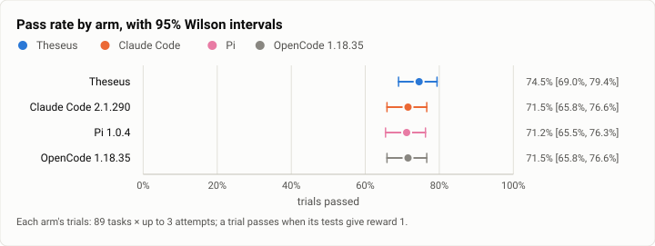
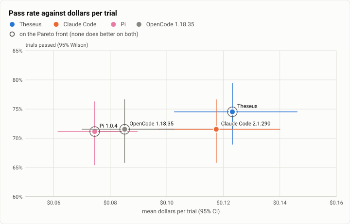
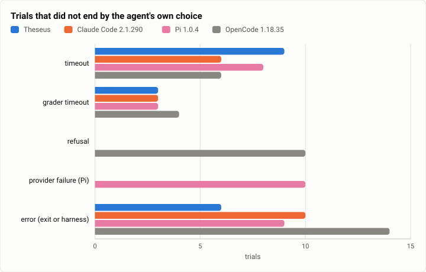
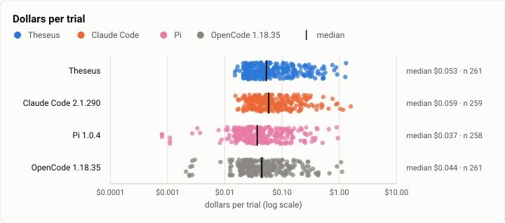
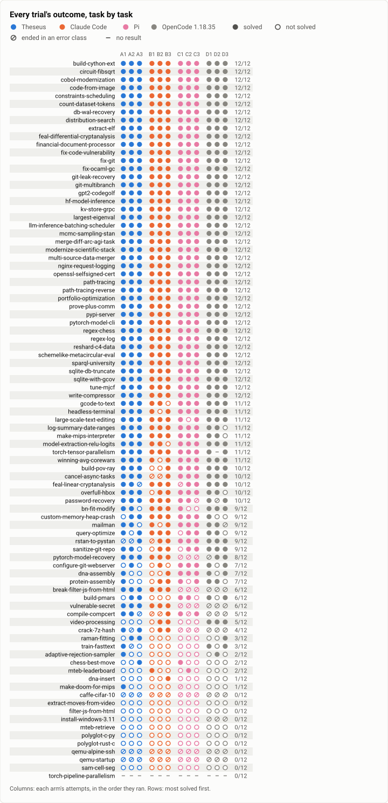
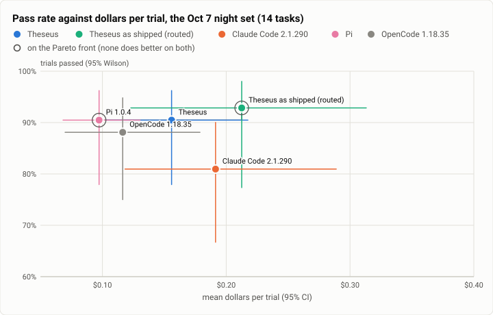
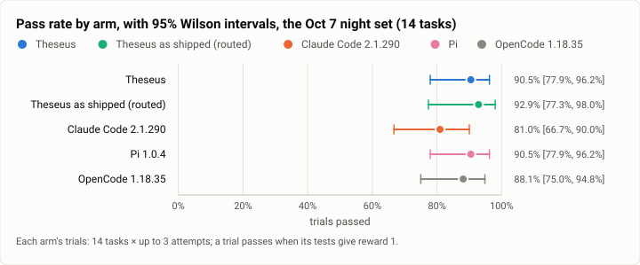
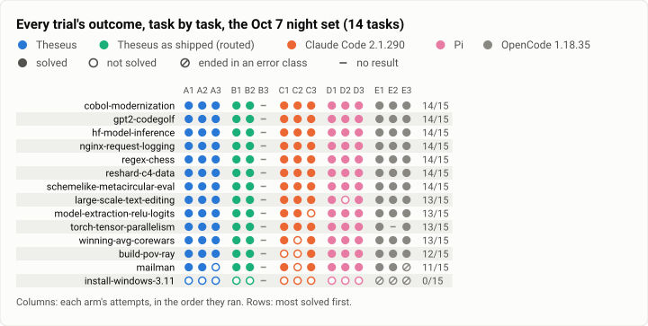

# Terminal-Bench 2.0: four harnesses on all 89 tasks, and Theseus as shipped on the night set (2026-10-13)

**The answer first.** On all 89 tasks of Terminal-Bench 2.0, three attempts each, every arm on Claude Sonnet 5.5 at
medium effort, the four harnesses solved nearly the same share: **Theseus 74.5%** (199 of 267; Wilson 95% 69.0% to
79.4%), Claude Code 2.1.290 71.5%, OpenCode 1.18.35 71.5% and Pi 1.0.4 71.2%. Paired by task, Theseus's lead over
each is about 3 points with an interval that crosses zero (over Pi +3.4, −1.9 to +9.0; over OpenCode +3.0, −2.6 to
+8.6). Over Pi and OpenCode, all of that lead is one harness feature: on four security-flavoured tasks Sonnet 5.5 refused, and Theseus and
Claude Code went on with another model while Pi and OpenCode stopped, 10 trials each. The dollars split the arms
where the score does not: **Pi $0.072 a trial and OpenCode $0.084, Theseus $0.120 and Claude Code $0.115**, the gap
being what each call carries (Theseus reads 25k cached tokens a call, Pi 10k) times how many calls it makes. On the
Oct 7 night set (14 tasks), **Theseus as shipped**, Jev choosing the model per message, solved **26 of 28** (92.9%;
77.4% to 98.0%) at **$0.21 a trial**, against $0.56 on Oct 10: its table now sends deep coding to Sonnet 5.5 at high
effort instead of Opus. The fixed-model Theseus solved 38 of 42 there at $0.16, level with Pi (38) at $0.10, and Claude
Code 34 at $0.19.

| | |
|---|---|
| Suite | Terminal-Bench 2.0 (`terminal-bench@2.0`) through Harbor 0.23 |
| Arms | **Theseus** `026dce3f` (the bench profile) · **Claude Code 2.1.290** · **Pi 1.0.4** · **OpenCode 1.18.35**, all on Claude Sonnet 5.5 at medium effort; **Theseus as shipped** (`theseus_agent:TheseusRouted`, Jev routing) on the night set |
| Trials | 89 × 3 an arm (1,068), and the night set's 14 × 2 for the routed arm (28) |
| Date and commit | 2026-10-13 (UTC−7), on EC2; Theseus built at `026dce3f` (install #25) |
| Cost | Pi $19.23, OpenCode $22.43, the routed arm $5.90 (this item, $47.56); Theseus's and Claude Code's arms are [R0](2026-10-13-terminal-bench-r0.md)'s |
| Data | [`2026-10-13-terminal-bench-harness-arms.json`](2026-10-13-terminal-bench-harness-arms.json), [`.csv`](2026-10-13-terminal-bench-harness-arms.csv) (one row per trial; the routed arm's rows last, arm `theseus-routed`) |

## The question

Where does Theseus sit among the agent harnesses that drive the same model, on the whole benchmark rather than the
14-task night set? On Oct 7's night set Pi and OpenCode solved the most (25 of 28 each) for the least ($0.15 to $0.16
a trial), Claude Code 23 at $0.21, and Theseus's arm was broken (its commands failed to start). The Oct 10 rerun
fixed that arm on the night set only, with its host overloaded. This run puts Pi and OpenCode beside R0's two arms on
all 89 tasks × 3, and runs Theseus as shipped (Jev picking each message's profile from the owner's routing table) on
the night set, where the frontier figure has its other points.

## The setup

- **Theseus** and **Claude Code 2.1.290**: R0's arms, the same trials ([R0](2026-10-13-terminal-bench-r0.md), its
  setup).
- **Pi 1.0.4** (`pi_agent:MeasuredPi`) and **OpenCode 1.18.35** (`opencode_agent:MeasuredOpenCode`): the adapters of
  Oct 7, pinned, effort medium (OpenCode's `medium` variant), `max_budget_usd=2.0`, `max_turns=200`.
- **Theseus as shipped** (`theseus_agent:TheseusRouted`, `bench/theseus-bench-routed.toml`): the judge on, Jev
  choosing a profile for each message from the routing table the owner set before the rerun (deep coding to
  Sonnet 5.5 at high effort, `sonnethi`, then Opus 5.5; design and "sophisticated" work to Opus then Fable; routine
  coding to Haiku 5.5 at high effort; Sonnet 5.5 at medium, the bench profile, when Jev's confidence is under the
  switch). Spend limit $20 a trial (the adapter's default for the routed arm), Jev's own cost added to the trial's.
  The night set's 14 tasks × 2 (`bench/plans/night-set-routed.json`).
- **Hosts and order** as R0: four EC2 m7a.8xlarge, each task's jobs for every arm on one host, in a fixed order per
  task; the plan files (`bench/plans/r0-harness-arms.json`, k = 3, and the night set's) committed before the run.
- **What changed since Oct 7 and Oct 10:** for Theseus, everything R0 lists (the spawn fix and its follow-ups, the
  shipped 60 s command wait, `cache-fix`, the stopping point's rows); the routing table (Opus for deep coding, Oct 10,
  became Sonnet 5.5 at high effort); the other arms are the same versions on the same adapters. The task set is now all
  89 tasks, not 14, and the hosts are EC2, not one loaded workstation.

## Results

| | Theseus | Claude Code 2.1.290 | Pi 1.0.4 | OpenCode 1.18.35 |
|---|---|---|---|---|
| Trials passed (95% Wilson) | 199/267 = **74.5%** [69.0%, 79.4%] | 191/267 = 71.5% [65.8%, 76.6%] | 190/267 = 71.2% [65.5%, 76.3%] | 191/267 = 71.5% [65.8%, 76.6%] |
| Theseus − arm, by task (95%) | – | +3.0 [−1.1, +7.5] | +3.4 [−1.9, +9.0] | +3.0 [−2.6, +8.6] |
| Tasks better for Theseus / for the arm | – | 14 / 9 (p = 0.40) | 11 / 7 (p = 0.48) | 14 / 9 (p = 0.40) |
| Tasks solved in every attempt / in any | 57 / 75 | 54 / 72 | 57 / 68 | 54 / 70 |
| Hard tasks (30) | 60/90 = 66.7% | 60/90 = 66.7% | 61/90 = 67.8% | 65/90 = 72.2% |
| **Dollars a trial** (the driver's count) | **$0.120** | **$0.115** | **$0.072** | **$0.084** |
| Dollars a trial, mean of priced trials (95%) | $0.123 [$0.103, $0.146] | $0.117 [$0.097, $0.140] | $0.075 [$0.061, $0.090] | $0.085 [$0.070, $0.100] |
| Model calls a trial | 9.4 | 7.6 | 6.7 | 6.4 |
| Cached prompt read a call | 25k tokens | 25k | 10k | 19k |
| Agent seconds a trial, median | 37 | 39 | 43 | 40 |
| Ended: timeout / grader timeout | 9 / 3 | 6 / 3 | 8 / 3 | 6 / 4 |
| Ended: Sonnet 5.5 refused, no fallback | 0 | 0 | 10 (`PiProviderError`) | 10 (`AgentSafetyRefusalError`) |
| Ended: error (exit or harness) | 6 | 10 | 9 | 14 |

<picture>
  <source media="(prefers-color-scheme: dark)" srcset="img/2026-10-13-terminal-bench-harness-arms/pass-rates-dark.svg">
  
</picture>

*Figure 1. Which arm solves the most trials, and do the intervals separate? Theseus solved 8 to 9 more trials than
each other arm; the four intervals overlap almost wholly. OpenCode is drawn in the neutral gray, named, as in the
earlier four-arm reports: the house palette has no slot of its own for it.*

<picture>
  <source media="(prefers-color-scheme: dark)" srcset="img/2026-10-13-terminal-bench-harness-arms/pareto-dollars-dark.svg">
  
</picture>

*Figure 2. Which arms buy the most passes for the least money? Pi, OpenCode and Theseus are on the front: Pi the
cheapest, Theseus the most solves at 1.7 times Pi's dollars; Claude Code is off it, since OpenCode solves as many
trials for less.*

<picture>
  <source media="(prefers-color-scheme: dark)" srcset="img/2026-10-13-terminal-bench-harness-arms/endings-dark.svg">
  
</picture>

*Figure 3. How does each arm's run end when it does not end on its own? Timeouts and grader timeouts are alike; Pi
and OpenCode each lose 10 trials to the model's refusals that Theseus and Claude Code carry on through.*

<picture>
  <source media="(prefers-color-scheme: dark)" srcset="img/2026-10-13-terminal-bench-harness-arms/cost-per-trial-dark.svg">
  
</picture>

*Figure 4. How are each arm's dollars spread? The medians say it plainly: Pi $0.037, OpenCode $0.044, Theseus $0.053,
Claude Code $0.059 a trial; the means are carried by the same long tasks in every arm.*

<picture>
  <source media="(prefers-color-scheme: dark)" srcset="img/2026-10-13-terminal-bench-harness-arms/outcomes-dark.svg">
  
</picture>

*Figure 5. Where do the arms differ, task by task? Mostly they agree; Pi and OpenCode's empty rows on
break-filter-js-from-html, crack-7z-hash and vulnerable-secret are the refusals.*

**T5 over the 151 pairs every arm solved:** dollars a solve $0.103 (Theseus), $0.104 (Claude Code), $0.073 (Pi),
$0.085 (OpenCode); model calls a solve 6.9, 6.3, 6.1, 6.3. **T4:** malformed inputs 1 (Theseus), 0, 0, 0; invented
names 2, 8, 0, 0. Trials with a tool-level error, 18% / 6% / 49% / 0%, do not compare across these arms: Pi flags a
command's non-zero exit as an error in a form the counter cannot tell from a tool's (most of its 237 are commands'
own failures and Python tracebacks), and OpenCode flags none.

### Theseus as shipped, on the Oct 7 night set

The 14 tasks of Oct 7's night run: the fixed-model arms' three R0 attempts on those tasks, and the routed arm's two.

| | Theseus as shipped (routed) | Theseus (fixed model) | Claude Code 2.1.290 | Pi 1.0.4 | OpenCode 1.18.35 |
|---|---|---|---|---|---|
| Trials passed (95% Wilson) | 26/28 = **92.9%** [77.4%, 98.0%] | 38/42 = 90.5% [77.9%, 96.2%] | 34/42 = 81.0% [66.7%, 90.0%] | 38/42 = 90.5% [77.9%, 96.2%] | 37/42 = 88.1% [75.0%, 94.8%] |
| Dollars a trial | **$0.21** | $0.16 | $0.19 | $0.10 | $0.12 |
| Model calls a trial | 10.3 | 9.7 | 9.3 | 7.3 | 6.7 |
| Oct 7 (2 attempts) | – | 20/28 at $0.36 (commands broken) | 23/28 at $0.21 | 25/28 at $0.15 | 25/28 at $0.16 |
| Oct 10 (2 attempts) | 25/28 at $0.56 (Opus for deep coding) | 20/28 at $0.21 (24 with host-hit reruns) | – | – | – |

<picture>
  <source media="(prefers-color-scheme: dark)" srcset="img/2026-10-13-terminal-bench-harness-arms/night-set-pareto-dollars-dark.svg">
  
</picture>

*Figure 6. On the night set, where does Theseus as shipped sit on the frontier? On the front at the top, with Pi at the
cheap end; routing costs a third more than the fixed model for no measurable gain here, where Oct 10's table cost
three and a half times as much.*

<picture>
  <source media="(prefers-color-scheme: dark)" srcset="img/2026-10-13-terminal-bench-harness-arms/night-set-pass-rates-dark.svg">
  
</picture>

*Figure 7. On the night set, do the arms separate? No: five arms between 81% and 93%, every interval overlapping.*

<picture>
  <source media="(prefers-color-scheme: dark)" srcset="img/2026-10-13-terminal-bench-harness-arms/night-set-outcomes-dark.svg">
  
</picture>

*Figure 8. Which night-set tasks does each arm lose? install-windows-3.11, every arm's every attempt; otherwise a
trial here and there, Claude Code's most on build-pov-ray and winning-avg-corewars.*

## Analysis

**The refusals are most of Theseus's lead over Pi and OpenCode.** On break-filter-js-from-html, crack-7z-hash,
vulnerable-secret and one password-recovery attempt, Sonnet 5.5 refused. Theseus and Claude Code finished those
trials on Sonnet 5 (9 and 10 trials; Theseus 8 of its 9 solved) where Pi ended with a provider error and OpenCode with
a refusal, 10 trials each, none solved. Without those four tasks Theseus, Pi and OpenCode are level (188, 188 and 189
of 255: 73.7% to 74.1%) and Claude Code 3 points behind (180). A refusal with a way forward is a real feature for a person whose work touches security (a fuzzer, a
password reset, a leaked key): Theseus gained it after Oct 4, when the same refusals ended its trials.

**Where the dollars go.** Every arm pays mostly for output and for reading its cached prompt. Theseus's and Claude
Code's calls each read about 25k cached tokens; OpenCode's 19k, Pi's 10k. Pi ships a short system prompt and few tool
schemas; Theseus's first request carries about 15.8k tokens of system prompt and tool schemas (the recall report's
census), and then it makes 9.4 calls a trial against Pi's 6.7. At list prices cache reads are 39% of Theseus's
dollars and 19% of Pi's. That is the whole of Pi's price advantage: output tokens a call are alike (631 to 713), and
so are the cached-prompt hit rates (89% to 96%). A lighter prompt (deferred tool schemas, a shorter system text) and
fewer round trips for background commands are what would close it, and both would help every user of Theseus on
every turn, not this benchmark alone.

**Theseus as shipped.** Jev sent 18 of the 28 trials (nine tasks) to `sonnethi`, Sonnet 5.5 at high effort, as deep
coding: 18 of 18 solved, $5.40. Six (build-pov-ray, hf-model-inference, nginx-request-logging) went to Haiku 5.5 at
high effort as routine coding: 6 of 6 solved for $0.07 in all, a third to a sixth of the fixed arm's dollars on the
same tasks. Four stayed on the bench profile (Sonnet 5.5 at medium) where Jev's confidence was under the switch
(install-windows-3.11, mailman): 2 of 4, the two losses being install-windows-3.11, which no arm solved. High effort
cost more on the coding tasks than the fixed arm's medium (cobol-modernization $0.19 against $0.05 a trial,
gpt2-codegolf $0.39 against $0.19, regex-chess $0.77 against $0.57, winning-avg-corewars $0.33 against $0.19) and
bought nothing measurable: the fixed arm solved those same tasks every time too. Net, $0.21 a trial against $0.16. On
Oct 10, with Opus at high effort for deep coding, the same arm cost $0.56 for 25 of 28: the owner's change to
`sonnethi` cut it by 62% with no solve lost. The night set is too easy to show what high effort is for: 13 of its 14
tasks are solved by nearly every arm at medium.

**Against Oct 7.** On the same 14 tasks, the fixed-model Theseus went from 20 of 28 at $0.36 (commands refused) to 38
of 42 at $0.16, at Pi's pass rate and between OpenCode's and Claude Code's dollars. The other arms ran the same
versions on the same adapters; their rates here (Pi 90%, OpenCode 88%, Claude Code 81%) match their Oct 7 rates
(89%, 89%, 82%), so the night set itself did not get easier between the two runs.

## Threats to validity

- **One trial was cut and run again.** At 16:42:26 an operator's idle-stop of the second host, meant for an idle lane
  host, stopped it with its last jobs running: OpenCode's `train-fasttext` trial `C2HTQhg`, 35 minutes into its agent
  run, ended with no reward. It is not counted: the trial ran again alone on the same host (reward 1.0, $0.31) and
  takes its place; the cut trial's files are kept apart with a note. The job's other two trials and Theseus's
  `train-fasttext` job had finished before the stop.
- **The host changed** from Oct 7's workstation to EC2; [R0](2026-10-13-terminal-bench-r0.md) found the host change
  moved neither outcomes nor agent time on 77 jobs run on both. Pi's and OpenCode's night-set rates match Oct 7's.
- **Every arm failed the two qemu tasks' installs** (the adapters' `apt-get` met a Debian security archive newer than
  the images' package lists): 6 trials an arm, in every arm, counted as failures.
- **The grader timeouts** are `torch-pipeline-parallelism` (every arm, every attempt, on one host) and one OpenCode
  `torch-tensor-parallelism`: the task's grader, not the agents.
- **T4 does not compare across these harnesses** (above). T5's pairs are the 151 that all four solved, a narrower set
  than R0's 175.
- **The routed arm's dollars** for Haiku calls are Theseus's own catalog's list prices (the bench's table holds Sonnet
  5.5 only); Jev's own calls are added. Its two attempts against the fixed arms' three is a smaller sample.
- **OpenCode and Pi refuse with no fallback by design**, not by a bug of their adapters; their scores here are what a
  person using them on these tasks would get on Sonnet 5.5.

## What it cost

- **Dollars a trial at list prices:** Theseus $0.120, Claude Code $0.115, Pi $0.072, OpenCode $0.084 (89 × 3 each);
  Theseus as shipped $0.211 and the fixed Theseus $0.156 on the night set.
- **This item: $47.56** (Pi $19.23, OpenCode $22.43 including the rerun trial's $0.31, the routed arm $5.90 with Jev's
  calls). Theseus's and Claude Code's 89 × 3 are R0's $62.89.
- The EC2 hosts: about $0.05 a trial on top (the whole pass about $73.6, of which $41.3 NAT data).

## Reproduction

As [R0](2026-10-13-terminal-bench-r0.md), with the other arms' adapters:

```bash
export PYTHONPATH=$PWD/bench/harbor HARBOR_TELEMETRY=0     # and ANTHROPIC_API_KEY
for t in $TASKS; do
  for a in pi_agent:MeasuredPi opencode_agent:MeasuredOpenCode; do
    harbor run -d terminal-bench@2.0 -i $t -a $a -m anthropic/claude-sonnet-5-5 --ak max_budget_usd=2.0 \
      --ak max_turns=200 -k 3 -n 2 --agent-setup-timeout-multiplier 3.0 -o jobs --job-name ${t}__${a%%_*}__r0
  done
done
# Theseus as shipped on the night set (bench/plans/night-set-routed.json); Jev's key as TYPESAFE_API_KEY in harbor's env only
for t in $(python3 -c "import json;print(' '.join(json.load(open('bench/plans/night-set-routed.json'))['attempts']))"); do
  THESEUS_BENCH_SPEND_LIMIT=20.0 THESEUS_BENCH_PROC_SYNC=60 harbor run -d terminal-bench@2.0 -i $t \
    -a theseus_agent:TheseusRouted -m anthropic/claude-sonnet-5-5 -k 2 -n 2 --agent-setup-timeout-multiplier 3.0 \
    -o jobs --job-name ${t}__theseus-routed__ns
done
```

The report was drafted with `bench/report/draft.py harbor` over the four arms' jobs, and again over the night set's
jobs for its figures, which were folded into this report's data file; OpenCode's marks were drawn as the registry's
`other`.

## Data

[`2026-10-13-terminal-bench-harness-arms.json`](2026-10-13-terminal-bench-harness-arms.json) (the four arms' numbers,
the paired tests, every figure's spec, and the night set's numbers under `night_set`) and
[`2026-10-13-terminal-bench-harness-arms.csv`](2026-10-13-terminal-bench-harness-arms.csv) (the four arms' 1,068
trials, then the routed arm's 28). No transcripts.
