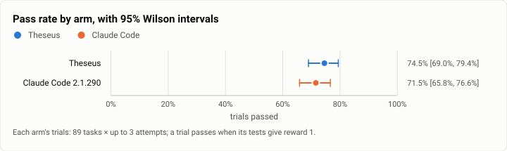
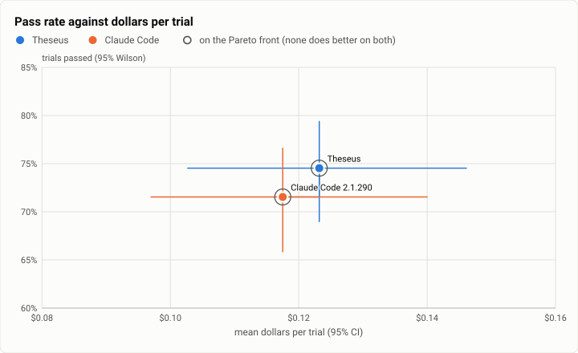
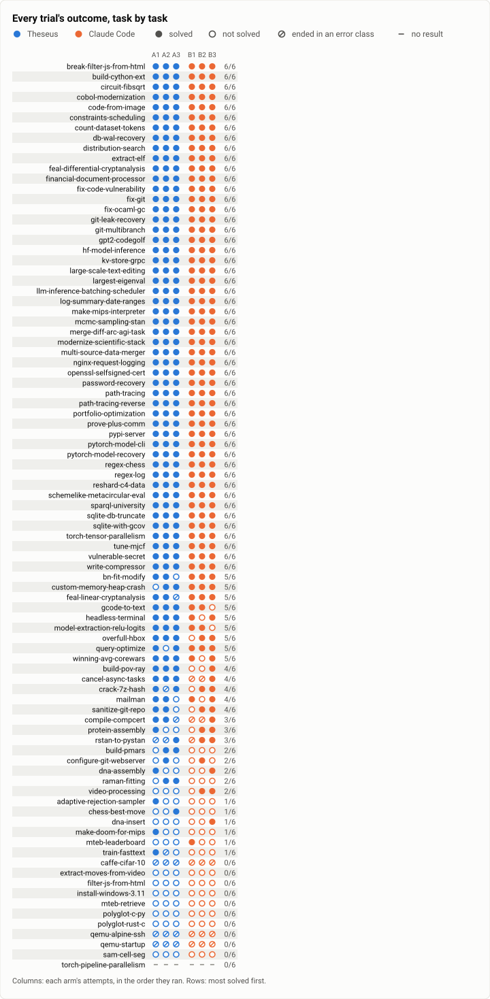
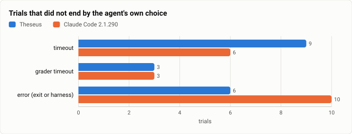
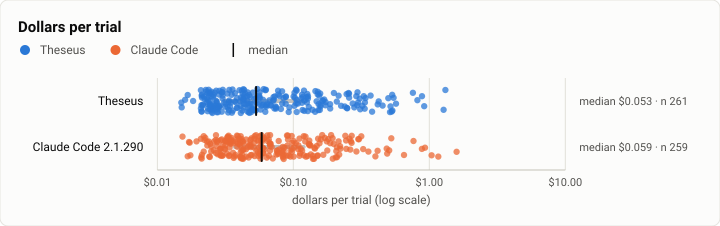

# Terminal-Bench 2.0 R0: Theseus against Claude Code on all 89 tasks, three attempts each, at the stopping point (2026-10-13)

**The answer first.** On all 89 tasks of Terminal-Bench 2.0, three attempts each, with Claude Sonnet 5.5 at medium
effort in both arms and the same limits, Theseus solved **74.5%** of its trials (199 of 267; Wilson 95% 69.0% to
79.4%) and Claude Code 2.1.290 **71.5%** (191 of 267; 65.8% to 76.6%). Paired by task, Theseus is **3.0 points ahead,
95% interval −1.1 to +7.5** (a bootstrap over tasks); it did better on 14 tasks and Claude Code on 9 (sign test
p = 0.40), so the lead is inside the noise, but the gap of Oct 4 (Claude Code 9.6 points ahead, p = 0.027) is gone.
On the 30 hard tasks the two are level (60 of 90 each). The dollars are level too: **$0.12 a trial** in both arms
($32.17 against $30.72 for 267 trials). What the tables don't show: the gap closed from both sides. Theseus gained
2.6 points over Oct 4 while thinking at medium effort where it then ran at the API's high default, the harness
faults of Oct 4 gone; Claude Code lost 9.9 points (worse on 22 tasks, better on 6, p = 0.004), most of it on the hard
tasks, at an effort now pinned to medium where Oct 4's was not recorded. And Theseus still pays for its prompt: it
makes 1.24 times Claude Code's model calls, and 18% of its trials carry a tool-level error against 6%, though most of
those are a background command's result reported twice, not a mistake.

| | |
|---|---|
| Suite | Terminal-Bench 2.0 (`terminal-bench@2.0`) through Harbor 0.23, 89 tasks, each in its own container |
| Arms | **Theseus** (`theseus_agent:Theseus`, the bench profile) · **Claude Code 2.1.290** (`claude_code_agent:MeasuredClaudeCode`, pinned) |
| Model | Claude Sonnet 5.5 (`anthropic/claude-sonnet-5-5`) at medium effort in both arms |
| Tasks × attempts | 89 × 3 an arm: 534 trials |
| Date and commit | 2026-10-13 09:41 to 17:19 (UTC−7), on EC2; Theseus built at `026dce3f` (install #25, the stopping point) |
| Cost | $62.89 at list prices (Theseus $32.17, Claude Code $30.72), plus the EC2 hosts (below) |
| Data | [`2026-10-13-terminal-bench-r0.json`](2026-10-13-terminal-bench-r0.json) (summary, paired tests, figures), [`.csv`](2026-10-13-terminal-bench-r0.csv) (one row per trial) |

## The question

Does Theseus, at the stopping point, solve as many Terminal-Bench tasks as Claude Code when both drive the same model
at the same effort under the same limits? The first full run ([Oct 4](2026-10-04-terminal-bench-first-full-run.md))
said no: Claude Code 81.5% against Theseus 71.9%, 16 tasks to 5, with most of Theseus's non-finishes on faults of its
harness. Every one of those faults has a fix joined since, along with the rows the stopping point gathered for this
run. R0 is the owed rerun: the same 89 tasks, now with three attempts, bench-fair settings (effort matched, Claude
Code pinned), on Theseus as it will ship. It is the interim measure of coding tests T1 and T2 (the parity line is
R1's, at five attempts: [R1](2026-10-13-terminal-bench-r1.md)) and of T4 and T5.

## The setup

- **Theseus**: `-a theseus_agent:Theseus` (`bench/harbor`), the static musl build of `026dce3f` (`bench/build.sh`,
  release-thin), the bench profile (`bench/theseus-bench.toml`): no vault, the key from the environment, every tool
  open, workspace roots at `/`, memory off (`[memory] mode = "off"`), effort medium. A command holds the turn for
  **60 s, the shipped default** (`THESEUS_BENCH_PROC_SYNC=60`; Oct 4 and Oct 10 ran the bench's 900 s), after which it
  continues as a job the model can wait on, read or stop. The spawn-ask follow is bounded by the task's agent timeout
  less 30 s (`THESEUS_BENCH_FOLLOW_FOR`). Spend limit $3.75 a trial (`THESEUS_BENCH_SPEND_LIMIT`: the $2.00 budget
  plus one call's reservation).
- **Claude Code 2.1.290** through the measured adapter (`claude_code_agent:MeasuredClaudeCode`), pinned, effort medium
  (`CLAUDE_CODE_EFFORT_LEVEL`, theseus-n6p5), `max_budget_usd=2.0`, `max_turns=200`.
- **What changed in Theseus since the last comparable run** (Oct 4 at `079f1db`; the Oct 10 night-set rerun at
  `2fd1f654`): the Oct 4 faults' fixes (refusal fallback, the output cap, approvals, provider-timeout retries, the stop),
  the spawn fix and its four follow-ups (terminals that keep their background processes, `term.read` waiting for its
  command, `fs.read` windows, `web.search` offered only with a key), and the stopping point's bench rows:
  `bench-parity`, `session-dir`, `project-context`, `output-kept`, `tool-input-fit`, `file-tools-polish`,
  `job-handles`, `subagent-wait`, `one-turn-compaction`, `proc-env` with `secrets-shapes`, `stop-nudge`, `money`,
  `cache-fix` and `parallel-calls`.
- **The host changed.** Oct 4 ran on one WSL2 workstation shared with builds. R0 ran on four EC2 m7a.8xlarge hosts (32
  vCPUs, 128 GiB, 1 TB gp3 each) in the project's own account, no public address, through Harbor's Docker
  environment. All of a task's jobs (every arm and attempt) ran on one host, so the paired comparisons never cross
  hosts. Up to 12 Harbor jobs at once on a host, each running its trials two at a time (`-n 2`); each task's container
  keeps the task's own CPU and memory caps.
- **Order.** For each task its image was pulled once, then its jobs in a fixed order (Theseus, Claude Code, then the
  other runs' arms); 41 tasks on the first host, 14 each on hosts 2 to 4, and the last 6 of the first host's share
  moved to the fourth host when it finished early. The plan file (`bench/plans/r0-sonnet-5-5.json`, k = 3) was
  committed before the run.

## Results

| | Theseus | Claude Code 2.1.290 |
|---|---|---|
| Trials passed (95% Wilson) | 199/267 = **74.5%** [69.0%, 79.4%] | 191/267 = **71.5%** [65.8%, 76.6%] |
| Tasks solved in every attempt / in any | 57 / 75 of 89 | 54 / 72 of 89 |
| Hard tasks (30): trials passed | 60/90 = 66.7% [56.4%, 75.6%] | 60/90 = 66.7% [56.4%, 75.6%] |
| Medium tasks (55) | 127/165 = 77.0% | 120/165 = 72.7% |
| Easy tasks (4) | 12/12 | 11/12 |
| Dollars a trial, mean (priced trials) | $0.123 [$0.103, $0.146] | $0.117 [$0.097, $0.140] |
| Dollars a trial, median | $0.053 | $0.059 |
| Dollars, total (the driver's count) | $32.17 | $30.72 |
| Agent minutes a trial, mean / median | 3.4 / 0.61 | 2.9 / 0.64 |
| Model calls a trial | 9.4 | 7.6 |
| Input read from the cache | 95.6% | 93.8% |
| Trials ending in: timeout | 9 | 6 |
| Trials ending in: grader timeout | 3 | 3 |
| Trials ending in: error (exit or harness) | 6 | 10 |

<picture>
  <source media="(prefers-color-scheme: dark)" srcset="img/2026-10-13-terminal-bench-r0/pass-rates-dark.svg">
  
</picture>

*Figure 1. Which arm solves the most trials, and do the intervals separate? Theseus solved 8 more trials than Claude
Code; the intervals overlap almost wholly, and the paired test agrees (p = 0.27 by trial, 0.40 by task).*

<picture>
  <source media="(prefers-color-scheme: dark)" srcset="img/2026-10-13-terminal-bench-r0/pareto-dollars-dark.svg">
  
</picture>

*Figure 2. Which arms buy the most passes for the least money? Neither: the two sit at the same dollars a trial, a
cent apart, with intervals that overlap on both axes.*

**Paired, by task and attempt.** 24 pairs passed only by Theseus, 16 only by Claude Code, 175 by both, 52 by neither
(exact McNemar p = 0.268). By task (each task's pass rate in each arm): Theseus − Claude Code = **+3.0 points, 95%
interval −1.1 to +7.5** (10,000 resamples of the 89 tasks, seed 20261013); Theseus better on 14 tasks, Claude Code on
9 (sign test p = 0.40). The one-sided 95% lower bound is −0.75 points, above T1's line of −5, at three attempts.
Hard tasks: 0.0 points (−7.8 to +7.8), 4 tasks each way. Tasks only Theseus solved in any attempt:
adaptive-rejection-sampler, build-pmars, chess-best-move, make-doom-for-mips, raman-fitting, train-fasttext; only
Claude Code: dna-insert, mteb-leaderboard, video-processing.

<picture>
  <source media="(prefers-color-scheme: dark)" srcset="img/2026-10-13-terminal-bench-r0/outcomes-dark.svg">
  
</picture>

*Figure 3. Where do the arms differ, task by task, and which tasks no arm solves? The two agree on most tasks; their
differences are spread over a score of tasks, a solve or two each, with build-pmars and build-pov-ray Theseus's
clearest and mteb-leaderboard Claude Code's.*

<picture>
  <source media="(prefers-color-scheme: dark)" srcset="img/2026-10-13-terminal-bench-r0/endings-dark.svg">
  
</picture>

*Figure 4. How does each arm's run end when it does not end on its own? Few trials: Theseus 18, Claude Code 19; the
errors are mostly the same two tasks' failed installs in both arms (below), and Theseus has three more agent timeouts.*

<picture>
  <source media="(prefers-color-scheme: dark)" srcset="img/2026-10-13-terminal-bench-r0/cost-per-trial-dark.svg">
  
</picture>

*Figure 5. How are each arm's dollars spread over its trials? Alike: half the trials cost under six cents in both arms,
and the means are carried by a tail of long tasks up to $1.31 (Theseus) and $1.59 (Claude Code); no trial of either
arm passed $2.00.*

**T4, tool friction.** Tool-level errors are results the tool flagged as errors, a command's own failure (its exit
code) left out (`bench/report/friction.py`).

| | Theseus | Claude Code 2.1.290 |
|---|---|---|
| Trials with a trajectory | 261 of 267 | 259 of 267 |
| Trials with at least one tool-level error | 47 (18.0%) | 16 (6.2%) |
| Tool-level errors, in all | 78 | 17 |
| Malformed inputs (trials) | 1 (1): `fs_write` | 0 |
| Invented names (trials) | 2 (2): `bash`, `bash_placeholder` | 8 (8): `bash` (the tool is `Bash`) |

**T5, cost and calls per solve**, over the 175 pairs both arms solved (a task's same-numbered attempt).

| | Theseus | Claude Code 2.1.290 |
|---|---|---|
| Dollars a solve, mean / median | $0.111 / $0.050 | $0.105 / $0.055 |
| Model calls a solve, mean | 7.6 | 6.7 |
| Agent seconds a solve, mean | 131 | 133 |
| Output tokens a call | 631 | 674 |

## Analysis

**What moved since Oct 4.** Theseus: 71.9% on Oct 4 (two attempts) to 74.5%, +2.6 points paired by task (−4.3 to
+9.7; 15 tasks better, 14 worse). That is with its effort lowered: on Oct 4 it sent no effort setting and so thought
at the API's default for Sonnet 5.5, high; here it ran at medium, as Claude Code did. The faults that ended 13 of its
21 non-finishing trials on Oct 4 (a refusal with no fallback, the 32,000-token output cap, an approval no one could
give, an unretried provider timeout, a stop that overran) ended none here: its non-finishes are 9 agent timeouts on
compute-heavy tasks (caffe-cifar-10 three times, rstan-to-pystan twice, compile-compcert, crack-7z-hash,
feal-linear-cryptanalysis, train-fasttext), 3 grader timeouts and 6 trials that never started (below). Claude Code:
81.5% to 71.5%, **−9.9 points (−16.1 to −4.3), worse on 22 tasks and better on 6 (p = 0.004)**, and −16.7 points on
the hard tasks. Two things changed for it, and this run cannot separate them: its effort is now pinned to medium
(on Oct 4, 2.1.288 said per-turn effort was active but not at which level), and its version moved 2.1.288 to
2.1.290. Refusals are not the difference: on Oct 4 Claude Code finished 6 trials on Sonnet 5 after Sonnet 5.5
refused, and here both arms did so on the same security-flavoured tasks (Claude Code in 10 trials, Theseus in 9:
break-filter-js-from-html, crack-7z-hash, vulnerable-secret, and one password-recovery for Claude Code), Theseus
through the refusal fallback it lacked on Oct 4. The drop
lands where more thinking would matter most, on the hard tasks, which points at effort, but that is a reading, not a
measurement. Either way, the comparison that counts is this run's own: same model, same effort, same hosts, paired.

**Where each wins.** Theseus's clearest tasks: build-pmars (2 of 3 against 0 of 3 here, 4 to 1 over five attempts in
R1), build-pov-ray (3 against 1), compile-compcert (Claude Code timed out twice), chess-best-move and raman-fitting. Claude Code's:
mteb-leaderboard (0 of 3 against 1 of 3; 0 against 3 over five), video-processing (0 against 2) and dna-insert.
mteb-leaderboard asks which model led a public leaderboard on a past date: the Claude Code trial that solved it called
Anthropic's server-side web search; Theseus, whose `web.search` is offered only with a search provider's key (none in
the bench profile), read pages with `http.fetch` and answered from what it found or remembered, wrongly each time.
That is a real gap, not a benchmark one: a user with only a model key gets no web search from Theseus. video-processing
is the model's own choices: four commands each attempt, then an `output.toml` the grader could not parse.

**Where the dollars go.** At list prices Theseus's dollars are 39% cache reads, 22% cache writes and 39% output;
Claude Code's 33%, 27% and 40%. Each of Theseus's calls reads about as much cached prompt as Claude Code's (25k
tokens), so the difference is the number of calls: 9.4 a trial against 7.6, and 7.6 against 6.7 a solve (1.13 times,
T5's line is 1.1). Cache writes fell from 34% of Theseus's dollars on Oct 10 to 22% here: `cache-fix` and the shipped
60 s wait (a long command now returns the turn instead of holding it past the cache's five minutes) did what they were
for.

**Tool friction, read closely.** Of Theseus's 78 tool-level errors, 29 are a background command's placeholder: a
`proc.run` that outlived its 60 s became a job, the model then waited on or stopped the job, and the original call's
result reads "Its result was given by your job_wait call already" (13) or "... job_stop call already" (16), flagged
as an error. The model loses nothing, but the flag is wrong for the person reading the transcript too, and it counts
against T4. Of the rest: 6 commands killed at their timeout, 5 calls cut by a refusal of the response that made them,
5 "outcome unknown", 8 calls to `file.read` (the session's attached files) with a filesystem path meant for
`fs.read`, 3 `memory.lookup` calls with memory off (the tool is offered when it cannot answer), 3 listings of a
`/tests` that does not exist, and 2 calls to a `bash` tool Theseus doesn't have (it ran them as `proc.run` and said
so). The one malformed input is an `fs.write`. Claude Code's 17: 8 calls to `bash` where its tool is `Bash`, 3 calls
cut by a refusal, and 3 reads of missing files.

**The six trials that never started.** On `qemu-alpine-ssh` and `qemu-startup` (Debian bullseye images) every arm's
install step failed: `apt-get install` of the adapters' packages got 404s from Debian's security archive for an
updated `nodejs` that the image's package lists did not yet know. Both arms lost all six trials, as Claude Code did on
Oct 4; they count as failures in both arms and move neither the gap nor the paired tests.

## Threats to validity

- **The host changed** from one shared workstation (Oct 4, Oct 10) to four EC2 hosts. A host comparison on the jobs
  that ran on both: 77 jobs (206 trials, every arm and phase) finished on this machine before the rerun moved to EC2, and
  ran again on EC2. Solved 136 here against 133 on EC2; median agent time 35.1 s against 37.9 s, the paired ratio by
  job 1.01; the local run better on 11 jobs, EC2 on 13. The host change moved neither outcome nor time. Wall times
  against Oct 4 are still not comparable; tokens, dollars and outcomes are.
- **Hosts differ by task, not by arm.** Hosts 2 and 3 show lower pass rates for every arm (Theseus 67%, Claude Code
  66% to 70%) than hosts 1 and 4 (71% to 83%): they drew harder tasks. Every task's jobs ran on one host, so each
  paired comparison is within one host.
- **Load.** Up to 24 trials ran on a host at once; a trial saw a mean of 14.9 others on its host between its agent's
  start and its verifier's end (90th percentile 31). The task containers' own CPU caps (one CPU on most tasks) bound
  what a neighbour can take, and the first host's pressure readings were the containers' throttling, not contention.
  The 3 grader timeouts in each arm are all `torch-pipeline-parallelism`, every arm's every attempt on host 3 (and
  Pi's and OpenCode's too, in the [harness arms](2026-10-13-terminal-bench-harness-arms.md)): the task's grader, not
  the agents. The draft's `overlap` column counts trials on any host and overstates it (mean 18.9); the host-aware
  figure above is the one to read.
- **Both arms used a second model where Sonnet 5.5 refused:** Sonnet 5, in 9 Theseus and 10 Claude Code trials (the
  same tasks). They count as each arm's trials, as a person would see them.
- **Effort is matched now, and was not on Oct 4,** so the change since Oct 4 mixes the harness's fixes with the effort
  change in both arms. Within this run both arms ran at medium.
- **Timeouts are not symmetric** (theseus-sgpx, as on Oct 4): at a task's timeout Theseus's adapter stops the turn,
  while Claude Code's agent can keep running while the tests do. Two of Claude Code's six timed-out trials were
  rewarded (both `schemelike-metacircular-eval`); none of Theseus's nine was.
- **Three attempts** separate a 3-point gap from zero only weakly; R1 adds two attempts to both arms.
- **The bench is the shipped config** in the one setting Oct 10 named (`proc_sync_secs` 60), but not in two: memory
  is off, and the bench profile offers no web search key.
- **Spend parity:** Theseus's limit is the $2.00 budget plus one call's reservation; no trial of either arm spent past
  $2.00 (the most: $1.31 and $1.59).

## What it cost

- Theseus: $32.17 for 267 trials, **$0.120 a trial**; Claude Code: $30.72, **$0.115 a trial** (the driver's count at
  list prices; the table's means are over the trials with a priced trajectory: 261 and 259).
- **In all: $62.89** of model money, of the rerun's $152.10 on EC2 (R0, the R1 top-up, the harness arms and the night
  set, 1,452 trials) plus a five-task smoke ($1.04).
- The hosts: about $73.6 for the whole EC2 pass (four hosts' hours $31.9, the NAT and its address $0.4, and **$41.3 of
  NAT data**: 917 GB, mostly each task's image pulled on its host and each agent's install inside each trial). About
  $0.05 a trial on top of the model's dollars, more than half of it data that a pull-through image cache would save.

## Reproduction

The raw outputs (trajectories included) stay off the public repository; the CSV beside this report has every trial.
To run the same configuration:

```bash
git checkout 026dce3f
bench/build.sh                     # the static musl theseus and theseusd (release-thin), into bench/bin
export THESEUS_BENCH_BIN_DIR=$PWD/bench/bin PYTHONPATH=$PWD/bench/harbor HARBOR_TELEMETRY=0   # and ANTHROPIC_API_KEY
for t in $(cut -d, -f2 docs/benchmarks/2026-10-13-terminal-bench-r0.csv | sed 1d | sort -u); do   # the 89 tasks
  THESEUS_BENCH_SPEND_LIMIT=3.75 THESEUS_BENCH_PROC_SYNC=60 THESEUS_BENCH_FOLLOW_FOR=<agent timeout − 30> \
    harbor run -d terminal-bench@2.0 -i $t -a theseus_agent:Theseus -m anthropic/claude-sonnet-5-5 \
      -k 3 -n 2 --agent-setup-timeout-multiplier 3.0 -o jobs --job-name ${t}__theseus__r0
  harbor run -d terminal-bench@2.0 -i $t -a claude_code_agent:MeasuredClaudeCode -m anthropic/claude-sonnet-5-5 \
    --ak max_budget_usd=2.0 --ak max_turns=200 -k 3 -n 2 --agent-setup-timeout-multiplier 3.0 -o jobs \
    --job-name ${t}__claude-code__r0
done
python3 bench/report/draft.py harbor --suite terminal-bench@2.0 --date 2026-10-13 --slug r0 \
  --arm "theseus=jobs/*__theseus__r0" --arm "claude-code=jobs/*__claude-code__r0" \
  --label claude-code="Claude Code 2.1.290" --model anthropic/claude-sonnet-5-5 --commit 026dce3f
```

The run itself went through a driver kept outside the repository (one Harbor job per task and arm, each task's image
pulled once, a fresh environment per job holding only the arm's key, a spend line past which no job starts), on the
four EC2 hosts of the `theseus-bench-host` stack. The paired-by-task bootstrap and the host comparison are small
scripts over the CSV and the jobs' `result.json` files.

## Data

[`2026-10-13-terminal-bench-r0.json`](2026-10-13-terminal-bench-r0.json) holds the arms' numbers, the paired
comparisons and every figure's spec (`python3 bench/report/draft.py plot docs/benchmarks/2026-10-13-terminal-bench-r0.json`
redraws them); [`2026-10-13-terminal-bench-r0.csv`](2026-10-13-terminal-bench-r0.csv) has one row per trial: arm,
task, attempt, reward, ending, agent seconds, dollars, calls and tokens by class. No transcripts.
