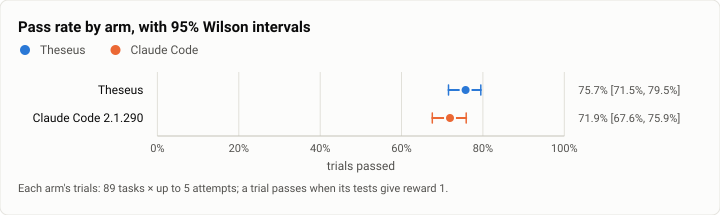
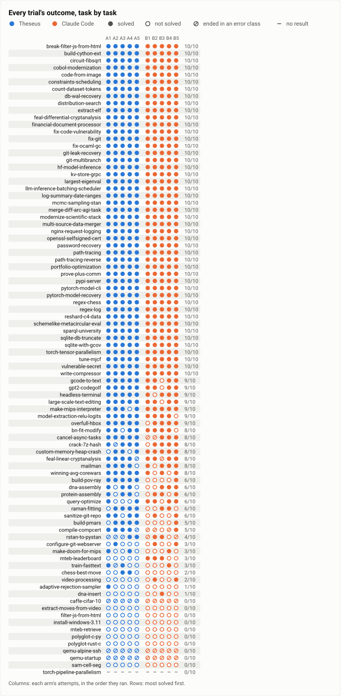
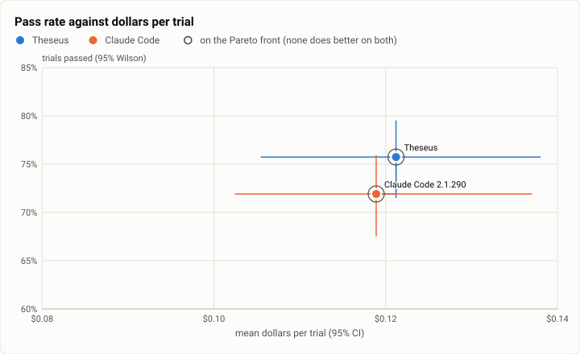
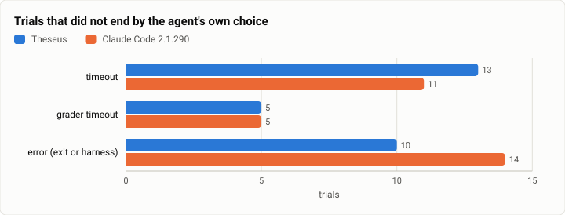

# Terminal-Bench 2.0 R1: the parity claim, Theseus against Claude Code at five attempts (2026-10-13)

**The answer first.** Topped up to five attempts on all 89 tasks (R0's three plus two more, both arms, the same
build), Theseus solved **75.7%** of its trials (337 of 445; Wilson 95% 71.5% to 79.5%) and Claude Code 2.1.290
**71.9%** (320 of 445; 67.6% to 75.9%), both on Claude Sonnet 5.5 at medium effort. Paired by task, Theseus is
**+3.8 points ahead, 95% interval 0.0 to +8.1**, better on 17 tasks against 7 (sign test p = 0.064; by trial, 40
pairs against 23, exact McNemar p = 0.043). **Coding test T1 passes**: its line is a 95% lower bound of −5 points,
and the bound is 0.0. **T2 passes**: on the 30 hard tasks Theseus is +1.3 points (68.7% against 67.3%; line −3).
"Beat" (T1 above zero) is at the edge and not established: the interval touches zero. Two of the match's other
lines fail narrowly: **T4** asks for no malformed tool input and Theseus made one in 445 trials (an `fs.write`), and
**T5** asks for at most 1.1 times Claude Code's model calls a solve and Theseus made 1.11 times (7.9 against 7.1),
at fewer dollars a solve ($0.112 against $0.114). What the score doesn't show: Theseus is the more consistent arm,
56 tasks solved in all five attempts against Claude Code's 49, from the same 75 to 76 tasks solved at least once.

| | |
|---|---|
| Suite | Terminal-Bench 2.0 (`terminal-bench@2.0`) through Harbor 0.23, 89 tasks |
| Arms | **Theseus** (`theseus_agent:Theseus`, the bench profile) · **Claude Code 2.1.290** (`claude_code_agent:MeasuredClaudeCode`, pinned) |
| Model | Claude Sonnet 5.5 at medium effort in both arms |
| Tasks × attempts | 89 × 5 an arm: [R0](2026-10-13-terminal-bench-r0.md)'s 3 and this top-up's 2; 890 trials |
| Date and commit | 2026-10-13 (UTC−7), on EC2; Theseus built at `026dce3f` (install #25) |
| Cost | the top-up $41.65 (Theseus $20.54, Claude Code $21.11); all five attempts $104.54 |
| Data | [`2026-10-13-terminal-bench-r1.json`](2026-10-13-terminal-bench-r1.json), [`.csv`](2026-10-13-terminal-bench-r1.csv) (one row per trial, attempts 1 to 5) |

## The question

Is Theseus at least as good as Claude Code on Terminal-Bench, by the north-star plan's own line? Coding test T1 asks
for all 89 tasks at five attempts, with the 95% lower bound of Theseus − Claude Code at or above −5 points; T2 asks
the 30 hard tasks' point estimate to be at or above −3; T4 and T5 ask for clean tool input and no more cost or calls
a solve than Claude Code's. On Oct 4 the plan read T1 at −9.6 points (two attempts), and −3.0 without the tasks a
since-fixed fault touched. R0 put the point estimate at +3.0 with three attempts; R1 adds two attempts to each arm on
the same build so the interval is the plan's.

## The setup

As [R0](2026-10-13-terminal-bench-r0.md), whose setup section holds the details: the same build (`026dce3f`, static
musl, release-thin), the same adapters and limits (Theseus's spend limit $3.75, the shipped 60 s command wait, the
follow bounded by the agent timeout; Claude Code pinned at 2.1.290, `max_budget_usd=2.0`, `max_turns=200`, effort
medium), the same four EC2 m7a.8xlarge hosts, and each task's R1 jobs on the same host as its R0 jobs, run right
after them (the plan file `bench/plans/r1-top-up.json`, k = 2, committed before the run). Both arms were topped up;
Claude Code's two attempts were run here, not taken from another day.

## Results

| | Theseus | Claude Code 2.1.290 |
|---|---|---|
| Trials passed, attempts 1 to 5 (95% Wilson) | 337/445 = **75.7%** [71.5%, 79.5%] | 320/445 = **71.9%** [67.6%, 75.9%] |
| Attempts 4 and 5 alone | 138/178 = 77.5% | 129/178 = 72.5% |
| Tasks solved in all 5 attempts / in any | **56** / 75 of 89 | **49** / 76 of 89 |
| Hard tasks (30) | 103/150 = 68.7% [60.9%, 75.6%] | 101/150 = 67.3% [59.5%, 74.3%] |
| Medium tasks (55) | 214/275 = 77.8% | 200/275 = 72.7% |
| Easy tasks (4) | 20/20 | 19/20 |
| Dollars a trial, mean (priced trials) | $0.121 [$0.106, $0.138] | $0.119 [$0.103, $0.137] |
| Dollars, total (the driver's count) | $52.71 | $51.83 |
| Agent minutes a trial, mean | 3.4 | 3.1 |
| Model calls a trial | 9.5 | 7.6 |
| Trials ending in: timeout / grader timeout / error | 13 / 5 / 10 | 11 / 5 / 14 |

<picture>
  <source media="(prefers-color-scheme: dark)" srcset="img/2026-10-13-terminal-bench-r1/pass-rates-dark.svg">
  
</picture>

*Figure 1. Which arm solves the most trials at five attempts, and do the intervals separate? Theseus leads by 17
trials; the intervals still overlap, but the paired tests, which remove the tasks' own difficulty, put the lead at
the edge of significance.*

### The coding tests

| Test | Line (match) | R1 | Verdict |
|---|---|---|---|
| T1 all 89 tasks, 5 attempts | 95% lower bound of Theseus − Claude Code ≥ −5 points | **+3.8 points [0.0, +8.1]** (bootstrap over tasks, 10,000 resamples, seed 20261013); one-sided 95% bound +0.45 | **pass** (Oct 4: −9.6) |
| T1, beat | the lower bound above zero | 0.0 | not established |
| T2 the 30 hard tasks | point estimate ≥ −3 points | **+1.3** [−3.3, +6.0]; 5 tasks better, 3 worse | **pass** (Oct 4: 7 tasks to 1 against) |
| T4 tool friction | 0 malformed inputs; invented names ≤ Claude Code's | malformed **1** (`fs.write`, 1 trial in 445); invented 2 against 12 | **fails by one input** (Oct 4: 21 malformed, 13 invented against 2) |
| T5 cost and calls a solve | dollars ≤ Claude Code's; calls ≤ 1.1× | $0.112 against $0.114 (median $0.047 against $0.052); calls 7.9 against 7.1 = **1.11×** | dollars pass; **calls fail narrowly** |

T5 is over the 297 pairs both arms solved (a task's same-numbered attempt). The tests from T3 on (SWE-bench, the long
instruction, the project context, long commands) are other runs'.

<picture>
  <source media="(prefers-color-scheme: dark)" srcset="img/2026-10-13-terminal-bench-r1/outcomes-dark.svg">
  
</picture>

*Figure 2. Where do the arms differ at five attempts? Theseus's rows are steadier (56 tasks solved every time against
49); the differences are a solve or two on many tasks, Theseus's largest on build-pmars, build-pov-ray and
compile-compcert, Claude Code's on mteb-leaderboard, video-processing and query-optimize.*

<picture>
  <source media="(prefers-color-scheme: dark)" srcset="img/2026-10-13-terminal-bench-r1/pareto-dollars-dark.svg">
  
</picture>

*Figure 3. Which arm buys the most passes for the least money? At five attempts the two still sit at the same
dollars a trial, two tenths of a cent apart; Theseus's higher pass rate is bought with more calls, not more dollars.*

<picture>
  <source media="(prefers-color-scheme: dark)" srcset="img/2026-10-13-terminal-bench-r1/endings-dark.svg">
  
</picture>

*Figure 4. How do the trials that don't end on their own end? Alike in both arms: a dozen agent timeouts on the
compute-heavy tasks, five grader timeouts on one task, and the two qemu tasks' failed installs (ten trials each).*

## Analysis

**Tasks that differ by two or more solves of five.** Theseus: build-pmars 4 against 1, build-pov-ray 5 against 1,
compile-compcert 4 against 1 (Claude Code timed out three times), cancel-async-tasks 5 against 3 (Claude Code's
install timed out twice), raman-fitting and sanitize-git-repo 4 against 2, winning-avg-corewars 5 against 3,
chess-best-move 2 against 0. Claude Code: mteb-leaderboard 3 against 0, video-processing 2 against 0,
custom-memory-heap-crash 5 against 3, query-optimize 4 against 2. Every Theseus loss among these ended on the agent's
own choice (no fault of the harness); mteb-leaderboard is the one with a harness cause: the trials that solved it
searched the web, which Theseus cannot do without a search provider's key ([R0](2026-10-13-terminal-bench-r0.md)).

**Consistency.** Both arms solve about the same set of tasks at least once (75 and 76); Theseus solves more of them
every time (56 against 49). For a person, an agent that does the same task right each time is the one they can leave
alone: this is the run's most practical difference, and the same split shows in R0 (57 against 54 at three).

**What T4 and T5 still say.** The one malformed input is an `fs.write` call that gave its `path` field twice (`path-tracing`, R0). The
calls: Theseus spends its extra calls on background commands (a command longer than the shipped 60 s wait comes
back as a job, then the model waits on it with one more call), and on the tool-level errors R0 describes; 29 of its
78 there were a job's placeholder result, flagged as an error, and none of Claude Code's. Neither costs a solve, and
the dollars a solve are already under Claude Code's.

**Since Oct 4.** T1's point estimate moved from −9.6 points to +3.8, and T4's malformed inputs from 21 to 1. R0's
analysis separates the two causes (the harness's fixes on Theseus's side, its refusal fallback among them; on Claude Code's, an effort now pinned to
medium). Over the five attempts both arms finished the same refused tasks on Sonnet 5: Theseus in 15 trials, Claude
Code in 16.

## Threats to validity

- **The same build, the same hosts and the same day as R0,** so R1 shares R0's threats (the host change since Oct 4,
  which a local comparison found moved nothing; the grader timeouts of `torch-pipeline-parallelism`; the qemu tasks'
  failed installs in every arm; the asymmetric stop at a timeout, under which two of Claude Code's timed-out
  `schemelike-metacircular-eval` trials were rewarded).
- **Attempts 4 and 5 ran right after attempts 1 to 3**, on the same host in the same hour; they are not independent of
  the host's state at that hour. Their rates (77.5% and 72.5%) match R0's.
- **A bootstrap over 89 tasks** treats the task set as a sample; it is the whole benchmark. The interval describes
  attempt-to-attempt noise and the spread over tasks, not a population beyond them.
- **The lower bound sits at zero** (the 250th of 10,000 resampled differences is 0.0 points exactly), so the "beat" reading changes with the seed; the
  "match" reading (≥ −5) does not.

## What it cost

- The top-up: Theseus $20.54 for 178 trials ($0.115 a trial), Claude Code $21.11 ($0.119). With R0's three attempts,
  Theseus $52.71 for 445 trials (**$0.118 a trial**), Claude Code $51.83 (**$0.116 a trial**).
- The EC2 hosts' share: about $0.05 a trial, as in [R0](2026-10-13-terminal-bench-r0.md).

## Reproduction

As [R0](2026-10-13-terminal-bench-r0.md), with `-k 2` and the job names `${t}__theseus__r1` and
`${t}__claude-code__r1`, then the draft over both phases:

```bash
python3 bench/report/draft.py harbor --suite terminal-bench@2.0 --date 2026-10-13 --slug r1 \
  --arm "theseus=jobs/*__theseus__r[01]" --arm "claude-code=jobs/*__claude-code__r[01]" \
  --label claude-code="Claude Code 2.1.290" --model anthropic/claude-sonnet-5-5 --commit 026dce3f
```

The T1 and T2 intervals resample the CSV's tasks (each task's mean reward in each arm, the difference averaged over
tasks; 10,000 resamples, seed 20261013).

## Data

[`2026-10-13-terminal-bench-r1.json`](2026-10-13-terminal-bench-r1.json) and
[`2026-10-13-terminal-bench-r1.csv`](2026-10-13-terminal-bench-r1.csv): every trial of attempts 1 to 5, both arms,
no transcripts.
