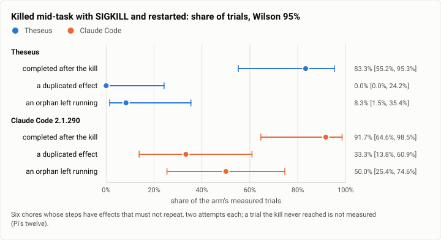

# Async: the kill -9 family at the v1 freeze (2026-10-18)

**The answer first.** Each chore's steps must not repeat: restart a service, apply a migration, convert an export,
bisect, run a pipeline, start a service. Each harness was killed with SIGKILL in the middle of one, then restarted the
way its documentation says to continue.

**Theseus (`351159fc`) did nothing twice and redid no finished step in any of 12 trials** (0 duplicated effects and 0
lost work, [0%, 24%]). It resumed in 10. In the other 2 its job carried on through the daemon's death and the restarted
daemon adopted it. It completed 10 of 12 [55%, 95%].

It did slip once: **one orphan**. In one of the two `service` trials a process from before the kill was still running
after the restart. Neither `service` trial completed. On Oct 12 Theseus had no orphans, and `service` was one of its
three failures then too.

**Claude Code 2.1.290**, restarted with `claude --continue`, completed 11 of 12. In 4 of them it did a step's effect
twice (8 duplicated effects: an export converted twice, a service restarted twice). It left a pre-kill process running
in 6 (11 orphans) and redid finished work in 2.

Pi's and OpenCode's arms are still unmeasured, from the same two bench-driver bugs as Oct 12: Pi's kill never fires,
and OpenCode's restart cannot find its own binary.

<picture>
  <source media="(prefers-color-scheme: dark)" srcset="img/2026-10-18-async-kill-family/kill-dark.svg">
  
</picture>

*Figure 1. Does each harness finish after a kill -9 without doing anything twice or leaving work running? Theseus never
repeats a step and leaves one orphan in 12 trials. Claude Code finishes one more chore, but repeats effects in a third
of its trials and leaves orphans in half.*

| | |
|---|---|
| Suite | the async bench's kill family (`bench/async/kill-tasks`): six chores, a SIGKILL each |
| Arms | Theseus `351159fc` (`TheseusAsync`; restart: `theseusd` on the same state, then `theseus wait`); Claude Code 2.1.290 (`ClaudeCodeAsync`; `claude --continue --print "Continue."`); Pi 1.0.4 and OpenCode 1.18.35 (not measured: below) |
| Model | Claude Sonnet 5.5, effort medium (the mechanics arms keep Oct 12's fixed model; this measures the harness, not the routing) |
| Trials | 6 chores × 2 attempts an arm; the oracle 6 of 6 |
| When | 2026-10-18, 17:59 to 19:06 (UTC−7), on the bench workstation |
| Cost | $0.62 as recorded: Claude Code $0.31, Theseus $0.16, Pi $0.11, OpenCode $0.04 |
| Data | [`2026-10-18-async-kill-family.json`](2026-10-18-async-kill-family.json): every trial's kill columns |

## The question

"Kill it mid-task; it finishes, and nothing runs twice" is one of the v1 README's six features. Does the frozen build
still keep it? The week since Oct 12 added task checkpoints and the task journey, which run through the same execution
store.

## The setup

The setup is Oct 12's ([that report](2026-10-12-async-kill-family.md), its setup section), at the frozen build.
- The driver writes `kill` to the tools' hash-chained ledger at a seeded moment or after a named step. It then sends
  SIGKILL to the harness's own processes, waits 2 s, and restarts the harness by its arm's command.
- The verifier reads five measures from the ledger and the processes left running:
  - **completed:** the chore's reward;
  - **duplicated effects:** a step's effect written twice;
  - **orphans:** a pre-kill process still running, or writing after its step was redone;
  - **lost work:** a finished step started again;
  - **time to resume.**

## Results

| Arm | Completed | Trials with a duplicated effect | Trials with an orphan | Trials that redid work | Median time to resume | Jobs adopted through the kill |
|---|---|---|---|---|---|---|
| Theseus | 10 of 12 = 83% [55, 95] | **0** [0, 24] | 1 = 8% [2, 35]; 1 process | **0** [0, 24] | 11.1 s | 2 |
| Claude Code | 11 of 12 = 92% [65, 99] | 4 = 33% [14, 61]; 8 effects | 6 = 50% [25, 75]; 11 processes | 2 = 17% [5, 45] | 5.0 s | 2 |
| Pi | not measured: the kill never fired | – | – | – | – | – |
| OpenCode | not measured: `sh: 1: opencode: not found` at every restart | – | – | – | – | – |

By chore, the count completed out of 2 (Theseus · Claude Code):

| Chore | Completed | Notes |
|---|---|---|
| bisect | 2 · 2 | Claude Code left 3 orphans |
| csv-merge | 2 · 2 | Claude Code: 5 duplicated effects, 5 orphans |
| health-restart | 2 · 2 | Claude Code: 2 duplicated effects, 2 orphans, 2 redone steps |
| migrations | 2 · 2 | |
| pipeline | 2 · 1 | Claude Code: 1 duplicated effect, 1 orphan |
| service | 0 · 2 | Theseus's orphan |

## Analysis

- **The durable store still does its job.** Across 12 kills Theseus never repeated an effect or redid a finished
  step. It resumed from the store in 10 trials, and in 2 the job had run on through the daemon's death.
- **`service` is Theseus's weak chore, now with an orphan.** It failed both trials here, and on Oct 12 it failed for
  querying the service before it had started. One trial left the service's pre-kill process running beside the
  restarted one. That is the first orphan the kill family has seen from Theseus. The improvement assessment names it.
- **Claude Code completes more but repeats itself.** Its 11 of 12 came with 8 duplicated effects and 11 orphans. For a
  user, that means a migration or a deploy run twice.

## What changed since Oct 12

- Theseus: 158 merges, including task checkpoints and the task journey. Its completed share went from 8 of 11 to 10
  of 12. Duplicated effects and lost work stayed at 0. Orphans went from 0 to 1.
- Claude Code: the same pin. It completed 12 of 12 then and 11 of 12 now. Trials with duplicates went from 7 to 4.
- Pi and OpenCode: the same two driver bugs, still unfixed.

## Threats to validity

- **Twelve trials an arm.** Every rate's interval is 25 to 40 points wide, and the zero counts are the sharp part.
- **Two arms unmeasured,** so the comparison is two harnesses, not four.
- **"Continue." is one text for every CLI arm.** A user who tells Claude Code which steps already ran would see fewer
  repeats.

## What it cost

$0.62 as recorded. Claude Code's record reads its last `result` event, which after a `--continue` restart may cover
only the resumed process, so its figure is a floor.

## Reproduction

```bash
export THESEUS_BENCH_BIN_DIR=<musl bins at 351159fc> PYTHONPATH=$PWD/bench/harbor:$PWD/bench/async HARBOR_TELEMETRY=0
K="-p bench/async/kill-tasks -m anthropic/claude-sonnet-5-5 -o jobs -k 2 -n 4 --agent-setup-timeout-multiplier 3.0"
harbor run -p bench/async/kill-tasks -a oracle -o jobs --job-name kill-oracle
harbor run $K -a async_agents:TheseusAsync --job-name kill-theseus
harbor run $K -a async_agents:ClaudeCodeAsync --ak max_budget_usd=2.0 --ak max_turns=200 --job-name kill-claude-code
```

## Data

[`2026-10-18-async-kill-family.json`](2026-10-18-async-kill-family.json): each arm's summary, every trial's kill
columns, and the figure's spec.
