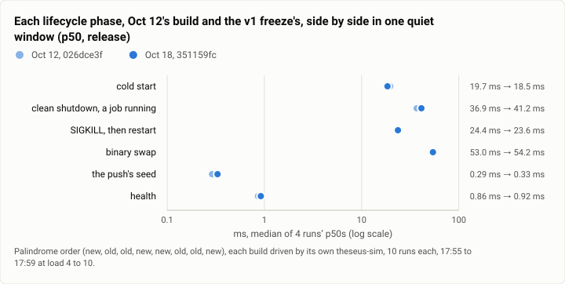
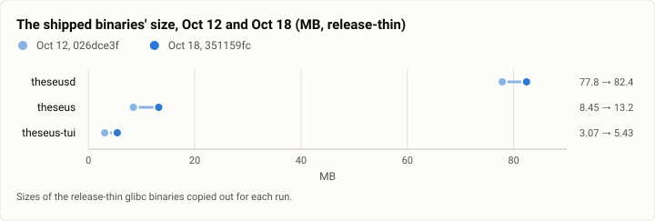

# Gate bench: the v1 freeze's release build, every speed bench once more (2026-10-18)

**The answer first.** On the release build frozen for v1 (`351159fc`), Theseus starts, stops, restarts and swaps as
fast as the stopping point's build of Oct 12 did. Both builds were measured side by side in one quiet window, in
palindrome order:
- a cold start's p50 is 18.5 ms against Oct 12's 19.7;
- a SIGKILL's restart is 23.7 ms against 24.4;
- a binary swap is 54.2 ms against 53.0;
- the push's seed is 0.33 ms against 0.29.

The one phase that moved is the **clean shutdown with a job running: 41.2 ms against 36.9 (+12%)**. It is still far
inside its 100 ms budget.

The day's longer pass ran four runs of ten while the machine was busier (load 15 to 24, against 4 to 10 for the side by
side). In that pass every p50 read 20% to 40% slower than Oct 12's published numbers, and four p95s missed their
budgets. The side-by-side window shows that this was the machine, not the code.

Two other results moved:
- `theseus status --short` now passes its 5 ms check (p90 3.3 ms, against 8.4 ms on Oct 12).
- **`theseusd` grew to 82.4 MB** (77.8 MB on Oct 12) against §9's 60 MB. It is still the one budget the release build
  fails.

Turns cost what they did: a plain turn takes 56 ms of wall and 4 frames, and a tool-call turn takes 131 ms and 8
frames.

<picture>
  <source media="(prefers-color-scheme: dark)" srcset="img/2026-10-18-gate-bench-v1/ab-oct12-dark.svg">
  
</picture>

*Figure 1. Did the week since Oct 12 make the start and stop path slower, or was it the machine? It was the machine.
Measured together, the two builds are within a run's spread on every phase except the clean stop, which is 4 ms
slower.*

| | |
|---|---|
| Suite | `gate-bench`: `theseus-sim bench` lifecycle, turn, jobs, idle, status, size; a reads probe; a glibc/musl A/B; an A/B against Oct 12's build |
| Arms | Theseus, the release build (`release-thin`, glibc), and for the A/B the stopping point's build of Oct 12 |
| Commit | `351159fc` (the v1 feature freeze), built in a worktree of its own and frozen in a directory for the run; Oct 12's `026dce3f` from that run's directory |
| Runs | lifecycle 4 × 10 (empty store) and 4 × 10 (10,000 sessions); turn 2 × 20 plus a burst of 30; jobs 2 × 40 a class; idle 30 s and 20 s; status 2 × 300; glibc/musl A/B (lifecycle 4 + 4, turn 2 + 2, idle); Oct 12 A/B (lifecycle 4 + 4) |
| When | 2026-10-18, 16:38 to 17:59 (UTC−7) |
| Cost | none (no model call) |
| Data | [`2026-10-18-gate-bench-v1.json`](2026-10-18-gate-bench-v1.json) |

## The question

The v1 features froze at 16:00. Two questions come before the release notes quote a speed:
- Does every §9 budget still hold on the build v1 ships?
- Did the week since the stopping point give back any of the speed lanes' gains? That week added RSI, the task
  journey, checkpoint routing and Haiku-first routine tasks, 158 merges (822 commits) in all.

## The setup

- **The build.** The release-thin glibc binaries of `351159fc`. They were built in a detached worktree at the frozen
  commit, because the spine had already moved one RSI-only merge past it. The binaries were copied into the run's own
  directory first.
- **The benches.** The same `bench1.sh` as Oct 12. Before each step it waits for a quiet machine: no Rust tree
  compiling, the gate lock free, and CPU pressure under 20% and IO pressure under 10% at avg10. It then measures and
  logs the load.
- **The A/B against Oct 12** was added after the first pass read slow. The frozen build and Oct 12's `026dce3f` ran in
  palindrome order (new, old, old, new, new, old, old, new). Each build was driven by its own `theseus-sim`, because
  the sim writes the config the daemon reads. There were 10 runs a block, from 17:55 to 17:59.
- **Terminal-Bench** ran at the same time on four EC2 hosts, not on this machine.

## Results

**Lifecycle, empty store** (four runs of ten; the median of the runs' p50s, and the median and maximum of their p95s):

| Phase | p50 (ms) | p95 median / max (ms) | Budget (p95) | Oct 12 p50 (published) | Same window: Oct 12's build → v1 (p50) |
|---|---|---|---|---|---|
| cold start | 21.7 | 31.3 / 39.3 | 50 | 18.1 | 19.7 → **18.5** |
| clean shutdown, a job running | 47.9 | 67.0 / **118.3** | 100 | 37.0 | 36.9 → **41.2** |
| SIGKILL, then restart | 30.7 | 40.6 / 77.2 | 150 | 22.2 | 24.4 → **23.7** |
| binary swap | 63.8 | 89.7 / 114.7 | 200 | 48.2 | 53.0 → **54.2** |
| restore | 205.6 | 226.4 / 314.3 | – | 146.1 | – |
| the push's seed | 0.35 | 1.10 / **4.46** | 2 | 0.32 | 0.29 → **0.33** |
| health | 0.94 | 2.72 / 4.15 | 5 | 0.81 | 0.86 → **0.92** |
| cancel | 26.8 | 39.7 / 46.1 | 100 | 26.7 | – |

**Lifecycle, 10,000 parked sessions** (four runs of ten): cold start 24.5 ms (p95 43.5; budget 250), clean shutdown
44.8 ms, SIGKILL restart 31.3 ms, binary swap 61.6 ms (one run's p95 204.4 against 200), seed 4.7 ms, health 1.7 ms
(one run's p95 6.8 against 5). Oct 12's p50s were 18.3, 32.8, 23.7, 49.4, 2.6 and 0.9 ms.

**The four p95 misses** are single runs of the busy pass: shutdown 118 ms, seed 4.5 ms, 10k swap 204 ms and 10k health
6.8 ms. The side-by-side window had none of them. Each still counts as a miss in the data file.

**Turns** (2 × 20, the stand-in model):

| | Wall p50 | Wall p90 | Frames | Oct 12 p50 |
|---|---|---|---|---|
| plain turn | 56.2 ms | 88.2 ms | 4 | 57.4 ms |
| tool-call turn | 131.3 ms | 155.2 ms | 8 | 134.1 ms |
| batch | 2,167 ms | 2,182 ms | 14 | 2,189 ms |

A burst of 30 turns across 6 sessions took 105 ms a turn (88 ms on Oct 12), and resident memory went from 48 to
90 MB (40 to 68 MB on Oct 12).

**Jobs:**
- An L0 job's total is 10.1 ms and 9.9 ms at p50, in two runs.
- An L1 job starts in 5.6 ms and 5.0 ms at p50 (p95 7.9 and 7.2, against a 25 ms target). On Oct 12, one of two
  runs missed that target at 28.7 ms.

**Idle:**
- 0.008% of a core and 1.5 wakeups a second on an empty store.
- 0.37% of a core and 4.2 wakeups a second at 10,000 sessions.

**Reads:** `theseus status --short` took 2.1 ms at p50 and 3.3 ms at p90 over 300 runs, inside its 5 ms check. On a
424 MB store of 470,000 ledger rows, the daemon's reads took 4.0 to 9.9 ms at p50.

**Size:**

| Binary | Oct 12 | Oct 18 | Budget |
|---|---|---|---|
| `theseusd` | 77.8 MB | **82.4 MB** | 60 MB |
| `theseus` | 8.4 MB | 13.2 MB | 60 MB |
| `theseus-tui` | 3.1 MB | 5.4 MB | 60 MB |

<picture>
  <source media="(prefers-color-scheme: dark)" srcset="img/2026-10-18-gate-bench-v1/binary-size-dark.svg">
  
</picture>

*Figure 2. How much did the binaries grow in the last week before v1? `theseusd` gained 4.6 MB and stays above its
60 MB budget. The CLI gained 4.8 MB.*

**glibc against static musl** (the build every Harbor trial runs, palindrome order):
- the lifecycle phases are within 1% to 4%, except the clean stop (glibc 49.5 ms, musl 55.1 ms);
- a tool-call turn is 141.5 ms on musl against 158.6 ms on glibc.

On Oct 12 musl was 17% slower on a tool-call turn. Today it is 11% faster, in a window that was not quiet. Read it as
"no difference shown", not as a reversal.

## Analysis

- **The code kept the speed lanes' gains.** Every phase except the clean stop lands inside the other build's spread
  when the two run together. The clean stop is about 4 ms slower in every block. One new-build block read 88.8 ms,
  and the other three read 38 to 41 ms.
- **The machine sets the published p50s.** The two passes ran 20 minutes apart. The busy pass reads 17% to 30% slower
  than the quiet one on every phase, by about as much as it reads slower than Oct 12. Every gate-bench report should
  carry a same-window control when its numbers will be quoted.
- **Size is the open budget.** `theseusd` has grown 4.6 MB in a week of features. The 60 MB line in §9 needs either a
  size lane (dependencies, codegen units, the embedded assets) or a new budget the owner sets.

## What changed since Oct 12

- 158 merges (822 commits), including RSI loop 1, the task journey and its checkpoints, checkpoint routing, Haiku-first
  routine tasks, the cockpit Tasks page and R8.
- `status --short` got under its 5 ms check.
- The L1 job's tail, missed once on Oct 12, held in both runs.
- The reads probe's `executions` command was removed from the CLI since Oct 12. The probe's 12 calls failed, so that
  row is missing here and was not measured.

## Threats to validity

- **The busy pass shared the machine.** Its neighbours were the OpenClaw gateway and a voice lane's test build, which
  ended before the pass resumed at 17:20. The quiet window had no compiling tree and the CPU pressure was under 10%.
- **Four blocks a build is small.** The side-by-side gives a direction, not a fine estimate. A 10% change on a 20 ms
  phase is about one run's spread.
- **Release-thin, not the tagged release.** The fat-LTO release build is measured after the cut.

## Cost

No model was called. The run took about 80 minutes of this machine.

## Reproduction

```
bins=<dir with theseusd, theseus, theseus-sim, theseus-tui built release-thin at 351159fc>
bash bench1.sh $bins <musl dir> out/          # the gate benches, each step after a settle
# the A/B: for each of new old old new new old old new:
$arm/theseus-sim bench lifecycle --theseusd $arm/theseusd --runs 10 --phases cold,shutdown,kill,swap,seed,health --json out/abold-N-$arm.json
```
