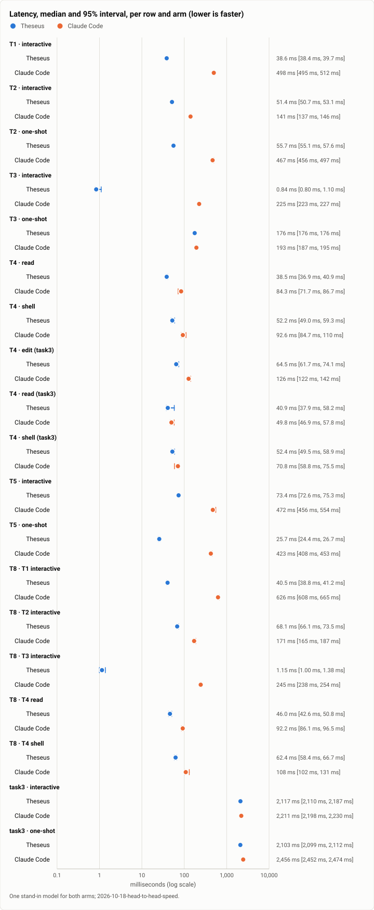
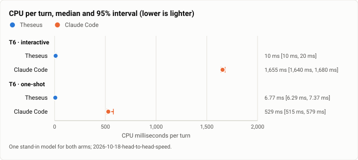
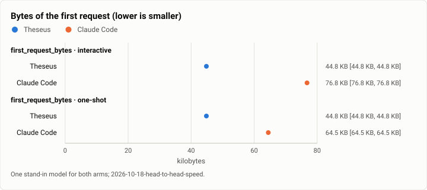
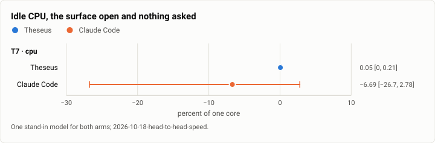
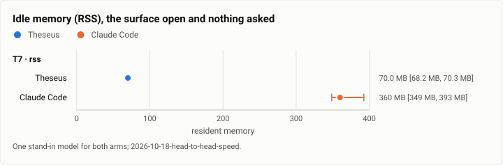

# Head-to-head speed: Theseus and Claude Code on one stand-in model, at the v1 freeze (2026-10-18)

**The answer first.** On the v1 freeze's release build (`351159fc`), Theseus is ahead of Claude Code 2.1.296 on 22 of
25 rows measured on both arms, and level within the noise on the other 3. The figures below are medians with their 95%
intervals, against one stand-in model:
- **Start to a ready prompt:** 38.6 ms against 498 ms (12.9×).
- **CPU per interactive turn:** 10 ms against 1,655 ms.
- **Idle resident memory:** 70.0 MB against 360 MB.
- **Resuming a 50-turn session:** 73.4 ms against 472 ms.

Against its own run of Oct 12, Theseus held the ready prompt (38.9 to 38.6 ms), the first text on screen (0.86 to
0.84 ms) and the CPU per turn (10 ms). Four rows moved the wrong way, and they are this run's findings:
- **A typed prompt now takes twice as long to leave as a request:** 26.1 to 51.4 ms interactive, and 31.0 to 55.7 ms
  one-shot.
- **An edit tool call's turnaround** rose from 43.9 to 64.5 ms.
- **Idle memory** rose from 49.6 to 71.7 MB.
- **The first request** grew from 39.2 KB to 45.9 KB.

Claude Code, at the same pinned version on the same machine, moved by −11% to +23% on those rows.

## The question

v1 froze at 16:00. Does the shipped build keep the lead it had over Claude Code on Oct 12? Did the week's 158 merges
add time anywhere a person waits?

## Results

| Row | What | Kind | Theseus | Claude Code | Difference |
|---|---|---|---|---|---|
| T1 | Start to a ready prompt | interactive | 38.6 ms (95% CI 38.4 ms to 39.7 ms; n 10) | 498 ms (95% CI 495 ms to 512 ms; n 10) | Theseus by 459 ms |
| T2 | Typed prompt to the request leaving | interactive | 51.4 ms (95% CI 50.7 ms to 53.1 ms; n 10) | 141 ms (95% CI 137 ms to 146 ms; n 10) | Theseus by 89.4 ms |
| T2 | Typed prompt to the request leaving | one-shot | 55.7 ms (95% CI 55.1 ms to 57.6 ms; n 10) | 467 ms (95% CI 456 ms to 497 ms; n 10) | Theseus by 411 ms |
| T3 | Model's first byte to the first text on screen | interactive | 0.84 ms (95% CI 0.80 ms to 1.10 ms; n 10) | 225 ms (95% CI 223 ms to 227 ms; n 10) | Theseus by 224 ms |
| T3 | Model's first byte to the first text on screen | one-shot | 176 ms (95% CI 176 ms to 176 ms; n 10) | 193 ms (95% CI 187 ms to 195 ms; n 10) | Theseus by 17.3 ms |
| T4 | Per tool call: the response's last byte to the next request | read | 38.5 ms (95% CI 36.9 ms to 40.9 ms; n 10) | 84.3 ms (95% CI 71.7 ms to 86.7 ms; n 10) | Theseus by 45.7 ms |
| T4 | Per tool call: the response's last byte to the next request | shell | 52.2 ms (95% CI 49.0 ms to 59.3 ms; n 10) | 92.6 ms (95% CI 84.7 ms to 110 ms; n 10) | Theseus by 40.5 ms |
| T4 | Per tool call: the response's last byte to the next request | edit (task3) | 64.5 ms (95% CI 61.7 ms to 74.1 ms; n 10) | 126 ms (95% CI 122 ms to 142 ms; n 10) | Theseus by 62.0 ms |
| T4 | Per tool call: the response's last byte to the next request | read (task3) | 40.9 ms (95% CI 37.9 ms to 58.2 ms; n 10) | 49.8 ms (95% CI 46.9 ms to 57.8 ms; n 10) | Theseus by 8.98 ms (noise) |
| T4 | Per tool call: the response's last byte to the next request | shell (task3) | 52.4 ms (95% CI 49.5 ms to 58.9 ms; n 10) | 70.8 ms (95% CI 58.8 ms to 75.5 ms; n 10) | Theseus by 18.5 ms (noise) |
| T5 | Resume of a long session | interactive | 73.4 ms (95% CI 72.6 ms to 75.3 ms; n 9) | 472 ms (95% CI 456 ms to 554 ms; n 9) | Theseus by 398 ms |
| T5 | Resume of a long session | one-shot | 25.7 ms (95% CI 24.4 ms to 26.7 ms; n 10) | 423 ms (95% CI 408 ms to 453 ms; n 10) | Theseus by 397 ms |
| T6 | CPU per turn | interactive | 10 ms (95% CI 10 ms to 20 ms; n 10) | 1,655 ms (95% CI 1,640 ms to 1,680 ms; n 10) | Theseus by 1,645 ms |
| T6 | CPU per turn | one-shot | 6.77 ms (95% CI 6.29 ms to 7.37 ms; n 10) | 529 ms (95% CI 515 ms to 579 ms; n 10) | Theseus by 522 ms |
| T7 | Idle, the surface open | cpu | 0.05% of a core (95% CI 0.00% of a core to 0.21% of a core; n 10) | -6.69% of a core (95% CI -26.74% of a core to 2.78% of a core; n 10) | Claude Code by 6.74% of a core (noise) |
| T7 | Idle, the surface open | rss | 70.0 MB (95% CI 68.2 MB to 70.3 MB; n 10) | 360 MB (95% CI 349 MB to 393 MB; n 10) | Theseus by 290 MB |
| T8 | Under neighbour IO (a dd and fsync loop beside) | T1 interactive | 40.5 ms (95% CI 38.8 ms to 41.2 ms; n 10) | 626 ms (95% CI 608 ms to 665 ms; n 10) | Theseus by 586 ms |
| T8 | Under neighbour IO (a dd and fsync loop beside) | T2 interactive | 68.1 ms (95% CI 66.1 ms to 73.5 ms; n 10) | 171 ms (95% CI 165 ms to 187 ms; n 10) | Theseus by 103 ms |
| T8 | Under neighbour IO (a dd and fsync loop beside) | T3 interactive | 1.15 ms (95% CI 1.00 ms to 1.38 ms; n 10) | 245 ms (95% CI 238 ms to 254 ms; n 10) | Theseus by 243 ms |
| T8 | Under neighbour IO (a dd and fsync loop beside) | T4 read | 46.0 ms (95% CI 42.6 ms to 50.8 ms; n 10) | 92.2 ms (95% CI 86.1 ms to 96.5 ms; n 10) | Theseus by 46.2 ms |
| T8 | Under neighbour IO (a dd and fsync loop beside) | T4 shell | 62.4 ms (95% CI 58.4 ms to 66.7 ms; n 10) | 108 ms (95% CI 102 ms to 131 ms; n 10) | Theseus by 45.9 ms |
| task3 | A three-tool coding task, end to end | interactive | 2,117 ms (95% CI 2,110 ms to 2,187 ms; n 10) | 2,211 ms (95% CI 2,198 ms to 2,230 ms; n 10) | Theseus by 93.1 ms |
| task3 | A three-tool coding task, end to end | one-shot | 2,103 ms (95% CI 2,099 ms to 2,112 ms; n 10) | 2,456 ms (95% CI 2,452 ms to 2,474 ms; n 10) | Theseus by 353 ms |
| first_request_bytes | Bytes of the first request | interactive | 44.8 KB (95% CI 44.8 KB to 44.8 KB; n 10) | 76.8 KB (95% CI 76.8 KB to 76.8 KB; n 10) | Theseus by 31.9 KB |
| first_request_bytes | Bytes of the first request | one-shot | 44.8 KB (95% CI 44.8 KB to 44.8 KB; n 10) | 64.5 KB (95% CI 64.5 KB to 64.5 KB; n 10) | Theseus by 19.6 KB |

Lower is better on every row. An interval is a seeded bootstrap of the median (95%) from five values up, else the range; "(noise)" marks a difference whose intervals overlap.

2 attempts gave no value (a marker that never showed, a request never logged); they are left out, never filled in: T5 interactive (Claude Code), T5 interactive (Theseus).

## Figures

<picture>
  <source media="(prefers-color-scheme: dark)" srcset="img/2026-10-18-head-to-head-speed/latency-dark.svg">
  
</picture>

*Figure 1. Which harness takes less on each row: latency?*

<picture>
  <source media="(prefers-color-scheme: dark)" srcset="img/2026-10-18-head-to-head-speed/cpu-per-turn-dark.svg">
  
</picture>

*Figure 2. Which harness takes less on each row: cpu per turn?*

<picture>
  <source media="(prefers-color-scheme: dark)" srcset="img/2026-10-18-head-to-head-speed/first-request-bytes-dark.svg">
  
</picture>

*Figure 3. Which harness takes less on each row: bytes of the first request (lower is smaller)?*

<picture>
  <source media="(prefers-color-scheme: dark)" srcset="img/2026-10-18-head-to-head-speed/idle-cpu-dark.svg">
  
</picture>

*Figure 4. Which harness takes less on each row: idle cpu?*

<picture>
  <source media="(prefers-color-scheme: dark)" srcset="img/2026-10-18-head-to-head-speed/idle-memory-dark.svg">
  
</picture>

*Figure 5. Which harness takes less on each row: idle memory (rss)?*

## Analysis

- **The lead holds wherever Oct 12 measured it.** Every row where Theseus was clearly ahead on Oct 12 is clearly ahead
  today, by similar ratios. The ready prompt is 12.9× faster (13.3× on Oct 12). CPU per turn is 165× lower (172×). A
  long session's resume is 6.4× faster (5.5×).
- **The prompt-to-request path doubled.** T2 grew by about 25 ms on both surfaces and under neighbour IO (T8's T2: 33.1
  to 68.1 ms). The model's time is fixed by the stand-in, so this is the harness's own work before the request leaves.
  This run does not say which work. The week's candidates on that path include checkpoint routing, the task
  journey's per-turn context and RSI's per-turn rows, none of them profiled here. The improvement assessment names it
  as a lane: profile T2's frames on the frozen build and move work off the send path.
- **The first request grew by 6.7 KB.** At about four bytes a token, that is roughly 1,700 more tokens a first turn.
  This is the request-budget line the owner set on Oct 14 (8k tokens for the CLI's first request). The data file has
  the bytes, and a token count against that line belongs to the same lane.
- **Idle memory rose by 22 MB.** It is still a fifth of Claude Code's.
- **T7's CPU row is noise on both arms.** Claude Code's interval spans zero, and Theseus idles at 0.05% of a core.

## What changed since Oct 12

- Theseus: 158 merges (822 commits) from `026dce3f` to `351159fc`.
- Claude Code: the same pinned 2.1.296.
- The machine: the same, with a newer WSL kernel (6.18.40.1 to 6.18.54.1). The load before the run was 14.5, against
  10.8 on Oct 12. Claude Code's own rows moved by −11% to +23% between the two days, which bounds the machine's share
  of any change.

## What it cost

No paid model. The stand-in model ran locally. The run took 10 minutes, from 17:45 to 17:55 (UTC−7).

## Method

Both arms ran on one machine against one stand-in model (`theseus-sim fake-model`), which answers every request after 300 ms to its first byte, in 8 chunks 25 ms apart, and logs each request's arrival, first byte and last byte on CLOCK_MONOTONIC, the bench's own clock. The model's time is the same for both, so what differs is the harness. Both ran the same work in their own tools (read `notes.txt`, edit a line, run `cat` or `wc -l`), with every tool open: Theseus's policy open, Claude Code with its permissions skipped.

Theseus theseusd 0.0.1 ran as a scratch daemon of a release build per run (its own state dir, socket and config; memory, the judge, the index, the language servers, Discord and the web UI off), its surface the terminal UI (`theseus-tui`) and its one-shot `theseus ask`. Claude Code 2.1.296 ran in a scratch home per run, onboarded, its project trusted, with updates, telemetry, error reports and nonessential traffic off; interactive with `--dangerously-skip-permissions`, one-shot with `-p`. T1 for Theseus is the TUI's start with its daemon serving, as Theseus runs (the daemon is a service); the scratch daemon's own start to its first health answer, not counted in T1, was 76.8 ms (95% CI 67.4 ms to 91.0 ms; n 31).

The interactive surfaces ran on a 120×40 pseudo-terminal, typed at by the bench; every read of the screen was stamped as it arrived, and a row's end is the first appearance of its marker (each reply is `<word>-<marker> … end-<marker>`). The arms alternated run by run, ABBA by pairs, 10 runs each. T5's session was 50 turns long; T7 sampled `/proc` for 10 s; T8 repeated T1 to T4 beside a loop writing 64 MiB with fsync.

## Threats to validity

- **One machine**: 16 CPUs (12th Gen Intel(R) Core(TM) i5-12600K), kernel 6.18.54.1-microsoft-standard-WSL2. Another machine moves every number; the comparison holds only on this one.
- **Load during the run**: load averages 14.47 / 15.74 / 14.40 before and 5.55 / 7.65 / 10.54 after. Other work on the machine lands in both arms' numbers.
- **The stand-in's timing**: a real model's first byte varies by seconds; the stand-in's is fixed, so these rows are the harness's own cost and not a user's whole wait. Its streaming (chunk count and spacing) shapes T3 and the turn's end.
- **Markers on a screen**: a surface that draws a word in pieces, or redraws it, is stamped when the word first stands whole in its output; a terminal's own paint time is not counted.
- **The TUI is not Claude Code's REPL**: Theseus's interactive surface is a board of sessions; its T1 counts the board with the session on it, and opening the session is not timed.
- **T5's one-shot resume adds a turn each run**, so its session grows by one turn a run.

## Reproduction

```bash
scripts/build.sh --profile release-thin
python3 bench/h2h/run.py --bin-dir <release-thin bins at 351159fc> --claude <claude 2.1.296> --runs 10 --out <run dir>
python3 bench/h2h/report.py <run dir>/run.json
```

## Data

`2026-10-18-head-to-head-speed.json` holds every cell's numbers and each figure's spec; the raw samples stay in the run's `run.json`, off the repository.
