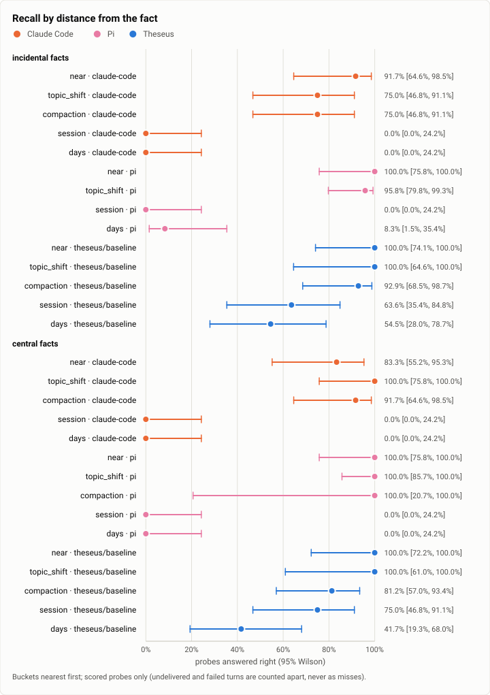

# Recall: the full run at the v1 freeze, Theseus against Claude Code and Pi over 600 turns (2026-10-18)

**The answer first.** The run used one scripted progression of 600 turns: three sessions, the third nine days after
the second, with 228 facts and 204 probes. Every arm ran Claude Sonnet 5.5 at medium effort. Theseus with its memory
(arm `baseline`, the v1 freeze `351159fc`) answered **73.1%** of the recall probes right [65.1, 79.9]. Pi 1.0.4 answered
56.9% [48.8, 64.7] and Claude Code 2.1.296 50.7% [42.6, 58.7], the same counts as on Oct 12 from fresh runs.

Paired on the same probes, Theseus was right where Claude Code was wrong 32 times, and the reverse 4 (exact McNemar
p < 0.0001). Against Pi the counts were 28 and 3.

**The lead is across sessions.** In a later session or days later:
- Theseus answered 27 of 46;
- Claude Code answered 0 of 48 and Pi 1 of 48, since neither carries anything from one session to the next;
- within a session the three recall alike: Theseus 60 of 64, Claude Code 62 of 72, Pi 71 of 72.

**Abstention is still weak.** Asked about something never said, Theseus gave a value instead of "I don't know" in 38 of
60 cases (Claude Code 36, Pi 21).

**What changed since Oct 12 is cost.** Theseus's system prompt and tools measure 7,335 tokens, against 15,835. Its
turns cost $0.019, against $0.026, and its share of the run fell from $15.81 to $11.44.

**One correction.** The bench's delivery check reads `theseus history`, which on this build returned fewer of the
messages a compaction cut. Of the 57 facts it called undelivered, 46 appear verbatim in Theseus's own replies, so they
were delivered and are scored. With the check as it ran, Theseus is 78.2% on 110 probes. Counting the 10 facts still
unproven as misses gives 68.1%.

| | |
|---|---|
| Suite | the incidental-recall bench (`bench/recall`) |
| Arms | Theseus `351159fc` (memory arm `baseline`, the bench profile); Claude Code 2.1.296; Pi 1.0.4 |
| Model | Claude Sonnet 5.5, effort medium, every arm |
| When | 2026-10-18, 17:59 to 18:47 (UTC−7), the three arms side by side, each in a throwaway container |
| Cost | $26.78 (Theseus $11.44, Pi $9.95, Claude Code $5.39) |
| Progression | `full`, seed 7: 600 turns in 3 sessions, 228 facts, 204 probes, an 88,000-token window planned at Theseus's measured overhead (7,335 tokens); digest `b350469370568df5…` |
| Scoring | stale rule `strict` |
| Data | [`2026-10-18-recall-full-run.json`](2026-10-18-recall-full-run.json), [`2026-10-18-recall-full-run.csv`](2026-10-18-recall-full-run.csv) |

## The question

Does the build v1 ships still remember its own work across sessions, as the stopping point's build did on Oct 12? It
is the same progression design and the same rivals at the same pins. The week since Oct 12 cut Theseus's prompt by
half and added the task journey and RSI. Either could change what a long session keeps.

## The setup

- **Theseus:** the frozen build's glibc release-thin binaries in a `python:3.12-slim` container, its daemon fresh, the
  bench profile (`bench/theseus-bench.toml`), memory arm `baseline`, and a $40 run limit. The driver measured the
  daemon's system prompt and tools first (7,335 tokens) and planned the progression's window and compaction marks at
  that overhead.
- **Claude Code 2.1.296 and Pi 1.0.4** replayed the same progression side by side, each in its own container, with the
  same pins as Oct 12. Claude Code compacted at the progression's marks (turns 121, 321 and 521). Pi compacted on its
  own once.
- **Scoring:** `score.py`, the stale rule `strict`. A probe counts only if its fact reached the arm, which means the
  fact's marker appears in that arm's transcript. For Theseus the transcript is `theseus history` plus its own
  replies (the correction above). The data file and CSV carry the corrected scoring.


## Results

| | claude-code | pi | theseus/baseline |
|---|---|---|---|
| Probes, scored / all | 204 / 204 | 204 / 204 | 194 / 204 |
| Recall accuracy | 50.7% | 56.9% | 73.1% |
| Abstention accuracy | 40.0% | 65.0% | 36.7% |
| Confident-wrong | 19 | 9 | 2 |
| Stale (of superseded) | 13 of 24 | 14 of 24 | 13 of 24 |
| Half-life, incidental (turns) | 135.5 | 130.4 | not reached |
| Dollars per probe | $1.06 | $0.019 | $0.022 |
| Undelivered / failed | 0 / 0 | 0 / 0 | 10 / 0 |
| System prompt and tools, measured / planned (tokens) | – | 2,431 / 2,431 | 7,335 / 7,335 |

<picture>
  <source media="(prefers-color-scheme: dark)" srcset="img/2026-10-18-recall-full-run/curve-dark.svg">
  
</picture>

*Figure 1. How fast does recall fall as the fact recedes, for each arm and salience? Theseus holds 64% and 75% in a later session, and 55% and 42% nine days later (incidental and central). Both rivals drop to zero at the session boundary.*

## Analysis

- **Across sessions is the whole difference.** Within a session Pi recalls best (71 of 72). Theseus (60 of 64) and
  Claude Code (62 of 72) follow. After the session boundary only Theseus answers.
- **Confident-wrong answers are rare in Theseus.** It gave 2, against 9 for Pi and 19 for Claude Code. When Theseus
  is wrong, it hedges.
- **Abstention is the open problem it was on Oct 12.** Theseus gave a value 38 times in 60 when the honest answer was
  "never said". The cause is the same as before: a same-kind distractor in memory reads as an answer. Pi abstains
  best.
- **Compaction ran more often (23 times, against 13 on Oct 12).** The smaller prompt let the planner pick an 88,000-token
  window, against 96,000. Recall across compaction held: 93% incidental and 81% central. Its central recall now reaches a half-life at 243 turns (not reached on Oct 12). Its incidental recall does not.
- **Cost fell with the prompt.** $0.019 a turn, against $0.026 on Oct 12. That is now close to Pi's $0.017. Claude
  Code's $0.009 is the cheapest because it carries nothing across sessions.
- **What changed since Oct 12:** the prompt and tool trims (15,835 to 7,335 tokens), the task journey, checkpoint
  routing and RSI, at the same pins on the rival side.

## Threats to validity

- **The delivery check.** The bench reads Theseus's transcript through `theseus history`, and on this build that read
  missed 57 fact markers. 46 appear in Theseus's own replies. The other 10 are unproven either way and are not scored.
  The strict reading (78.2% on 110 probes) and the worst-case reading (68.1%) bracket the 73.1% headline. A fix
  belongs in the bench: read the turn records too.
- **One progression, one seed.** Each arm's interval is about ±7 points. The paired tests carry the comparison.
- **Same counts as Oct 12 for both rivals.** The replies differ (19 confident-wrong for Claude Code against 12 on Oct
  12), so these are fresh runs that land on the same totals.

## What it cost

$26.78 in all at list prices: Theseus $11.44, Pi $9.95 and Claude Code $5.39. Claude Code's per-probe figure in the table
($1.06) is the scorer reading its cumulative `total_cost_usd`; its real spend is $0.009 a turn.


## Reproduction

```bash
python3 bench/recall/drive.py --arm theseus ... --seed <seed> --size <size> --out <run>   # plans at the daemon's measured overhead
python3 bench/recall/drive.py --arm <arm> ... --progression <run> --out <arm-run>
python3 bench/recall/score.py <runs...> --out <scores>
python3 bench/report/draft.py recall --scores <scores>/scores.json --date 2026-10-18
```

## Data

[`2026-10-18-recall-full-run.json`](2026-10-18-recall-full-run.json): each arm's summary and curve, and the figures' specs; [`2026-10-18-recall-full-run.csv`](2026-10-18-recall-full-run.csv): one row per probe, no transcript.
