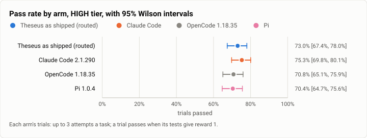
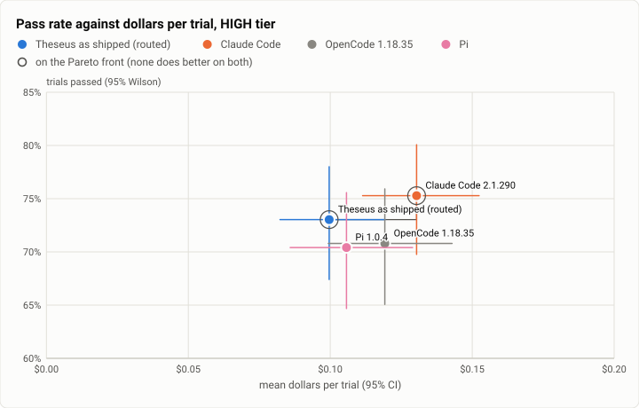
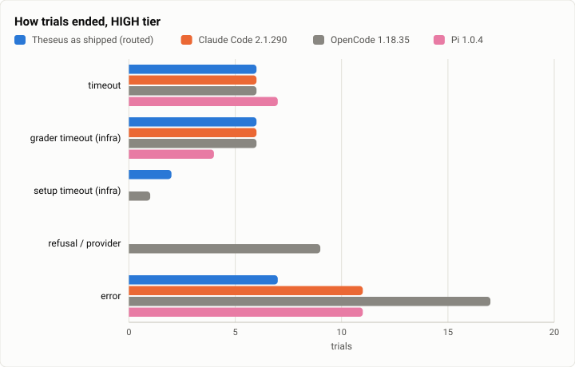

# Terminal-Bench 2.0 at the v1 freeze, HIGH tier: Theseus as shipped against Claude Code, OpenCode and Pi (2026-10-18)

**The answer first.** All 89 tasks of Terminal-Bench 2.0 ran three times for each arm, with every harness at high
effort. Theseus as shipped (Jev picking each message's model and effort, capped at high) solved **73.0%** of its
trials [67.4, 78.0]. The rivals each ran on Claude Sonnet 5.5:
- Claude Code 2.1.290 solved **75.3%** [69.8, 80.1];
- OpenCode 1.18.35 solved 70.8%;
- Pi 1.0.4 solved 70.4%.

Paired by task, Theseus is **level with Claude Code**: −2.2 points, 95% interval −7.9 to +3.0, 12 tasks better and 14
worse. It is level with OpenCode (+2.2) and Pi (+2.6). Every interval crosses zero.

Theseus's lead over Pi and OpenCode is its refusal fallback, as on Oct 13. On three security-flavoured tasks Sonnet
5.5 refused. Theseus went on with another model and solved 8 of 9, while Pi and OpenCode solved none.

**Dollars split the arms where the score does not.** Theseus paid **$0.136 a solved task**, the least of the four:
Pi paid $0.150, OpenCode $0.168 and Claude Code $0.173. Jev ran 59% of Theseus's turns on Sonnet 5.5 at high effort,
24% on the base profile (Sonnet 5.5 at medium) and 15% on Haiku 5.5 at high effort, which brings its $0.100 a trial
under Claude Code's $0.130.

None of Theseus's 2,218 model calls went to a China-origin model.

<picture>
  <source media="(prefers-color-scheme: dark)" srcset="img/2026-10-18-terminal-bench-v1-high/pass-rates-high-dark.svg">
  
</picture>

*Figure 1. Which harness solves the most trials, and do the intervals separate? Claude Code solved 6 more trials than
Theseus, and Theseus 6 to 7 more than OpenCode and Pi. All four intervals overlap.*

| | |
|---|---|
| Suite | Terminal-Bench 2.0 (`terminal-bench@2.0`) through Harbor 0.23 |
| Arms | **Theseus as shipped** (`theseus_agent:TheseusRouted`, the frozen build `351159fc`, Jev routing on the live table, effort bounds `low` to `high`) · **Claude Code 2.1.290** (`reasoning_effort` high) · **OpenCode 1.18.35** (`variant` high) · **Pi 1.0.4** (`thinking` high); the three rivals on Claude Sonnet 5.5 |
| Trials | 89 tasks × 3 an arm (1,068) |
| Date and commit | 2026-10-18, 16:20 to 19:01 (UTC−7), on four EC2 hosts; Theseus at `351159fc`, the v1 feature freeze |
| Cost | $121.47 at list prices: Theseus $26.60, Claude Code $34.81, OpenCode $31.83, Pi $28.22 (the trials' own records) |
| Data | [`2026-10-18-terminal-bench-v1-high.json`](2026-10-18-terminal-bench-v1-high.json), [`.csv`](2026-10-18-terminal-bench-v1-high.csv) (one row per trial) |

## The question

v1 is a harness. The question is whether Theseus, as it ships, is as good as the best other harnesses on their own
best model. The owner's plan for benchmarks (Oct 17) narrows a broad pass to the top three rivals. Terminal-Bench's
broad pass of Oct 13 put Claude Code, OpenCode and Pi level at about 71.5% each on all 89 tasks.

The run has two tiers. **HIGH**, this report, is the cost trade-off: every harness at high effort, and Jev's effort
capped at high. **MAX**, its own report, gives every harness its top effort on the 30 hard tasks.

## The setup

- **Theseus as shipped.**
  - The frozen build's static musl `theseus` and `theseusd` run in each task's container. The adapter is
    `TheseusRouted` with the judge on, the routed profile, a $20 spend limit (reservations) and a 60 s command wait.
  - The routed profile (`bench/theseus-bench-routed.toml`) was brought to the table the owner runs live. Sonnet 5.5
    runs at medium and Opus at medium, Fable at high, `opushi` is added (the shipped `review` class names it first), and
    the effort bounds are `["low", "high"]`. The repository's bench copy had drifted from the live table; a follow-up
    brings it level.
  - No China-origin profile is routable: the live table routes none, and the bench has no Z.ai or DeepSeek key.
- **The rivals** are pinned as on Oct 13 and run on Claude Sonnet 5.5. Each gets high effort through its own option,
  and its record says which effort ran (all three: `high`). Caps are $2 and 200 turns a trial. No trial passed either.
- **Hosts.**
  - Four m7a.8xlarge on EC2 (32 vCPU, 123 GB), each holding all of a task's jobs for every arm.
  - Tasks ran longest first, split by Oct 13's trial times.
  - The run started at 16 jobs a host. Every host's CPU pressure passed 83%, so at 16:38 each was set to 12 (Oct 13's
    level). The first 20 minutes' heavy tasks ran under that load (see Threats).

## Results

| Arm | Trials passed (95% Wilson) | $ a trial (95%) | $ a solve | Agent s (median) | Model calls | Timeout / grader timeout / setup timeout / refusal / error |
|---|---|---|---|---|---|---|
| Theseus as shipped | 195/267 = **73.0%** [67.4, 78.0] | **$0.100** [0.082, 0.119] | **$0.136** | 50 | 8.6 | 6 / 6 / 2 / 0 / 7 |
| Claude Code 2.1.290 | 201/267 = **75.3%** [69.8, 80.1] | $0.130 [0.111, 0.152] | $0.173 | 56 | 8.2 | 6 / 6 / 0 / 0 / 11 |
| OpenCode 1.18.35 | 189/267 = 70.8% [65.1, 75.9] | $0.119 [0.099, 0.143] | $0.168 | 60 | 7.7 | 6 / 6 / 1 / 9 / 17 |
| Pi 1.0.4 | 188/267 = 70.4% [64.7, 75.6] | $0.106 [0.086, 0.129] | $0.150 | 55 | 7.7 | 7 / 4 / 0 / 0 / 11 |

| Theseus − arm, by task | Mean gap (95%, bootstrap over tasks) | Tasks better / worse | Sign test |
|---|---|---|---|
| Claude Code | −2.2 points [−7.9, +3.0] | 12 / 14 | p = 0.85 |
| OpenCode | +2.2 points [−4.1, +9.0] | 13 / 11 | p = 0.84 |
| Pi | +2.6 points [−3.4, +9.0] | 18 / 12 | p = 0.36 |

On the **30 hard tasks**, the HIGH tier solved 66.7% for Theseus, 67.8% each for Claude Code and OpenCode, and 71.1%
for Pi. These are the tier trade-off's comparison points for the MAX report.

<picture>
  <source media="(prefers-color-scheme: dark)" srcset="img/2026-10-18-terminal-bench-v1-high/pareto-dollars-high-dark.svg">
  
</picture>

*Figure 2. Which harness buys the most passes for the least money? Theseus and Claude Code are the frontier. Theseus
is cheapest per trial at a pass rate inside Claude Code's interval.*

<picture>
  <source media="(prefers-color-scheme: dark)" srcset="img/2026-10-18-terminal-bench-v1-high/endings-high-dark.svg">
  
</picture>

*Figure 3. How does each harness's run end when it does not end on its own? Mostly the same way for all four. The
exceptions are OpenCode's 9 refusals and its 14 non-zero exits.*

## Model selection

Theseus's arm is the only one that picks a model, so this section reads its trials' own ledgers. The `route.decided`
and `judge.call` rows and each model call's usage come from the 252 trials that saved ledgers; the other 15 have none.

| Model | Provider / origin | Model calls | Share of calls | $ | Share of $ |
|---|---|---|---|---|---|
| claude-sonnet-5-5 | anthropic / US | 1,726 | 77.8% | 23.10 | 88.4% |
| claude-haiku-5-5 | anthropic / US | 363 | 16.4% | 0.42 | 1.6% |
| claude-sonnet-5 | anthropic / US | 115 | 5.2% | 2.41 | 9.2% |
| claude-opus-5-5 | anthropic / US | 14 | 0.6% | 0.21 | 0.8% |

- **China-origin share: 0 of 2,218 calls (0.0%).** GLM left live routing on Oct 17, and DeepSeek is not configured.
  The routed table here is Anthropic-only, as it was on Oct 13.
- **Jev's mode per turn:** deep coding 193 (74.5%), routine coding 60 (23.2%) and sophisticated 6 (2.3%).
- **Profile per turn:** `sonnethi` 59.1%, the base `bench` profile 24.3% (Jev's confidence under the switch line),
  `haikuhi` 15.4% and `opus` 1.2%. The turn ran at high effort 181 times and at medium 78; Jev never went below
  medium.
- **Solve rate by mode:** deep coding 153 of 186, routine coding 40 of 60, sophisticated 2 of 6.
- **`claude-sonnet-5` is the refusal fallback.** On security-flavoured tasks (for example `crack-7z-hash` and
  `break-filter-js-from-html`) Sonnet 5.5's first call returned nothing, and the turn went on with Sonnet 5.
- **Jev's data verdicts are a finding.**
  - route.v6 asks whether a message's data is open or private. On these open-source tasks every verdict should be
    `open (act)`.
  - Jev said `private` in 155 of 258 turns (78 escalate, 57 confirm, 20 act) and `open` in 103, never with `act`.
  - Under the data gate that the China-origin routing work plans, these turns would be kept off China-origin models
    or held for a question. The gate's open-path list, not Jev's guess, has to carry open-source work.
- **Against Oct 13.**
  - The fixed-model Theseus of R0 and R1 (Sonnet 5.5 at medium; 89 tasks, 5 attempts) solved 78.6% of its trials
    with ledgers, at $0.156 a solve. As shipped today it solves 77.4% of those, at $0.135. These are different task
    draws and efforts, so read this as context, not a paired test.
  - On Oct 7's 14-task night set, the like-with-like comparison, the routed arm solved 37 of 42 (88.1%) at $0.166 a
    trial. On Oct 13 it solved 26 of 28 (92.9%) at $0.212, with the same profile shares, since Jev routes the same
    prompts the same way.

## Analysis

- **Level with the best rival, at lower cost.** Paired by task, the 26 tasks where Theseus and Claude Code differ split
  12 to 14. Claude Code's 6-trial edge sits inside its own interval. Theseus reaches the same pass rate for 77% of
  Claude Code's dollars per trial.
- **The lead over Pi and OpenCode is one feature.** Three tasks refuse on Sonnet 5.5 (`crack-7z-hash`,
  `break-filter-js-from-html`, `vulnerable-secret`). Theseus and Claude Code go on and solve them (8 and 9 of 9),
  while Pi and OpenCode stop (0 of 9 each). Without those three tasks, Theseus is within a point of Pi and OpenCode (−0.4
  and −0.8 points), and 1.9 points behind Claude Code.
- **Routing paid for itself.** A quarter of turns stayed on Sonnet 5.5 at medium and 15% went to Haiku at high
  effort. Those turns solved routine coding 40 of 60 times at a fraction of the price. The fixed-model Theseus of
  Oct 13 paid $0.156 a solve; as shipped it pays $0.136.
- **Where Theseus loses to Claude Code**, by task: `build-pmars`, `crack-7z-hash`, `gpt2-codegolf`, `kv-store-grpc`,
  `large-scale-text-editing`, `mteb-leaderboard`, `path-tracing`, `polyglot-c-py`, `polyglot-rust-c`,
  `pytorch-model-recovery`, `sanitize-git-repo`, `sqlite-with-gcov`, `torch-tensor-parallelism` and `train-fasttext`
  (14). It wins on 12. The improvement assessment reads the losing trajectories for real-user causes.

## What changed since Oct 13

- **Theseus:** 158 merges (822 commits), including checkpoint routing, Haiku-first routine tasks, the task journey and
  RSI loop 1, plus the routed profile brought to the live table (`opushi`, efforts, bounds).
- **Rivals:** the same versions, now at **high** effort (medium on Oct 13). Claude Code rose from 71.5% to 75.3%,
  OpenCode from 71.5% to 70.8%, and Pi from 71.2% to 70.4%.
- **Theseus's arm** is now routed on all 89 tasks. Oct 13's 74.5% was the fixed-model arm at medium.

## Threats to validity

- **Host load in the first 20 minutes.**
  - At 16 jobs a host, every arm hit infrastructure endings: grader timeouts on `filter-js-from-html`, Harbor's
    30-second exec timeouts and an OOM kill on `make-doom-for-mips`, and setup timeouts. 42 trials across the four
    arms ended this way, 8 of them Theseus's.
  - `torch-pipeline-parallelism`'s grader times out on every arm, as it did on Oct 13. `caffe-cifar-10` times out as on
    Oct 13 too. Both are inherent.
  - Excluding all 11 tasks with any such ending, the paired gaps are Claude Code −2.6 [−8.1, +2.6], OpenCode +0.9 and
    Pi +3.8. The same picture.
- **Three attempts a task.** A one-task difference moves the paired mean by about 1.1 points, and the intervals are
  about ±5 points wide.
- **The routed arm's effort is Jev's.** Its records name the base profile's effort (`medium`). The effort each turn
  ran is in the model selection section.
- **Cost counts.** These are the trials' own records at list prices. The driver's count, which includes trials still
  settling, read $127.86.

## Cost

Model spend for this tier was $121.47. The AWS cost (four hosts, NAT data) is shared with the MAX tier and is in the
MAX report.

## Reproduction

```
# the hosts: Harbor 0.23, the v1 harness (eight tier arms), the tier trees at 351159fc
tb_run_v1.sh start runs/v1-high-N --phases high --tasks <host N's share>     # 12 jobs a host, k = 3
headline.py tb/merged-high/jobs tb/hl-high                                   # rows.csv, the table
tb_report.py tb/hl-high/rows.csv high report.json                            # paired gaps, figures
model_selection.py --jobs tb/merged-high/jobs --arms theseus-routed-high     # the model selection section
python3 bench/report/draft.py plot docs/benchmarks/2026-10-18-terminal-bench-v1-high.json
```
