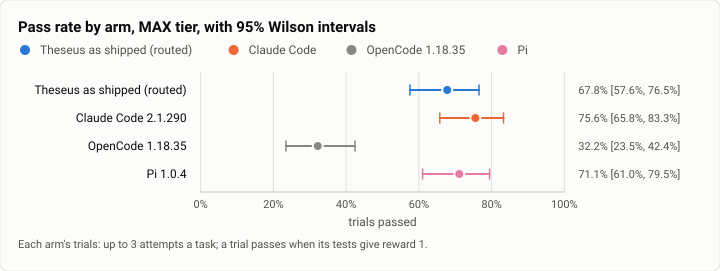
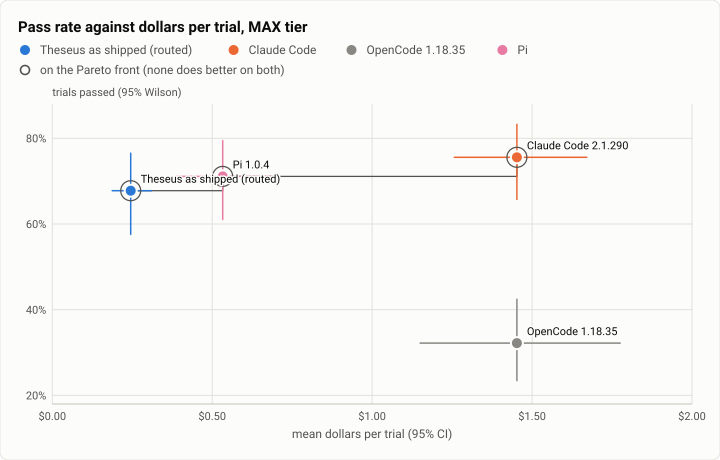
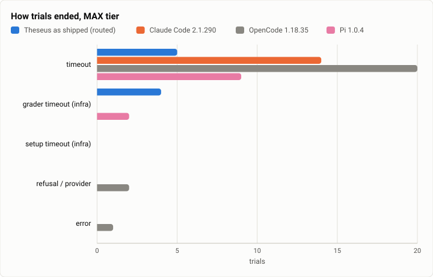

# Terminal-Bench 2.0 at the v1 freeze, MAX tier: the hard tasks, every harness at its top effort (2026-10-18)

**The answer first.** This tier ran Terminal-Bench 2.0's 30 hard tasks three times each, with every harness at its top
effort. The rivals ran on Claude Sonnet 5.5: Claude Code at `max`, OpenCode at `max`, and Pi at `xhigh` (its top
level). Theseus ran as shipped, with Jev free to choose up to `max`.
- **Claude Code 2.1.290 solved 75.6%** [65.8, 83.3];
- Pi 1.0.4 solved 71.1%;
- **Theseus as shipped solved 67.8%** [57.6, 76.5];
- OpenCode 1.18.35 solved 32.2%.

Paired by task, Theseus trails Claude Code by 7.8 points [−18.9, +1.1]: 1 task better and 4 worse. It is level with
Pi (−3.3 points).

**Max effort bought Claude Code its lead at six times the price.** On the same 30 tasks at HIGH, Claude Code solved
67.8% at $0.31 a solve. At MAX it solved 75.6% at **$1.92 a solve**.

Theseus barely moved, from 66.7% to 67.8% and from $0.25 to $0.36 a solve. Jev never chose `max`: on these hard tasks
it ran high (69 turns), xhigh (9) and medium (12). **Theseus as shipped spends a fifth of what Claude Code spends a
solved task here.**

OpenCode at `max` mostly ran out of time: 20 of its 90 trials hit the agent timeout.

<picture>
  <source media="(prefers-color-scheme: dark)" srcset="img/2026-10-18-terminal-bench-v1-max/pass-rates-max-dark.svg">
  
</picture>

*Figure 1. Which harness solves the most of the hard tasks at top effort, and do the intervals separate? Claude Code
solves the most. Pi and Theseus sit inside its interval, and OpenCode falls far behind.*

| | |
|---|---|
| Suite | Terminal-Bench 2.0 (`terminal-bench@2.0`) through Harbor 0.23, its 30 hard tasks |
| Arms | **Theseus as shipped** (`TheseusRouted`, `351159fc`, Jev routing on the live table, effort bounds `low` to `max`) · **Claude Code 2.1.290** (`reasoning_effort` max) · **OpenCode 1.18.35** (`variant` max) · **Pi 1.0.4** (`thinking` xhigh); the rivals on Claude Sonnet 5.5 |
| Trials | 30 tasks × 3 an arm (360) |
| Date and commit | 2026-10-18, 18:02 to 20:27 (UTC−7), on four EC2 hosts as the HIGH tier drained; Theseus at `351159fc` |
| Cost | $331.48 in model calls at list prices (Claude Code $130.73, OpenCode $130.73, Pi $47.95, Theseus $22.07); the hosts for both tiers about $84 |
| Data | [`2026-10-18-terminal-bench-v1-max.json`](2026-10-18-terminal-bench-v1-max.json), [`.csv`](2026-10-18-terminal-bench-v1-max.csv) |

## The question

What does each harness give at its best, regardless of cost? The owner's two tiers (Oct 17) pair this with HIGH, the
cost trade-off ([HIGH](2026-10-18-terminal-bench-v1-high.md)). MAX runs only on the 30 hard tasks, where effort can
matter, and stays inside the night's spend limit.

## The setup

- **As HIGH** ([its setup](2026-10-18-terminal-bench-v1-high.md#the-setup)), with these differences:
  - each rival's top effort;
  - Theseus's routed profile with the shipped effort bounds `["low", "max"]`;
  - caps of $5 and 300 turns a trial (5 OpenCode trials passed $5; its harness does not stop at the cap);
  - the same hosts, 12 jobs a host, started as each host's HIGH queue emptied.
- **Spend stops.**
  - Each host's MAX run carried a spend limit, and the hosts' limits were set by hand to hold the night's $500
    Terminal-Bench line.
  - One host's run paused at its limit with five jobs unstarted. They ran afterwards in two small runs on the same host.

## Results

| Arm | Trials passed (95% Wilson) | $ a trial (95%) | $ a solve | Agent s (median) | Model calls | Timeout / grader timeout / refusal / error |
|---|---|---|---|---|---|---|
| Theseus as shipped | 61/90 = 67.8% [57.6, 76.5] | **$0.245** [0.187, 0.311] | **$0.362** | 96 | 11.8 | 5 / 4 / 0 / 0 |
| Claude Code 2.1.290 (max) | 68/90 = **75.6%** [65.8, 83.3] | $1.453 [1.257, 1.671] | $1.923 | 792 | 20.8 | 14 / 0 / 0 / 0 |
| Pi 1.0.4 (xhigh) | 64/90 = 71.1% [61.0, 79.5] | $0.533 [0.388, 0.697] | $0.749 | 215 | 16.7 | 9 / 2 / 0 / 0 |
| OpenCode 1.18.35 (max) | 29/90 = 32.2% [23.5, 42.4] | $1.453 [1.150, 1.776] | $4.508 | 389 | 25.3 | 20 / 0 / 2 / 1 |

| Theseus − arm, by task | Mean gap (95%, bootstrap over tasks) | Tasks better / worse | Sign test |
|---|---|---|---|
| Claude Code | −7.8 points [−18.9, +1.1] | 1 / 4 | p = 0.38 |
| Pi | −3.3 points [−13.3, +5.6] | 4 / 4 | p = 1.00 |
| OpenCode | +35.6 points [+20.0, +52.2] | 14 / 2 | p = 0.004 |

**The tier trade-off** on the same 30 tasks (HIGH from [its report](2026-10-18-terminal-bench-v1-high.md)):

| Arm | HIGH: passed, $ a solve | MAX: passed, $ a solve | Change |
|---|---|---|---|
| Theseus as shipped | 66.7%, $0.254 | 67.8%, $0.362 | +1.1 points for 1.4× a solve |
| Claude Code | 67.8%, $0.308 | 75.6%, $1.923 | +7.8 points for 6.2× a solve |
| Pi | 71.1%, $0.248 | 71.1%, $0.749 | none, for 3.0× a solve |
| OpenCode | 67.8%, $0.297 | 32.2%, $4.508 | −35.6 points: `max` runs out of time |

<picture>
  <source media="(prefers-color-scheme: dark)" srcset="img/2026-10-18-terminal-bench-v1-max/pareto-dollars-max-dark.svg">
  
</picture>

*Figure 2. Which harness buys the most passes for the least money at top effort? Theseus at $0.24 a trial and Claude
Code at $1.45 form the frontier. Pi sits between them, just inside it.*

<picture>
  <source media="(prefers-color-scheme: dark)" srcset="img/2026-10-18-terminal-bench-v1-max/endings-max-dark.svg">
  
</picture>

*Figure 3. How does each harness's run end at top effort when it does not end on its own? Mostly by the agent
timeout: OpenCode 20 times, Claude Code 14, Pi 9 and Theseus 5.*

## Model selection

This section reads Theseus's 86 trials with ledgers.
- **Models:** Claude Sonnet 5.5 for all 1,050 calls, with **0 China-origin**. Jev sent nothing on these hard tasks to
  Haiku or Opus.
- **Mode:** deep coding 84 turns (93%) and routine coding 6.
- **Profile:** `sonnethi` 80%, and the base profile 20% (Jev under the switch line).
- **Effort the turn ran at:** high 69, xhigh 9, medium 12, **max 0**. The bounds allowed `max`; Jev's effort answer
  never reached it.
- **Solve rate by mode:** deep coding 61 of 80, routine coding 0 of 6. Every turn Jev called routine on a hard task
  failed.
- **Data verdicts:** `private` 49 and `open` 41, never `open (act)`. This is the same finding as HIGH: on open-source
  work the data gate cannot rely on Jev's guess.
- **Against the previous run:** no comparable earlier MAX run exists, so this is the first.

## Analysis

- **Claude Code's lead here is effort, paid for.** At `max` it takes 21 model calls and 13 minutes a trial, against 10
  calls and 1.4 minutes at HIGH on the same tasks. It solves 7 more trials at 6.2 times the price of each solve.
- **Theseus as shipped does not escalate effort on hard tasks.** With `max` allowed, Jev kept 90% of turns at high or
  below. That leaves 8 points on the table against Claude Code's max, and saves five-sixths of the spend. Whether a user wants
  that trade is a routing-table question, not a harness limit. The improvement assessment names it.
- **The six turns Jev called routine all failed.** On a hard task, a routine verdict sends the turn to a cheaper
  profile and lower effort. HIGH showed the same shape.
- **OpenCode's `max` variant is not usable at these timeouts.** It loses 36 points against its own HIGH run.

## What changed since Oct 13

This is the first MAX-tier run. Oct 13 ran all arms at medium. On the hard 30 at Oct 13's medium effort, Theseus solved
66.7%, Claude Code 66.7%, Pi 67.8% and OpenCode 72.2% (all 89 tasks × 3, the hard subset).

## Threats to validity

- **Spend stops decided what ran when.** Every task ran all four arms, but five jobs ran later than their host's order
  (above). The hard tasks are long, and a job's place in the queue does not change its result.
- **Three attempts on 30 tasks.** The intervals are about ±10 points. The Claude Code gap's interval crosses zero.
- **The routed arm's records name the base effort** (`medium`). The turns' real efforts are in the model selection
  section.

## Cost

Model calls: $331.48 at list prices, of which Theseus's were $22.07.

AWS for both tiers was about $84, estimated from the hours and the NAT's bytes (Cost Explorer lags a day):
- four m7a.8xlarge for 21.1 host-hours, $39;
- 945 GB through the NAT, $43 (the agents' installs inside every trial and the task images);
- the root volumes, $2.

The hosts were terminated as each finished its last pull.

## Reproduction

```
tb_run_v1.sh start runs/v1-max-N --phases max --tasks <host N's hard tasks>     # 12 jobs a host, k = 3
headline.py tb/merged-max/jobs tb/hl-max
tb_report.py tb/hl-max/rows.csv max report.json --tasks @hard30.txt
model_selection.py --jobs tb/merged-max/jobs --arms theseus-routed-max
python3 bench/report/draft.py plot docs/benchmarks/2026-10-18-terminal-bench-v1-max.json
```
