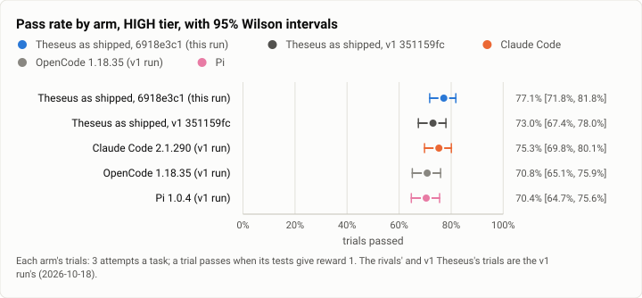
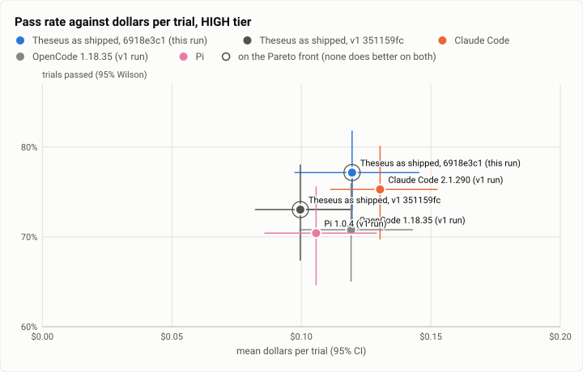

# Terminal-Bench 2.0 rerun, HIGH tier: Theseus at 6918e3c1 against v1's Theseus and the v1 rivals (2026-10-21)

**The answer first.** Theseus as shipped was rerun on all 89 tasks of Terminal-Bench 2.0, three times each, on build
`6918e3c1` (the patch1 work, three days after v1). Jev picked each message's model and effort, capped at high. It
solved **77.2%** of its trials [71.8, 81.8], against **73.0%** for v1's Theseus on the same tasks.
- Paired by task, that is **+4.1 points** over v1 [−1.9, +10.1]: 16 tasks better and 10 worse. The interval crosses
  zero, so this is a likely gain, not a proven one.
- Against the v1 run's rivals (not rerun; their trials stand), Theseus now sits **above Claude Code's 75.3%**
  (+1.9 points paired [−3.7, +7.1]), and above OpenCode (70.8%) and Pi (70.4%). Against Pi the paired gap is
  +6.7 points [+0.7, +13.1].

**It costs a little more.** Theseus paid **$0.120 a trial** and **$0.155 a solved task**, against v1's $0.100 and
$0.136. That is still below Claude Code's $0.173 a solve and OpenCode's $0.168, and level with Pi's $0.150. Turns ran
longer, with a median of 68 agent seconds against 50, and more of them ran on Sonnet 5.5 at high effort (66% against
59%).

None of Theseus's 2,549 model calls went to a China-origin model.

<picture>
  <source media="(prefers-color-scheme: dark)" srcset="img/2026-10-21-terminal-bench-rerun-high/pass-rates-high-dark.svg">
  
</picture>

*Figure 1. Did the patch work move Theseus's pass rate, and where does it sit among the v1 rivals? Theseus solved 11
more trials than at v1, and more than any v1 rival; every interval still overlaps.*

| | |
|---|---|
| Suite | Terminal-Bench 2.0 (`terminal-bench@2.0`) through Harbor 0.23 |
| Arms | **Theseus as shipped** (`theseus_agent:TheseusRouted`, `6918e3c1`, Jev routing on the live table, effort bounds `low` to `high`). For comparison, from the [v1 run](2026-10-18-terminal-bench-v1-high.md) (Oct 18): Theseus at `351159fc`, **Claude Code 2.1.290**, **OpenCode 1.18.35** and **Pi 1.0.4**, all at high effort, the rivals on Claude Sonnet 5.5 |
| Trials | 89 tasks × 3 (267) for Theseus; the v1 arms' 267 each are reused |
| Date and commit | 2026-10-21, 19:45 to 21:38 (UTC−7), on two EC2 hosts; Theseus at `6918e3c1` |
| Cost | $31.94 at list prices (the trials' own records) |
| Data | [`2026-10-21-terminal-bench-rerun-high.json`](2026-10-21-terminal-bench-rerun-high.json), [`.csv`](2026-10-21-terminal-bench-rerun-high.csv) (this run's trials, one row each) |

## The question

What did the three days of work after v1 do to Theseus on real tasks? That work includes turn-end facts, job truths,
effort on evidence, route.v7 and checkpoint routing (below). The rivals have not changed since v1, so only Theseus was
rerun. The owner approved this scope on Oct 21: Theseus only, both tiers, a model cap of $140 and about $25 of AWS.
The rivals' v1 trials stand in every comparison here.

The two tiers are as in v1. **HIGH**, this report, is the cost trade-off: Jev's effort is capped at high. **MAX**, its
own report ([MAX](2026-10-21-terminal-bench-rerun-max.md)), gives Jev the shipped bounds on the 30 hard tasks.

## The setup

- **Theseus as shipped**, as in v1 ([its setup](2026-10-18-terminal-bench-v1-high.md#the-setup)), with these
  differences:
  - The build is `6918e3c1`. Its static musl `theseus` and `theseusd` were built with the install's own `release`
    profile (fat LTO). v1 used `release-thin`. The profile changes speed, not behaviour.
  - The routed profile is the repository's own `bench/theseus-bench-routed.toml`, which now mirrors the live table
    (since `5e0bd195`), with the effort bounds `["low", "high"]` and the shipped `review` class added. v1 made the
    same edits by hand.
  - The adapter, judge, $20 spend limit (reservations) and 60 s command wait are unchanged.
- **Hosts.** Two m7a.8xlarge on EC2 (32 vCPU, 123 GB), 12 jobs a host. Tasks were split by v1's Theseus trial times,
  longest first. HIGH and MAX ran side by side on the same hosts: 9 HIGH jobs and 3 MAX at first, with MAX taking
  each slot HIGH freed. The hosts' CPU pressure read above 90% at every check in the first hour (see Threats).
- **The rivals** are not rerun. Their numbers are the v1 run's, on the same 89 tasks, 3 attempts each.

## Results

| Arm | Trials passed (95% Wilson) | $ a trial (95%) | $ a solve | Agent s (median) | Model calls | Timeout / grader timeout / setup timeout / refusal / error |
|---|---|---|---|---|---|---|
| **Theseus, 6918e3c1** (this run) | 206/267 = **77.2%** [71.8, 81.8] | $0.120 [0.098, 0.145] | $0.155 | 68 | 9.8 | 11 / 3 / 0 / 0 / 6 |
| Theseus, v1 `351159fc` | 195/267 = 73.0% [67.4, 78.0] | **$0.100** [0.082, 0.119] | **$0.136** | 50 | 8.6 | 6 / 6 / 2 / 0 / 7 |
| Claude Code 2.1.290 (v1 run) | 201/267 = 75.3% [69.8, 80.1] | $0.130 [0.111, 0.152] | $0.173 | 56 | 8.2 | 6 / 6 / 0 / 0 / 11 |
| OpenCode 1.18.35 (v1 run) | 189/267 = 70.8% [65.1, 75.9] | $0.119 [0.099, 0.143] | $0.168 | 60 | 7.7 | 6 / 6 / 1 / 9 / 17 |
| Pi 1.0.4 (v1 run) | 188/267 = 70.4% [64.7, 75.6] | $0.106 [0.086, 0.129] | $0.150 | 55 | 7.7 | 7 / 4 / 0 / 0 / 11 |

| Theseus 6918e3c1 − arm, by task | Mean gap (95%, bootstrap over tasks) | Tasks better / worse | Sign test |
|---|---|---|---|
| Theseus v1 | +4.1 points [−1.9, +10.1] | 16 / 10 | p = 0.33 |
| Claude Code | +1.9 points [−3.7, +7.1] | 16 / 9 | p = 0.23 |
| OpenCode | +6.4 points [−0.0, +13.1] | 15 / 8 | p = 0.21 |
| Pi | +6.7 points [+0.7, +13.1] | 16 / 8 | p = 0.15 |

**Where the gain is.** On the 30 hard tasks Theseus solved 73.3% (66 of 90), against v1's 66.7%. On the other 59 it
solved 79.1%, against 76.3%. The hard tasks carry most of the gain, and they also carry most of the extra cost: $0.209
a trial against $0.169.

<picture>
  <source media="(prefers-color-scheme: dark)" srcset="img/2026-10-21-terminal-bench-rerun-high/pareto-dollars-high-dark.svg">
  
</picture>

*Figure 2. Which arm buys the most passes for the least money, and which way did Theseus move since v1? Up and a
little right: 4 points more for 2 cents more a trial, still left of Claude Code.*

**How trials ended.** The infrastructure endings are the ones v1 saw:
- `torch-pipeline-parallelism`'s grader timed out three times. It does so on every arm.
- `qemu-startup` and `qemu-alpine-ssh` end with the agent's non-zero exit on all trials, as they did in v1.
- `caffe-cifar-10` hit the agent timeout three times (inherent, as in v1).

Theseus's own timeouts rose from 6 to 11: `compile-compcert` 3 (it solved 2 of 3 in v1), `crack-7z-hash` 2,
`make-doom-for-mips` 2 and `train-fasttext` 1.

## Model selection

Theseus's arm is the only one that picks a model, so this section reads its trials' own ledgers: the `route.decided`
and `judge.call` rows and each model call's usage. 258 trials saved ledgers; the rest include the six qemu trials, whose agent never started.

| Model | Provider / origin | Model calls | Share of calls | $ | Share of $ |
|---|---|---|---|---|---|
| claude-sonnet-5-5 | anthropic / US | 1,937 | 76.0% | 27.51 | 87.9% |
| claude-haiku-5-5 | anthropic / US | 493 | 19.3% | 0.40 | 1.3% |
| claude-sonnet-5 | anthropic / US | 116 | 4.6% | 3.30 | 10.6% |
| claude-opus-5-5 | anthropic / US | 3 | 0.1% | 0.08 | 0.3% |

- **China-origin share: 0 of 2,549 calls (0.0%).** The bench has no Z.ai or DeepSeek key, and the live table routes
  no China-origin profile.
- **Route decisions:** 327 in 261 turns, where v1 made 259 in 259. The patch work's checkpoint routing ("a routed turn
  that keeps failing asks a checkpoint and moves up") now re-routes mid-turn.
- **Jev's mode per decision:** deep coding 259 (79.2%), routine coding 61 (18.7%), sophisticated 6 and no verdict 1.
- **Profile:** `sonnethi` 65.7% (v1 59.1%), the base `bench` profile 20.2% (24.3%), `haikuhi` 13.8% (15.4%) and
  `opus` 0.3% (1.2%).
- **Effort the turn ran at:** high 271 and medium 55. Jev asked for `xhigh` 107 times and `max` 8 times. Both are
  above this tier's cap, so those turns ran at high (or medium, on the base profile). A `haikuhi` turn never ran below high. That is the patch work's "a
  routed profile never runs below its own effort".
- **Solve rate by mode:** deep coding 162 of 190, routine coding 42 of 61, sophisticated 2 of 6.
- **`claude-sonnet-5` is the refusal fallback,** as in v1. `break-filter-js-from-html` and `vulnerable-secret` were
  solved 3 of 3. `crack-7z-hash` was solved 0 of 3, two of them by agent timeout.
- **Jev's data verdicts moved.** route.v7 rewords the data question.
  - v1 called these open-source tasks `private` in 60% of turns and never said `open (act)`.
  - Now `private` is 59 of 340 verdicts (17%) and `open (act)` 51 (15%). Most verdicts are `open` with a band of
    escalate (127) or confirm (95).
  - Every verdict here should still be `open (act)`. The data gate's open-path list, not Jev's guess, still has to
    carry open-source work.
- **Against v1, like with like** (the trials with ledgers): 79.8% at $0.153 a solve, against 77.4% at $0.135.

## Analysis

- **Theseus moved up, and the move is mostly on the hard tasks.** The 30 hard tasks went from 66.7% to 73.3%. The
  route ledgers show why the money moved too: the share of turns on `sonnethi` rose, Jev asked for more effort
  (`xhigh` in a third of decisions, against a quarter in v1), and checkpoints re-routed 66 times mid-turn. More work a trial, more passes.
- **Against the rivals the order changed.** At v1, Claude Code led Theseus by 2.2 points. Now Theseus's point
  estimate is 1.9 points above Claude Code's v1 run. Both intervals cross zero, and the rivals were not rerun on the
  same night (see Threats). The defensible reading is that Theseus is level with the best rival and the cheapest of
  the four per solve but for Pi, which is level.
- **The tasks that went down** are mostly long ones that now run into the agent timeout: `compile-compcert`,
  `train-fasttext` and `crack-7z-hash`. The rest are `chess-best-move`, `dna-assembly`, `install-windows-3.11`,
  `mailman`, `query-optimize`, `raman-fitting` and `video-processing`. The tasks that went up include
  `adaptive-rejection-sampler`, `build-pmars`, `configure-git-webserver`, `gpt2-codegolf`, `kv-store-grpc`,
  `large-scale-text-editing`, `mteb-leaderboard`, both `polyglot` tasks, `pytorch-model-recovery`, `sanitize-git-repo`
  and `sqlite-with-gcov`. 12 of the 14 tasks Theseus lost to Claude Code at v1 are among them.

## What changed since v1

- **Theseus:** 371 commits (97 merges) from `351159fc` to `6918e3c1`. Those the bench touches:
  - turn-end facts: a command's result names the new files it left, and a turn ending beside them is told once;
  - job truths: a job's command and outcome are reported as they are;
  - effort on evidence: a checkpoint raises effort without a move, and a routed profile never runs below its own
    effort;
  - checkpoint routing and route.v7: a failing routed turn asks a checkpoint and moves up, and the data question is
    reworded;
  - the bench profile now mirrors the live table in the repository itself.
- **Rivals:** unchanged and not rerun. Their v1 trials stand.

## Threats to validity

- **Not the same night as the rivals.** The rivals ran on Oct 18, and Theseus ran on Oct 21. Model-side drift in
  Sonnet 5.5 over three days is unmeasured here. The v1 Theseus arm is the like-for-like baseline. The rival
  comparisons are context.
- **Host load.** Both hosts read above 90% CPU pressure at every check in the first hour, since each started with its
  longest tasks on both tiers at once. v1 ran four hosts. The infrastructure endings (grader timeout on `torch-pipeline-parallelism`,
  the qemu exits) match v1's, and there were no 30-second exec timeouts or setup timeouts. The extra agent timeouts on
  long tasks may still owe something to load.
- **Three attempts a task.** One task's difference moves the paired mean by about 1.1 points. The intervals are about
  ±6 points wide.
- **The routed arm's records name the base effort** (`medium`). The effort each turn ran is in the model selection
  section.
- **A different build profile.** The bench binaries were built `release` (fat LTO), v1's `release-thin`. That does not
  change what the agent does.

## Cost

Model spend for this tier was $31.94 at list prices (the trials' records; the driver counted $35.27). The whole rerun,
both tiers, spent $53.18, against the owner's $140 cap.

AWS for both tiers was about $20, estimated from the hours and the NAT's bytes (Cost Explorer lags a day):
- two m7a.8xlarge for 4.1 host-hours, about $7.70;
- 222.5 GB through the NAT, about $10.00 (task images and the installs inside trials);
- the root volumes and the NAT's hours, under $1;
- about 8% tax.

The stack was deleted after the last pull.

## Reproduction

```
# the hosts: Harbor 0.23, the v1 harness, the tier trees and static musl binaries at 6918e3c1
tb_run_v1.sh start runs/rr-high-N --phases high --arms theseus-routed-high --tasks <host N's share>   # k = 3
headline.py tb/merged-high/jobs tb/hl-high                                      # rows.csv
rr_report.py tb/hl-high/rows.csv <v1 hl-high/rows.csv> high report.json         # v1's tb_report.py plus v1 Theseus
model_selection.py --jobs tb/merged-high/jobs --arms theseus-routed-high --prev <v1 merged-high/jobs> --prev-arms theseus-routed-high
python3 bench/report/draft.py plot docs/benchmarks/2026-10-21-terminal-bench-rerun-high.json
```
