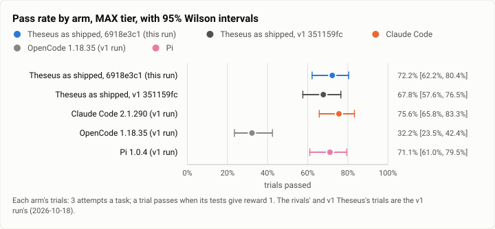
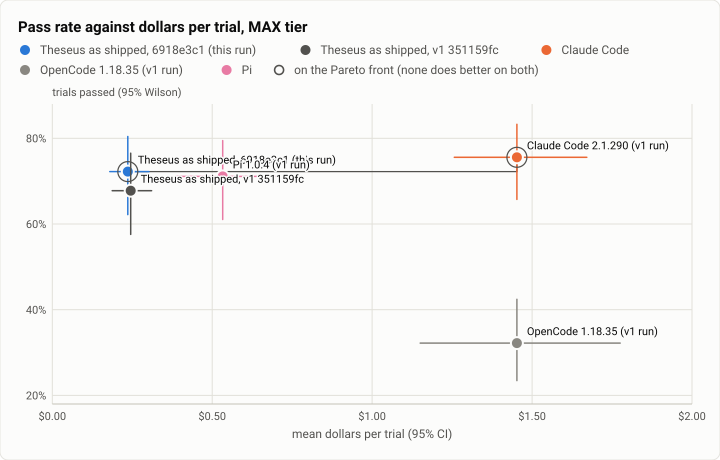

# Terminal-Bench 2.0 rerun, MAX tier: the 30 hard tasks, Theseus at 6918e3c1 free to choose `max` (2026-10-21)

**The answer first.** Theseus as shipped was rerun on Terminal-Bench 2.0's 30 hard tasks, three times each, on build
`6918e3c1`, with Jev free to choose any effort up to `max`. It solved **72.2%** of its trials [62.2, 80.4], against
**67.8%** for v1's Theseus on the same tasks.
- Paired by task, that is **+4.4 points** over v1 [−5.6, +15.6]: 3 tasks better and 2 worse.
- Against the v1 run's rivals at their top effort (not rerun), Theseus is level with Claude Code's 75.6% (−3.3
  points [−14.4, +7.8]) and with Pi's 71.1% (+1.1). It is far ahead of OpenCode's 32.2%.

**It is the cheapest per solve by far.** Theseus paid **$0.327 a solved task**, less than v1's $0.362. Claude Code at
`max` paid $1.92 and Pi at `xhigh` $0.75.

**Theseus still never ran at `max`.** This run tested whether effort on evidence, new since v1, lets Jev reach `max`
on hard tasks. It did not:
- Jev asked for `max` in 8 of 138 route decisions (v1: 3 of 90). Each time it was below its own confidence line
  (0.35 to 0.42), so the turn ran at high.
- It asked for `xhigh` 78 times, and 11 turns ran at `xhigh` (v1: 9).

None of the 1,048 model calls went to a China-origin model.

<picture>
  <source media="(prefers-color-scheme: dark)" srcset="img/2026-10-21-terminal-bench-rerun-max/pass-rates-max-dark.svg">
  
</picture>

*Figure 1. Did the patch work move Theseus's pass rate on the hard tasks, and where does it sit among the v1 rivals?
Up 4 trials over v1, inside Claude Code's and Pi's intervals; OpenCode far behind.*

| | |
|---|---|
| Suite | Terminal-Bench 2.0 (`terminal-bench@2.0`) through Harbor 0.23, its 30 hard tasks |
| Arms | **Theseus as shipped** (`TheseusRouted`, `6918e3c1`, Jev routing on the live table, effort bounds `low` to `max`). For comparison, from the [v1 MAX run](2026-10-18-terminal-bench-v1-max.md) (Oct 18): Theseus at `351159fc`, **Claude Code 2.1.290** (`reasoning_effort` max), **OpenCode 1.18.35** (`variant` max) and **Pi 1.0.4** (`thinking` xhigh), the rivals on Claude Sonnet 5.5 |
| Trials | 30 tasks × 3 (90) for Theseus; the v1 arms' 90 each are reused |
| Date and commit | 2026-10-21, 19:45 to 21:20 (UTC−7), on two EC2 hosts beside the HIGH tier; Theseus at `6918e3c1` |
| Cost | $21.24 in model calls at list prices; the hosts for both tiers about $20 |
| Data | [`2026-10-21-terminal-bench-rerun-max.json`](2026-10-21-terminal-bench-rerun-max.json), [`.csv`](2026-10-21-terminal-bench-rerun-max.csv) |

## The question

Two questions. Did the patch work move Theseus at its best on the hard tasks? And does effort on evidence, new since
v1, let Jev reach `max` when a task is hard? The rivals have not changed since v1, so only Theseus was rerun
([HIGH](2026-10-21-terminal-bench-rerun-high.md) has the scope and the owner's approval).

## The setup

- **As this run's HIGH** ([its setup](2026-10-21-terminal-bench-rerun-high.md#the-setup)), with the shipped effort
  bounds `["low", "max"]`.
- **Side by side with HIGH.** Each host started 3 MAX jobs beside 9 HIGH jobs, longest first, and MAX took each slot
  HIGH freed. Every task ran to its three trials, and no spend stop tripped.

## Results

| Arm | Trials passed (95% Wilson) | $ a trial (95%) | $ a solve | Agent s (median) | Model calls | Timeout / grader timeout / refusal / error |
|---|---|---|---|---|---|---|
| **Theseus, 6918e3c1** (this run) | 65/90 = **72.2%** [62.2, 80.4] | **$0.236** [0.180, 0.302] | **$0.327** | 156 | 11.8 | 1 / 4 / 0 / 0 |
| Theseus, v1 `351159fc` | 61/90 = 67.8% [57.6, 76.5] | $0.245 [0.187, 0.311] | $0.362 | 96 | 11.8 | 5 / 4 / 0 / 0 |
| Claude Code 2.1.290, max (v1 run) | 68/90 = **75.6%** [65.8, 83.3] | $1.453 [1.257, 1.671] | $1.923 | 792 | 20.8 | 14 / 0 / 0 / 0 |
| Pi 1.0.4, xhigh (v1 run) | 64/90 = 71.1% [61.0, 79.5] | $0.533 [0.388, 0.697] | $0.749 | 215 | 16.7 | 9 / 2 / 0 / 0 |
| OpenCode 1.18.35, max (v1 run) | 29/90 = 32.2% [23.5, 42.4] | $1.453 [1.150, 1.776] | $4.508 | 389 | 25.3 | 20 / 0 / 2 / 1 |

| Theseus 6918e3c1 − arm, by task | Mean gap (95%, bootstrap over tasks) | Tasks better / worse | Sign test |
|---|---|---|---|
| Theseus v1 | +4.4 points [−5.6, +15.6] | 3 / 2 | p = 1.00 |
| Claude Code | −3.3 points [−14.4, +7.8] | 2 / 4 | p = 0.69 |
| Pi | +1.1 points [−10.0, +12.2] | 6 / 4 | p = 0.75 |
| OpenCode | +40.0 points [+24.4, +56.7] | 16 / 1 | p < 0.001 |

**The tier trade-off** on the same 30 tasks (HIGH from this run's [HIGH report](2026-10-21-terminal-bench-rerun-high.md)):

| Theseus | HIGH: passed, $ a solve | MAX: passed, $ a solve | Change |
|---|---|---|---|
| 6918e3c1 (this run) | 73.3%, $0.285 | 72.2%, $0.327 | −1.1 points for 1.15× a solve |
| v1 `351159fc` | 66.7%, $0.254 | 67.8%, $0.362 | +1.1 points for 1.4× a solve |

On the hard tasks the patch work's gain shows up in both tiers. MAX adds nothing over HIGH for Theseus, because the
extra effort MAX allows is rarely used.

<picture>
  <source media="(prefers-color-scheme: dark)" srcset="img/2026-10-21-terminal-bench-rerun-max/pareto-dollars-max-dark.svg">
  
</picture>

*Figure 2. Which arm buys the most passes for the least money at top effort, and which way did Theseus move since v1?
Straight up: 4 points more for slightly less a trial, with Claude Code's 3 points more at six times the price.*

**How trials ended.** One agent timeout (`feal-linear-cryptanalysis`, 1 of 3), against v1's 5. Four grader timeouts:
`torch-pipeline-parallelism`, which times out on every arm, 3 times, and `torch-tensor-parallelism` once.

## Model selection

This section reads Theseus's 86 trials with ledgers.
- **Models:** Claude Sonnet 5.5 for all 1,048 calls, **0 China-origin**. Nothing on these hard tasks went to Haiku or
  Opus.
- **Route decisions:** 138 in 90 turns, where v1 made one a turn. Checkpoint routing re-routed 48 times mid-turn.
- **Mode:** deep coding 131 decisions (95%), routine coding 6, no verdict 1.
- **Profile:** `sonnethi` 84.8% (v1 80%), and the base profile 15.2% (20%).
- **Effort: what Jev asked for, and what ran.**

  | Jev asked for | this run | v1 | ran at (this run) |
  |---|---|---|---|
  | `max` | 8 | 3 | high 8: all below Jev's confidence line (0.35 to 0.42) |
  | `xhigh` | 78 | 39 | xhigh 11, high 65, medium 2: 51 below the confidence line, 15 held at high |
  | `high` | 46 | 45 | high 36, medium 10 (the base profile) |
  | `medium` / `low` | 5 | 3 | as asked, or the profile's own floor |

  The effort that ran: high 111, medium 15, xhigh 11, **max 0**. In v1: high 69, medium 12, xhigh 9, max 0.
- **Solve rate by mode:** deep coding 61 of 79, routine coding 3 of 6 (v1: 0 of 6).
- **Data verdicts:** `private` 21 of 147 (14%), and `open (act)` 7. In v1 these were 49 `private` and never
  `open (act)`. route.v7 moved this, as in HIGH, but still short of `open (act)` everywhere.
- **Against v1, like with like** (trials with ledgers): 75.6% at $0.283 a solve, against 70.9% at $0.314.

## Analysis

- **Effort on evidence did not reach `max`.**
  - The hypothesis was that a checkpoint would raise effort to `max` on a hard task. The ledgers show checkpoints
    re-routing (48 extra decisions), and Jev asking for more effort than in v1 (`xhigh` in 57% of decisions against
    43%).
  - But the effort answer's confidence stays low on these tasks, and the routing table applies an effort only above
    its line. `max` was asked for 8 times, at a confidence of at most 0.42, and never applied.
  - Whether `max` should apply at lower confidence on a task that keeps failing is a routing-table question. This run
    says the current line keeps Theseus at high.
- **The gain came anyway, and cheaply.** Without `max`, Theseus gained 4 points on v1 and paid less a solve. The
  turns Jev called routine on these hard tasks, all failures in v1 (0 of 6), solved 3 of 6.
- **Claude Code's lead is still effort, paid for.** It is 3.3 points ahead, with an interval from −14.4 to +7.8, at
  5.9 times Theseus's price a solve.
- **Trials ran longer**: 156 agent seconds median, against 96 in v1, with the same 11.8 model calls a trial. The time
  went to tool steps, not model calls, and the hosts' load may account for part of it.

## What changed since v1

As in [HIGH](2026-10-21-terminal-bench-rerun-high.md#what-changed-since-v1): 371 commits, among them turn-end facts,
job truths, effort on evidence, checkpoint routing and route.v7. The rivals are unchanged and not rerun.

## Threats to validity

- **Not the same night as the rivals** (Oct 18 against Oct 21). The v1 Theseus arm is the like-for-like baseline.
- **Three attempts on 30 tasks.** The intervals are about ±10 points wide. The gap to v1 is 4 trials.
- **Host load.** MAX ran beside HIGH on two hosts at high CPU pressure. Its endings match v1's (`torch-pipeline-parallelism`'s
  grader), with fewer agent timeouts than v1.
- **The routed arm's records name the base effort** (`medium`). The turns' real efforts are in the model selection
  section.

## Cost

Model calls: $21.24 at list prices, against v1 Theseus's $22.07.

AWS for both tiers was about $20 ([HIGH](2026-10-21-terminal-bench-rerun-high.md#cost) has the breakdown). The
hosts were terminated after their last pull and the stack deleted.

## Reproduction

```
tb_run_v1.sh start runs/rr-max-N --phases max --arms theseus-routed-max --tasks <host N's hard tasks>   # k = 3
headline.py tb/merged-max/jobs tb/hl-max
rr_report.py tb/hl-max/rows.csv <v1 hl-max/rows.csv> max report.json
model_selection.py --jobs tb/merged-max/jobs --arms theseus-routed-max --prev <v1 merged-max/jobs> --prev-arms theseus-routed-max
python3 bench/report/draft.py plot docs/benchmarks/2026-10-21-terminal-bench-rerun-max.json
```
