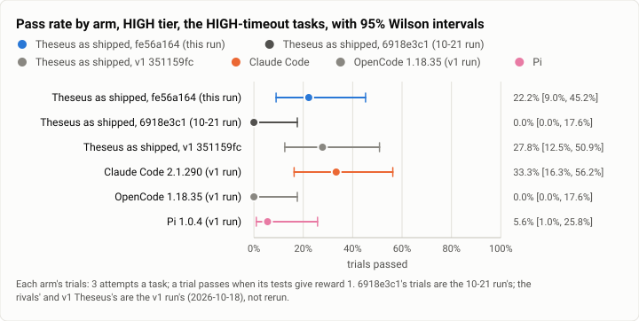
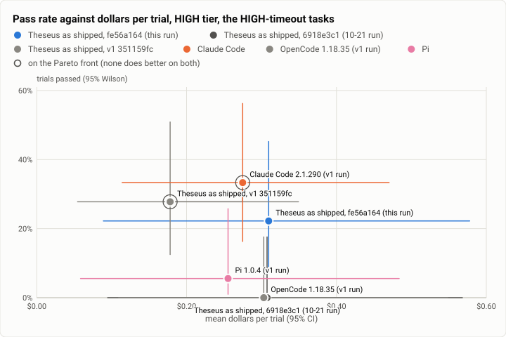

# Terminal-Bench 2.0 retest, HIGH tier: the six tasks that timed out on 10-21, at fe56a164 under a heavy-task cap (2026-10-23)

**The answer first.** The 10-21 rerun's HIGH tier had 11 agent timeouts, against 6 at v1, and `compile-compcert`
went from 2 solves in 3 at v1 to none. That raised a question: were those timeouts the host's load or the agent's own?
This retest ran the six tasks with a timeout ending again, three times each, on build `fe56a164`, with no more than
four heavy jobs on a host at once. The answer is **mostly the agent's own; load explains at most two of the 11.**
- **8 agent timeouts this time** (`caffe-cifar-10` 3, `make-doom-for-mips` 3, `compile-compcert` 2), against 11 on
  10-21. Each of those three tasks timed out again on a trial that ran while the host was at most a fifth busy.
- **`compile-compcert` solved 1 of 3.** Its last trial timed out at the 40-minute limit with the host 12% busy. Its
  container used 1.8 of the 2 CPUs the task allows, so it was not short of CPU. Its one solve came in the first hour,
  under load.
- **`crack-7z-hash` and `train-fasttext` did not time out again.** They went 0 → 2 and 0 → 1 solves of 3. Their 10-21
  timeouts (2 and 1) fit load or chance.
- **Solved 4 of 18 trials** (22.2% [9.0, 45.2]), against 0 of 18 on 10-21 and 5 of 18 for v1's Theseus. Paired by task,
  that is +22.2 points over 10-21 [+5.6, +44.4] and −5.6 against v1 [−16.7, 0.0]: back to v1's level, not past it.

**The load reading on 10-21 was partly wrong.** That run reported "CPU pressure 95-99%" as evidence of load. On these
hosts the host-wide CPU pressure reads 96-99.9% even with the host idle. Each task container runs under its own CPU
quota (1 or 2 CPUs), and its throttling counts as pressure at the host's root. This retest measured the host's busy
share and each container's use against its quota instead (below).

<picture>
  <source media="(prefers-color-scheme: dark)" srcset="img/2026-10-23-terminal-bench-retest-high-timeouts/pass-rates-high-dark.svg">
  
</picture>

*Figure 1. On the six tasks that timed out on 10-21, did fe56a164 move Theseus's pass rate? From none to 4 of 18,
level with v1's Theseus, below Claude Code's v1 run; all the intervals are wide.*

| | |
|---|---|
| Suite | Terminal-Bench 2.0 (`terminal-bench@2.0`) through Harbor 0.23: the six tasks with a timeout ending in the [10-21 HIGH rerun](2026-10-21-terminal-bench-rerun-high.md) |
| Tasks | `compile-compcert`, `crack-7z-hash`, `make-doom-for-mips`, `train-fasttext` and `caffe-cifar-10` (agent timeouts on 10-21), and `torch-pipeline-parallelism` (grader timeouts) |
| Arms | **Theseus as shipped** (`TheseusRouted`, `fe56a164`, Jev routing on the live table, effort bounds `low` to `high`). For comparison: Theseus at `6918e3c1` (10-21), and from the [v1 run](2026-10-18-terminal-bench-v1-high.md) (Oct 18) Theseus at `351159fc`, **Claude Code 2.1.290**, **OpenCode 1.18.35** and **Pi 1.0.4**, the rivals on Claude Sonnet 5.5 |
| Trials | 6 tasks × 3 (18) for Theseus; the earlier arms' 18 each on the same tasks are reused |
| Date and commit | 2026-10-23, 07:56 to 09:16 (UTC−7), on two EC2 hosts beside the MAX retest; Theseus at `fe56a164` |
| Cost | $5.57 in model calls at list prices (the trials' records) |
| Data | [`2026-10-23-terminal-bench-retest-high-timeouts.json`](2026-10-23-terminal-bench-retest-high-timeouts.json), [`.csv`](2026-10-23-terminal-bench-retest-high-timeouts.csv) |

## The question

Were 10-21's HIGH timeouts load or real? That run started the heavy tasks of both tiers at once on two hosts, which
loaded them heavily (load 36 to 128 on 32 vCPU). `compile-compcert` is the case the owner named. The retest reruns
only those tasks, with the heavy tasks capped and spread across the hosts, and records the host's state for every
trial. The rivals have not changed since v1, so they were not rerun.

## The setup

- **Theseus as shipped**, as on 10-21 ([its setup](2026-10-21-terminal-bench-rerun-high.md#the-setup)), with these
  differences:
  - The build is `fe56a164`, static musl `theseus` and `theseusd`, profile `release`, as on 10-21.
  - **The routing's effort values.** `effort_confidence = 0.35`, new since 10-21: an effort answer applies at that
    confidence even when the model switch is unsure. `high_effort_confidence = 0.40`: xhigh and max apply only above
    it. That is the owner's live value since 10-22, and the code's default at `fe56a164`. The HIGH bounds
    `["low", "high"]` still clamp any xhigh or max to high.
- **The heavy-task cap.** These are the heavy tasks: `qemu-*`, `compile-compcert`, `make-doom-for-mips`,
  `train-fasttext`, `torch-*`, `caffe-cifar-10`, `install-windows-3.11`, `build-*`, `crack-7z-hash`, and any task with
  a 10-21 trial over 30 minutes.
  - No host ran more than 4 heavy jobs at once, across both tiers; a job runs up to 2 trials at a time. Light MAX
    jobs filled the other 8 slots.
  - The six HIGH jobs were split 3 a host by their 10-21 times, and all six started first.
  - The MAX heavy jobs took the heavy slots as HIGH freed them.
- **What was measured.**
  - Every 15 s: each host's load average and CPU pressure.
  - Every 30 s, from 08:24: the host's CPU busy share (from `/proc/stat`), and each task container's CPU use against its
    quota.
  - Each trial is matched to the samples taken during its agent run.

## Results

| Arm | Trials passed (95% Wilson) | $ a trial (95%) | $ a solve | Agent s (median) | Model calls | Timeout / grader timeout / refusal / error |
|---|---|---|---|---|---|---|
| **Theseus, fe56a164** (this run) | 4/18 = **22.2%** [9.0, 45.2] | $0.310 [0.089, 0.578] | $1.393 | 941 | 17.2 | 8 / 3 / 0 / 0 |
| Theseus, 6918e3c1 (10-21) | 0/18 = 0.0% [0.0, 17.6] | $0.307 [0.095, 0.568] | – | 1059 | 17.2 | 11 / 3 / 0 / 0 |
| Theseus, v1 `351159fc` | 5/18 = 27.8% [12.5, 50.9] | $0.178 [0.054, 0.349] | $0.641 | 1021 | 14.4 | 5 / 3 / 0 / 1 |
| Claude Code 2.1.290 (v1 run) | 6/18 = **33.3%** [16.3, 56.3] | $0.275 [0.114, 0.470] | $0.824 | 792 | 17.7 | 3 / 3 / 0 / 2 |
| Pi 1.0.4 (v1 run) | 1/18 = 5.6% [1.0, 25.8] | $0.255 [0.058, 0.484] | $4.596 | 1086 | 13.2 | 6 / 3 / 0 / 1 |
| OpenCode 1.18.35 (v1 run) | 0/18 = 0.0% [0.0, 17.6] | $0.303 [0.109, 0.548] | – | 700 | 13.1 | 3 / 3 / 3 / 8 |

| Theseus fe56a164 − arm, by task | Mean gap (95%, bootstrap over tasks) | Tasks better / worse | Sign test |
|---|---|---|---|
| Theseus 6918e3c1 (10-21) | +22.2 points [+5.6, +44.4] | 3 / 0 | p = 0.25 |
| Theseus v1 | −5.6 points [−16.7, 0.0] | 0 / 1 | p = 1.00 |
| Claude Code | −11.1 points [−22.2, 0.0] | 0 / 2 | p = 0.50 |
| Pi | +16.7 points [0.0, +38.9] | 2 / 0 | p = 0.50 |
| OpenCode | +22.2 points [+5.6, +44.4] | 3 / 0 | p = 0.25 |

**By task** (solved of 3; timeouts in brackets):

| Task | fe56a164 | 6918e3c1 (10-21) | v1 Theseus | Claude Code (v1) | CPU quota, agent limit |
|---|---|---|---|---|---|
| `compile-compcert` | **1** (2 timeouts) | 0 (3) | 2 | 1 | 2 CPUs, 40 min |
| `crack-7z-hash` | **2** (0) | 0 (2) | 2 | 3 | 1 CPU, 15 min |
| `train-fasttext` | **1** (0) | 0 (1) | 1 | 2 | 1 CPU, 60 min |
| `make-doom-for-mips` | 0 (3) | 0 (2) | 0 | 0 | 1 CPU, 15 min |
| `caffe-cifar-10` | 0 (3) | 0 (3) | 0 | 0 | 1 CPU, 20 min |
| `torch-pipeline-parallelism` | 0 (3 grader timeouts) | 0 (3 grader) | 0 | 0 | 1 CPU, 15 min |

<picture>
  <source media="(prefers-color-scheme: dark)" srcset="img/2026-10-23-terminal-bench-retest-high-timeouts/pareto-dollars-high-dark.svg">
  
</picture>

*Figure 2. Which arm buys the most passes on these six tasks, and which way did Theseus move? Straight up from
6918e3c1 at the same price a trial; v1's Theseus is as good for less, Claude Code a little better.*

### The host during each trial

The cleanest test is a trial that ran while the host was quiet. From about 08:35 every host ran only its few
heavy jobs.

| Task | Trial | Ending | Agent min | Host load (mean / max) | Host busy (mean / max) | Its container: CPU used of quota |
|---|---|---|---|---|---|---|
| `compile-compcert` | 1 | **solved** | 33.6 | 51 / 112 | 16% / 23% (last 10 min) | 1.35 of 2 |
| | 2 | timeout | 40.0 | 45 / 112 | 16% / 23% (last 16 min) | 1.35 of 2 |
| | 3 | **timeout** | 40.1 | **9 / 31** | **12% / 21%** | **1.77 of 2** (at quota 61% of the time) |
| `make-doom-for-mips` | 1, 2 | timeout | 15.7 | 54 / 104 | – (before 08:24) | – |
| | 3 | **timeout** | 15.0 | **18 / 37** | **16% / 23%** | 0.38 of 1 |
| `caffe-cifar-10` | 1, 2 | timeout | 20.7 | 68 / 112 | – | – |
| | 3 | **timeout** | 20.1 | **17 / 37** | **15% / 21%** | 0.90 of 1 (at quota 80%) |
| `train-fasttext` | solved | | 48.1 | 8 / 31 | 14% / 27% | 0.98 of 1 |
| | 2 failed | (no timeout) | 8.4, 27.7 | 18-28 / 39 | 24% | 1.00 of 1 |
| `crack-7z-hash` | 2 solved, 1 failed | (no timeout) | 2.2, 2.2, 12.3 | 20-28 / 39 | – | – |

- **`compile-compcert` is not a load problem.** Its third trial had the host almost to itself. It used most of the 2
  CPUs the task grants, and still ran out the 40 minutes. Under load, one of its first two trials solved. The task
  gives the agent about one build's worth of time on 2 CPUs; v1 fitted that 2 times in 3, 10-21 not at all and this
  run once.
- **`make-doom-for-mips` and `caffe-cifar-10` time out on every arm.** Each timed out again at low load, and no harness
  in v1 solved either. `make-doom-for-mips` also used under half of its one CPU: it is not a CPU-bound wait.
- **The host never ran short.** From 08:24 its busy share stayed under 30% on both hosts. The load average was high
  only in the first 30 minutes, when 12 jobs a host started together and pulled their images. The task containers are
  held to their own quotas, so the host's busy share is the honest load signal here.

## Model selection

This section reads Theseus's 15 trials with a verifier result (the three grader-timeout trials of
`torch-pipeline-parallelism` have none, so the section's tool skips them).
- **Models:** 308 calls.
  - Claude Sonnet 5.5: 81.5% of calls, 96.9% of the $.
  - Claude Haiku 5.5: 12.7%.
  - Claude Sonnet 5: 5.8%, all on `crack-7z-hash`. That is the refusal fallback (a password-cracking task), as on 10-21.
  - **0 China-origin calls.**
- **Route decisions:** 37 in 18 turns (10-21: 30); checkpoint routing re-routed 19 times.
- **Mode:** deep coding 31, routine coding 6. Routine-coding turns solved 3 of 6, deep coding 1 of 9.
- **Profile per turn:** the base profile 45.9%, `sonnethi` 45.9%, `haikuhi` 8.1% (10-21: `sonnethi` 50%, base
  36.7%).
- **Effort: what Jev asked for, and what ran.**

  | Jev asked for | this run | 10-21 | v1 | ran at (this run) |
  |---|---|---|---|---|
  | `xhigh` | 18 | 18 | 9 | high 16, medium 2: 15 above 0.40 clamped to high by the tier's bounds, 1 at 0.35-0.40 held at high, 2 under 0.35 at the profile's own effort |
  | `high` | 16 | 8 | 6 | high |
  | `medium` | 3 | 3 | 3 | medium |

  The effort that ran: high 30, medium 7. This tier caps effort at high, so the new effort bar changes the reason a
  turn gives (`clamped` where 10-21 said `held_high`), not the level.
- **Data verdicts:** `private` 12 of 40 (30%), and `open (act)` 4. These benchmark tasks are open source, so every
  verdict should be `open (act)`; the rest are a finding (route.v7).
- **Against 10-21, like with like** (trials with ledgers): 4 of 15 solved at $0.309 a trial, against 0 of 15 at
  $0.300.

## Analysis

- **Most of 10-21's timeouts were real.**
  - 8 of the 11 came back.
  - The tasks that came back include the ones no harness solves (`caffe-cifar-10`, `make-doom-for-mips`) and
    `compile-compcert`, which this run shows to be tight on its own terms.
  - The three that did not come back (`crack-7z-hash` 2, `train-fasttext` 1) are the ones load or chance can explain.
- **`compile-compcert` needs most of its 40 minutes.**
  - Its trials that ran out spent the whole limit building on close to 2 CPUs.
  - The real-world point is time awareness on a long build: the agent should know how long it has, and that the
    container gives it 2 CPUs rather than the host's 32 (a `make -j` sized to the host only adds throttling).
  - That is a patch2 row (below), not a benchmark tweak.
- **`make-doom-for-mips` is expensive to lose.** Its three trials cost $4.33, 78% of this run's HIGH spend, and all
  timed out. On 10-21 its trials cost the same. A turn that keeps paying for a task it is not finishing is a real cost
  for any user, and the second patch2 row.
- **The rest moved back to v1's level.** `crack-7z-hash` and `train-fasttext` solved as often as v1's Theseus.

## What changed since 6918e3c1

465 commits. For these tasks the relevant ones are:
- effort applying below the model-switch line, at `effort_confidence` (theseus-7pm8t), with its `held_high_unsure` and
  `sticky_unsure` reasons;
- the thread's working size (40% of the window, and a resume keeps 20 turns);
- recall and tool admission sized to the prompt;
- the trivial detour carrying `tools_find` only.

The rivals are unchanged and not rerun.

## Threats to validity

- **Six tasks, three attempts.** The intervals are about ±20 points wide. The run answers "load or real" per trial,
  not by the totals.
- **The first round still ran under load.** The first two trials of each heavy task started with 12 jobs on each host
  at once (load up to 112). The busy-share sampler started at 08:24, so those trials have load averages only. Each
  task's third trial ran at low load.
- **The heavy cap bounds jobs, not CPU.** The containers' quotas bound CPU. A host ran 4 heavy jobs, up to 8 heavy
  trials, which used under a third of its CPUs.
- **Not the same day as the rivals** (Oct 18 against Oct 23).

## Cost

- **Model calls: $5.57** at list prices, by the trials' records. `make-doom-for-mips` was $4.33 of that.
- **AWS:** the two hosts and the NAT ran for both tiers; [MAX](2026-10-23-terminal-bench-retest-max.md#cost) has the
  breakdown.

## Reproduction

```
tb_run_v1.sh start runs/rt-high-N --phases high --arms theseus-routed-high --tasks <host N's 3 tasks>   # k = 3
rt-chain.sh N 4 8 6 <maxh limit> <maxl limit>            # the heavy cap: HIGH + MAX heavy share 4 jobs a host
rt-cpu.sh                                                # host busy % and each container's CPU use vs its quota
headline.py tb/merged-high/jobs tb/hl-high
rt_report.py tb/hl-high/rows.csv <10-21 hl-high/rows.csv> <v1 hl-high/rows.csv> high report.json --tasks @high-retest.txt
trial_load.py tb/merged-high/jobs tb
model_selection.py --jobs tb/merged-high/jobs --arms theseus-routed-high --prev <10-21 jobs, these tasks> --prev-arms theseus-routed-high
python3 bench/report/draft.py plot docs/benchmarks/2026-10-23-terminal-bench-retest-high-timeouts.json
```
