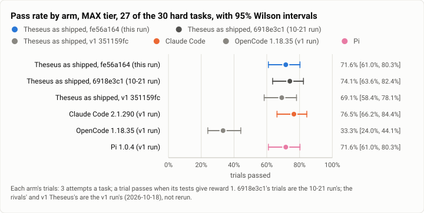
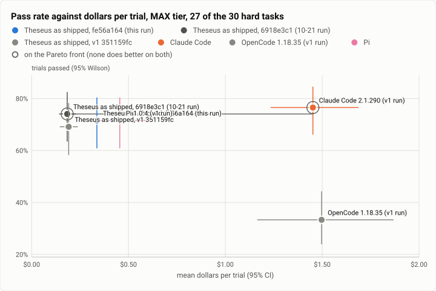

# Terminal-Bench 2.0 retest, MAX tier: the hard tasks at fe56a164, with effort free to apply below the model-switch line (2026-10-23)

**The answer first.** On 10-21, Theseus on its MAX tier never ran a turn at `max`. Jev, the router, asked for `max` 8
times, and each answer was below the bar for a model switch. Build `fe56a164` lets an effort answer apply at its own,
lower bar. This retest ran 27 of Terminal-Bench 2.0's 30 hard tasks three times each on that build.
- **Effort now applies, but `max` still does not run.**
  - `xhigh` ran in **35 turns**, against 10 for `6918e3c1` on the same tasks. Every `xhigh` answer above 0.40 applied.
  - Jev asked for `max` **once** in 118 route decisions, at a confidence of 0.39, so that turn ran at high. On 10-21
    it had asked 5 times on these tasks, twice above 0.40, which would now apply.
  - **No turn ran at `max`.**
- **The extra effort cost money and bought no solves.**
  - Theseus solved **71.6%** of its trials [61.0, 80.3], against **74.1%** for `6918e3c1` on the same 27 tasks: −2.5
    points paired [−13.6, +7.4].
  - It paid **$0.337 a trial**, 1.83× the earlier $0.184. That is **$0.470 a solve**, against $0.248.
  - The 10 tasks with an `xhigh` turn cost 2.16× as much as on 10-21 and solved one trial more (22 of 30 against 21).
    The other 17 cost the same (1.05×).
- **Against v1 and the v1 rivals** on the same 27 tasks:
  - v1's Theseus: 69.1% (+2.5 points paired [−8.6, +14.8]).
  - Claude Code at `max`: 76.5% at $1.90 a solve. Pi at `xhigh`: 71.6% at $0.64.
  - Theseus is still the cheapest per solve by a wide margin.

None of the 1,110 model calls went to a China-origin model.

<picture>
  <source media="(prefers-color-scheme: dark)" srcset="img/2026-10-23-terminal-bench-retest-max/pass-rates-max-dark.svg">
  
</picture>

*Figure 1. On 27 of the hard tasks, did fe56a164 move Theseus's pass rate? Two trials down on 6918e3c1 and two up on
v1, inside every interval; Claude Code and Pi as at v1; OpenCode far behind.*

| | |
|---|---|
| Suite | Terminal-Bench 2.0 (`terminal-bench@2.0`) through Harbor 0.23: 27 of its 30 hard tasks |
| Arms | **Theseus as shipped** (`TheseusRouted`, `fe56a164`, Jev routing on the live table, effort bounds `low` to `max`). For comparison: Theseus at `6918e3c1` ([10-21](2026-10-21-terminal-bench-rerun-max.md)), and from the [v1 MAX run](2026-10-18-terminal-bench-v1-max.md) (Oct 18) Theseus at `351159fc`, **Claude Code 2.1.290** (`reasoning_effort` max), **OpenCode 1.18.35** (`variant` max) and **Pi 1.0.4** (`thinking` xhigh), the rivals on Claude Sonnet 5.5 |
| Trials | 27 tasks × 3 (81) for Theseus; every other arm's trials on the same 27 tasks are reused |
| Left out | `make-doom-for-mips`, `regex-chess` and `feal-linear-cryptanalysis`, to hold the run's spend line (below) |
| Date and commit | 2026-10-23, 07:56 to 10:07 (UTC−7), on two EC2 hosts beside the HIGH retest; Theseus at `fe56a164` |
| Cost | $27.27 in model calls at list prices (the trials' records), plus $0.41 for two trials stopped unfinished |
| Data | [`2026-10-23-terminal-bench-retest-max.json`](2026-10-23-terminal-bench-retest-max.json), [`.csv`](2026-10-23-terminal-bench-retest-max.csv) |

## The question

Does MAX now reach `xhigh` and `max`, how often, at what cost, and does the solve rate move? The change under test is
theseus-7pm8t, in `fe56a164`. Before it, an effort answer applied only when Jev's answer was "sure", the bar a model
switch needs. Now it applies at a confidence of 0.35 or more (`effort_confidence`), and `xhigh` or `max` need more than
0.40 (`high_effort_confidence`). The owner set 0.40 on 10-22 for this case. The rivals have not changed since v1, so
only Theseus was rerun.

## The setup

- **As on 10-21** ([its setup](2026-10-21-terminal-bench-rerun-max.md#the-setup)), with these differences:
  - The build is `fe56a164`, static musl, profile `release`.
  - The routed profile's `[routing]` carries `effort_confidence = 0.35`, which is the code's default and is not set
    live, and `high_effort_confidence = 0.40`, the owner's live value since 10-22. The bounds are the shipped
    `["low", "max"]`.
- **Heavy tasks capped and spread.** Each host ran at most 4 heavy jobs at once across both tiers, with light jobs in
  the other 8 slots ([HIGH](2026-10-23-terminal-bench-retest-high-timeouts.md#the-setup) lists them). On 10-21 both
  tiers' heavy tasks started together.
- **The spend line.** The owner's quote was about $25, with a hard pause at $35.
  - By 08:39 MAX was costing 1.6 to 2.3 times its 10-21 price a trial. Priced per task, the full queue projected
    about $40.
  - All runs were paused (no new job starts), and a MAX `regex-chess` job running for 8 minutes was stopped.
  - Then the cheapest unstarted heavy tasks ran in two small catch-ups: `mcmc-sampling-stan`,
    `torch-tensor-parallelism`, `install-windows-3.11` and `train-fasttext`.
  - Left out: `make-doom-for-mips` (about $7 projected; this run's HIGH trials of it cost $1.3 to $1.8 each and all
    timed out), `regex-chess` and `feal-linear-cryptanalysis`.
  - Every comparison below is on the same 27 tasks.

## Results

| Arm | Trials passed (95% Wilson) | $ a trial (95%) | $ a solve | Agent s (median) | Model calls | Timeout / grader timeout / refusal / error |
|---|---|---|---|---|---|---|
| **Theseus, fe56a164** (this run) | 58/81 = **71.6%** [61.0, 80.3] | $0.337 [0.236, 0.455] | **$0.470** | 129 | 13.7 | 2 / 4 / 0 / 0 |
| Theseus, 6918e3c1 (10-21) | 60/81 = 74.1% [63.6, 82.4] | $0.184 [0.143, 0.226] | $0.248 | 106 | 10.9 | 0 / 4 / 0 / 0 |
| Theseus, v1 `351159fc` | 56/81 = 69.1% [58.4, 78.1] | $0.191 [0.147, 0.237] | $0.276 | 82 | 10.9 | 2 / 4 / 0 / 0 |
| Claude Code 2.1.290, max (v1 run) | 62/81 = **76.5%** [66.2, 84.4] | $1.452 [1.236, 1.686] | $1.897 | 763 | 21.4 | 11 / 0 / 0 / 0 |
| Pi 1.0.4, xhigh (v1 run) | 58/81 = 71.6% [61.0, 80.3] | $0.455 [0.317, 0.612] | $0.635 | 200 | 16.4 | 6 / 2 / 0 / 0 |
| OpenCode 1.18.35, max (v1 run) | 27/81 = 33.3% [24.0, 44.1] | $1.497 [1.166, 1.867] | $4.491 | 390 | 26.5 | 18 / 0 / 2 / 1 |

| Theseus fe56a164 − arm, by task | Mean gap (95%, bootstrap over tasks) | Tasks better / worse | Sign test |
|---|---|---|---|
| Theseus 6918e3c1 (10-21) | −2.5 points [−13.6, +7.4] | 2 / 2 | p = 1.00 |
| Theseus v1 | +2.5 points [−8.6, +14.8] | 3 / 2 | p = 1.00 |
| Claude Code | −4.9 points [−17.3, +6.2] | 2 / 3 | p = 1.00 |
| Pi | 0.0 points [−12.3, +9.9] | 5 / 3 | p = 0.73 |
| OpenCode | +38.3 points [+22.2, +54.3] | 15 / 0 | p < 0.001 |

**Where it moved against 6918e3c1.**
- Better: `video-processing` 3 of 3 (1 of 3 on 10-21) and `make-mips-interpreter` 3 (2).
- Worse: `configure-git-webserver` 0 (3) and `model-extraction-relu-logits` 1 (3).
  - Every other arm, v1's Theseus included, solved `configure-git-webserver` 0 of 3. The 10-21 run is the outlier
    there.

<picture>
  <source media="(prefers-color-scheme: dark)" srcset="img/2026-10-23-terminal-bench-retest-max/pareto-dollars-max-dark.svg">
  
</picture>

*Figure 2. Which arm buys the most passes for the least money, and which way did Theseus move? To the right: 1.8× the
price a trial for the same pass rate, still well left of Pi and Claude Code.*

**How trials ended.**
- Two agent timeouts: `gpt2-codegolf` and `train-fasttext`, once each (10-21: none on these tasks).
- Four grader timeouts: `torch-pipeline-parallelism`, which times out on every arm, 3 times, and
  `torch-tensor-parallelism` once.

## Model selection

This section reads Theseus's 77 trials with a verifier result (the four grader timeouts have none).
- **Models:** Claude Sonnet 5.5 for all 1,110 calls, **0 China-origin**.
- **Route decisions:** 118 in 81 turns, the same count as 10-21 on these tasks.
- **Mode:** deep coding 111 decisions (94%), routine coding 6, chat 1.
  - Deep coding solved 58 of 71 trials, routine coding 0 of 6.
- **Profile per turn:** `sonnethi` 78.8% (10-21 82.2%), the base profile 21.2%.
- **Effort: what Jev asked for, and what ran** (same 27 tasks).

  | Jev asked for | this run | 6918e3c1 | v1 | ran at (this run) |
  |---|---|---|---|---|
  | `max` | **1** | 5 | 0 | high: at 0.39, at or under the 0.40 bar (`held_high_unsure`) |
  | `xhigh` | 66 | 61 | 33 | **xhigh 35** (15 sure, 20 below the switch line at ≥ 0.35), high 26, medium 5: 8 at 0.35-0.40 held at high, 23 under 0.35 at the profile's own effort |
  | `high` | 48 | 46 | 45 | high 47 (28 of them below the switch line), and 1 at the profile's own |
  | `medium` | 3 | 3 | 3 | as asked |

  - The effort that ran: high 75, **xhigh 35**, medium 8, **max 0**.
  - 6918e3c1: high 92, medium 15, xhigh 10. v1: high 60, medium 12, xhigh 9.
  - 27 of 81 trials had at least one turn at `xhigh` (6918e3c1: 10).
- **What the new bar did.**
  - 48 answers applied below the switch line (`applied_unsure`); on 10-21 those turns kept the profile's effort.
  - Of 10-21's five `max` answers on these tasks (confidence 0.35, 0.36, 0.38, 0.41, 0.41), the two at 0.41 would run
    at `max` today. This run's answers simply asked for it less.
- **Data verdicts:**
  - `private` 19 of 122 (16%), and `open (act)` 6.
  - These benchmark tasks are open source, so every verdict should be `open (act)`. The rest stay a finding
    (route.v7).
- **Against 6918e3c1, like with like** (trials with a verifier result): 75.3% at $0.403 a solve, against 77.9% at
  $0.219.

## Analysis

- **The change works as specified, and moves effort to `xhigh`, not `max`.** The bar that held effort back is gone:
  every `xhigh` answer above 0.40 ran. What keeps MAX off `max` now is Jev's answer itself: one `max` in 118 decisions
  on the hardest tasks in the suite. Which evidence should move that answer to `max` is a routing question for real
  hard work, not a benchmark knob (patch2 row below).
- **`xhigh` doubled the price where it ran and bought one trial.** On the 10 tasks with an `xhigh` turn, Theseus paid
  $22.64 against $10.46 on 10-21, for 22 solves against 21. `sam-cell-seg` cost $1.27 a trial (10-21 $0.22) and
  solved none, as on every arm. `make-mips-interpreter` cost $1.97 (10-21 $0.44) and solved 3 against 2. Whether
  that trade is worth it is the owner's call; the data says "not on these tasks".
- **The solve rate did not move.** −2.5 points against 6918e3c1 and +2.5 against v1, with intervals over ±10.
  The two tasks that fell are one outlier (`configure-git-webserver`, solved on 10-21 only) and one 1-of-3
  (`model-extraction-relu-logits`).
- **Still the cheapest per solve.** $0.470 against Pi's $0.64 and Claude Code's $1.90, for a pass rate level with Pi
  and 4.9 points under Claude Code (interval −17.3 to +6.2).

## What changed since 6918e3c1

465 commits. For this tier:
- effort on its own bar (theseus-7pm8t) and its reasons, `applied_unsure`, `held_high_unsure` and `sticky_unsure`;
- the owner's `high_effort_confidence` 0.70 → 0.40;
- the thread's working size, and recall and tool admission sized to the prompt.

The rivals are unchanged and not rerun.

## Threats to validity

- **27 of 30 tasks.** The three left out are heavy, and two of them (`make-doom-for-mips`, `regex-chess`) are among
  the most expensive. The comparison is paired on the 27, so it is fair between arms, but not the tier's full figure.
- **Three attempts.** Intervals are about ±10 points; the gap to 6918e3c1 is 2 trials.
- **Host load differed.** Heavy tasks were capped this time, so the hosts ran far quieter than on 10-21 after the
  first half hour. On these hosts the CPU-pressure figure measures the task containers' own quota throttling, not host
  load ([HIGH](2026-10-23-terminal-bench-retest-high-timeouts.md#the-host-during-each-trial)).
- **The routed arm's records name the base effort** (`medium`); the turns' real efforts are in Model selection.

## Cost

- **Model calls:**
  - MAX: $27.27 at list prices by the trials' records, against 6918e3c1's $14.87 on the same tasks.
  - The two stopped `regex-chess` trials spent $0.41 more.
  - With HIGH ($5.57), the run's model calls came to about $33.3 by the records ($33.38 by the drivers' count, $33.79
    with the stopped trials), under the $35 line.
- **AWS, about $12** for both tiers:
  - 3.75 host-hours of m7a.8xlarge, about $7. Host 1 ran 07:49 to 09:14, host 2 07:49 to 10:09.
  - NAT data: 76.7 GB, $3.45.
  - Disks and NAT hours, under $1; about 8% tax.
- **Teardown:** the hosts were terminated after their last pull and the stack deleted; no instance, NAT gateway,
  address, volume or secret was left.

## Reproduction

```
tb_run_v1.sh start runs/rt-maxh-N --phases max --arms theseus-routed-max --tasks <host N's heavy hard tasks>   # k = 3
tb_run_v1.sh start runs/rt-maxl-N --phases max --arms theseus-routed-max --tasks <host N's light hard tasks>
rt-chain.sh N 4 8 <high limit> <maxh limit> <maxl limit>      # heavy cap 4 a host, light 8
headline.py tb/merged-max/jobs tb/hl-max
rt_report.py tb/hl-max/rows.csv <10-21 hl-max/rows.csv> <v1 hl-max/rows.csv> max report.json --tasks @max-done.txt
effort_table.py rt=tb/merged-max/jobs r68=<10-21 jobs, same tasks> v1=<v1 jobs, same tasks>
model_selection.py --jobs tb/merged-max/jobs --arms theseus-routed-max --prev <10-21 jobs, same tasks> --prev-arms theseus-routed-max
python3 bench/report/draft.py plot docs/benchmarks/2026-10-23-terminal-bench-retest-max.json
```
