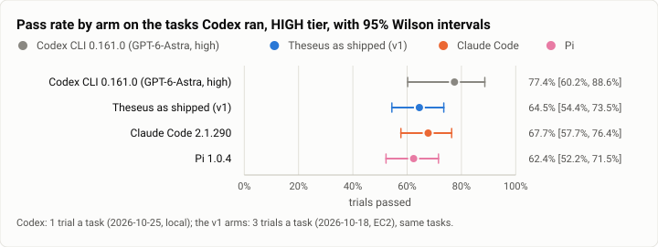
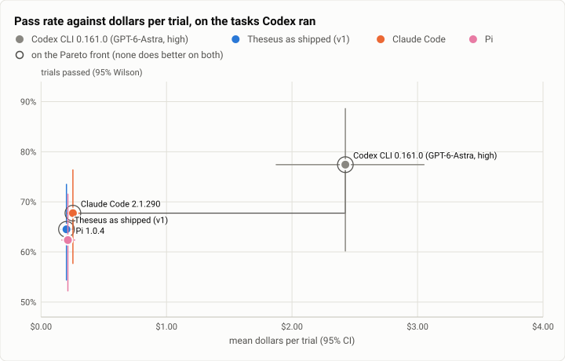

# Terminal-Bench 2.0, HIGH tier: Codex CLI on GPT-6-Astra against the v1 arms, on the 31 heaviest tasks (2026-10-25)

**The answer first.** Codex CLI 0.161.0 ran GPT-6-Astra, OpenAI's frontier model, at high effort, one trial a task.
The $75 spend line stopped it after **31 of the 89 tasks**: the heavy, long-running ones, run first. On those 31 it
solved **24 (77.4%** [60.2, 88.6]). The v1 arms solved fewer of the same tasks on Oct 18:
- Theseus as shipped, 64.5%;
- Claude Code, 67.7%;
- OpenCode, 61.3%;
- Pi, 62.4%.

Paired by task, Codex is ahead of every v1 arm. The gap is clear of zero against OpenCode (+16.1 points) and Pi
(+15.1). It is not clear of zero against Theseus (+12.9 points, 95% −2.2 to +28.0; 9 tasks better, 3 worse) or
Claude Code (+9.7, −5.4 to +24.7).

**It costs ten times as much.** Codex paid **$2.43 a trial and $3.13 a solved task**. Theseus paid $0.20 and $0.31 on
the same tasks. That is about 12× a trial and 10× a solve. Most of the gap is the model: GPT-6-Astra is listed at $10
in and $50 out per million tokens, five times Claude Sonnet 5.5. Codex also made about twice the model calls a trial
(25.7 against 12.4). Half of its trials (16 of 31) cost more than the $2 cap the rivals carried; Codex has no cap.

<picture>
  <source media="(prefers-color-scheme: dark)" srcset="img/2026-10-25-terminal-bench-codex-high/pass-rates-codex-dark.svg">
  
</picture>

*Figure 1. Where does Codex CLI on GPT-6-Astra land against the v1 arms? Ahead on the 31 tasks, but on one trial a
task its interval spans 60% to 89% and overlaps all three shown. OpenCode (61.3%) is in the table.*

| | |
|---|---|
| Suite | Terminal-Bench 2.0 (`terminal-bench@2.0`, the same 89 task directories as v1) through Harbor 0.23 |
| Arm | **Codex CLI 0.161.0** (`codex_agent:MeasuredCodex`), model `openai/gpt-6-astra`, `reasoning_effort` high; caps of $2 and 200 turns recorded, not enforced |
| Compared with | The v1 HIGH arms' trials of 2026-10-18 (`351159fc`): Theseus as shipped, Claude Code 2.1.290, OpenCode 1.18.35, Pi 1.0.4, three trials a task each, not rerun |
| Trials | 31 tasks × 1 (58 tasks unrun: the spend line) |
| Date and commit | 2026-10-25, 02:00 to 03:33 (UTC−7), on the owner's WSL machine; the adapters at `b69236c1` |
| Cost | $75.18 at list prices (the trials' own records) |
| Data | [`2026-10-25-terminal-bench-codex-high.json`](2026-10-25-terminal-bench-codex-high.json), [`.csv`](2026-10-25-terminal-bench-codex-high.csv) (one row per trial) |

## The question

The v1 run compared Theseus with the top three harnesses of the broad pass, each on Claude Sonnet 5.5. Codex CLI was
not among them: it speaks only OpenAI's Responses API, so it cannot run Sonnet. This run adds Codex on the best model
its key can use, at the same HIGH tier. The question is where the leading OpenAI harness, on OpenAI's frontier model,
lands against the v1 arms, and at what cost.

Its default model, GPT-6.1-Sol, is not open to the key's project (a 404), so GPT-6-Astra is the best model this key
can reach. The owner chose one trial a task for this run. Per the rule for rivals, the other harnesses are not rerun:
their v1 trials stand.

## The setup

- **The arm.** Harbor's Codex adapter as the other runs measure it (`bench/harbor/codex_agent.py`): Codex pinned at
  0.161.0, `--model gpt-6-astra`, `model_reasoning_effort=high`. Each trial's record confirms both. The record comes
  from Harbor's trajectory of the rollout (`efficiency.codex_record`), priced from the bench's list-price table.
- **The key.** `OPENAI_API_KEY` was read at run time into the driver's memory and placed only in each Harbor run's
  environment.
- **The host.** One WSL2 machine (16 vCPU, 23 GB, 16 GB swap), up to 4 trials at once. Each task's image was pulled
  for its trial and removed after it.
- **The order.** Heavy tasks went first: the 17 with a timeout or a trial over 20 minutes in the v1 HIGH run, longest
  first. The rest followed in order of the v1 run's mean agent time, longest first.
- **The stops.** A start was held when finished spend plus an estimate for each running trial would pass $75. No start
  after 07:40, and running trials stopped at 07:55. The spend line ended the run at 03:33.

## Results

On the 31 tasks Codex ran (the v1 arms: their three trials on each of the same tasks):

| Arm | Trials passed (95% Wilson) | $ a trial (95%) | $ a solve | Agent s (median) | Agent min (total) | Model calls | Timeout / grader timeout / setup timeout / refusal / error |
|---|---|---|---|---|---|---|---|
| Codex CLI 0.161.0 (GPT-6-Astra, high) | 24/31 = **77.4%** [60.2, 88.6] | $2.425 [1.874, 3.051] | $3.133 | **237** | 166 | 25.7 | 0 / 0 / 0 / 1 / 0 |
| Theseus as shipped (v1) | 60/93 = 64.5% [54.4, 73.5] | **$0.203** [0.162, 0.250] | **$0.314** | 310 | 814 | 12.4 | 6 / 6 / 2 / 0 / 1 |
| Claude Code 2.1.290 | 63/93 = 67.7% [57.7, 76.4] | $0.254 [0.208, 0.306] | $0.374 | 360 | 899 | 13.1 | 6 / 6 / 0 / 0 / 5 |
| OpenCode 1.18.35 | 57/93 = 61.3% [51.1, 70.6] | $0.230 [0.180, 0.289] | $0.376 | 275 | 955 | 11.7 | 6 / 6 / 1 / 3 / 8 |
| Pi 1.0.4 | 58/93 = 62.4% [52.2, 71.5] | $0.214 [0.165, 0.268] | $0.343 | 253 | 866 | 12.1 | 7 / 4 / 0 / 0 / 5 |

| Codex − arm, by task | Mean gap (95%, bootstrap over tasks) | Tasks better / worse | Sign test |
|---|---|---|---|
| Theseus as shipped (v1) | +12.9 points [−2.2, +28.0] | 9 / 3 | p = 0.15 |
| Claude Code | +9.7 points [−5.4, +24.7] | 10 / 3 | p = 0.09 |
| OpenCode | +16.1 points [+4.3, +30.1] | 8 / 1 | p = 0.04 |
| Pi | +15.1 points [+2.2, +30.1] | 8 / 1 | p = 0.04 |

The gap is Codex's 0 or 1 on a task minus the arm's mean over its three trials there.

<picture>
  <source media="(prefers-color-scheme: dark)" srcset="img/2026-10-25-terminal-bench-codex-high/pareto-dollars-codex-dark.svg">
  
</picture>

*Figure 2. What does Codex's pass rate cost against the v1 arms'? The v1 arms sit together near $0.20 a trial.
Codex's 13 points more cost about $2.20 a trial more.*

## Analysis

- **Where Codex wins against Theseus** (9 tasks): `adaptive-rejection-sampler` (1 against 0 of 3),
  `mteb-leaderboard` (0 of 3), `torch-pipeline-parallelism` (0 of 3), `path-tracing` (1 of 3),
  `pytorch-model-recovery` (1 of 3), `train-fasttext` (1 of 3), `compile-compcert`, `feal-linear-cryptanalysis` and
  `gpt2-codegolf` (2 of 3 each). Four of the nine cost Codex more than $2: compcert $4.43, fasttext $4.08, and
  adaptive-rejection-sampler and gpt2-codegolf $2.24 each. Claude Code stops at $2.
- **Where it loses** (3 tasks):
  - `break-filter-js-from-html`: OpenAI's safeguard refused the first turn ("flagged for possible cybersecurity risk").
    Theseus and Claude Code solved it 3 of 3.
  - `torch-tensor-parallelism`: 0, against 2 of 3.
  - `install-windows-3.11`: 0, against 1 of 3. This was its second most expensive trial, at $6.18.
- **Four tasks nobody solved**, in this run or in v1: `caffe-cifar-10`, `filter-js-from-html`, `make-doom-for-mips`
  and `sam-cell-seg`. Codex ended all four on its own, without a timeout. Its 31 trials had no agent timeout at all,
  against 6 or 7 for each v1 arm on these tasks.
- **`torch-pipeline-parallelism` is not inherently a grader timeout.** The v1 report called its grader timeout
  inherent, because every arm's grader timed out on EC2, on Oct 18 and on Oct 13. Here the grader finished and Codex
  passed. The EC2 timeouts may be host load, and the task belongs on the patch2 rerun list.
- **Faster in the loop, slower to start.** Codex's median trial spent 237 s in the agent, the least of the five arms,
  and 5.4 minutes on average. But Harbor installs Node and Codex in every container, a median 251 s of setup that is
  not agent time.
- **The cost is mostly the model.** Of the $75.18:
  - output tokens (at $50 a million) were $19.46;
  - cached input (at $1) was $34.31;
  - uncached input was $21.39.

  At Sonnet 5.5's prices the same tokens would cost about a fifth as much, about $0.49 a trial. That is still twice
  the v1 arms, in line with Codex making twice the calls.

## What changed since Codex last ran (Oct 7)

- **Model and effort.** On Oct 7 Codex ran GPT-5.6-Sol at medium effort, on the 14-task night set (28 trials): 82.1%
  at $0.45 a trial. Now it runs GPT-6-Astra at high effort on the heaviest 31 tasks, at $2.43 a trial. The two runs
  share no task set, so they are not comparable as a pair.
- **The harness** is the same pin, 0.161.0.
- **The comparison.** The v1 arms ran at high effort on Sonnet 5.5 (and Jev's routing for Theseus). This is the first
  time Codex sits beside them at the same tier.

## Threats to validity

- **A subset, and not a random one.** The spend line stopped the run after the 31 heaviest tasks, chosen by v1's own
  run times. On these 31, the v1 arms score 61% to 68%, against 70% to 75% on all 89. Codex's 77.4% is on the hard end
  of the suite and does not predict its 89-task score in either direction. The other 58 tasks are listed in the data
  file (`unrun`) and wait for the next window.
- **One trial a task.** Each task is a single draw for Codex, against three for the v1 arms. Its interval is ±14
  points, and one task moves its rate by 3.2 points.
- **Model and harness are confounded.** Codex runs an OpenAI model, while the rivals ran Claude Sonnet 5.5. This run
  cannot say how much of the gap is Codex and how much is GPT-6-Astra.
- **A different host and day.**
  - The v1 arms ran on EC2 m7a.8xlarge hosts at 12 jobs a host on Oct 18. Codex ran on the owner's WSL machine at 4
    trials at once, seven days later. The task images were the same.
  - The host was busy beside the run. At trial starts, load was 7.5 to 23.6 on 16 vCPU (mean 12.4), from the gateway,
    agent sessions and a long-running file search.
  - No Rust build or gate ran during the trials. Memory pressure stayed low (PSI full ≤ 5.9), swap held at 4.2 GB,
    and C: stayed above 70 GB free.
  - The v1 run's heavier host load is a threat to its own timeouts, not to this run (see `torch-pipeline-parallelism`).
- **No cap.** Codex has no spend or turn cap; the $2 and 200-turn caps are recorded only. Claude Code enforced its
  $2 cap in v1. 16 of Codex's 31 trials passed $2, and four of its nine wins over Theseus did.
- **Cost counts.**
  - The bench's price table charges GPT-6-Astra's uncached input as a cache write ($12.50 a million), not as input
    ($10). That overstates the total by about $4.30: it is $70.90 at the input price.
  - The refused trial recorded no tokens.
- **The driver.** This run used a new local driver (`cx_driver.py`), not v1's `tb_driver.py` on EC2. Both call
  `harbor run` with the same adapter options. This one points Harbor at the task directory (`-p`) rather than the
  registry name; the task files are the same.

## Cost

Model spend: $75.18 at list prices ($70.90 with uncached input at the input price). The host was the owner's own
machine: no EC2.

## Reproduction

```
# the driver, its order and its guards (spend line, 07:40 start stop, disk guard, memory pressure): outside the repo
cx_driver.py --dir run          # Harbor 0.23, -a codex_agent:MeasuredCodex -m openai/gpt-6-astra
                                #   --ak max_budget_usd=2.0 --ak max_turns=200 --ak reasoning_effort=high -k 1 -n 1
cx_report.py run docs/benchmarks/2026-10-18-terminal-bench-v1-high.csv out/cx   # the tables, the paired gaps
python3 bench/report/draft.py plot docs/benchmarks/2026-10-25-terminal-bench-codex-high.json
```
