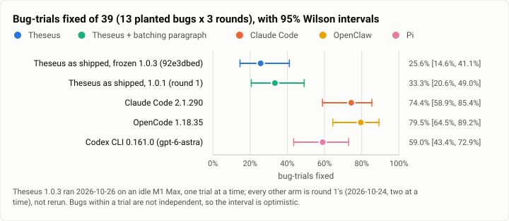
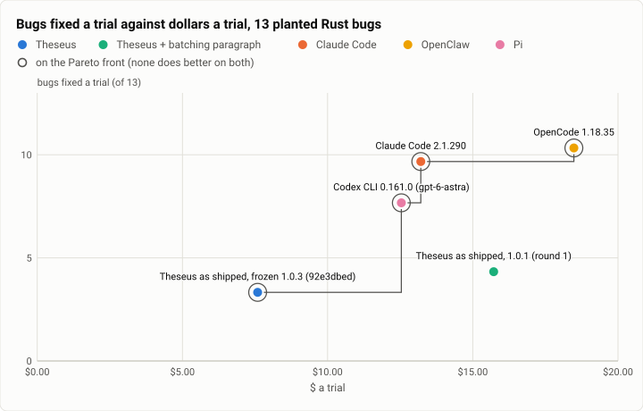

# Bug Hunt RS: the 1.0.3 build against round 1, three trials on thirteen planted Rust bugs (2026-10-26)

> **PRICE BASIS — CORRECTION, 2026-10-26.** The two rounds were billed on **different price tables**. A catalog
> change on 2026-10-25 moved the Sonnet 5.5 cache-read price **$0.10 → $0.20/Mtok**, landing between round 1
> (10-24) and round 2 (10-26). Both prices are measured here rather than inferred from the dates, by solving each
> recorded per-call cost against its recorded usage: round 1 fits $0.10 over 586 calls, round 2 fits $0.20 over
> 455 calls. **So the "52% cheaper" below adds a price change to a behaviour change. Like for like the saving is
> 65% — larger, not smaller, than the figure first published.** The ratio is 0.348–0.350× on either basis,
> because both rounds are almost entirely Sonnet 5.5. Every other number on this page is unaffected: bug counts,
> call counts, tool counts and wall times are not priced. Reproduce with `driver/bh_pricebasis.py`.
>
> | basis | round 1 $/trial | round 2 $/trial | round 2 / round 1 | cheaper by |
> |---|---|---|---|---|
> | both at $0.10 (like for like) | $15.71 | $5.47 | 0.348× | **65.2%** |
> | both at $0.20 (like for like) | $21.66 | $7.58 | 0.350× | **65.0%** |
> | as billed — **mixed, as first published** | $15.71 | $7.58 | 0.483× | 51.7% |

> **ARM KEYS — CORRECTION, 2026-10-27.** Three rows of this run's data carried an arm key that named the wrong
> harness. **No measured number moves**; only the key beside each label does.
>
> | was | is now | the label it always had |
> |---|---|---|
> | `openclaw` | `opencode` | OpenCode 1.18.35 |
> | `pi` | `codex` | Codex CLI 0.161.0 (`gpt-6-astra`) |
> | `theseus-batching` | `theseus-1.0.1` | Theseus as shipped, 1.0.1 (round 1) |
>
> The labels, the setup table and every figure's prose were right all along; the keys disagreed with them. It
> mattered because the cockpit and `charts.py` read a harness's name and its palette colour off the arm key alone,
> so a chart over this table drew OpenClaw where OpenCode ran, Pi where Codex CLI ran, and the batching ablation
> where the 1.0.1 carry-forward ran. The two figures below are redrawn from the corrected keys: OpenCode and Codex
> CLI have no slot in the house palette, so they take the gray outside it with their names on the mark (the same
> way OpenCode is drawn in the 10-18, 10-21 and 10-23 reports), and the 1.0.1 carry-forward takes `oracle`, the
> carried-build neutral those reports use. Every value, interval and tip is byte-identical to the first drawing.
> `bench/report/test_manifest.py` now holds every published dataset to the agreement (theseus-sjf5q).

**The answer first.** The 1.0.3 behaviour build does **less work for less money and fixes no more bugs**. Over three
trials it fixed **3.33 of 13** a trial at **$7.59** a trial, against round 1's 1.0.1 build at **4.33 of 13** and
**$15.72**. Cost fell **52% as billed and 65% like for like** (the price-basis note above), model calls
**22%**, tool calls **29%** and wall time **24%**; the bug count fell by
one, which three trials a side cannot separate from noise (4, 4, 5 against 4, 2, 4; Wilson over the 39 bug-trials
25.6% [14.6, 41.1] against 33.3% [20.6, 49.0]). **Cost per bug improved, from $3.63 to $2.28.**

That was the hypothesis this cell was built to test, and it comes back negative in a useful way. Round 1's
post-mortem found that at half its spend limit the progress check told Theseus to *"take the smallest step that can
pass"*, after which it ran the suite and ended its turn 18 seconds later while Claude Code and OpenCode used the
full 34–36 minutes. The 1.0.3 rows that fix that mechanism (`progress_step.rs`, the loop cap, the question TTL) **did
not buy capability here**. They removed waste: the same three easy bugs, one r-bug on luck, half the spend.

**Theseus is still last on this benchmark and the gap is not small.** OpenCode fixes 10.33 bugs a trial, Claude Code
9.67, Codex 7.67. All three were *not* rerun, per the rivals-not-rerun rule; their round-1 trials stand.

**And one thing this cell found that is bigger than its own result:** in the same build, **a quarter of Theseus's
bench trials silently run `claude-sonnet-5`, not `claude-sonnet-5-5`**. The catalog gives Sonnet 5.5 a
`refusal_fallback_model` of Sonnet 5; when it fires the whole turn continues on the fallback. Round 1's build shows
none of it. Filed as `theseus-wf482`; the detail is under "Threats to validity" because it bears on every Theseus
number on this page, not only this one.

<picture>
  <source media="(prefers-color-scheme: dark)" srcset="img/2026-10-26-bughunt-rs-theseus-k3/bugs-by-arm-dark.svg">
  
</picture>

*Figure 1. Did the 1.0.3 stops rows move what Theseus fixes? No: the two Theseus intervals sit on top of each other,
and both sit well below the three rivals'. Bugs within a trial are not independent, so these intervals are
optimistic — the three-round bootstrap is narrower still and says the same thing.*

| | |
|---|---|
| Suite | Bug Hunt RS: 13 bugs planted in the Theseus Rust tree, 26 hidden tests, a bug counts as fixed when all of its hidden tests pass (`bench/bughunt`) |
| Arm measured | **Theseus as shipped (routed)**, frozen behaviour build **`92e3dbed`** (install #88), aarch64 glibc release-thin binaries, HIGH tier tree (`effort_bounds` low..high) |
| Arms carried forward | Theseus 1.0.1, Claude Code 2.1.290, OpenCode 1.18.35, Codex CLI 0.161.0 on `gpt-6-astra` — all from 2026-10-24, **not rerun** |
| Model | Claude Sonnet 5.5 for every arm but Codex (`gpt-6-astra`); Jev routes each Theseus turn |
| Trials | 3 per arm, one trial a Harbor job |
| Limits | $30 trial spend cap plus one reservation ($32), 36-minute agent timeout, 600 loops. **Round 1's limits, unchanged** |
| Host | M1 Max (aarch64 Asahi, 10 cores, 30 GB). One trial at a time; load1 median **0.26**, p75 0.62, max 11.8 over 225 samples; MemAvailable never below 15 GB |
| Image | `bughunt-rs-hunt-core:0.1-pilot`, mtimes normalized to one stamp (`MTIME-CHECK PASS`; the grader scores 0/13 on the seeded tree and 13/13 on the fixed one) |
| Cost | **$22.76** (Theseus's own ledger, catalog prices) |
| Data | [`2026-10-26-bughunt-rs-theseus-k3.json`](2026-10-26-bughunt-rs-theseus-k3.json), [`.csv`](2026-10-26-bughunt-rs-theseus-k3.csv) (one row per trial, both runs) |

## The question

On 2026-10-24 the Bug Hunt gave Theseus 4.33 bugs of 13 at $15.72 a trial while OpenCode got 10.33 for less. The
post-mortem's leading cause was a stop, not a capability: the progress check cut the turn short at a share of the
deadline. The four 1.0.3 "stops" rows change exactly that mechanism, and the gauntlet froze behaviour at `92e3dbed`
so the question could be asked cleanly: **with the stops fixed, does Theseus find more bugs?**

The rivals are not rerun. Nothing about them changed, and a rerun buys a re-measurement of unchanged conditions.

## The setup

- **The arm.** The routed arm — Jev picks the profile per message — on the frozen build's aarch64 glibc binaries,
  built in a Debian 12 container so the libc matches the hunt image's (`tools/m1max-bins.sh`; newest GLIBC symbol
  2.34 against the image's 2.36). `bench/TREE-SHA` and each trial's `build_commit` both read `92e3dbed`.
- **The caps are round 1's, deliberately.** The gauntlet took the **$2 Terminal-Bench per-trial cap** off every
  harness; the Bug Hunt's $30 is a different thing — its own tier design, and the figure round 1 ran under. Moving
  it would have made this cell incomparable with the rivals it is read against, so it stayed.
- **One trial at a time**, where round 1 ran two. That makes this cell's wall times *more* favourable than round
  1's, which is the direction that matters for the one claim wall time supports (see the threats).
- **The image.** The pilot's leak — mtimes that pointed at the planted edits — is closed: every path under `/app`
  carries one stamp, nothing is newer than `Cargo.toml`, and the offline grader reads 0/13 seeded and 13/13 fixed.
- **Keys.** Anthropic and Jev into the controller's memory over stdin and thence into each Harbor subprocess's
  environment. After the run, a substring scan of 52,319 files on the M1 Max and 104 in the fetched copy: **CLEAN**
  for all three keys.

## Results

**The `$ a trial` and `$ a bug` columns are AS BILLED, and the two Theseus rows are on different price tables**
(the price-basis note at the top). On one basis the two Theseus rows are $21.66 and $7.58 at $0.20, or $15.71
and $5.47 at $0.10. The non-Theseus rows are from their own runs and are not repriced here.

| Arm | Bugs a trial (of 13) | Bug-trials fixed of 39 (95% Wilson) | Hidden tests of 78 | $ a trial (as billed) | $ a bug | Model calls | Tool calls | Wall (mean) |
|---|---|---|---|---|---|---|---|---|
| **Theseus, frozen 1.0.3** | **3.33** (4, 2, 4) | 10 = **25.6%** [14.6, 41.1] | 31 | **$7.59** | **$2.28** | 153 | 206 | **15.1 min** |
| Theseus 1.0.1 (round 1) | 4.33 (4, 4, 5) | 13 = 33.3% [20.6, 49.0] | 40 | $15.72 | $3.63 | 196 | 290 | 19.9 min |
| Claude Code 2.1.290 | 9.67 (10, 10, 9) | 29 = 74.4% [58.9, 85.4] | 60 | $13.21 | $1.37 | 312 | 375 | 29.3 min |
| OpenCode 1.18.35 | **10.33** (10, 10, 11) | 31 = **79.5%** [64.5, 89.2] | **66** | $18.48 | $1.79 | 41 | 59 | 35.2 min |
| Codex 0.161.0 (`gpt-6-astra`) | 7.67 (9, 7, 7) | 23 = 59.0% [43.4, 72.9] | 50 | $12.54 | $1.64 | 59 | 58 | **8.2 min** |

OpenCode's dollars count **every** session in its saved `opencode.db`, not the root one. The retained root-only
figure is $1.65 a trial; its nine to forty-one `task` children take it to $18.48. On Terminal-Bench the same
correction moves nothing — all 350 published TB2 trials have exactly one session — but on the Bug Hunt it is the
difference between OpenCode looking ten times cheaper than it is and looking the most expensive arm on the board.

<picture>
  <source media="(prefers-color-scheme: dark)" srcset="img/2026-10-26-bughunt-rs-theseus-k3/pareto-bughunt-dark.svg">
  
</picture>

*Figure 2. What does each harness's bug count cost? 1.0.3 moves Theseus left — half the money — and not up. The
rivals cluster between $12.50 and $18.50 a trial for two to three times the bugs, so on this benchmark Theseus is
the cheapest arm and the least effective one, and the cheapness is new.*

### Which bugs

Every Theseus trial in both runs fixed the same easy three and then one more on luck:

Trials that fixed each bug, of three:

| | a1 | a2 | a3 | a4 | r1 | r2 | r3 | r4 | r6 | r7 | r8 | r9 | r10 |
|---|---|---|---|---|---|---|---|---|---|---|---|---|---|
| **Theseus 1.0.3** | 2 | **3** | **3** | 0 | 0 | 0 | 0 | 0 | 0 | 0 | 2 | 0 | 0 |
| Theseus 1.0.1 | **3** | **3** | **3** | 0 | 0 | 0 | 0 | 1 | 0 | 2 | 0 | 0 | 1 |
| Claude Code | 3 | 3 | 3 | 2 | 3 | 1 | 0 | 3 | 3 | 2 | 3 | 0 | 3 |
| OpenCode | 3 | 3 | 3 | 3 | 3 | 1 | 0 | 3 | 3 | 3 | 3 | 0 | 3 |
| Codex | 2 | 3 | 3 | 0 | 2 | 0 | 0 | 3 | 3 | 1 | 0 | 3 | 3 |

The union tells the story more plainly than the mean: 1.0.3 reached **four** distinct bugs over three trials
(`a1 a2 a3 r8`), 1.0.1 reached **six** (`a1 a2 a3 r4 r7 r10`), Claude Code **eleven** and OpenCode **eleven**.
Theseus is not failing the hard bugs narrowly; it is not reaching them. Two bugs, `r3` and `r9`, defeat every
Claude-model arm in both runs — only Codex ever fixes `r9` — which is worth a look of its own before anyone treats
13 as the achievable ceiling.

## Analysis

**Where the money went, and why less of it is not obviously good.** Cost fell 65% like for like (52% as billed)
while model calls fell only 22%, so the cost *per call* fell from **$0.110 to $0.050** on one basis — a **55%**
drop. The earlier reading of this line, "$0.080 to $0.050, a 38% drop with the same price table", was wrong in
its premise: **the price table is not the same across the two rounds** (the price-basis note at the top), and
$0.080 is round 1's per-call cost on round 1's older table against round 2's on the newer one. On either single
table the per-call drop is 55% — $0.1105 → $0.0495 at $0.20, or $0.0802 → $0.0358 at $0.10, over 196.0 and
153.3 calls a trial. Tool calls fell 29% and
wall time 24%. Taken together the 1.0.3 build is doing shorter, cheaper turns: fewer calls, fewer commands, smaller
contexts per call. On Terminal-Bench the same build moves the *other* way, spending several times the published
arm's per-trial cost and running many more model calls. **That comparison carries the same two-table problem and
the figure quoted here, "four to seven times", was a mixed-basis reading from an early partial cell**; take the
Terminal-Bench ratio from that cell's own report, which prints it on one basis. The two cells disagree, and
that is itself the finding: the stops rows did not simply "let Theseus work longer", they changed *where* it stops,
and on a repository-scale bug hunt it now stops sooner.

**The three bugs it always fixes, and the ten it never does.** `a1`, `a2` and `a3` are fixed in five of six Theseus
trials across both builds; `a4` and seven of the nine `r` bugs are fixed in none. Claude Code reaches eleven of
thirteen. A harness that reliably fixes the same three and never sees the rest is not short of turns — it is short of
search. OpenCode's shape is the clearest contrast: **41 model calls and 59 tool calls a trial** for 10.33 bugs,
against Theseus's 153 and 206 for 3.33. OpenCode delegates to `task` children that look at the tree; Theseus spends
four times the calls and finds a third as much.

**Cost per bug is the one axis Theseus now leads on, and it leads by a lot less than the headline suggests.** $2.28 a
bug against Claude Code's $1.37 and OpenCode's $1.79 — Theseus is still the most expensive *per bug fixed* of the
four, and it got there by spending less rather than finding more.

## What changed since the last comparable run

Two days, one build, and three changes that bear on the reading:

1. **The build.** `92e3dbed` (install #88) against round 1's 1.0.1, carrying the four "stops" rows the gauntlet froze
   behaviour for.
2. **Parallelism**: one trial at a time here, two in round 1. This cell's host was quieter, which **favours** this
   cell on wall time and cannot explain its lower bug count.
3. **OpenCode's dollars** are now summed over its child sessions, which moves it from $1.65 to $18.48 a trial. That
   is an accounting repair to round 1's number, not a new measurement.

## Threats to validity

- **n = 3 a side, and the bug-count difference does not survive it.** 4, 4, 5 against 4, 2, 4: the Wilson intervals
  over the 39 bug-trials overlap heavily and the three-round bootstrap ([0.154, 0.308] against [0.308, 0.385])
  barely separates. **The honest claim is that the stops rows did not raise the bug count, not that they lowered
  it.** The cost difference is the robust one: every 1.0.3 trial is cheaper than every 1.0.1 trial, with no overlap.
- **A quarter of the Theseus arm did not run the model this page names** (`theseus-wf482`). Nine of the 33 trials
  across this cell and the Terminal-Bench cell record
  `fallback = {"category": …, "from": "claude-sonnet-5-5", "to": "claude-sonnet-5", "answered": true}`, and in those
  trials the daemon's history records `claude-sonnet-5` for **every** answer, not only the one that tripped — one
  Terminal-Bench trial ran 59 of 59 answers on the fallback. Across the 33 trials that is **205 of 922 model calls
  (22%) and $10.21 of $35.79 (29%)**. The categories are `reasoning_extraction` (7) and `cyber` (2); the mechanism is
  `catalog.rs`'s `refusal_fallback_model` for Sonnet 5.5. The two catalog rows carry identical prices **as of the
  2026-10-25 catalog change, which is the table this round was billed on** — before it, Sonnet 5.5 cache reads
  were half Sonnet 5's, so this sentence is not safe to carry back to a pre-10-25 run. Here the
  **dollars are right**; what is wrong is the arm's identity, and validity rule 8 of the gauntlet plan says a
  version bump is a new arm. In this cell one trial (`bh-tr-r3`) is affected, 5 of its 152 calls. Round 1's build
  shows no fallback at all, so it either arrived or widened between 1.0.1 and `92e3dbed` — **a hypothesis, not a
  finding**; the frozen merge's own message names "a transient provider failure is retried inside the turn".
  **Update, 2026-10-26, from the Terminal-Bench cell at 154 trials:** the fallback is not rare there. **33 of 122
  clean trials (27.0%) fall back, over 28 distinct tasks — 28 of them on `reasoning_extraction` and 5 on
  `cyber`** — and **64.2% of that cell's dollars are spent at or after the first fallback call**, because the
  switch holds for the rest of the turn rather than retrying once. Reproduce with `driver/wf482.py`.
- **The host was not formally idle at the start.** A conductor flake-count loop (`arml-p386-sh`) was running when
  the cell launched. Its cost is measured, not assumed: over 225 samples the M1 Max's load1 median was **0.26** and
  p75 **0.62**, with the 11.8 maximum coming from the Bug Hunt's own cargo work. The neighbour was effectively idle.
- **One arm, one host class.** This cell ran on aarch64 with glibc binaries; the Terminal-Bench cells run x86 musl
  on WSL. Bug Hunt numbers are only ever compared with other Bug Hunt numbers on this host.
- **`grade_m1.py` could not price `bh-tr-r3` at catalog rates** because its table has no `claude-sonnet-5` row — the
  same fallback, showing up as a missing number. Every dollar figure above is the ledger's own (`cost_usd`), which is
  priced from the catalog by the daemon.
- **Test integrity.** All three trials: visible tests green, no hidden test added, removed or changed. Round 1's
  Claude Code r2 touched a test; this cell's arm did not.

## The run's cost

**$22.76** over three trials ($8.45, $6.19, $8.12), against the gauntlet plan's **$68–96** band for this cell — it
came in at a third of the band's floor, for the same reason the headline says: the build spends less. Jev's own
routing calls were $0.0027 a trial. The $140 spend stop was never approached. Against the owner's $610 line for the
Theseus arms, this cell took 3.7% of it.

## Reproduction

The controller, its launcher and the grader live outside the repo; the image and its checks are in
`bench/bughunt/hunt-image/`.

```
# the binaries and the adapter tree at the frozen commit, on the M1 Max ($0, no key, no model call)
m1max-bins.sh 92e3dbed        # aarch64 glibc theseus + theseusd, proved to start inside the hunt image
make_m1max_tree.sh 92e3dbed   # the HIGH tier tree (effort_bounds low..high), shipped to the host
# the cell: the Theseus arm alone, k=3, one trial at a time; the keys go over the controller's stdin
GO=1 bh_launch.py launch 92e3dbed TR
bh_launch.py checkkeys        # the post-run scan; expect three CLEAN
# grading, then this report's figures
grade_m1.py jobs
python3 bench/report/draft.py plot docs/benchmarks/2026-10-26-bughunt-rs-theseus-k3.json
```

`bh_launch.py` is `m1max_launch.py` with one option, `--arms`, and `bh_g.py` is `bh_m1.py` with the filter that
option needs — so the Theseus arm can run alone at k=3 while the rivals' round-1 trials stand. Everything else
about the controller, the caps, the timeout and the key handling is round 1's.
