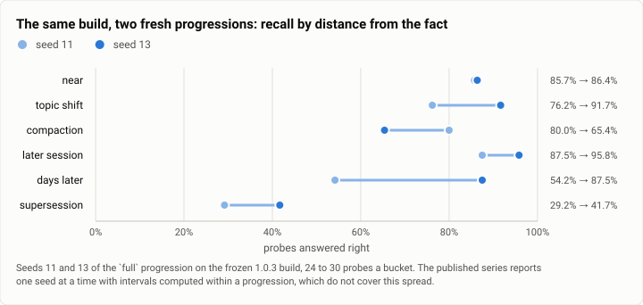

# Recall at two fresh seeds on the frozen 1.0.3 build: how much of the published number is the seed? (2026-10-26)

> **TWO CORRECTIONS, 2026-10-26, both to this page's "what is robust" section. Neither touches the seed-spread
> headline, the recall rates, delivery, supersession or the figure.**
>
> **1. PRICE BASIS.** A catalog change on 2026-10-25 moved the Sonnet 5.5 cache-read price **$0.10 →
> $0.20/Mtok**. The 10-18 seed-7 run was billed on the old table and both 10-26 seeds on the new one, so
> **"about 3.2× more" adds a price change to a behaviour change.** Measured from each seed's own per-turn
> records — the implied cache-read price solves to exactly $0.20 over all 600 turns at both seeds — the two
> seeds cost **$23.15** and **$22.55** on seed 7's table, against **$11.44**: **about 2.0× like for like**, not
> 3.2×. (The 1.95–2.02× spread depends on how the handful of non-Sonnet turns are treated; the direction and
> magnitude do not.) **And about half of even that remaining rise is the bench, not the build:** the planned
> context window moved 88,000 → 183,000 tokens between the runs, 2.08×, so per unit of window these runs are
> slightly *cheaper* than 10-18. The prompt is unchanged (7,467 tokens against 7,335). Seed 7's published data
> file carries no per-turn usage, so it cannot be repriced upward; comparisons must be made on its table.
> Reproduce with `driver/recall_pricebasis.py`.
>
> **2. THE ABSTENTION RESULT IS A GRADER ARTEFACT, and this is the correction that matters.** "Theseus gave a
> value instead of 'I don't know' in 51 of 60 and 56 of 60 cases" is **not what the replies say**. All 120
> abstention probes across the two seeds — **60 of 60 at each seed** — contain an explicit abstention, and
> **none of them carries a value-shaped string in its first sentence.** What trips the grader is the second
> half of the reply, where the model volunteers the nearest thing it does hold and says it is a *different*
> component: *"I don't know where the veery indexer keeps its cache index… The quail indexer's is
> `/srv/quail/indexer/cache-43.idx`"*. The bench's `lacks` clause is applied to the whole reply and cannot tell
> that apart from an answer. **Rescored with `lacks` applied to the answer rather than to the explanation,
> abstention is 60/60 at both seeds, not 9/60 and 4/60**, and 107 probes flip. The corrected table is in
> "Rescored abstention" below, beside the original. **Confident-wrong is a separate population** (none of the
> 32 confident-wrong probes is an abstention probe) and is corrected on its own terms there too.

**The answer first.** Two progressions the series has never used, both on the frozen 1.0.3 build, both Theseus
with its memory (arm `baseline`) on Claude Sonnet 5.5 at medium effort. Seed 11 answered **68.8%** of the recall
probes right; seed 13 answered **77.8%**. **They straddle the published 73.1% from seed 7, and they differ from
each other by nine points.** So 73.1% was a typical draw — and the spread between two draws of the same build is
as large as any build-to-build difference this series has reported.

**That is the finding, and it is about the method rather than the build.** The published intervals (73.1%
[65.1, 79.9]) are computed over the 204 probes *within* one progression. They say nothing about the variation
*between* progressions, and this run measures it for the first time: **±4.5 points on overall recall, and ±10
points on the cross-session figure** (70.8% at seed 11 against 91.7% at seed 13, where seed 7 gave 58.7%). Per
bucket and per carrier, where each cell holds ten to thirty probes, the swings are larger still — facts carried
in a tool's output were recalled 22% of the time at seed 11 and 64% at seed 13.

**Three things are robust, because both seeds agree and both differ from seed 7 in the same direction:**

- **Delivery is fixed.** 228 of 228 facts delivered at both seeds, **0 undelivered**. The 10-18 run's delivery
  check flagged **57** facts it could not see through a compaction; **46 of them had to be recovered by hand**
  (they appear verbatim in Theseus's own replies) and **10 remain unproven in the published data file**, which
  is why that report carries a correction section and two different headline rates. On this build there is
  nothing to correct.
- ~~**Abstention got worse, and it was already the weak spot.** Asked about something never said, Theseus gave a
  value instead of "I don't know" in **51 of 60** cases at seed 11 and **56 of 60** at seed 13, against **38 of
  60** on 10-18. **Confident-wrong moved with it: 21 and 11 against 2.** Those two are the numbers that moved
  against the build at both seeds.~~ **WITHDRAWN — correction 2 at the top.** Rescored against the replies,
  abstention is **60 of 60 at both seeds**; the 51 and 56 are the grader's `lacks` clause firing on a
  *different* component's path named in the explanation after the abstention. Confident-wrong is a separate
  population and survives, smaller: 17 of 21 and 6 of 11 are date-valued probes in which the model preferred
  the machine clock to the bench's narrated calendar and said so. Ex-date it is **4 of 114 and 5 of 124**
  against seed 7's 2 of 129 on the same rule — real, and too small to interval.
- **It costs about 2.0× more like for like, not 3.2×** (correction 1 at the top). The whole 600-turn
  progression cost **$37.17** and **$35.10** as billed, against **$11.44** on 10-18 — but on 10-18's own price
  table the two seeds are **$23.15** and **$22.55**. The planned context window also moved 88,000 → 183,000
  tokens (2.08×) between the runs, which over-explains what is left: per unit of window these runs are slightly
  cheaper than 10-18's. The system prompt and tools are unchanged (7,467 tokens measured, against 7,335), so
  what remains is more work per turn rather than a bigger prompt.

<picture>
  <source media="(prefers-color-scheme: dark)" srcset="img/2026-10-26-recall-seeds-1.0.3/seed-spread-dark.svg">
  
</picture>

*Figure 1. Each bar's length is the gap between two draws of the same build. Near facts are stable across
seeds (0.7 points); everything further away is not — days-later recall moves 33 points, topic shift 16 and
compaction 15. The published series reports one seed at a time, with intervals computed within a progression,
which do not cover this.*

| | |
|---|---|
| Suite | the incidental-recall bench (`bench/recall`), progression `full` |
| Arm | Theseus, memory arm `baseline`, frozen 1.0.3 behaviour build `92e3dbed`, aarch64 glibc |
| Model | Claude Sonnet 5.5, effort medium |
| Seeds | 11 (digest `34c09f7de2cf9b2d…`) and 13 (digest `2d1e77c16fb304d6…`), each 600 turns in 3 sessions, 228 facts, 204 probes |
| Rivals | **not rerun** — see "Why no rivals" |
| Scoring | `score.py`, stale rule `strict`; 204 scored, 0 failed, 0 undelivered at both seeds |
| When | 2026-10-26, 12:14–13:21 and 13:21–14:33 (UTC−7) |
| Cost | $72.27 for the two seeds (whole runs); $37.56 of that on the 204 probe turns each |

## The question

Does the build 1.0.3 freezes still remember its own work across sessions? The 10-18 run answered that at **seed
7** on the v1 freeze. This run asks it again on `92e3dbed`, and asks something the series has not asked before:
**how much of a published recall number is the progression it was drawn from?** One progression is one draw. Two
fresh draws cannot give an interval over draws, but they can say whether the published figure sat in an ordinary
place.

## Why no rivals, and why that is not a gap

The rivals-not-rerun rule applies here with unusual force. The published cross-session result is not a number a
build can move: **Claude Code answered 0 of 48 and Pi 1 of 48 across sessions**, because neither carries anything
from one session to the next. That is structural, not a measurement that drifts, and re-running them at new seeds
would buy a restatement of it at full price. Within a session the three were already alike. So the comparison
this run can usefully move is **Theseus against Theseus**: `92e3dbed` at seeds 11 and 13 against `351159fc` at
seed 7.

## The setup

- **Theseus:** the frozen build's aarch64 glibc binaries — `theseus`, `theseusd`, and `theseus-index`, which runs
  beside the daemon as its tender and without which the driver refuses to start — with the bench profile, the
  embedder's weights, `idle_unload_mins = 600`, memory arm `baseline`, a $40 run limit a seed.
- **Overhead:** the driver measures the daemon's system prompt and tools before the run and plans the
  progression's window and compaction marks at that overhead, so a prompt that changed size would change the
  progression rather than quietly changing the difficulty. Measured 7,467 tokens at both seeds.
- **Scoring:** `score.py`, stale rule `strict` — a superseded value named anywhere is stale and the answer wrong.
  A probe counts only if its fact reached the arm; a fact that never arrived is excluded and counted, never
  scored as a miss.

## Results

| | seed 11 | seed 13 | seed 7 (published, 10-18) |
|---|---|---|---|
| recall, all probes | **68.8%** (99/144) | **77.8%** (112/144) | **73.1%** |
| cross-session (later session, or days later) | 70.8% (34/48) | 91.7% (44/48) | 58.7% (27/46) |
| within a session | 67.7% (65/96) | 70.8% (68/96) | 80.7% (71/88) |
| abstention: gave a value instead of "I don't know" | 51/60 | 56/60 | 38/60 |
| confident-wrong | **21 (10.3%)** | **11 (5.4%)** | **2 (1.0%)** |
| undelivered facts | **0** | **0** | 10 (after 46 of 57 were recovered by hand) |
| cost, whole 600-turn run | $37.17 | $35.10 | $11.44 |
| cost over the 204 probe turns | $19.20 | $18.37 | $4.84 |
| cost a probe turn | $0.094 | $0.090 | $0.0237 |
| overhead (prompt + tools) | 7,467 tok | 7,467 tok | 7,335 tok |

**Two cost bases, and they must not be mixed.** The published report's headline dollar figure is the
**whole 600-turn run**; a scores file carries only the **204 probe turns**. Comparing a new seed's probe-sum
with the old whole-run figure understates the gap by about two and a half times, so both bases are given above
and each is compared with its own.

Seed 7's rows above are **recomputed from its published data file on this report's own grouping**, not copied
from its prose. Its report quotes "60 of 64" within a session, which groups the buckets differently; on the
grouping used here it is 71 of 88. Its overall rate is over 134 scored recall probes (10 were undelivered and
dropped), against 144 at each new seed. The rates compare; the counts are not of the same denominator.

Recall by distance bucket, nearest first — and the row to read is how much it moves between two draws of the
same build:

| bucket | seed 11 | seed 13 |
|---|---|---|
| near | 18/21 (86%) | 19/22 (86%) |
| topic shift | 16/21 (76%) | 22/24 (92%) |
| compaction | 24/30 (80%) | 17/26 (65%) |
| later session | 21/24 (88%) | 23/24 (96%) |
| days later | 13/24 (54%) | 21/24 (88%) |
| supersession | **7/24 (29%)** | **10/24 (42%)** |

## What is robust, and what is not

**Robust — both seeds agree, and both differ from seed 7 the same way:**

- **Delivery.** 0 undelivered, against 57 flagged and 10 still unproven on 10-18. That report had to correct
  its own scoring by hand because its delivery check read `theseus history`, which on that build returned fewer
  of the messages a compaction cut. This build does not need the correction, and its rate needs no asterisk.
- ~~**Abstention is worse.** 51 and 56 of 60 gave a value where seed 7 gave 38 of 60.~~ **WITHDRAWN** — it is
  the grader, not the build. See "Rescored abstention" below; on the corrected rule it is 60 of 60 at both
  seeds. Abstention is named as weak in both prior reports, so the same clause very likely cost seed 7 too;
  its raw replies are not on this machine and that cannot be checked here.
- **Supersession is the weakest bucket at both seeds** — 29% and 42% — and the failure mode is naming the
  superseded value rather than refusing: the strict stale rule counts a stale value named anywhere as wrong.
  **This is the same clause as the abstention artefact**, applied to a population where naming the superseded
  value genuinely is the error, so it stands — but a reader should see the two together.
- **Confident-wrong rose** — 21 and 11 against **2** on seed 7, a rate of 10.3% and 5.4% against 1.0%.
  ~~it sits beside the abstention result: this build is readier to assert a wrong value and less ready to say
  it does not know.~~ **That gloss is withdrawn:** the abstention half of it is a grader artefact, and **17 of
  the 21 and 6 of the 11 are date-valued probes** where the bench narrates a simulated calendar, the build
  surfaces the real machine date, and the model says which it used (*"Your first message said the date was
  2026-11-24, but the machine date is 2026-10-26, and I used the machine's"*). **Ex-date the rise is 4 of 114
  and 5 of 124 against 2 of 129** — real, small, and on counts too low to interval.
- **Cost is up about 2.0× on the whole run** at both seeds on one price table (3.2× as billed, across two),
  on an unchanged prompt and with the planned context window 2.08× larger. See correction 1 at the top.

**Not robust — a single seed would have told a different story:**

- **Overall recall** moves 9 points between draws, which is wider than the gap between any two published builds.
- **Cross-session** moves 21 points (70.8% to 91.7%).
- **Where facts are cited** swings from 92% to 27%, and **facts carried in a tool's output** from 22% to 64%.
  These are ten-to-thirty-probe cells and should not be read as build properties at all.
- **The incidental half-life** is 256 turns at seed 11 and *not reached* at seed 13.

**The practical consequence for this series: a single-seed recall number should not be compared with another
single-seed recall number to two significant figures, and the published intervals do not cover this.** Any
future claim that a build moved recall by a few points needs more than one progression behind it.

## Rescored abstention — the original scoring and the corrected one, side by side

Added 2026-10-26, from the saved replies. **No model call, no rerun, $0.** Both columns are printed by one
tool over one set of replies, so the difference is the grader and nothing else.

**What the grader does, and the one line that changes.** An abstention probe asks about a fact the progression
never stated. Its check is two clauses:

```
reply lacks /<value-shaped regex: \/srv\/… for a path, \d+\.\d+\.\d+ for a version, …>/
reply has   /<abstention-phrase regex: don't know | no record | not mentioned | …>/i
```

`lacks` is evaluated against **the whole reply**. The corrected rule evaluates it against **the first sentence**
— the answer — and leaves `has` over the whole reply unchanged. One scope, one clause:

```diff
- lacks_ok = not value_regex.search(reply)
+ lacks_ok = not value_regex.search(first_sentence(reply))
```

| | seed 11 | seed 13 | 10-18 seed 7 |
|---|---|---|---|
| abstention probes | 60 | 60 | 60 |
| contain an explicit abstention phrase | **60** | **60** | not checkable here * |
| **as shipped** — `lacks` over the whole reply | 9 correct | 4 correct | 22 correct (38 "gave a value") |
| **corrected** — `lacks` over the first sentence | **60** | **60** | not checkable here * |
| variant — `lacks` over the first paragraph | 58 | 60 | — |
| probes that flip wrong → right | **51** | **56** | — |

\* **Seed 7 cannot be rescored and this is a real limit of the correction, not a formality.** Its published
data file carries scores and usage but **no replies**, and no run directory for it survives on either host, so
there is nothing to apply a corrected grader to. Its 38-of-60 figure is on the uncorrected rule. The two 10-26
seeds are therefore compared with a seed-7 number the correction could not reach, and **the honest reading is
that the abstention comparison across builds is not available at all**, rather than that it favours either
build. Abstention was named as weak in both prior reports, so the same clause plausibly cost seed 7 as well.

**What the correction does *not* change.** The 144 non-abstention probes are untouched: recall stays **99/144**
at seed 11 and **112/144** at seed 13, and every bucket, carrier and cross-session figure on this page stands.
The confident-wrong population is disjoint from the abstention one — **0 of the 32 confident-wrong probes is an
abstention probe** — so it is not flipped by this at all; it is qualified separately above, by the date split.

All four rows below are over the **144 non-abstention probes** — the same population as this page's
`recall, all probes` row. (The 10.3% / 5.4% rates quoted earlier on this page are the same counts over all
204 probes; the counts, not the denominators, are what the date split moves.)

| | seed 11 | seed 13 | seed 7 (10-18, rescored) |
|---|---|---|---|
| confident-wrong | 21 | 11 | 2 |
| of those, date-valued | **17** | **6** | 0 |
| confident-wrong, ex-date | **4 of 114** | **5 of 124** | **2 of 129** |
| recall, ex-date | 88/114 = 77.2% | 100/124 = 80.6% | 95/129 = 73.6% |
| recall, all scored (unchanged) | 99/144 = 68.8% | 112/144 = 77.8% | 98/134 = 73.1% |

Seed 7's column is the **same rule over its own saved scores**, not the estimate this page's source report
gave as a range: its 14 date probes are 9 undelivered and 5 scored (3 right, 0 confident-wrong), and setting
those 5 aside leaves 95/129. Its 134 is the scored recall probes (10 of 204 were undelivered); a new seed's
denominator is 144. The three columns are read by one grader and one rule — the rule being that **a date
probe of a run whose clock was not pinned to its narrated dates is set aside, counted as `clock_conflict`
and scored nowhere** (`theseus-kyrgn`; all three runs predate the pin). Nothing here shows a rise in date recall:
the replies are on disk and say what they say, so a rescore can only stop counting the conflict. **The rise
needs a pinned rerun** (`drive.py --clock pin`), which makes model calls and is not run in 1.0.4.

Reproduce with `driver/recall_rescore.py` (prints both columns and the flipped probes) over
`seed{11,13}-turns.jsonl`, `seed{11,13}-prog.json` and this cell's own `seed{11,13}-scores.json`. The
as-shipped column reproduces the shipped scorer exactly — 9 and 4 — which is what makes the corrected column
comparable.

## Validity

1. **A different host and architecture.** This run was on the aarch64 machine; the published series ran on the
   x86 box. Recall is bound by model calls and scored on answer correctness, so the recall figures compare — but
   **the latency figures do not** and are given for this host only (p50 5,650 ms and 6,807 ms).
2. **A busy host.** Other work ran beside this cell, with load between about 2 and 14. That is a threat to the
   latency figures, not the recall ones.
3. **Two seeds are a spread, not an interval.** Nothing here is pooled into one figure and no interval is
   computed across two draws. The point of the run is the spread itself.
4. **The driver runs the binaries directly on the host.** Its "run live in a throwaway container or VM" note is
   a warning to the operator about tool confinement, not something the driver does; the published run was
   sandboxed in a container and this one was not. That affects containment, not the measurement.

## Reproduction

```
recall_remote.sh --size full 11 13      # on the aarch64 host, key on stdin
# per seed: drive.py --arm theseus --memory-arm baseline --bin-dir <frozen bins>
#           --profile <bench profile> --model anthropic/claude-sonnet-5-5 --effort medium
#           --seed <N> --size full --spend-limit 40 --out <run>
#           then score.py <run> --out <run>-scores
```

Data: [`2026-10-26-recall-seeds-1.0.3.json`](2026-10-26-recall-seeds-1.0.3.json) — each seed's summary, its
per-bucket, per-carrier and per-kind breakdowns, the half-life curves and the seed-7 comparison — and
[`2026-10-26-recall-seeds-1.0.3.csv`](2026-10-26-recall-seeds-1.0.3.csv), one row per probe per seed.

This report takes no `index.json` row: the manifest carries one row per measured arm of a **pass-rate**
benchmark, and `manifest.py` declines a recall dataset with a named reason ("no summary entry holds a pass rate
with its interval (a different measurement)"), as it does for the memory exam and the gate bench.
