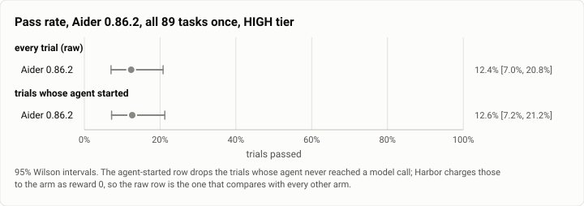
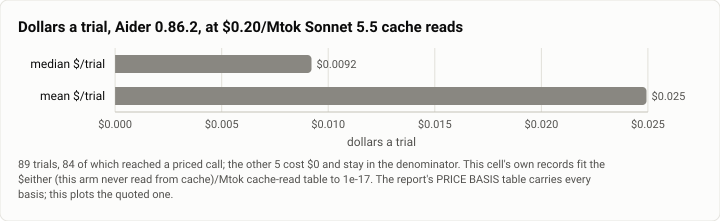

# Terminal-Bench 2.0, HIGH tier: Aider 0.86.2 on all 89 tasks (2026-10-26)

**The answer first.** Aider 0.86.2 on `claude-sonnet-5-5` solved **11 of 89 trials, 12.4%** [7.0, 20.8],
at a **median $0.0092 and a mean $0.0249 a trial**, $2.22 for the whole cell. This is Aider's **first
`terminal-bench@2.0` row**; its only earlier appearance here is the 10-07 harness sweep on the old
14-task `terminal-bench`, a different benchmark and not a baseline for this.

**This number is low because Aider is not an agentic loop, and that is the measurement rather than a
fault in the run.** Aider answers **one message** with up to three reflections and edits files; its median
trial here made **1 model call** and took **12.5 seconds**. It suggests shell commands but never runs
them: Aider requires an explicit yes per command (`explicit_yes_required`), which `--yes-always` does not
give, so every task that needs a command run — a service started, a package installed, a build driven —
fails in Aider as shipped. The arm deliberately leaves that as it is, because changing it would measure
something other than Aider. **Read this row as "Aider as shipped, one pass", never as "Sonnet 5.5 solved
12%".**

<picture>
  <source media="(prefers-color-scheme: dark)" srcset="img/2026-10-26-terminal-bench-aider-high-k1/pass-rate-aider-dark.svg">
  
</picture>

*Figure 1. 95% Wilson intervals at k=1. Dropping the two trials whose agent never started moves the point
by 0.2 points, which is the whole effect of the denominator rule at this rate.*

| | |
|---|---|
| Suite | `terminal-bench@2.0`, all 89 tasks, k=1 (`task_set: full`) through Harbor, plan `g1-high-k1` |
| Arm | **Aider 0.86.2** (`aider_agent:MeasuredAider`), harbor arm at `ee7e1c9f`, pinned release not latest |
| Tier | HIGH is the gauntlet's cell label; Aider has no effort bounds, and `output_config.effort` went out at `medium` |
| Cap | **off** (`no_cap`); `--ak max_budget_usd=2.0` and `--ak max_turns=200` are recorded, not enforced — Aider has neither |
| Model | `anthropic/claude-sonnet-5-5`, pinned as the main, weak and editor model, so every call is the one model |
| Baseline | **none.** Aider has no published `terminal-bench@2.0` row to compare against; see the index |
| Host | the owner's WSL machine, four trials at once, sampled every 30 s |
| Elapsed | 22:49:13 → 23:43:34 MST, 54m |
| Cost | $2.22 over 89 trials — see PRICE BASIS |
| Data | [`2026-10-26-terminal-bench-aider-high-k1.json`](2026-10-26-terminal-bench-aider-high-k1.json), [`.csv`](2026-10-26-terminal-bench-aider-high-k1.csv) (one row per trial) |

## The arm's own adjustments, stated because they move the number

Aider 0.86.2 predates Claude Sonnet 5.5, so the arm hands it the settings Aider ships for its newest
Sonnet with three changes, each forced rather than chosen:

- **no `temperature`** (`use_temperature: false`): Sonnet 5.5 returns a 400 for every request carrying one,
  and Aider sends 0 by default. Without this the cell would be 0 of 89;
- **the effort as `output_config: {effort: medium}`**, the field Theseus sends — Aider's own
  `--reasoning-effort` goes out as a literal `extra_body` key the API does not take;
- **Sonnet 5.5 as the weak and editor model too**, where Aider's Sonnet settings name Haiku.

The arm also supplies the context window and list prices Aider's own table lacks, and pins
`aider-chat==0.86.2` rather than taking the latest release at install time, so the row is reproducible.

## PRICE BASIS

Install #85 (2026-10-25, `theseus-rko44`) moved the Sonnet 5.5 cache-read list price **$0.10 →
$0.20/Mtok**, and a cost number that does not say which table it is on cannot be compared with another
run's. **This cell is unaffected, and it is the only one of the three that is**: Aider read **zero** tokens
from cache and wrote zero, so the entry that moved never applies.

| basis | median $/trial | mean $/trial | total |
|---|---|---|---|
| **cache reads at $0.20/Mtok (today's table)** | **$0.0092** | **$0.0249** | **$2.22** |
| cache reads at $0.10/Mtok | $0.0092 | $0.0249 | $2.22 |

Measured rather than assumed: fitting each trial's recorded dollars against its recorded usage reproduces
every trial to **$1.4e-17**, with the cache columns empty in all 84 priced trials. Over **89 trials**, 84
of which reached a priced call; the other 5 cost $0 and stay in the denominator. $/solve is **$0.2017**.

**Aider's settings do enable prompt caching.** It bought nothing here because a trial is one call: there
is no second request to read a cache back. That is why Aider's median trial is **6.7× cheaper** than
OpenHands' and its mean **4.8× cheaper**, and yet a solve costs **1.2× more** ($0.2017 against $0.1670) —
the dollars are small, and so is the share of them that buys anything.

<picture>
  <source media="(prefers-color-scheme: dark)" srcset="img/2026-10-26-terminal-bench-aider-high-k1/cost-basis-aider-dark.svg">
  
</picture>

*Figure 2. Mean 2.7× median: a handful of trials run the three reflections against a large repo map and
carry most of a very small bill.*

## The recorded total is a FLOOR, not the spend

A trial ending in `AgentTimeoutError` records `cost_usd: null` and an empty `by_model`, so whatever it
burned is in no total. Three trials ended that way here, and the harness kept no usage for a trial it
killed. Read $2.22 as **at least** $2.22. This is a property of the measurement and applies identically to
cells 2 and 4.

## Errors, by type

| type | n | tasks |
|---|---|---|
| `AgentTimeoutError` | 3 | `break-filter-js-from-html`, `password-recovery`, `vulnerable-secret` |
| `NonZeroAgentExitCodeError` | 2 | `qemu-alpine-ssh`, `qemu-startup` |

Five of 89, 5.6%. All five scored 0 and all five are in the denominator.

**The two `qemu-*` tasks fail the same way in all three rival cells** — Aider, OpenHands and OpenClaw each
lose exactly `qemu-startup` and `qemu-alpine-ssh` to `NonZeroAgentExitCodeError` with no model call, no
`reward.txt` and $0. Three different harnesses failing identically on two tasks points at the task images
or this host's nested virtualisation, not at any arm. It is not corrected for: the raw row keeps them, as
every published arm's raw row does.

A timeout is a notable error shape for an arm whose median trial is 12.5 s. All three are tasks where
Aider's one call returns a very large edit.

## What this run measured

| | |
|---|---|
| Trials | 89 over 89 tasks, k=1 |
| Passed | 11 (12.4% [7.0, 20.8]) |
| Agent reached a model call | 84 of 89 |
| Model calls | 87 total, median **1** a trial — 1.04 calls per trial that made any |
| Agent wall clock | median **12.49 s** a trial |
| Tokens | 770,840 input, 67,733 output, **0** cache read, **0** cache write |
| Billed models | `claude-sonnet-5-5` on all 84 priced trials; nothing else appears in the bill |

**Host conditions.** No WSL join gate overlapped this run, so no trial is gate-contaminated and the "quiet
host" grouping equals the raw one. The sampler's medians over 108 samples: load1 **3.12**,
`cpu_some_avg10` **1.48**, `io_some_avg10` **3.00**, swap 2.60 GB. This is the quietest of the three rival
cells; cell 4 ran at `cpu_some_avg10` 19.48, so the three are not matched on host load.
