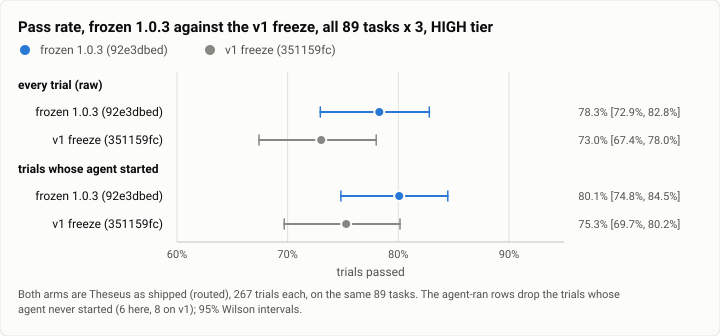
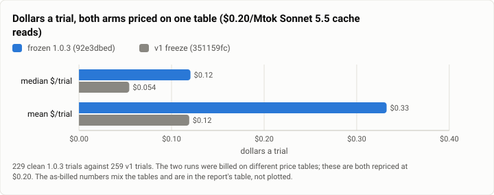
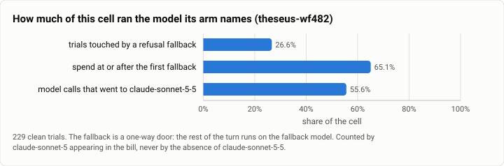

# Terminal-Bench 2.0, HIGH tier: the frozen 1.0.3 build against the v1 freeze, all 89 tasks × 3 (2026-10-26)

**The answer first.** The frozen 1.0.3 behaviour build solved **209 of 267 trials, 78.3%** [72.9, 82.8], against
the v1 freeze's **195 of 267, 73.0%** [67.4, 78.0] on the same 89 tasks. That is +5.3 points **with overlapping
intervals**, so this run does not establish that 1.0.3 solves more of the suite than v1 did. What it does
establish is the price: **like for like on one price table, the median trial costs 2.22× and the mean 2.79×**,
and the median trial also takes 2.09× the wall clock. Both numbers have to be published together — either one
alone misreads the run.

**Read the two sections after the cost tables before quoting anything.** A quarter of this run did not execute
the model its arm names (`theseus-wf482`), and 65% of its dollars were spent after that switch, so "1.0.3 costs
2.2×" is a statement about the arm as shipped rather than about Claude Sonnet 5.5.

<picture>
  <source media="(prefers-color-scheme: dark)" srcset="img/2026-10-26-terminal-bench-theseus-1.0.3-high-k3/pass-rates-c1-dark.svg">
  
</picture>

*Figure 1. Does 1.0.3 solve more of the suite than v1 did? Not distinguishably. The gain is the same size on
either denominator rule — +5.3 points raw, +4.8 agent-ran — and on both the intervals overlap by most of their
width. The agent-ran rows are the honest pairing: they drop the trials whose agent never started, 6 here and 8
on v1, and the two arms lose them on the same two tasks.*

| | |
|---|---|
| Suite | `terminal-bench@2.0` at `69671fba`, all 89 tasks, k=3 (`task_set: full`) through Harbor |
| Arm | **Theseus as shipped (routed)**, frozen 1.0.3 behaviour build `92e3dbed`, x86-64 musl static binaries |
| Tier | HIGH: `effort_bounds = ["low", "high"]` |
| Cap | **off** (`BENCH_NO_CAP=1`); the arm's own limit is a $57.75 runaway guard plus one reservation |
| Model | Jev-routed Anthropic profiles; the pinned model is `claude-sonnet-5-5` |
| Baseline | the published v1 HIGH Theseus arm, `351159fc`, 2026-10-18, 267 trials, **not rerun** |
| Host | the owner's WSL machine, four trials at once, sampled every 30 s |
| Cost | $89.81 recorded over 267 trials; the baseline's $26.60 over 267 — see PRICE BASIS before taking a ratio |
| Data | [`2026-10-26-terminal-bench-theseus-1.0.3-high-k3.json`](2026-10-26-terminal-bench-theseus-1.0.3-high-k3.json), [`.csv`](2026-10-26-terminal-bench-theseus-1.0.3-high-k3.csv) (one row per trial) |

## This is also the Theseus-general cell, with one provider family missing

The as-shipped routed arm is the Theseus-general point, so this run is both. **It reaches every provider it
has, and today every one of them is Anthropic's**, because the China-origin providers are blocked by the data
floor: bench briefs still refuse at the first request. That is a property of this measurement and belongs on the
chart's label rather than in a footnote — *Theseus-general, Claude-origin providers only.*

## What must be said about validity before any number

1. **A contaminated window.** Four build gates ran on this host while the run was live — 08:32–09:11 (before
   it), 11:00–11:45, 12:05–12:21 and 12:22–12:48 — each an 8,703-test suite at 8 threads plus a release build.
   Inside those windows the run's own sampler puts `cpu_some_avg10` at a median of **35.25** against **4.59**
   outside, where the launcher refuses to *start* above **5.0**. **33 trials are affected**, marked with their
   window in the data file. See "The contaminated window" for what was done about it.
2. **Trials whose agent never started are reported separately, and they are two named tasks rather than a flaky
   rate.** Harbor charges a container that could not `apt-get install` to the arm as reward 0. Every such trial
   here is `qemu-startup` or `qemu-alpine-ssh`, failing the same package install on every replicate, in loaded
   and quiet windows alike. **The published v1 arm lost the same two tasks, 3 of 3 replicates each, with the
   same exception** (checked against its per-trial CSV, not its prose), so this is neither a regression nor a
   condition of today's host. **Every arm loses these two tasks:** across all published `terminal-bench@2.0`
   runs, **0 of 58 trials on them ever started an agent**, for `claude-code`, `codex`, `opencode`, `pi` and
   Theseus alike, including the two arms that do not install Node through apt. On the 2026-10-04 run agents did
   run both tasks and **scored 0 on all four trials**. Their only effect is on the denominator, equally for
   everyone. The harness was deliberately not changed mid-run.
3. **Pass rates are compared on one denominator rule, and the baseline's published figure is not that rule.**
   The v1 arm's headline **73.0% (195/267) is raw** and carries **8 trials whose agent never started**; its own
   agent-ran rate is **75.3% (195/259)**. An agent-ran figure from this run must be read against 75.3%, not
   against 73.0% — mixing the two overstates the gap by about two points. **The agent-ran basis also
   neutralises a second asymmetry:** this run used `--agent-setup-timeout-multiplier 3` and the baseline did
   not, so the baseline lost 2 further trials to `AgentSetupTimeoutError` that this run would have rescued.
   Those trials have no agent and drop out of both agent-ran denominators; on the raw basis they cost the
   baseline about 0.7 points.
4. **`theseus-wf482` rides along.** A quarter of trials are touched by the catalog's refusal fallback from
   `claude-sonnet-5-5` to `claude-sonnet-5`. Prices are identical so the dollars stand; **the arm's identity
   and the refusal column do not**.
5. **One difference from the published HIGH runs beyond the build**, and it is a threat rather than a defect:
   the current `bench/theseus-bench-routed.toml` has **no `[routing.classes.review]`**, which the v1 tier trees
   added. The profile carries `opushi`, so that class is the only remaining difference in the routing tree.
6. **Prices.** Sonnet 5.5 cache reads are billed at **$0.20/Mtok, a decision in force rather than a settled
   fact**. Cache reads dominate this arm, so absolute dollars are sensitive to it; the ratios are not, because
   both sides are priced the same way.

## The contaminated window

**33 of the 267 trials ran inside a build-gate window, the measurement survives them, and none was rerun.**

The unpaired split looks damning and is worth nothing on its own: **66.7% inside the windows against ~82%
outside**. Harbor walks the task list in a fixed order, so a time window selects a *contiguous slice of tasks*,
not a random sample — the gap could be task mix entirely.

**The run supplies its own control for free.** Harbor runs every task on attempt 1 before it starts attempt 2,
so a window catches one replicate and leaves that task's others to run clean later, on the same task, arm and
binaries. That is a paired comparison. At 24 of the 33 gated tasks paired:

| | this run | calibration: no effect | calibration: a real effect |
|---|---|---|---|
| paired pass, gated vs clean | **17/24 vs 17/24** | 58.3% vs 66.7% | 41.7% vs 62.5% |
| sign test | **1 / 1, 22 agree** | 4 / 1 | 6 / 1 |
| **paired agent-time ratio** | **0.96×** | 0.99× | 2.20× |
| tasks slowed past 1.5× | 4/23 | 0/12 | 12/12 |

The calibration columns are two synthetic cells built before the real pairs existed, so the rule could not be
fitted to the data: **rerun only if the paired agent-time ratio is clearly above ~1.3× with a substantial share
of tasks slowed**, because that is the mechanism by which a loaded host would hurt a trial at all.

**The strongest version of the check is the long tasks, where neighbour IO should show first** — the eight
paired tasks whose gated replicate ran over 300 s read **0.94×**, and the three longest ran *faster* inside a
window than outside it (`regex-chess` 0.58×, `compile-compcert` 0.65×, `caffe-cifar-10` 0.91×). Two tasks are
slower, two much faster: scattered rather than one-sided.

**So the windows did not move the measurement, the unpaired split was task mix, and the 33 trials are published
marked rather than rerun.** The rerun cell was built, costed (~$13, ~1.7 h) and left unfired.

## PRICE BASIS — this goes above the cost numbers, and they are not quoted without it

**This run and its baseline were billed on different price tables, so any cost ratio taken from the two runs'
recorded dollars is a price change and a behaviour change added together.** Install #85 (2026-10-25) moved the
Sonnet 5.5 cache-read list price **$0.10 → $0.20/Mtok**. The 10-18 v1 arm ran before it and this run after it.
The prices are **measured, not inferred from the dates**: solving each recorded per-call cost against its
recorded usage fits $0.10 across the v1 arm's Sonnet 5.5 calls and $0.20 across this run's, to 1e-6; input,
cache write and output are identical on both tables, and only that one entry moved.

Over **229 clean 1.0.3 trials against 259 v1 trials**:

| basis | 1.0.3 median | v1 median | ratio | 1.0.3 mean | v1 mean | ratio |
|---|---|---|---|---|---|---|
| **both at $0.20 (like for like)** | $0.1204 | $0.0543 | **2.22×** | $0.3323 | $0.1191 | **2.79×** |
| both at $0.10 (like for like) | $0.1076 | $0.0492 | 2.19× | $0.3143 | $0.1060 | 2.96× |
| as billed — **mixed, do not quote** | $0.1204 | $0.0492 | 2.45× | $0.3323 | $0.1060 | 3.13× |

<picture>
  <source media="(prefers-color-scheme: dark)" srcset="img/2026-10-26-terminal-bench-theseus-1.0.3-high-k3/cost-basis-c1-dark.svg">
  
</picture>

*Figure 2. What does 1.0.3's trial cost against v1's, like for like? About twice as much at the median and
nearly three times at the mean, with both arms repriced on the $0.20 table. The mean is the larger ratio
because 1.0.3's tail is heavier, not because its typical trial is dearer than the median says.*

The median and the mean disagree about which basis is kinder, which is itself worth a line: on the $0.10 basis
the median ratio falls and the mean rises, because the cheap trials are cache-read heavy and the dear ones
output heavy. **A single "about N×" with no basis named is the error this series has now made five times**, and
the as-billed row is printed here only so that nobody re-derives the mixed number from the data file and
concludes the page is wrong. Two earlier pages that carried the same flaw are corrected in this branch.

## `theseus-wf482` — a quarter of this run did not execute the model its arm names

The turn machinery switches to the catalog's `refusal_fallback_model` on `stop_reason == "refusal"` — Sonnet
5.5 to Sonnet 5 — and **the rest of the turn runs there**, by design, as a one-way door.

<picture>
  <source media="(prefers-color-scheme: dark)" srcset="img/2026-10-26-terminal-bench-theseus-1.0.3-high-k3/wf482-share-c1-dark.svg">
  
</picture>

*Figure 3. How much of this run is the fallback? A quarter of the trials by count, but two thirds of the money
— the fallback fires early in the trials that then run long, so it is over-represented in the dollars this page
reports.*

- **61 of 229 clean trials (26.6%) hit a refusal fallback, over 37 distinct tasks.**
- **53 of them are `reasoning_extraction`** and 8 are `cyber`. The `reasoning_extraction` ones land on ordinary
  coding tasks with no safety-relevant content; the refusal is output-side, with the text stripped.
- **$49.27 of the run's $75.66 clean-trial spend — 65.1% — is spent at or after the first fallback call.**
- Only **55.6% of model calls (2,063 of 3,709) went to `claude-sonnet-5-5`**; the rest are the fallback and the
  routed haiku profiles.
- The share held steady as n grew (27.0% at 154 trials, 26.6% at 267) and so did the dollar share (64.2% →
  65.1%), so this is a property of the build, not a small-sample artefact.
- Count it by **`claude-sonnet-5` appearing in the bill, never by the absence of `claude-sonnet-5-5`**: on the
  routed arm Jev picks a haiku profile for routine coding, so a trial billed only `claude-haiku-5-5` is the arm
  working as designed, not a fallback.

A version bump is a new arm. **This run is therefore not a clean single-model arm and says so in its headline
rather than in a footnote.** Whether `reasoning_extraction` is ours or the provider's is unresolved; that is an
ablation, not a claim this page makes.

## Results

**Read the groupings as alternatives, not as a ladder: each is the same run under a different, stated exclusion
rule. 95% Wilson intervals throughout.**

| grouping | solved | pass rate | 95% CI | spend | agent_s p50 | calls p50 |
|---|---|---|---|---|---|---|
| **every trial** (the headline) | 209/267 | **78.3%** | [72.9, 82.8] | $89.81 | 118.7 s | 12 |
| trials whose agent actually started | 209/261 | 80.1% | [74.8, 84.5] | $89.81 | 118.7 s | 12 |
| trials on a quiet host (the clean set) | 187/234 | 79.9% | [74.3, 84.5] | $76.11 | 105.4 s | 11 |
| trials inside a build-gate window | 22/33 | 66.7% | [49.6, 80.2] | $13.70 | 223.0 s | 13 |
| trials whose agent never started | 0/6 | 0.0% | [0.0, 39.0] | $0.00 | — | — |

**The six trials whose agent never started are two tasks, not a scatter**, which is why they are reported
separately rather than dropped: `qemu-startup` ×3 and `qemu-alpine-ssh` ×3, all `NonZeroAgentExitCodeError`,
five on a quiet host and one inside a window — the task's own setup, not host pressure.

**Against the baseline, on one denominator rule applied to both sides:**

| | 1.0.3 (`92e3dbed`) | v1 freeze (`351159fc`) |
|---|---|---|
| raw | **209/267 = 78.3%** [72.9, 82.8] | 195/267 = 73.0% [67.4, 78.0] |
| agent-ran | **209/261 = 80.1%** [74.8, 84.5] | 195/259 = 75.3% [69.7, 80.2] |
| recorded spend | $89.81 | $26.60 |

## What changed, and the two numbers that must both be published

**Both numbers, together: the pass rate did not clearly move, and the cost did.** 78.3% against 73.0% is +5.3
points with overlapping intervals — suggestive, not established at k=3 over 89 tasks — while the cost ratios
are large and stable:

- **median $/trial 2.22×**, **mean 2.79×**, both at the $0.20 basis;
- **agent_s median 2.09×** (105.4 s against 50.4 s), so the extra money buys extra wall clock too.

**The mechanism, from the turn traces** (261 trials here against 259 on v1):

| | 1.0.3 | v1 | ratio |
|---|---|---|---|
| model calls, median | 12 | 7 | 1.71× |
| loops, median | 12 | 7 | 1.71× |
| context tokens, median | 20,455 | 14,292 | 1.43× |
| elapsed, median | 116.9 s | 49.5 s | 2.36× |

So the run is dearer mainly because **it takes more turns, each carrying more context** — not because any one
call got dramatically more expensive. The loop ceiling is visible at the tail: **the dearest trial made 200
model calls**, the ceiling itself, against the v1 arm's maximum of 40.

**The tail, and why the cap matters:** the median clean trial costs $0.1204, but the **four trials above $2**
are `winning-avg-corewars` ($5.991 and $3.033), `regex-chess` ($3.978) and `filter-js-from-html` ($2.664), and
**three of the four failed**. The top five trials are **19.7% of the run's $89.81**. The v1 run's dearest trial
was $1.252 and none passed $2.

## The cap, and a correction the plan deserves

The gauntlet's plan recommended taking the $2 per-trial cap off as a **fairness** repair costing $0, because on
the measured builds "no arm's most expensive trial of 267 came within a third of $2". **On this build that is
no longer true.** The v1 Theseus arm's dearest trial was **$1.252** with **none** above $2; this run has **four
trials above $2, the dearest at $5.991 — three times the cap**. With the cap on, those four would have been
truncated, and three of them failed, so the truncation would have been scored as a failure at a cost the page
would then have understated. Taking the cap off was **necessary** here rather than cosmetic: with it on, part
of what this page would have called a regression would have been the cap truncating the dearest trials.

## Against the Bug Hunt run, which points the other way

The same frozen build on the Bug Hunt RS fixed the same bugs for **65% less money** — that is the like-for-like
figure on one price table. Here it spends more. **One build, two benchmarks, opposite cost results, and neither
page should be read without the other.** The plausible reading is that the Bug Hunt's 36-minute agent timeout
and $30 tier cap bound the work, while Terminal-Bench's per-task timeout with the cap now off does not — so the
same change shows up as removed waste in one place and extra spend in the other.

## Reproduction

**The build.** Theseus at the frozen 1.0.3 behaviour commit **`92e3dbed`** (install #88), x86-64 **musl static**
binaries. Every trial's `build_commit` records it; a trial that disagrees is not part of this run.

**The harness.** The gauntlet worktree on `bench/gauntlet-1025` off `origin/main` `3235e029`. The plan is
committed (the runner refuses an uncommitted one): `bench/plans/g1-high-k3-theseus.json`, 89 tasks × k=3,
`effort_bounds = ["low","high"]`. **That plan exists because the generic `g1-*` plans carry no `effort_bounds`,
and without the key the settings write no bound at all** — the router could then reach `max` on a HIGH frame,
which is a different arm and would have read as a 1.0.3 improvement.

**The arm.** `bench/theseus-bench-routed.toml`, Jev routing freely over Anthropic profiles. Per-trial cap off
(`BENCH_NO_CAP=1`): the routed arm's own limit is **$57.75** and the plain arm's **$51.75**, read from the arm
rather than assumed.

**The run.**

```
driver/cell.py --cell c1-theseus-high-k3 --plan bench/plans/g1-high-k3-theseus.json --keys anthropic,jev -- \
    harbor run -d terminal-bench@2.0 --agent-setup-timeout-multiplier 3 \
    -a theseus_agent:TheseusRouted -m anthropic/claude-sonnet-5-5 --job-name c1-theseus-high-k3
```

Keys enter the run's environment only and are never written or printed. Four trials at once — the plan's whole
allowance for this host — behind a launcher that refuses to start above `cpu_some_avg10` 5.0. The host is
sampled every 30 s.

**The numbers on this page.**

```
driver/tb_report.py  runs/c1-theseus-high-k3 --csv        # every block, Wilson intervals, the baseline pairing
driver/regate_check.py runs/c1-theseus-high-k3            # the paired gate-window read
driver/regate_pairs.py runs/c1-theseus-high-k3            # which gated tasks are paired
driver/pricebasis.py --c1 runs/pricebasis/data-c1-full-2352.jsonl   # the three price bases
driver/wf482.py --data    runs/pricebasis/data-c1-full-2352.jsonl   # the refusal-fallback shares
driver/c1_publish.py <docs lane>                          # this page's data file and figure specs
```

Every comparison column is recomputed from the baseline's own `.csv` on this page's grouping and basis, never
taken from its prose or from `index.json`'s `usd_per_trial` — which is a **mean**, and comparing a median
against it understated the cost ratio by half when it was first published.
