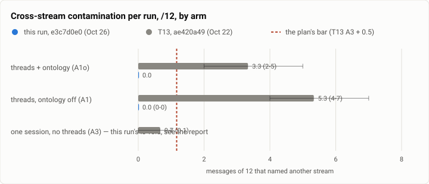

# Threadbench: cross-stream contamination on the shipped build, after the recall fixes (2026-10-26)

**The answer first.** Four days ago threadbench found a thread's answers volunteering other work streams' details, above
the plan's bar, and a guard bug that held a third of the threads arms' turns at an approval nobody answered. Both were
fixed and joined. Re-measured on the build that ships today (`e73c983a`'s progression, Theseus at `e3c7d0e0`), on the
same 143-message progression as before:

- **Cross-stream contamination is gone, and the bar is met for the first time.** On the cross-stream questions, **0 of
  12** messages named another stream in every complete run of both threads arms, against **5.3 of 12** for threads
  (A1) and **3.3** for threads-with-ontology (A1o) on 10-22. The plan's bar is the one-session control plus 0.5, which
  is **1.2**; both arms are at 0. On the owner's own checks contamination is **0.5 of 26** for A1 and **0** for A1o,
  against 3.3 and 1.0.
- **No turn was held at an approval any more.** The guard bug cost the threads arms 5 to 10 turns a run on 10-22; here
  it is **0 turns in every run**. That is the measurable half of the fix, and it is why the arms now cost more: a turn
  that is not parked finishes its work, so it makes **1.5 tool calls** where it used to make 0.9, and a turn costs
  **$0.0272** against $0.0157.
- **The thread lens is now admitting much less, and some of what it dropped was wanted.** Recall admits **157 to 246**
  notes a run, against 399 to 447 on 10-22 — roughly back to where it was before that build. Contamination went to
  zero with it, but so did some legitimate citing: on the cross-stream questions A1 cited the right other-stream fact
  in **21 of 24** (87.5% [69, 96]), against 36 of 36 before. A1o still cites 12 of 12.
- **Correctness is not resolved, and this run cannot settle it.** With the parked turns gone the oracle is finally
  readable, and it reads **0.58** for A1 (0.50-0.67) and 0.33 for A1o's one complete run, against 0.78 and 0.56. The
  runs fail the same long-standing checks as before — the pipeline summary's regenerating script in every run of both
  builds, and harness-dev's README flags — so this is a difference of degree inside overlapping spreads at two runs an
  arm, not a new fault. It is the open question this run leaves.
- **The one-session control is void in this run, and the reason is this run's own cost cap.** 71 of its 143 turns were
  refused with "the session reached its spend limit". `--spend-limit` is per *session*, so the one-session arm
  accumulates a whole run against it while the threads arms spread theirs over a session per thread and never touch
  it. The bar above therefore comes from 10-22's control, which is the conservative choice: that control had 0.7 of 12,
  so the bar it sets is lower than a quieter control would set.

None of this run's model calls went to a China-origin model.

<picture>
  <source media="(prefers-color-scheme: dark)" srcset="img/2026-10-26-threadbench/cross-contamination-dark.svg">
  
</picture>

*Figure 1. Is a thread's answer still pulling in other streams? Both threads arms sit at zero, under a bar they missed
by 3× and 4× four days ago. This run's own one-session control is void (below), so the bar is drawn from 10-22's.*

| | |
|---|---|
| Suite | `threads` (threadbench, theseus-9ofg): six interleaved streams of work with colliding facts, 143 messages |
| Arms | **A1** threads, the shipped default (`bench/plans/threadbench-t13-onto.json`); **A1o** the same with the ontology judge on; **A3** one session, no threads (`threadbench-t12.json`), the control. Sonnet 5.5 at medium effort throughout |
| Runs | A1 ×2 complete; A1o ×1 complete and one that stopped at turn 129 of 143; A3 ×1, **void** (below). Every run is the same progression, seed 11, size standard, digest `e73c983a…`, byte-identical to 10-22's |
| Baseline | the 10-22 run at `ae420a49` ([its numbers](#results)), three runs an arm, as published then |
| Left out | the session-per-stream arm (A5) and the rivals, neither rerun; and the third repeat of each arm, to hold the run's spend line (below) |
| Date and commit | 2026-10-26, 05:50 to 07:44 (UTC−7), one x86 host, one throwaway container at a time; Theseus at `e3c7d0e0` (`theseusd 1.0.2`), the binaries frozen from the installed set and checked against it |
| Cost | **$19.59**: $19.15 in model calls (each turn's own reported usage, summed) and $0.43 for the judge, against a $20 line |
| Data | [`2026-10-26-threadbench.json`](2026-10-26-threadbench.json) |

## The question

On 10-22 threadbench reported two faults. The first (theseus-stwkb) was that recall had begun letting much more of the
other streams into a thread: admissions rose about 2.9×, and the answers, while still correct, volunteered other
projects' details while saying they were ignoring them. By the bench's measure that was above the plan's bar. The
second (theseus-4gb4w) was that the misroute guard compared a thread's *relative* working-set roots against the tool
call's *absolute* path, so it never matched: every turn placed below the act bar had its first write or program held at
an approval, and the bench's simulated owner does not answer approvals, so that work was simply lost. 33 of 44 held
turns were in the right thread.

Both fixes joined (`fe56a164`, and a follow-up at `3bac00ab` for a live probe of the same recall fault). Neither had
been measured. This run asks the one question that matters for the build that ships: **is a thread's answer still
pulling in other work streams, and at what cost to the work itself?**

## The setup

- **The build under test is the installed one.** `e3c7d0e0`, `theseusd 1.0.2`. The four binaries were copied out of the
  installed set before the run and compared byte for byte against it (4 of 4 identical); the run used only that copy,
  so a later install could not move under it.
- **The source is a clean clone pinned at this branch's tip**, with `bench/` mounted read-only into the container, so
  every plan is the committed one; the driver refuses a run if a plan differs from its commit.
- **The progression is 10-22's exactly.** Seed 11, size standard, 143 messages, digest
  `e73c983a228ce9c8ce2bbc2fae4a5681d74c1c5fdb1fe419fbbc596d32cea6c3`; the generated file is byte-identical to the
  earlier run's, so arm-to-arm and run-to-run comparisons are on the same work.
- **Order:** A1o and A1 interleaved, then the control. One container at a time, the host script and containers at the
  lowest priority and idle IO.
- **Scoring is writable** (one of 10-22's two data repairs): the local-ops oracle writes into the workspace it checks,
  so a read-only scoring fails two restart checks for that reason alone. Every number here comes from a writable
  scoring with this build's scorer.
- **The judge's rows are read whole** (the other repair, theseus-mcl4v, fixed on this branch). `ledger.tail` answers
  the newest *n* rows and the daemon clamps *n* to 1,000, so the single page the driver asked for held only the last
  1,000 of a run's 1,600 to 1,854 judge calls, and the judge's bill read 37% to 49% low. The read now walks the
  cursor `ledger.tail` already answers, the way the history read does. The runs in this report were driven before that
  landed, so their judgment files were rebuilt afterwards from each run's own saved store, and each cut file is kept
  beside the whole one; the rebuilt counts agree exactly with a paged read of the same store (1,723 rows for A1's first
  run, by both routes).
- **The host was not quiet, and the walls are not a result.** The owner's own daemon builds and tests a task tree on a
  cycle on this machine, and it is not this run's to stop; load sat between 3 and 25 throughout. Nothing in this report
  except `wall p50` is sensitive to that, and `wall p50` should not be read against 10-22's.

### The spend line, and what it cost this run

The owner approved about $13 to $20 with a hard stop at $20. On this build a run costs **$3.6 to $4.1** against
$1.9 to $2.4 on 10-22 — 1.7× a turn, for the reason in the answer above: turns that are no longer parked at an
approval do more work. Three repeats of three arms would have been about $32, and even the six threads runs alone about
$21. So the set was cut to hold the line, and two things were lost:

1. **The first A1o run stopped at turn 129 of 143**, at a per-run cap of $3.50 set before the new per-turn cost was
   known. It is reported separately and never pooled; the 14 turns it lost carry about 15 of the 149 probes.
2. **The control is void.** With the cap raised to $4.50 for the remaining runs, the one-session arm hit it as a
   *session* limit and refused its last 71 turns outright (`stop: budget`, exit 5). Its oracle, cites, request tokens
   and one embargo probe are all artefacts of that, and none is used here. 10-22's control stands in for the bar.

The second is a bench fault worth naming for whoever runs this next: **`--spend-limit` binds a session, so the
one-session arm needs it set above that arm's whole modelled cost**, not above a per-turn average. 10-22 set $25 and
never came near it.

## Results

Mean per run with the spread across runs; rates pooled over the runs with a Wilson 95% interval. "/12" and "/26" are
counts of probes a run, not percentages.

| arm | runs | oracle | contamination /26 | cross contaminated /12 | cross cites /12 | reach /2 | embargo /4 | top-1 clear | asked ambiguous / clear | orphan turns | request tokens | $/turn | $/run |
|---|---|---|---|---|---|---|---|---|---|---|---|---|---|
| **A1** threads (shipped) | 2 | 0.58 (0.50-0.67) | **0.5** (0-1) | **0** (0-0) | 10.5 (10-11) | 0.5 | 4/4 | 93% [89-95] | 13% [5-30] / 5% [3-9] | 4.0 | 28.6k | $0.0272 | $3.88 |
| **A1o** threads + ontology | 1 | 0.33 | **0** | **0** | 12 | 0 | 4/4 | 94% [89-97] | 7% [1-30] / 7% [4-13] | 5.0 | 29.5k | $0.0260 | $3.71 |
| *A1o, the run that stopped at 129* | 1 | 0.83 | 2/24 | 2/10 | 9/10 | 0/1 | 3/3 | 88% [81-93] | 8% [1-33] / 6% [3-12] | 6.0 | 28.3k | $0.0280 | $3.61 |
| *A3 one session — **void**, 71 turns refused* | 1 | *0.50* | *0* | *0* | *6* | *0* | *3/4* | n/a | n/a | n/a | *31.8k* | *$0.0288* | *$4.12* |
| A1, 10-22 `ae420a49` | 3 | 0.78 (0.50-1.00) | 3.3 (2-5) | 5.3 (4-7) | 12 | 0.3 | 4/4 | 93% [90-95] | 7% [2-18] / 5% [3-7] | 6.3 | 30.9k | $0.0157 | $2.25 |
| A1o, 10-22 | 3 | 0.56 (0.50-0.67) | 1.0 (0-2) | 3.3 (2-5) | 12 | 0.3 | 4/4 | 91% [88-93] | 7% [2-18] / 5% [3-7] | 6.7 | 28.6k | $0.0152 | $2.18 |
| A3, 10-22 (**the bar's source**) | 3 | 1.00 | 0 | 0.7 (0-1) | 11.7 | 1.3 | 4/4 | n/a | n/a | n/a | 58.8k | $0.0161 | $2.30 |

Per run, as oracle / contamination /26 / cross /12 / cites /12 / top-1: **A1** r1 0.50/0/0/10/91%, r2 0.67/1/0/11/94%;
**A1o** r2 0.33/0/0/12/94%, and the stopped run 0.83/2/2/9/88%. 10-22's, for the same columns: A1 0.50/2/7/12/91%,
0.83/3/4/12/94%, 1.00/5/5/12/94%; A1o 0.50/1/2/12/90%, 0.67/0/5/12/90%, 0.50/2/3/12/93%.

**Against the plan's acceptance targets**

| measure | target | A1 | A1o | met? |
|---|---|---|---|---|
| cross-stream contaminated /12 | ≤ A3 + 0.5 = 1.2 | **0** | **0** | **yes** (was no) |
| owner-check contamination /26 | ≤ A3 + 0.5 = 0.5 | **0.5** | **0** | **yes** (was no) |
| cross cites /12 | ≥ 11 | 10.5 | **12** | A1 just under, A1o yes |
| embargo probes | 4/4 | **4/4** | **4/4** | **yes**, 0 leaks |
| streams without a thread | 0 | **0** | **0** | **yes** |
| routing top-1 (clear) | ≥ 92% | **93%** [89-95] | **94%** [89-97] | **yes** |
| asked on clear | ≤ 15% | **5%** | **7%** | **yes** |
| orphan turns per run | ≤ 1 | 4.0 | 5.0 | no (6.3 and 6.7 before) |
| oracle | ≥ A3 | 0.58 | 0.33 | no — the open question |
| request tokens | ≤ 45% of A3 | not measurable: the control is void | | |

## What moved, and why

**1. The thread lens drops much more, and contamination goes with it.** From each run's own saved store: recall
admitted **157** and **230** notes in A1's two runs and **246** in A1o's, against **447** and **399** on 10-22 — and
about 154 on the build before that, so this is a return rather than a new low. The drops now include a reason that did
not exist on 10-22, a thread-own test that turns away 233 to 301 notes a run, alongside the entity (851-1,086), base
(499-602) and bar (436-474) tests. That is the mechanism the fix intended, and the contamination counts follow it
exactly: the pattern 10-22 described — a reply that lists other streams' ports and then says it is ignoring them —
does not appear in any complete run here.

**2. The approval holds are gone, and they were paying for the old numbers.** Not one turn in any run of this report
stopped at an approval; on 10-22 there were 5 to 10 a run in each threads arm, 44 across six runs, 33 of them inside
the right thread. The cost of the fix is visible in every cost column: 1.5 tool calls a turn against 0.9, 741 output
tokens a turn against 471, $0.0272 a turn against $0.0157. The benefit is that the arms' work is no longer silently thrown
away, which is what makes the oracle readable at all.

**3. Which is why the oracle is the open question rather than a win.** A1's oracle reads 0.58 against 0.78, A1o's one
complete run 0.33 against 0.56 — but the failing checks are the same ones as before, in the same streams: the
pipeline summary's regenerating script fails in every run of both builds, harness-dev's README-documents-both-flags
in three of this run's four, and pr-round's retry behaviour in both. Two runs an arm against three, with per-run
oracles of 0.50 and 0.67 against 0.50, 0.83 and 1.00, cannot separate a real loss from the spread. What *is* a
measurable change in the same direction is citing: A1 cited the right other-stream fact in 21 of 24 cross-stream
questions (87.5% [69, 96]) where 10-22's A1 managed 36 of 36. Taken with finding 1, the reading to test next is that
the lens now turns away some notes a thread legitimately needed, and the cheapest test is the cites column at three
runs with the admissions logged per question.

**4. The judge is asked more, and now it is counted.** A1 made 1,723 and 1,600 judge calls a run and A1o 1,854,
against 1,353-1,439 and 1,506-1,707 on 10-22; the bill is $0.1022-$0.1198 a run. Those numbers only exist because the
ledger read was fixed: the capped read reported $0.0611-$0.0648 for the same runs, 37% to 49% low, and for the run
that stopped early it wrote no judgment file at all.

**5. Routing did not move.** Top-1 on clear messages 93% and 94% against 93% and 91%, asks on clear 5% and 7% against
5%, every stream gets its own thread in every run. Orphan turns fell (4.0 and 5.0 against 6.3 and 6.7) but are still
far off the plan's 1. The messages that come back as orphans are the same ones named on 10-22: 63, 112 and 132 in
nearly every run, 19 in most.

## Threats to this run's validity

- **Two runs an arm, not three.** Every interval here is wider than 10-22's, and the oracle in particular cannot be
  read against it. The contamination result does not depend on this: it is 0 of 12 in all three complete threads runs
  and 2 of 10 in the one that stopped, against 4 to 7 in every one of 10-22's six.
- **No control on this build.** The bar is 10-22's control, and a control is exactly the arm a build change could move
  underneath you. It is the conservative direction — that control's 0.7 of 12 sets a *lower* bar than a cleaner one
  would — but a complete one-session run on this build is the first thing the next run should buy.
- **One A1o run is 14 turns short**, so its probe counts are out of 24 and 10 rather than 26 and 12; it is reported
  separately for that reason and pooled into nothing.
- **The host was busy with the owner's own daemon throughout**, so `wall p50` is not comparable with 10-22's. Nothing
  else here is timing-derived.
- **The bench's simulated owner still never answers an approval** (theseus-uxum0, open). It did not bite in this run
  because nothing was held, but it will return the moment a guard arms again.

## Running it again

From a clean clone at this commit, with `bench/` read-only in the container and the binaries frozen from the install:

```sh
python3 bench/threads/th_generate.py --seed 11 --size standard --out OUT/tb-prog
python3 bench/threads/th_drive.py --arm A1  --out OUT/tb-a1-r1 --plan bench/plans/threadbench-t13-onto.json \
  --progression OUT/tb-prog --model anthropic/claude-sonnet-5-5 --effort medium --bin-dir BINS \
  --spend-limit 25 --config-overlay JEV.toml
python3 bench/threads/th_drive.py --arm A3  --out OUT/tb-a3-r1 --plan bench/plans/threadbench-t12.json \
  --progression OUT/tb-prog --model anthropic/claude-sonnet-5-5 --effort medium --bin-dir BINS --spend-limit 25
python3 bench/threads/th_score.py OUT/tb-a1-r1 OUT/tb-a3-r1 --out SCORES   # the run dirs must be writable
```

Set `--spend-limit` above the whole arm's cost, not a turn's: it binds a session, and the one-session arm will refuse
its remaining turns the moment the session reaches it. `A1o` is the same command as `A1` with `--arm A1o`.
