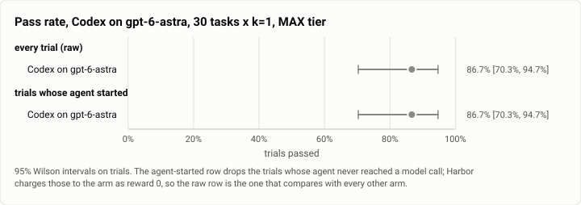
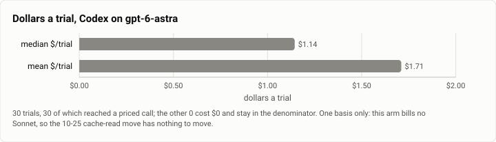

# Terminal-Bench 2.0, MAX tier: Codex on `gpt-6-astra`, the hard 30 (2026-10-27)

**The answer first.** Codex driving `openai/gpt-6-astra` at `reasoning_effort=high` solved **26 of 30
trials, 86.7%** [70.3, 94.7] on the hard-30 MAX task set, at a **median $1.1441 and a mean $1.7106 a
trial**, $51.32 for the cell, in 1h 07m. **It ran clean: not one exception in 30 trials.** That is the
highest figure any arm has recorded on this task set, and the cleanest cell in the gauntlet.

**What the number is worth.** The MAX task set has 30 tasks, so this cell is **k=1 over 30 trials** and its
95% interval is **24.4 points wide**. The published MAX arms it beats are all k=3 over 90: Claude Code
**75.6%** [65.8, 83.3], Pi **71.1%** [61.0, 79.5], Theseus 1.0.3 **65.6%** [55.3, 74.6], the Theseus v1
freeze **67.8%** [57.6, 76.5], OpenCode **32.2%**. Codex's interval **overlaps every one of those except
OpenCode**. Read it as *"Codex is in the leading group on the hard 30 and did not stumble once"*, which is
true and useful, and not as *"Codex is 11 points better than Claude Code"*, which 30 trials cannot say.

<picture>
  <source media="(prefers-color-scheme: dark)" srcset="img/2026-10-27-terminal-bench-codex-astra-max-k1/pass-rate-codex-astra-max-dark.svg">
  
</picture>

*Figure 1. The two rows are identical here: every trial reached a model call, so the raw and agent-started
denominators are both 30. That is itself the cell's cleanest result.*

| | |
|---|---|
| Suite | `terminal-bench@2.0`, the hard 30, k=1 through Harbor, plan `g1-max-k1` |
| Arm | **Codex** (`codex_agent:MeasuredCodex`), harbor arm at `d7eb4c27` |
| Tier | MAX is the gauntlet's cell label; for Codex the knob is `--ak reasoning_effort=high` |
| Cap | **off** (`no_cap`); `--ak max_budget_usd=5.0` and `--ak max_turns=300` are recorded, not enforced — **10 of 30 trials went over that $5** |
| Model | `openai/gpt-6-astra`, pinned — no routing, no fallback, one model in the whole bill |
| Baseline | **none like for like.** The published Codex row (10-25) is HIGH tier over all 89 tasks, a different task set; the comparison is the MAX arms in the index |
| Host | the owner's WSL machine, four trials at once, sampled every 30 s |
| Elapsed | 15:39:46 → 16:46:54 MST, 1h 07m |
| Cost | $51.32 recorded, on the OpenAI table — see PRICE BASIS |
| Data | [`2026-10-27-terminal-bench-codex-astra-max-k1.json`](2026-10-27-terminal-bench-codex-astra-max-k1.json), [`.csv`](2026-10-27-terminal-bench-codex-astra-max-k1.csv) (one row per trial) |

## PRICE BASIS

**This cell bills no Sonnet at all**, so install #85's Sonnet 5.5 cache-read move ($0.10 → $0.20/Mtok,
2026-10-25, `theseus-rko44`) cannot touch it and **there is no second basis to quote**. All 30 trials are
billed to `gpt-6-astra` on the OpenAI table; the recorded dollars *are* the quote.

The rival-cell tool (`driver/price_basis.py`) will solve these trials against the two Sonnet tables and
report a "basis" anyway — it misses by **$5.33** on the worst trial. That is not a price basis, it is a
category error, and the number must not be published. A cost figure from here is comparable with cell 5
(the other `gpt-6-astra` cell) and with nothing else until both sides are put on one table.

| basis | median $/trial | mean $/trial | total |
|---|---|---|---|
| **as billed (OpenAI table) — quote this** | **$1.1441** | **$1.7106** | **$51.32** |

All **30 trials** reached a priced call. $/solve is **$1.9737**.

<picture>
  <source media="(prefers-color-scheme: dark)" srcset="img/2026-10-27-terminal-bench-codex-astra-max-k1/cost-codex-astra-max-dark.svg">
  
</picture>

*Figure 2. One basis, because there is only one. Codex draws in the neutral "other arm" colour: the
categorical palette in `bench/report/charts.py` has no slot for it, and `arm_color()` raises rather than
falling back, so adding one is a code change and this is a docs-only branch.*

## The cost is the finding, not the pass rate

**$1.97 a solve, against $0.36 for the Theseus v1 freeze on the same 30 tasks** — 5.5×, for a pass rate
whose interval overlaps it from end to end. Against the frozen 1.0.3 Theseus MAX cell that ran three hours
later on this same host, it is **$1.97 against $0.94** a solve. The ranking on this task set by money a
solve is unchanged by this cell: the cheap arms are still cheap and the expensive arms are still expensive.

**Against Codex's own HIGH row (10-25, all 89 tasks, `reasoning_effort` one step lower): 85.4% at $1.3110
a trial and $1.5353 a solve.** The two cells are on *different task sets*, so the pass rates are not
comparable and the 86.7% here is not evidence that top effort helped. The dollars are comparable per trial,
and they say the effort step costs about **30% more a trial**. Whether it buys anything needs the same task
set at both efforts, which this gauntlet did not run.

Where the money goes: **20.2M cache-read tokens** and **289,911 output** over 532 model calls, a median of
11 a trial. That is *less* work than most arms do here — Theseus 1.0.3 MAX runs a median of 16 calls and
369 s against Codex's 11 calls and 122 s — so the bill is the model's price, not a longer agent loop.
Codex is the second fastest MAX arm measured here — only the Theseus v1 freeze is quicker, at 96.25 s —
and one of the two most expensive, beside Claude Code's $1.4526 a trial.

## The recorded total is a FLOOR, not the spend

Every cell in this gauntlet carries the same caveat: a trial the harness kills before harvesting usage
records `cost_usd: null` and its dollars land in no total. **No trial here ended that way** — this is the
one published cell where the floor and the figure coincide, because nothing errored at all.

## Errors, by type

**None.** Zero exceptions across 30 trials, every trial reached a model call and wrote a `reward.txt`.

That is worth one line of context rather than a shrug: the two `qemu-*` tasks that fail in every HIGH-tier
rival cell on this host **are not in the MAX task set**, so this cell never met the suite's one known
host-side failure. A clean sheet here is a real result, but it is a clean sheet over 30 tasks that exclude
the ones known to break.

## What this run measured

| | |
|---|---|
| Trials | 30 over 30 tasks, k=1 |
| Passed | 26 (86.7% [70.3, 94.7]); agent-started 26 of 30, the same row |
| Model calls | 532 total, median **11** a trial |
| Tool calls | 502 total, median **10** a trial |
| Agent wall clock | median **122.08 s** a trial — second only to the Theseus v1 freeze's 96.25 s |
| Tokens | 1,596 input, 289,911 output, 20.2M cache read, 1.33M cache write |
| Billed models | `openai/gpt-6-astra` on all 30 trials; nothing else appears in the bill |
| Over the recorded $5 | 10 of 30 trials |

## Host conditions

No WSL join gate overlapped this run, so no trial is gate-contaminated and the "quiet host" grouping equals
the raw one. The sampler took 189 samples at 30 s. CPU pressure was the lowest of the three closing cells
(`cpu_some_avg10` **2.15**), but **IO pressure was the highest** (`io_some_avg10` **10.29**, against 2.12
in cell 5 and 8.49 in cell 7) — this cell ran while the host was writing, not while it was computing.

| cell | load1 | `cpu_some_avg10` | `io_some_avg10` | swap |
|---|---|---|---|---|
| c5 OpenClaw `gpt-6-astra` | 5.60 | 9.07 | 2.12 | 4.17 GB |
| **c6 Codex (this run)** | **5.50** | **2.15** | **10.29** | **4.16 GB** |
| c7 Theseus 1.0.3 MAX | 3.83 | 6.80 | 8.49 | 4.00 GB |

A wall-clock comparison across these three is therefore worth less than the cost and pass-rate ones. The
dollars are not affected by host load at all, which is why this page leads with them.
