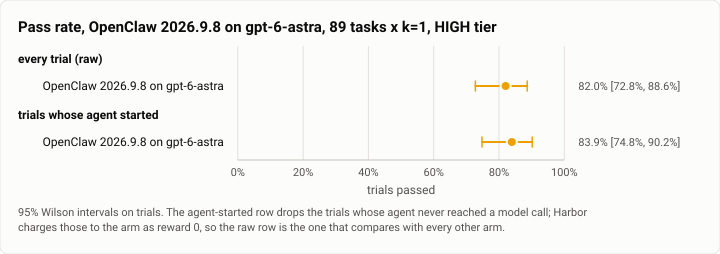
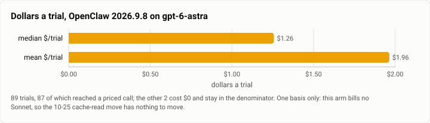

# Terminal-Bench 2.0, HIGH tier: OpenClaw 2026.9.8 on `gpt-6-astra`, all 89 tasks (2026-10-27)

**The answer first.** OpenClaw 2026.9.8 driving `openai/gpt-6-astra` solved **73 of 89 trials, 82.0%**
[72.8, 88.6], at a **median $1.2570 and a mean $1.9644 a trial**, $174.83 for the cell. It is the highest
raw pass rate any arm has recorded on all 89 tasks here, and it is also, by a distance, the most expensive
cell this suite has ever run: **6.0× the dollars of the same harness on `claude-sonnet-5-5`** three hours
earlier on the same host.

**The comparison this cell exists for, and what it does not establish.** Cell 4 ran **the same harness, the
same 89 tasks, the same day, the same machine**, changing only the model: OpenClaw on `claude-sonnet-5-5`
scored **66 of 89, 74.2%** [64.2, 82.1] at a median **$0.1222**. The gap looks like +7.9 points for 10.3×
the median trial. Because the two cells are paired task-for-task at k=1, the gap can be tested properly
rather than by eyeballing two intervals: **`astra` solved 13 tasks that `sonnet-5-5` missed, `sonnet-5-5`
solved 6 that `astra` missed**, 60 both and 10 neither — an exact McNemar test over those 19 discordant
tasks gives **p = 0.17**. So this run does **not** establish that `gpt-6-astra` is the better model in this
harness. What it establishes at k=1 is the cost: the money is not ambiguous at all.

<picture>
  <source media="(prefers-color-scheme: dark)" srcset="img/2026-10-27-terminal-bench-openclaw-astra-high-k1/pass-rate-openclaw-astra-high-dark.svg">
  
</picture>

*Figure 1. The raw row keeps the two trials whose agent never started, which Harbor charges to the arm as
reward 0; it is the row that compares with every other published arm.*

| | |
|---|---|
| Suite | `terminal-bench@2.0`, all 89 tasks, k=1 (`task_set: full`) through Harbor, plan `g1-high-k1` |
| Arm | **OpenClaw 2026.9.8** (`openclaw_agent:MeasuredOpenClaw`), harbor arm at `d7eb4c27` |
| Tier | HIGH is the gauntlet's cell label; OpenClaw has no effort bounds, and every call went out at `medium` |
| Cap | **off** (`no_cap`); `--ak max_budget_usd=2.0` and `--ak max_turns=200` are recorded, not enforced — **22 of 89 trials went over that $2** |
| Model | `openai/gpt-6-astra`, pinned — no routing, no fallback, one model in the whole bill |
| Baseline | **none.** This is OpenClaw's first `gpt-6-astra` row; the Sonnet 5.5 cell of 10-27 is the comparison, not a baseline |
| Host | the owner's WSL machine, four trials at once, sampled every 30 s — **quieter than the Sonnet cell** |
| Elapsed | 13:21:41 → 15:37:46 MST, 2h 16m |
| Cost | $174.83 recorded, on the OpenAI table — see PRICE BASIS |
| Data | [`2026-10-27-terminal-bench-openclaw-astra-high-k1.json`](2026-10-27-terminal-bench-openclaw-astra-high-k1.json), [`.csv`](2026-10-27-terminal-bench-openclaw-astra-high-k1.csv) (one row per trial) |

## PRICE BASIS

**This cell bills no Sonnet at all**, so install #85's Sonnet 5.5 cache-read move ($0.10 → $0.20/Mtok,
2026-10-25, `theseus-rko44`) cannot touch it and **there is no second basis to quote**. All 87 priced
trials are billed to `gpt-6-astra` on the OpenAI table; the recorded dollars *are* the quote.

That is worth stating rather than leaving implicit, because the tool the three rival Sonnet cells were
published with (`driver/price_basis.py`) will happily solve these trials against the two Sonnet tables and
report a "basis" — and it misses by **$10.50** on the worst trial, because it is answering a question this
cell does not pose. A cost figure from here is comparable with another OpenAI-billed cell and with nothing
else until both are put on one table.

| basis | median $/trial | mean $/trial | total |
|---|---|---|---|
| **as billed (OpenAI table) — quote this** | **$1.2570** | **$1.9644** | **$174.83** |

Over **89 trials**, 87 of which reached a priced call; the other 2 cost $0 and stay in the denominator.
$/solve is **$2.3950**.

<picture>
  <source media="(prefers-color-scheme: dark)" srcset="img/2026-10-27-terminal-bench-openclaw-astra-high-k1/cost-openclaw-astra-high-dark.svg">
  
</picture>

*Figure 2. One basis, because there is only one. The median-to-mean spread (1.56×) is this arm's own tail,
not a price question.*

## Where $174.83 went

The bill is a cache-read bill: **93.2M cache-read tokens** against 5,847 input, 4.22M cache write and
577,118 output. The harness re-reads a long context on nearly every call, 1,952 calls over the cell at a
median of 15 a trial, and `gpt-6-astra` prices that context higher than Sonnet does. Nothing about the
arm's *shape* changed between cells 4 and 5 — the median trial made 15 model calls here against 9.5 there,
and ran 151 s against 94 s — so the 6.0× is mostly the model's own price, not a different amount of work.

**$2.3950 a solve.** For scale, the frozen 1.0.3 Theseus cell on the same 89 tasks solves at **$0.4297**
(median trial $0.1204, 78.3%). This cell is the expensive end of what the suite has measured — **5.6× a
solve** — and it bought a pass rate that an exact paired test cannot separate from a cell costing a sixth
as much.

## The recorded total is a FLOOR, not the spend

A trial that ends without the harness harvesting usage records `cost_usd: null` and an empty `by_model`,
and whatever it burned is then in no total. Two trials here cost $0 because their agent never reached a
model call (below), which is a true zero; but read **$174.83 as at least $174.83** on the same principle
that governs every cell in this gauntlet.

## Errors, by type

| type | n | tasks |
|---|---|---|
| `AgentSafetyRefusalError` | 2 | `break-filter-js-from-html` (2 calls, $0.2250), `vulnerable-secret` (5 calls, $0.5965) |
| `NonZeroAgentExitCodeError` | 2 | `qemu-alpine-ssh`, `qemu-startup` (no model call, $0) |

Four of 89, 4.5%. All four scored 0 and all four are in the denominator.

**The two refusals are the model's, not the harness's.** Both trials reached the model, spent real money
and stopped: `gpt-6-astra` declined two security tasks that the Sonnet cell attempted. They are the only
two refusals in the cell, and they are a property of the model being swapped in — the thing this cell set
out to measure — so they are reported, not corrected for.

**The two `qemu-*` tasks fail the same way in every rival cell on this host** — OpenHands, Aider and both
OpenClaw cells lose exactly `qemu-startup` and `qemu-alpine-ssh` with no model call, no `reward.txt` and
$0. Four harness/model combinations failing identically on two tasks points at the task images or this
host's nested virtualisation, not at any arm. It is not corrected for: the raw row keeps them. A reader
who wants this host's ceiling should use **87, not 89**.

## What this run measured

| | |
|---|---|
| Trials | 89 over 89 tasks, k=1 |
| Passed | 73 (82.0% [72.8, 88.6]); agent-started 73 of 87 (83.9% [74.8, 90.2]) |
| Model calls | 1,952 total, median **15** a trial |
| Tool calls | 1,645 total, median **13** a trial |
| Agent wall clock | median **151.22 s** a trial |
| Tokens | 5,847 input, 577,118 output, 93.2M cache read, 4.22M cache write |
| Billed models | `gpt-6-astra` on all 87 priced trials; nothing else appears in the bill |
| Over the recorded $2 | 22 of 89 trials |

## Host conditions

No WSL join gate overlapped this run, so no trial is gate-contaminated and the "quiet host" grouping equals
the raw one. The sampler (402 samples, every 30 s) puts this cell **between** the three rival Sonnet cells
and well under the one it is being compared with:

| cell | load1 | `cpu_some_avg10` | `io_some_avg10` | swap |
|---|---|---|---|---|
| c3 Aider | 3.12 | 1.48 | 3.00 | 2.60 GB |
| c2 OpenHands | 3.38 | 5.46 | 0.93 | 2.97 GB |
| **c5 OpenClaw `gpt-6-astra` (this run)** | **5.60** | **9.07** | **2.12** | **4.17 GB** |
| c4 OpenClaw `claude-sonnet-5-5` | 6.95 | 19.48 | 3.71 | 3.48 GB |

The direction matters for the one comparison this page makes: **the cell with the higher pass rate also had
the quieter host**, so some unknown part of the +7.9 points is host conditions rather than model. That
cuts against the headline, not for it, and is one more reason the paired p = 0.17 is the number to quote.
