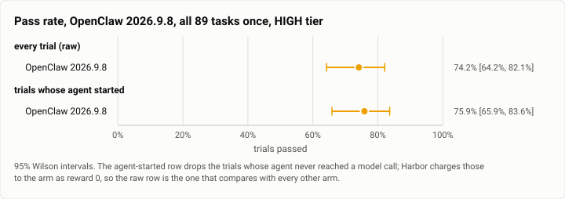
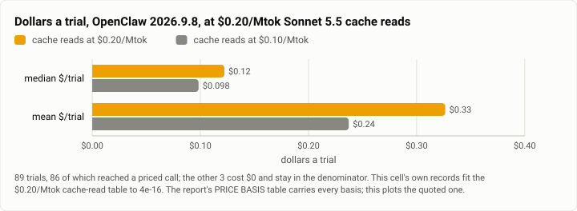

# Terminal-Bench 2.0, HIGH tier: OpenClaw 2026.9.8 on all 89 tasks (2026-10-27)

**The answer first.** OpenClaw 2026.9.8 on `claude-sonnet-5-5` solved **66 of 89 trials, 74.2%**
[64.2, 82.1], at a **median $0.1222 and a mean $0.3265 a trial**, $29.06 for the cell. This is OpenClaw's
**first `terminal-bench@2.0` row**; its only earlier appearance here is the 10-07 harness sweep on the old
14-task `terminal-bench`, a different benchmark and not a baseline for this.

**The number that will get quoted, and the caveat that has to travel with it.** OpenClaw's 74.2%
[64.2, 82.1] sits 4.1 points under the frozen 1.0.3 Theseus cell's **78.3%** [72.9, 82.8] with intervals
that overlap over almost their whole width, and its median trial costs **$0.1222** against that cell's
**$0.1204** — on the same 89 tasks, the same model and the same price table, this run separates the two
arms at neither end. But this cell is k=1 against that
cell's k=3, its interval is **17.9 points wide**, and it ran on a **measurably busier host** (below).
It does not establish parity; it fails to establish a difference, which is a weaker claim.

<picture>
  <source media="(prefers-color-scheme: dark)" srcset="img/2026-10-27-terminal-bench-openclaw-sonnet-high-k1/pass-rate-openclaw-dark.svg">
  
</picture>

*Figure 1. The raw row keeps the two trials whose agent never started, which Harbor charges to the arm as
reward 0; it is the row that compares with every other published arm.*

| | |
|---|---|
| Suite | `terminal-bench@2.0`, all 89 tasks, k=1 (`task_set: full`) through Harbor, plan `g1-high-k1` |
| Arm | **OpenClaw 2026.9.8 (`fc23bc8`)** (`openclaw_agent:MeasuredOpenClaw`), harbor arm at `d7eb4c27` |
| Tier | HIGH is the gauntlet's cell label; OpenClaw has no effort bounds, and every call went out at `medium` |
| Cap | **off** (`no_cap`); `--ak max_budget_usd=2.0` and `--ak max_turns=200` are recorded, not enforced |
| Model | `anthropic/claude-sonnet-5-5`, pinned — no routing, no fallback, one model in the whole bill |
| Baseline | **none.** OpenClaw has no published `terminal-bench@2.0` row to compare against; see the index |
| Host | the owner's WSL machine, four trials at once, sampled every 30 s — **the busiest of the three rival cells** |
| Elapsed | 07:09:12 → 09:27:06 MST, 2h 18m |
| Cost | $29.06 recorded, already on today's table — see PRICE BASIS |
| Data | [`2026-10-27-terminal-bench-openclaw-sonnet-high-k1.json`](2026-10-27-terminal-bench-openclaw-sonnet-high-k1.json), [`.csv`](2026-10-27-terminal-bench-openclaw-sonnet-high-k1.csv) (one row per trial) |

## PRICE BASIS

Install #85 (2026-10-25, `theseus-rko44`) moved the Sonnet 5.5 cache-read list price **$0.10 →
$0.20/Mtok**. **This cell is billed on the new table**, which is the one cell 1 is quoted on, so its
recorded dollars can be compared with cell 1's as recorded.

**It cannot be compared with cell 2's as recorded.** OpenHands ran on the same host the same morning and
is billed at **$0.10**, because it prices itself out of the catalog in the litellm build its arm pins.
Two cells, one host, one day, two tables — which is exactly why the table is **measured from each cell's
own per-call records** rather than inferred from its date. Here the $0.20 table reproduces all 86 priced
trials to **$4.4e-16**.

| basis | median $/trial | mean $/trial | total |
|---|---|---|---|
| **cache reads at $0.20/Mtok (today's table, as billed — quote this)** | **$0.1222** | **$0.3265** | **$29.06** |
| cache reads at $0.10/Mtok | $0.0984 | $0.2372 | $21.11 |

Over **89 trials**, 86 of which reached a priced call; the other 3 cost $0 and stay in the denominator.
$/solve is **$0.4402**.

This arm is **cache-read heavy** — 79.4M cache-read tokens against 3,930 input tokens — so the price move
hits it harder than any other cell: the same run on the old table would have cost **27% less**. An
OpenClaw cost figure from before 10-25 is not comparable with this one.

<picture>
  <source media="(prefers-color-scheme: dark)" srcset="img/2026-10-27-terminal-bench-openclaw-sonnet-high-k1/cost-basis-openclaw-dark.svg">
  
</picture>

*Figure 2. Both bases are plotted because the gap between them is this arm's own: 2.7× between median and
mean on either table, and between the tables 1.24× on the median and 1.38× on the mean.*

## The recorded total is a FLOOR, not the spend

A trial ending in `AgentTimeoutError` records `cost_usd: null` and an empty `by_model`, so whatever it
burned is in no total. One trial ended that way here, and the harness kept no usage for a trial it
killed. Read $29.06 as **at least** $29.06. This is a property of the measurement and applies identically
to cells 2 and 3 — where it costs four and three trials respectively, so the *floor* is tightest here.

## Errors, by type

| type | n | tasks |
|---|---|---|
| `NonZeroAgentExitCodeError` | 3 | `qemu-alpine-ssh`, `qemu-startup`, **`password-recovery`** |
| `AgentTimeoutError` | 1 | `caffe-cifar-10` |

Four of 89, 4.5% — the lowest error rate of the three rival cells. All four scored 0 and all four are in
the denominator.

**`password-recovery` is a different animal from the other two and should not be counted with them.** It
made **3 model calls and spent $0.0218** before exiting non-zero, so its agent genuinely started and then
died; the two `qemu-*` trials never reached a model call at all. That is why the dataset's "agent started"
grouping says 87 and not 86: the denominator rule splits on whether a model call happened, not on the
exception type. A reader counting `NonZeroAgentExitCodeError` as "never started" would be wrong by one.

**The two `qemu-*` tasks fail the same way in all three rival cells** — OpenClaw, OpenHands and Aider each
lose exactly `qemu-startup` and `qemu-alpine-ssh` with no model call, no `reward.txt` and $0. Three
different harnesses failing identically on two tasks points at the task images or this host's nested
virtualisation, not at any arm. It is not corrected for: the raw row keeps them.

## What this run measured

| | |
|---|---|
| Trials | 89 over 89 tasks, k=1 |
| Passed | 66 (74.2% [64.2, 82.1]) |
| Agent reached a model call | 86 of 89 |
| Model calls | 1,790 total, median **9.5** a trial — the most of the three rival cells |
| Agent wall clock | median **94.26 s** a trial |
| Tokens | 3,930 input, 783,138 output, 79.4M cache read, 2.13M cache write |
| Billed models | `claude-sonnet-5-5` on all 86 priced trials; nothing else appears in the bill |

## Host conditions — this cell is NOT matched with cells 2 and 3

No WSL join gate overlapped this run, so no trial is gate-contaminated and the "quiet host" grouping
equals the raw one. But the gate windows are not the only thing that loads this host, and the sampler
says this run had company. Medians over 307 samples:

| cell | load1 | `cpu_some_avg10` | `io_some_avg10` | swap |
|---|---|---|---|---|
| c2 OpenHands | 3.38 | 5.46 | 0.93 | 2.97 GB |
| c3 Aider | 3.12 | 1.48 | 3.00 | 2.60 GB |
| **c4 OpenClaw (this run)** | **6.95** | **19.48** | **3.71** | **3.48 GB** |

For scale, cell 1's gate-contaminated windows ran `cpu_some_avg10` at a median of **35.25** against
**4.59** outside them. This run sits between the two. **So a few points of difference between the three
rival cells is not evidence about the harnesses**, and a wall-clock comparison between them is worth less
than the cost and pass-rate ones. The arm with the busiest host is the one with the highest pass rate,
which is the direction that makes the 74.2% a conservative reading rather than a flattering one.
