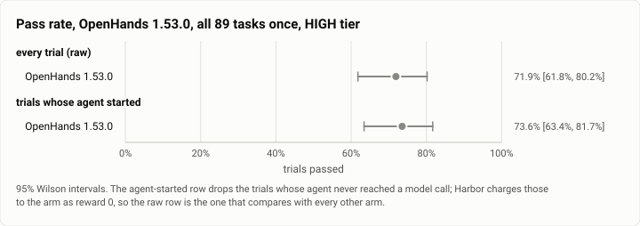
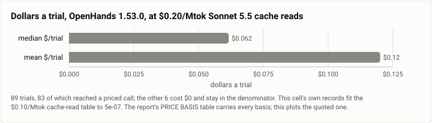

# Terminal-Bench 2.0, HIGH tier: OpenHands 1.53.0 on all 89 tasks (2026-10-27)

**The answer first.** OpenHands 1.53.0 on `claude-sonnet-5-5` solved **64 of 89 trials, 71.9%**
[61.8, 80.2], at a **median $0.0616 and a mean $0.1201 a trial** on today's price table. This is
OpenHands' **first `terminal-bench@2.0` row**: its only earlier appearance here is the 10-07 harness
sweep, which is the old 14-task `terminal-bench` and a different benchmark, not a baseline for this.

**One pass, so read the interval and not the point.** At k=1 the 95% Wilson interval is **18.4 points
wide**. It overlaps every other 89-task arm on this suite except Codex, so this run does not separate
OpenHands from Theseus, Claude Code, OpenClaw, Pi or OpenCode — it places it among them.

<picture>
  <source media="(prefers-color-scheme: dark)" srcset="img/2026-10-27-terminal-bench-openhands-high-k1/pass-rate-openhands-dark.svg">
  
</picture>

*Figure 1. The raw row is the one that compares with every other arm: it keeps the two trials whose
agent never started, which Harbor charges to the arm as reward 0. Dropping them moves the point 1.7
points and neither interval is narrow enough for that to matter.*

| | |
|---|---|
| Suite | `terminal-bench@2.0`, all 89 tasks, k=1 (`task_set: full`) through Harbor, plan `g1-high-k1` |
| Arm | **OpenHands 1.53.0** (`openhands_agent:MeasuredOpenHands`), harbor arm at `7b2f1565` |
| Tier | HIGH is the gauntlet's cell label; OpenHands has no effort bounds, and every call went out at `medium` |
| Cap | **off** (`no_cap`); `--ak max_budget_usd=2.0` and `--ak max_turns=200` are recorded, not enforced |
| Model | `anthropic/claude-sonnet-5-5`, pinned — no routing, no fallback, one model in the whole bill |
| Baseline | **none.** OpenHands has no published `terminal-bench@2.0` row to compare against; see the index |
| Host | the owner's WSL machine, four trials at once, sampled every 30 s |
| Elapsed | 04:56:56 → 07:07:09 MST, 2h 10m |
| Cost | $9.05 recorded; **$10.69 on today's table** — see PRICE BASIS before taking a ratio |
| Data | [`2026-10-27-terminal-bench-openhands-high-k1.json`](2026-10-27-terminal-bench-openhands-high-k1.json), [`.csv`](2026-10-27-terminal-bench-openhands-high-k1.csv) (one row per trial) |

## The first run of this cell is invalid and is kept beside it

`runs/c2-openhands-high-k1.invalid-1026/` is a 2026-10-26 22:16–22:47 run of the same cell in which
**89 of 89 trials errored** — 88 `NonZeroAgentExitCodeError` and one `ApiRateLimitError`, accuracy 0.0,
**$0.00 settled**, because every agent died at import before any model call:

    ImportError: cannot import name 'CacheableResult' from 'mcp.types'

It is kept, not deleted, and **no `index.json` row cites it**. Two things about it are worth carrying
forward. First, `harbor run` exited 0 — a job whose every trial errored is still a job that ran — so the
cell wrote a `DONE` marker and could have been carried as a finished rival arm; the marker was removed and
`MeasuredOpenHands.after_install` now fails the install loudly instead. Second, the fix was a **litellm**
pin (`<1.103.0`), not an `mcp` pin, and the rerun on this page carries **zero** import errors against 89
of 89 on the invalid run.

## PRICE BASIS — this goes above the cost numbers, and OpenHands is the reason

**This cell was billed on the OLD price table, and it ran two days after the table moved.** Install #85
(2026-10-25, `theseus-rko44`) took the Sonnet 5.5 cache-read list price **$0.10 → $0.20/Mtok**. Cell 4
(OpenClaw) ran on the same host the same morning and is billed at **$0.20**; this cell is billed at
**$0.10**, because OpenHands prices itself out of the catalog inside the litellm build the arm pins
(`<1.103.0`), which predates the move.

**The table is measured, not inferred from the date.** Solving each trial's recorded dollars against its
recorded usage fits the $0.10 table across all 83 priced trials to **$5e-07**; the $0.20 table does not
fit. So the run's recorded dollars are **not comparable with cell 4's or cell 1's as recorded**, and the
$0.20 row below is the one to quote.

| basis | median $/trial | mean $/trial | total |
|---|---|---|---|
| **cache reads at $0.20/Mtok (today's table — quote this)** | **$0.0616** | **$0.1201** | **$10.69** |
| cache reads at $0.10/Mtok (as billed) | $0.0532 | $0.1017 | $9.05 |

Over **89 trials**, 83 of which reached a priced call; the other 6 cost $0 and stay in the denominator,
because they are in the pass rate's denominator too. $/solve is **$0.1414** as billed, **$0.1670** at $0.20.

<picture>
  <source media="(prefers-color-scheme: dark)" srcset="img/2026-10-27-terminal-bench-openhands-high-k1/cost-basis-openhands-dark.svg">
  
</picture>

*Figure 2. Median and mean are 2.0× apart, which is this suite's shape rather than this arm's: a few long
tasks carry most of the bill. The median is the typical trial; the mean is what 89 trials cost.*

## The recorded total is a FLOOR, not the spend

**A trial that ends in `AgentTimeoutError` records `cost_usd: null` and an empty `by_model`**, so the
tokens it really burned are in nobody's total. Four trials ended that way here. Their dollars are missing
from the $9.05 and from the $10.69, and there is no record left to recover them from — the harness never
harvested usage for a trial it killed. Read every cost figure on this page as **at least**.

This is a property of the measurement, not of OpenHands, and it applies identically to cells 3 and 4.

## Errors, by type

| type | n | tasks |
|---|---|---|
| `AgentTimeoutError` | 4 | `caffe-cifar-10`, `compile-compcert`, `extract-moves-from-video`, `make-doom-for-mips` |
| `NonZeroAgentExitCodeError` | 2 | `qemu-alpine-ssh`, `qemu-startup` |

Six of 89, 6.7%. All six scored 0 and all six are in the denominator.

**The two `qemu-*` tasks fail the same way in all three rival cells** — OpenHands, Aider and OpenClaw each
lose exactly `qemu-startup` and `qemu-alpine-ssh` to `NonZeroAgentExitCodeError` with no model call, no
`reward.txt` and $0. That is three different harnesses failing identically on two tasks, which points at
the task images or this host's nested virtualisation rather than at any arm. It is not corrected for here:
the raw row keeps them, as every published arm's raw row does.

The four timeouts are the suite's long builds. They are the trials whose true cost is lost (above).

## What this run measured

| | |
|---|---|
| Trials | 89 over 89 tasks, k=1 |
| Passed | 64 (71.9% [61.8, 80.2]) |
| Agent reached a model call | 83 of 89 |
| Model calls | 738 total, median **6** a trial |
| Agent wall clock | median **56.75 s** a trial |
| Tokens | 1,654 input, 424,675 output, 16.4M cache read, 1.26M cache write |
| Billed models | `claude-sonnet-5-5` on all 83 priced trials; nothing else appears in the bill |

**Host conditions.** No WSL join gate overlapped this run, so no trial is gate-contaminated and the
"quiet host" grouping equals the raw one. The sampler's medians over 266 samples: load1 **3.38**,
`cpu_some_avg10` **5.46**, `io_some_avg10` **0.93**, swap 2.97 GB. For scale, cell 1's contaminated
windows ran `cpu_some_avg10` at a median of 35.25 against 4.59 outside them — this run sits at the
quiet end. **Cell 4 does not** (median 19.48), so the three rival cells are not matched on host load and
a difference between them of a few points should not be read as a difference between the harnesses.
