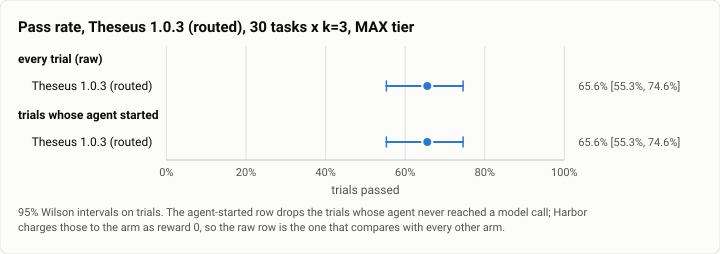
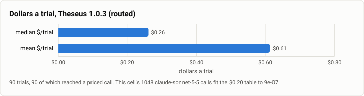

# Terminal-Bench 2.0, MAX tier: Theseus 1.0.3 (routed) on the hard 30 × 3 (2026-10-27)

**The answer first.** Theseus as shipped, routed, on the frozen 1.0.3 bench binaries `92e3dbed`, solved
**59 of 90 trials, 65.6%** [55.3, 74.6] on the hard-30 MAX task set, at a **median $0.2611 and a mean
$0.6134 a trial**, $55.21 for the cell, in 4h 42m. The v1 freeze scored **61 of 90, 67.8%** [57.6, 76.5]
on the same 30 tasks at k=3.

**The finding is not the pass rate — it is that the pass rate did not move while the bill and the clock
did.** Paired task by task, 1.0.3 is **better on 7 tasks, worse on 7, unchanged on 16**; a sign test over
the 14 that moved gives **p = 1.000**. On one price table it costs **2.3–2.6× a trial** and takes **3.8×
the wall clock**. This cell is the MAX-tier counterpart of what cell 1 found at HIGH, and it is a sharper
version of it.

<picture>
  <source media="(prefers-color-scheme: dark)" srcset="img/2026-10-27-terminal-bench-theseus-1.0.3-max-k3/pass-rate-theseus-103-max-k3-dark.svg">
  
</picture>

*Figure 1. The two rows are identical: every trial reached a model call, so the raw and agent-started
denominators are both 90.*

| | |
|---|---|
| Suite | `terminal-bench@2.0`, the hard 30, k=3 through Harbor, plan `g1-max-k3-theseus` |
| Arm | **Theseus as shipped, routed** (`theseus_agent:TheseusRouted`), harbor arm at `d7eb4c27` |
| Build | **bench binaries `92e3dbed`** — all 90 trials' `agent/build-commit.txt` agree; see BUILD PROVENANCE |
| Tier | MAX is the `low..max` effort band; Jev chooses within it |
| Cap | **off** (`no_cap`); 6 of 90 trials recorded over budget |
| Model | `anthropic/claude-sonnet-5-5` asked for. Jev routes, and the `theseus-wf482` refusal fallback put **813 of 1,861 calls** on `claude-sonnet-5` |
| Baseline | **Theseus as shipped (routed), v1 freeze, MAX, hard 30 × 3** ([2026-10-18](2026-10-18-terminal-bench-v1-max.md)) — same tasks, same k, same tier |
| Host | the owner's WSL machine, four trials at once, sampled every 30 s |
| Elapsed | 16:48:58 → 21:30:30 MST, 4h 42m |
| Cost | $55.21 recorded, on today's table — see PRICE BASIS |
| Data | [`2026-10-27-terminal-bench-theseus-1.0.3-max-k3.json`](2026-10-27-terminal-bench-theseus-1.0.3-max-k3.json), [`.csv`](2026-10-27-terminal-bench-theseus-1.0.3-max-k3.csv) (one row per trial) |

## BUILD PROVENANCE — read this before citing the build

This cell ran on **`92e3dbed`**, the gauntlet's frozen 1.0.3 bench build. It did **not** run on the
`theseus-wf482` bench build `d5a3f1ef` (`92e3dbed` + `3cf5c` + wf482), which was built at 22:39 on
10-26 and exists on the bench host.

The handoff that queued this cell asked for that build; the launcher
(`driver/c7-theseus-max-k3.sh`) passes no `--bin-dir`, so `driver/cell.py` used its default and recorded
`build_commit: 92e3dbed…` in `cell.json`. Two independent records agree and they are the ones to trust:
`cell.json`'s `bin_dir`/`build_commit`, and **all 90 trials' own `agent/build-commit.txt`**, which read
`92e3dbed47a466bec774148f201974ad0773cdaa` without exception.

One thing that could mislead a reader in the other direction: the per-trial records **do** carry the
`theseus-wf482` mark (`mixed_model` / `fallback`), all 90 of them. That mark is written by the harbor arm's
`bench/harbor/efficiency.py` on the Python side, not by the binaries, so its presence says nothing about
which Rust build ran. **wf482 is measured here, not fixed here.**

## PRICE BASIS

Install #85 (2026-10-25, `theseus-rko44`) moved the Sonnet 5.5 cache-read list price **$0.10 →
$0.20/Mtok**. **This cell is billed on the new table.** That is measured, not inferred from the date: its
**1,048 `claude-sonnet-5-5` calls fit the $0.20 table to $9.0e-07** and miss the $0.10 table by
**$1.8e-02**, solved per call against the recorded `action.settle` usage.

The efficiency-level solve that published the three rival cells is **not usable on this arm**, and this is
the general rule for any routed cell: the arm bills **two** models, so a one-table solve over a two-model
bill fits nothing cleanly (worst residual $6.1e-03, against $4.4e-16 for a single-model rival). A routed
Theseus cell's basis has to be taken at the per-call trace level.

| basis | median $/trial | mean $/trial | total |
|---|---|---|---|
| **cache reads at $0.20/Mtok (today's table, as billed — quote this)** | **$0.2611** | **$0.6134** | **$55.21** |
| cache reads at $0.10/Mtok (the pre-10-25 table) | $0.2496 | $0.5875 | $52.87 |

All **90 trials** reached a priced call. $/solve is **$0.9357**.

**The price move barely touches this cell — 4.4% — and that is itself a finding.** Cell 4 (OpenClaw,
pinned Sonnet) would have cost 27% less on the old table, because almost all of its bill is Sonnet 5.5
cache reads. Here the bill is dominated by **output tokens (2.51M)** and by the `claude-sonnet-5` fallback
calls, which the entry that moved never touches. An arm that thinks harder is less exposed to a cache-read
price change and more exposed to an output-token one.

<picture>
  <source media="(prefers-color-scheme: dark)" srcset="img/2026-10-27-terminal-bench-theseus-1.0.3-max-k3/cost-theseus-103-max-k3-dark.svg">
  
</picture>

*Figure 2. Median $0.2611 against mean $0.6134 — a 2.35× spread, the widest of the three closing cells.
The tail is where this cell's money is, and the next section says what is in the tail.*

## `theseus-wf482`: the refusal fallback is where the money goes

`turn/fallback_step.rs` switches a turn to `refusal_fallback_model` (Sonnet 5.5 → Sonnet 5) on
`stop_reason == "refusal"` and **keeps the rest of the turn there**. A refusal is therefore not one retry;
it is a model change for everything that follows it in that turn. Over this cell:

| | |
|---|---|
| Trials with a refusal fallback | **35 of 90 = 38.9%**, over **17 of 30 tasks** |
| Category, every one of them | `reasoning_extraction` |
| Calls that ended up on `claude-sonnet-5` | **813 of 1,861 = 43.7%** |
| Cell total | $54.99 (model bill, at $0.20/Mtok cache reads) |
| **Spent at or after the first fallback call** | **$39.19 = 71.3%** |
| Trials where the fallback carried the whole trial | 2 (both `make-doom-for-mips`, both failed) |

**At HIGH (cell 1) wf482 fired in 27.0% of clean trials and took 64.2% of the dollars. At MAX it is 38.9%
and 71.3%.** The harder the task set and the longer the turn, the more of the bill is spent on the
fallback model. The median fallback trial costs **$1.1313** against **$0.1218** for a trial that never
fell back — 9.3×.

**What this does not show.** Fallback trials pass at 24 of 35 (68.6%) against 35 of 55 (63.6%), so this is
not "refusals cause failures". The causality most consistent with the data runs the other way: long, hard,
expensive turns are the ones with enough calls to meet a refusal. The defensible claim is the narrow one —
**71.3% of this cell's spend happens on the fallback model, after a refusal the arm did not need to have**
— and Ablation A has already established that
the `reasoning_extraction` refusal is ours, not the provider's and not the clock.

## Against the v1 freeze: same answers, 2.3–2.6× the money, 3.8× the clock

Same 30 tasks, same k=3, same tier, same harness.

| | v1 freeze (10-18) | 1.0.3 `92e3dbed` (this run) | |
|---|---|---|---|
| Passed | 61/90 = **67.8%** [57.6, 76.5] | 59/90 = **65.6%** [55.3, 74.6] | sign test over tasks **p = 1.000** |
| Median $/trial | $0.1017 as billed, **$0.1114** repriced | **$0.2611** | **2.34–2.57×** |
| Mean $/trial | $0.2452 as billed, **$0.2789** repriced | **$0.6134** | **2.20–2.50×** |
| Cell total | $22.07 as billed, **$25.10** repriced | **$55.21** | **2.20–2.50×** |
| Agent wall clock, median | 96.25 s | **368.87 s** | **3.83×** |

**Read the cost ratios as ranges, not points.** The v1 cell was billed on the **old** table, so a ratio
taken from the two runs' recorded dollars mixes a price change with a behaviour change. The repriced
column adds $0.10/Mtok to *every* cache-read token in that cell, which is an **upper bound** on its true
repriced cost — the routed arm also billed cheaper models whose price never moved, and the published cell
keeps no per-call traces here to split them. So the honest statement is a bound: **between 2.2× and 2.6×,
on one table, for no measurable change in what gets solved.**

Which tasks moved, paired:

- **Better (7):** `torch-pipeline-parallelism` 0→3, `polyglot-rust-c` 0→2, `bn-fit-modify` 2→3,
  `feal-linear-cryptanalysis` 2→3, `torch-tensor-parallelism` 2→3, `install-windows-3.11` 0→1,
  `make-doom-for-mips` 0→1.
- **Worse (7):** `gpt2-codegolf` 3→0, `dna-assembly` 3→1, `model-extraction-relu-logits` 3→1,
  `protein-assembly` 3→1, `make-mips-interpreter` 3→2, `path-tracing-reverse` 3→2, `video-processing` 1→0.
- **Unchanged:** 16.

**Two of the seven regressions are the refusal, directly.** `protein-assembly` went 3/3 → 1/3 and **all
three of its trials raised `AgentSafetyRefusalError`**; `gpt2-codegolf` went 3/3 → 0/3 with one
`TheseusTurnCutError` and two silent failures at 32 and 39 calls. The v1 freeze never refused on this
suite at all (Ablation A, arm A2: 0 refusals in 64 trials on the tasks that refuse here).

## The recorded total is a FLOOR, not the spend

A trial the harness kills before harvesting usage records `cost_usd: null` and an empty `by_model`, and its
dollars land in no total. **No trial here ended that way** — all 90 are priced — so for once the floor and
the figure coincide. The caveat still travels with every cross-cell comparison on this page, because the
cells being compared against do have such trials.

## Errors, by type

| type | n | tasks |
|---|---|---|
| `AgentSafetyRefusalError` | 3 | `protein-assembly` × 3 (20, 25 and 25 calls; $0.5318, $0.7903, $0.7320) |
| `TheseusTurnCutError` | 1 | `gpt2-codegolf` (39 calls, $1.2853) |

Four of 90, 4.4%. All four are in the denominator.

**An exception is not the same as a failed trial, and this cell proves it.** One of the three refusing
`protein-assembly` trials **scored reward 1** — the agent solved the task and refused somewhere along the
way. A reader counting exceptions as failures would be wrong by one here, in the arm's favour.

## What this run measured

| | |
|---|---|
| Trials | 90 over 30 tasks, k=3 |
| Passed | 59 (65.6% [55.3, 74.6]); agent-started 59 of 90, the same row |
| Model calls | 1,861 total, median **16** a trial; **813 of them on `claude-sonnet-5`** |
| Tool calls | 2,051 total, median **18.5** a trial |
| Agent wall clock | median **368.87 s** a trial |
| Tokens | 321,745 input, 2.51M output, 82.9M cache read, 5.08M cache write |
| Billed models | `claude-sonnet-5-5` alone on 55 trials, both models on 33, `claude-sonnet-5` alone on 2 |
| Over budget | 6 of 90 trials |

## Host conditions

No WSL join gate overlapped this run, so no trial is gate-contaminated and the "quiet host" grouping equals
the raw one. The sampler took 744 samples at 30 s — the longest cell in the gauntlet. It ran on the
**quietest host of the three closing cells by load** but with sustained IO pressure:

| cell | load1 | `cpu_some_avg10` | `io_some_avg10` | swap |
|---|---|---|---|---|
| c5 OpenClaw `gpt-6-astra` | 5.60 | 9.07 | 2.12 | 4.17 GB |
| c6 Codex | 5.50 | 2.15 | 10.29 | 4.16 GB |
| **c7 Theseus 1.0.3 MAX (this run)** | **3.83** | **6.80** | **8.49** | **4.00 GB** |

The 3.83× wall-clock ratio against the v1 freeze is the one figure on this page that host conditions could
plausibly inflate, and the two runs are nine days and two machine states apart. The **dollars cannot be
inflated by host load**, and they move by the same order — which is why the cost ratio, not the clock, is
the claim this page makes.
