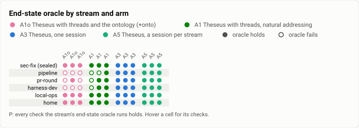
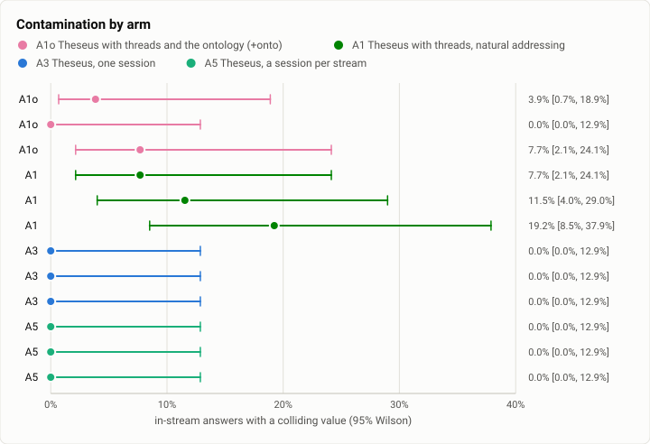
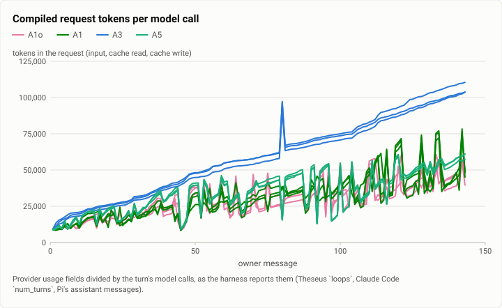
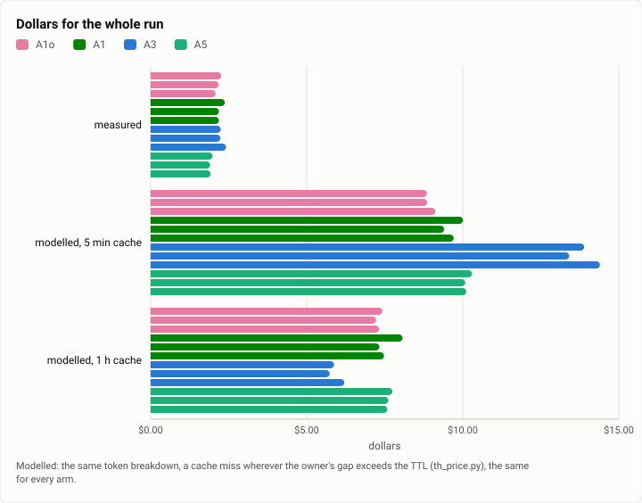
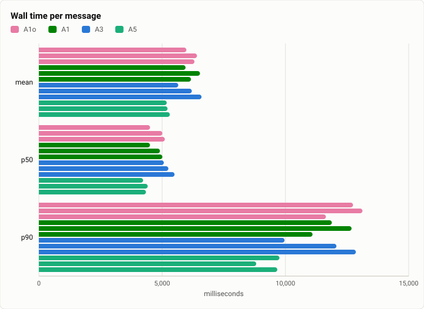

# Threadbench: the cost of not splitting (2026-11-13)

**The answer first.** The ontology makes threads leak less and decide more, and this run cannot tell you what it does to correctness. Threadbench's first ontology arm (`theseus-ri5up`): A1o, with `[ontology] judge` on and `recall_boost` 0.25, against its control A1 with both off — the same 143 owner messages over six interleaved streams, the same frozen binaries, three runs each on the development progression (seed 11, digest `011a0c8319c6`) and one run each on the held-out progression (seed 29, digest `c3743e478790`), with nothing tuned between the two halves. The held-out half is its own page: [the held-out progression](2026-11-13-threadbench-onto-held-out.md). Both halves ran on install #74, main `ae420a49`, deliberately: the plan freezes the binaries so that the held-out set and the development set are compared on one build rather than on two.

**What both halves agree on.** Contamination falls: in-stream answers carrying another stream's colliding value are 3/78 (3.8%) against 10/78 (12.8%) on the development seed and 0/26 against 6/26 (23.1%) on the held-out one — the same sign twice, with the larger difference on the seed nobody looked at. Context gets smaller: 28,626 against 30,919 request tokens a model call on the development seed, 27,141 against 27,973 on the held-out one. Dollars a message barely move (−$0.0005 and −$0.0001). Jev decides more: **9.10 against 5.34** decisions a message on the development seed and **9.06 against 5.30** on the held-out one — a difference of +3.75 and +3.76, the closest agreement anything in this measurement reaches, because the ontology's filings are extra decision questions answered at the act band. That is the cost side of this ledger, not a benefit.

**What it cannot tell you.** Correctness. The oracle is all-or-nothing per stream, so one failed check zeroes a stream and moves the headline 16.7 points: the held-out gap (66.7% against 83.3%) is exactly one check, A1o passing 4 of 5 on `pr-round` where A1 passed 5. On the continuous measure the lean is the same but far smaller — checks passed 59/78 (75.6%) against 69/78 (88.5%) on the development seed, 24/26 (92.3%) against 25/26 (96.2%) on the held-out one. Both halves also ran on a build whose misroute guard holds work it should not (`theseus-4gb4w`, under "The build both halves ran on" below), which costs both arms turns that nobody answers. **No correctness verdict should be read out of this run.** Routing likewise: top-1 placement of a clear message is 90.9% against 93.1% on the development seed and 92.9% against 91.3% on the held-out one — two small differences in opposite directions, which is the shape of noise and the honest answer that the ontology does not measurably move routing.

**Both halves' `judgments.json` was rebuilt from the saved store WAL before scoring** (`theseus-mcl4v`, P2: the driver keeps only the newest 1,000 `judge.call` rows and these runs make 1,353–1,802). The cut files are kept beside each run as `judgments.capped.json`. Scored from the capped files the decisions column and Jev's cost read about 35% low, and the two halves would not have been comparable; this is the same repair the development half had on the day it ran.

**The number a threads arm has to beat**, unchanged by the ontology: one session's requests average 59,279 tokens against a session per stream's 34,683 (59% of it), and the cross-stream questions are answered 12/12 by the split and 12/12 by the one session.

| | |
|---|---|
| Suite | threadbench (`bench/threads`): six interleaved streams with colliding facts |
| Arms | A1o Theseus with threads and the ontology (+onto); A1o Theseus with threads and the ontology (+onto); A1o Theseus with threads and the ontology (+onto); A1 Theseus with threads, natural addressing; A1 Theseus with threads, natural addressing; A1 Theseus with threads, natural addressing; A3 Theseus, one session; A3 Theseus, one session; A3 Theseus, one session; A5 Theseus, a session per stream; A5 Theseus, a session per stream; A5 Theseus, a session per stream |
| Not measured | A1p: not measurable: the daemon builds one persona-set layer whenever two or more [personas] are configured (config.rs `context_paths`, `persona_engaging`) and has no switch for a layer per persona; the arm is not built as a product change, so it is not measurable (as A8 is not); A8 (OpenCode): not measurable: opencode could not be run here (FileNotFoundError: [Errno 2] No such file or directory: 'opencode') |
| Progression | seed 11, standard, digest `011a0c8319c6` |
| Model | anthropic/claude-sonnet-5-5 at effort medium |
| Data | [`2026-11-13-threadbench-onto.json`](2026-11-13-threadbench-onto.json), [`2026-11-13-threadbench-onto.csv`](2026-11-13-threadbench-onto.csv) |

## Per-stream correctness by arm

<picture>
  <source media="(prefers-color-scheme: dark)" srcset="img/2026-11-13-threadbench-onto/stream-correctness-dark.svg">
  
</picture>

*Which arm finished which stream's work correctly?*


| stream | A1o | A1o | A1o | A1 | A1 | A1 | A3 | A3 | A3 | A5 | A5 | A5 |
|---|---|---|---|---|---|---|---|---|---|---|---|---|
| `sec-fix` (sealed) | 100.0% (5 of 5 checks); recall 4/4 (100.0%) | 100.0% (5 of 5 checks); recall 4/4 (100.0%) | 100.0% (5 of 5 checks); recall 4/4 (100.0%) | 100.0% (5 of 5 checks); recall 4/4 (100.0%) | 100.0% (5 of 5 checks); recall 4/4 (100.0%) | 100.0% (5 of 5 checks); recall 4/4 (100.0%) | 100.0% (5 of 5 checks); recall 2/4 (50.0%) | 100.0% (5 of 5 checks); recall 4/4 (100.0%) | 100.0% (5 of 5 checks); recall 4/4 (100.0%) | 100.0% (5 of 5 checks); recall 4/4 (100.0%) | 100.0% (5 of 5 checks); recall 4/4 (100.0%) | 100.0% (5 of 5 checks); recall 4/4 (100.0%) |
| `pipeline` | 0.0% (2 of 4 checks); recall 3/4 (75.0%) | 0.0% (2 of 4 checks); recall 3/4 (75.0%) | 0.0% (2 of 4 checks); recall 3/4 (75.0%) | 0.0% (2 of 4 checks); recall 3/4 (75.0%) | 0.0% (2 of 4 checks); recall 3/4 (75.0%) | 100.0% (4 of 4 checks); recall 3/4 (75.0%) [old checks: 0.0%] | 100.0% (4 of 4 checks); recall 1/4 (25.0%) [old checks: 0.0%] | 100.0% (4 of 4 checks); recall 3/4 (75.0%) [old checks: 0.0%] | 100.0% (4 of 4 checks); recall 3/4 (75.0%) [old checks: 0.0%] | 100.0% (4 of 4 checks); recall 3/4 (75.0%) [old checks: 0.0%] | 100.0% (4 of 4 checks); recall 3/4 (75.0%) [old checks: 0.0%] | 100.0% (4 of 4 checks); recall 3/4 (75.0%) [old checks: 0.0%] |
| `pr-round` | 0.0% (2 of 5 checks); recall 5/6 (83.3%) | 100.0% (5 of 5 checks); recall 4/6 (66.7%) [old checks: 0.0%] | 0.0% (2 of 5 checks); recall 5/6 (83.3%) | 0.0% (2 of 5 checks); recall 4/6 (66.7%) | 100.0% (5 of 5 checks); recall 5/6 (83.3%) [old checks: 0.0%] | 100.0% (5 of 5 checks); recall 5/6 (83.3%) [old checks: 0.0%] | 100.0% (5 of 5 checks); recall 4/6 (66.7%) [old checks: 0.0%] | 100.0% (5 of 5 checks); recall 6/6 (100.0%) | 100.0% (5 of 5 checks); recall 6/6 (100.0%) | 100.0% (5 of 5 checks); recall 6/6 (100.0%) [old checks: 0.0%] | 100.0% (5 of 5 checks); recall 6/6 (100.0%) [old checks: 0.0%] | 100.0% (5 of 5 checks); recall 6/6 (100.0%) [old checks: 0.0%] |
| `harness-dev` | 0.0% (4 of 5 checks); recall 5/5 (100.0%) | 0.0% (2 of 5 checks); recall 5/5 (100.0%) | 0.0% (2 of 5 checks); recall 5/5 (100.0%) | 0.0% (3 of 5 checks); recall 5/5 (100.0%) | 100.0% (5 of 5 checks); recall 5/5 (100.0%) | 100.0% (5 of 5 checks); recall 5/5 (100.0%) | 100.0% (5 of 5 checks); recall 4/5 (80.0%) | 100.0% (5 of 5 checks); recall 5/5 (100.0%) | 100.0% (5 of 5 checks); recall 5/5 (100.0%) | 100.0% (5 of 5 checks); recall 5/5 (100.0%) | 100.0% (5 of 5 checks); recall 5/5 (100.0%) | 100.0% (5 of 5 checks); recall 5/5 (100.0%) |
| `local-ops` | 100.0% (4 of 4 checks); recall 6/6 (100.0%) | 100.0% (4 of 4 checks); recall 6/6 (100.0%) | 100.0% (4 of 4 checks); recall 6/6 (100.0%) | 100.0% (4 of 4 checks); recall 6/6 (100.0%) | 100.0% (4 of 4 checks); recall 6/6 (100.0%) | 100.0% (4 of 4 checks); recall 6/6 (100.0%) | 100.0% (4 of 4 checks); recall 4/6 (66.7%) | 100.0% (4 of 4 checks); recall 6/6 (100.0%) | 100.0% (4 of 4 checks); recall 6/6 (100.0%) | 100.0% (4 of 4 checks); recall 4/6 (66.7%) | 100.0% (4 of 4 checks); recall 6/6 (100.0%) | 100.0% (4 of 4 checks); recall 6/6 (100.0%) |
| `home` | 100.0% (3 of 3 checks); recall 0/1 (0.0%) | 100.0% (3 of 3 checks); recall 0/1 (0.0%) | 100.0% (3 of 3 checks); recall 0/1 (0.0%) | 100.0% (3 of 3 checks); recall 1/1 (100.0%) | 100.0% (3 of 3 checks); recall 1/1 (100.0%) | 100.0% (3 of 3 checks); recall 1/1 (100.0%) | 100.0% (3 of 3 checks); recall 0/1 (0.0%) | 100.0% (3 of 3 checks); recall 1/1 (100.0%) | 100.0% (3 of 3 checks); recall 1/1 (100.0%) | 100.0% (3 of 3 checks); recall 1/1 (100.0%) | 100.0% (3 of 3 checks); recall 1/1 (100.0%) | 100.0% (3 of 3 checks); recall 1/1 (100.0%) |
| **oracle mean** | **50.0%** | **66.7%** | **50.0%** | **50.0%** | **83.3%** | **100.0%** | **100.0%** | **100.0%** | **100.0%** | **100.0%** | **100.0%** | **100.0%** |
| oracle mean, the checks before the scorer fix (theseus-x0ls3) | 50.0% | 50.0% | 50.0% | 50.0% | 66.7% | 66.7% | 66.7% | 83.3% | 83.3% | 66.7% | 66.7% | 66.7% |

Probes by kind (right / asked; a probe whose fact never reached the arm is excluded, never a miss):

| kind | A1o | A1o | A1o | A1 | A1 | A1 | A3 | A3 | A3 | A5 | A5 | A5 |
|---|---|---|---|---|---|---|---|---|---|---|---|---|
| in_direct | 15/16 (93.8%) | 15/16 (93.8%) | 15/16 (93.8%) | 15/16 (93.8%) | 15/16 (93.8%) | 15/16 (93.8%) | 15/16 (93.8%) | 15/16 (93.8%) | 15/16 (93.8%) | 15/16 (93.8%) | 15/16 (93.8%) | 15/16 (93.8%) |
| in_indirect | 8/10 (80.0%) | 7/10 (70.0%) | 8/10 (80.0%) | 8/10 (80.0%) | 9/10 (90.0%) | 9/10 (90.0%) | 0/10 (0.0%) | 10/10 (100.0%) | 10/10 (100.0%) | 8/10 (80.0%) | 10/10 (100.0%) | 10/10 (100.0%) |
| cross | 12/12 (100.0%) | 12/12 (100.0%) | 12/12 (100.0%) | 12/12 (100.0%) | 12/12 (100.0%) | 12/12 (100.0%) | 11/12 (91.7%) | 12/12 (100.0%) | 12/12 (100.0%) | 11/12 (91.7%) | 11/12 (91.7%) | 10/12 (83.3%) |
| embargo | 4/4 (100.0%) | 4/4 (100.0%) | 4/4 (100.0%) | 4/4 (100.0%) | 4/4 (100.0%) | 4/4 (100.0%) | 4/4 (100.0%) | 4/4 (100.0%) | 4/4 (100.0%) | 4/4 (100.0%) | 4/4 (100.0%) | 4/4 (100.0%) |
| abstention | 1/3 (33.3%) | 1/3 (33.3%) | 1/3 (33.3%) | 0/3 (0.0%) | 0/3 (0.0%) | 0/3 (0.0%) | 0/3 (0.0%) | 2/3 (66.7%) | 1/3 (33.3%) | 1/3 (33.3%) | 3/3 (100.0%) | 1/3 (33.3%) |
| misroute | 1/2 (50.0%) | 2/2 (100.0%) | 2/2 (100.0%) | 1/2 (50.0%) | 2/2 (100.0%) | 0/2 (0.0%) | 2/2 (100.0%) | 2/2 (100.0%) | 2/2 (100.0%) | 2/2 (100.0%) | 2/2 (100.0%) | 2/2 (100.0%) |

Oracle checks per stream: `sec-fix`: the handler refuses names that leave public/ and still serves public files, the suite passes, a regression test fails on the old handler, a reproduction script exists, the advisory note names the ticket and the handler; `pipeline`: the three cleaned files match the rules, the summary matches the final cutoff, a script regenerates the summary, a test covers the duplicate rule, and the suite passes; `pr-round`: attempts, jitter and retry_on behave as the review asked, the suite passes and holds the review's tests, the README shows retry_on in a code block, the PR description lists all four comments, the PR description holds nothing of the sealed stream; `harness-dev`: --min-len ignores short words, --top 0 prints nothing, the default output is unchanged, the suite passes through run-tests.sh and tests both flags, the README documents both flags; `local-ops`: VERSION is bumped and the changelog and verify.sh agree, the config key is migrated, value in milliseconds, the restart script restarts the stand-in service, verified, the restart script fails when the service never becomes ready; `home`: a thank-you note exists, the pancake recipe is scaled to six, three cat names.

## Contamination and leaks

<picture>
  <source media="(prefers-color-scheme: dark)" srcset="img/2026-11-13-threadbench-onto/contamination-dark.svg">
  
</picture>

*How often does an in-stream answer give another stream's value of the same kind?*


| metric | A1o | A1o | A1o | A1 | A1 | A1 | A3 | A3 | A3 | A5 | A5 | A5 |
|---|---|---|---|---|---|---|---|---|---|---|---|---|
| in-stream answers with a colliding value | 1/26 (3.9%) | 0/26 (0.0%) | 2/26 (7.7%) | 2/26 (7.7%) | 3/26 (11.5%) | 5/26 (19.2%) | 0/26 (0.0%) | 0/26 (0.0%) | 0/26 (0.0%) | 0/26 (0.0%) | 0/26 (0.0%) | 0/26 (0.0%) |
| stale value given (of superseded) | 2/2 (100.0%) | 1/2 (50.0%) | 1/2 (50.0%) | 1/2 (50.0%) | 1/2 (50.0%) | 1/2 (50.0%) | 1/2 (50.0%) | 1/2 (50.0%) | 1/2 (50.0%) | 1/2 (50.0%) | 1/2 (50.0%) | 1/2 (50.0%) |
| cross-stream: right value | 12/12 (100.0%) | 12/12 (100.0%) | 12/12 (100.0%) | 12/12 (100.0%) | 12/12 (100.0%) | 12/12 (100.0%) | 12/12 (100.0%) | 12/12 (100.0%) | 12/12 (100.0%) | 12/12 (100.0%) | 12/12 (100.0%) | 12/12 (100.0%) |
| cross-stream: right value and a source named (the stream's name, its thread's title or slug, "this thread", "the thread card", a standing-note id) | 12/12 (100.0%) | 12/12 (100.0%) | 12/12 (100.0%) | 12/12 (100.0%) | 12/12 (100.0%) | 12/12 (100.0%) | 11/12 (91.7%) | 12/12 (100.0%) | 12/12 (100.0%) | 11/12 (91.7%) | 11/12 (91.7%) | 10/12 (83.3%) |
| cross-stream: right value and the stream named (the old check, `named_stream`) | 8/12 (66.7%) | 10/12 (83.3%) | 8/12 (66.7%) | 10/12 (83.3%) | 10/12 (83.3%) | 11/12 (91.7%) | 11/12 (91.7%) | 12/12 (100.0%) | 12/12 (100.0%) | 9/12 (75.0%) | 8/12 (66.7%) | 10/12 (83.3%) |
| cross-stream: colliding value in the answer | 2/12 (16.7%) | 5/12 (41.7%) | 3/12 (25.0%) | 7/12 (58.3%) | 4/12 (33.3%) | 5/12 (41.7%) | 0/12 (0.0%) | 1/12 (8.3%) | 1/12 (8.3%) | 3/12 (25.0%) | 5/12 (41.7%) | 6/12 (50.0%) |
| abstention: no value, and admits it | 1/3 (33.3%) | 1/3 (33.3%) | 1/3 (33.3%) | 0/3 (0.0%) | 0/3 (0.0%) | 0/3 (0.0%) | 0/3 (0.0%) | 2/3 (66.7%) | 1/3 (33.3%) | 1/3 (33.3%) | 3/3 (100.0%) | 1/3 (33.3%) |
| embargo: probes clean | 4/4 (100.0%) | 4/4 (100.0%) | 4/4 (100.0%) | 4/4 (100.0%) | 4/4 (100.0%) | 4/4 (100.0%) | 4/4 (100.0%) | 4/4 (100.0%) | 4/4 (100.0%) | 4/4 (100.0%) | 4/4 (100.0%) | 4/4 (100.0%) |
| reach: the "also this week" section names two other open streams, pr-round and pipeline probes | 1/2 (50.0%) | 0/2 (0.0%) | 0/2 (0.0%) | 0/2 (0.0%) | 0/2 (0.0%) | 1/2 (50.0%) | 2/2 (100.0%) | 0/2 (0.0%) | 2/2 (100.0%) | 0/2 (0.0%) | 0/2 (0.0%) | 0/2 (0.0%) |
| reach: the same on all four "also this week" probes | 1/4 (25.0%) | 0/4 (0.0%) | 0/4 (0.0%) | 0/4 (0.0%) | 0/4 (0.0%) | 3/4 (75.0%) | 2/4 (50.0%) | 0/4 (0.0%) | 2/4 (50.0%) | 1/4 (25.0%) | 0/4 (0.0%) | 0/4 (0.0%) |
| embargo: sealed markers in other streams' files | 0 | 0 | 0 | 0 | 0 | 0 | 2 | 0 | 0 | 0 | 0 | 0 |
| misroute recovery (note in the right file only) | 1/2 (50.0%) | 2/2 (100.0%) | 2/2 (100.0%) | 1/2 (50.0%) | 2/2 (100.0%) | 0/2 (0.0%) | 2/2 (100.0%) | 2/2 (100.0%) | 2/2 (100.0%) | 2/2 (100.0%) | 2/2 (100.0%) | 2/2 (100.0%) |

Leaks found: A3: home/notes/p027.txt: sec-4412; A3: home/notes/p027.txt: ledgerweb.

## Context tokens per turn over the run

<picture>
  <source media="(prefers-color-scheme: dark)" srcset="img/2026-11-13-threadbench-onto/context-tokens-dark.svg">
  
</picture>

*How big is each request over the run, for one long context against one per stream?*


| metric | A1o | A1o | A1o | A1 | A1 | A1 | A3 | A3 | A3 | A5 | A5 | A5 |
|---|---|---|---|---|---|---|---|---|---|---|---|---|
| request tokens per model call, mean / p90 | 28,301 / 45,926 | 28,582 / 42,835 | 28,997 / 47,875 | 32,033 / 45,964 | 29,714 / 46,009 | 31,010 / 49,081 | 59,279 / 95,997 | 56,683 / 93,590 | 60,455 / 101,303 | 34,683 / 54,624 | 34,190 / 53,464 | 34,243 / 54,115 |
| last request | 48,316 | 39,607 | 48,291 | 45,087 | 49,315 | 48,304 | 103,774 | 103,784 | 110,503 | 60,964 | 57,512 | 60,980 |
| prompt tokens in all (input + cache read + cache write) | 6,365,247 | 6,068,492 | 6,103,733 | 6,889,254 | 6,822,328 | 7,034,639 | 12,469,961 | 12,286,799 | 13,698,248 | 7,546,995 | 7,254,385 | 7,184,404 |
| cache-read share of the prompt | 93.4% | 93.7% | 94.2% | 93.7% | 95.0% | 95.2% | 98.8% | 98.8% | 98.9% | 96.4% | 96.3% | 96.2% |
| sessions / compactions | 6 / 0 | 6 / 0 | 6 / 0 | 6 / 0 | 6 / 0 | 6 / 0 | 1 / 0 | 1 / 0 | 1 / 0 | 6 / 0 | 6 / 0 | 6 / 0 |

## Dollars measured and modelled

<picture>
  <source media="(prefers-color-scheme: dark)" srcset="img/2026-11-13-threadbench-onto/dollars-dark.svg">
  
</picture>

*What does the run cost as measured (cache always warm) and at the owner's gaps?*


| dollars | A1o | A1o | A1o | A1 | A1 | A1 | A3 | A3 | A3 | A5 | A5 | A5 |
|---|---|---|---|---|---|---|---|---|---|---|---|---|
| measured (the harness's count; cache warm throughout) | $2.26 | $2.18 | $2.08 | $2.38 | $2.19 | $2.19 | $2.25 | $2.24 | $2.42 | $1.98 | $1.91 | $1.92 |
| per message, measured | $0.016 | $0.015 | $0.015 | $0.017 | $0.015 | $0.015 | $0.016 | $0.016 | $0.017 | $0.014 | $0.013 | $0.013 |
| modelled, 5-minute cache | $8.85 (97 misses) | $8.86 (97 misses) | $9.12 (97 misses) | $10.01 (97 misses) | $9.40 (97 misses) | $9.71 (97 misses) | $13.89 (73 misses) | $13.41 (73 misses) | $14.40 (73 misses) | $10.30 (97 misses) | $10.08 (97 misses) | $10.11 (97 misses) |
| modelled, 1-hour cache | $7.43 (36 misses) | $7.22 (36 misses) | $7.32 (36 misses) | $8.07 (36 misses) | $7.33 (36 misses) | $7.48 (36 misses) | $5.88 (9 misses) | $5.73 (9 misses) | $6.21 (9 misses) | $7.75 (36 misses) | $7.62 (36 misses) | $7.58 (36 misses) |

The model (`th_price.py`, the same for every arm): a session's prompt cache lives one TTL after its last request; a message whose gap since its own session's previous message is over the TTL re-writes its prefix (its first request's cache reads become writes, at the 5-minute write price, or at twice the input price for the 1-hour TTL); the gaps are the owner's, drawn once for the progression. An arm with a session per stream sees longer gaps than one session does. Behaviour on a cold cache is not modelled.

## Routing

| arm | top-1 (true stream) | asked on ambiguous | asked on clear |
|---|---|---|---|
| A1o | 113/125 (90.4%) | 0/15 (0.0%) | 5/125 (4.0%) |
| A1o | 112/125 (89.6%) | 1/15 (6.7%) | 7/125 (5.6%) |
| A1o | 116/125 (92.8%) | 2/15 (13.3%) | 5/125 (4.0%) |
| A1 | 114/125 (91.2%) | 1/15 (6.7%) | 6/125 (4.8%) |
| A1 | 118/125 (94.4%) | 1/15 (6.7%) | 7/125 (5.6%) |
| A1 | 117/125 (93.6%) | 1/15 (6.7%) | 5/125 (4.0%) |
| A3 | no router: nothing to score | – | – |
| A3 | no router: nothing to score | – | – |
| A3 | no router: nothing to score | – | – |
| A5 | the owner's own split: every message goes where the owner puts it | – | – |
| A5 | the owner's own split: every message goes where the owner puts it | – | – |
| A5 | the owner's own split: every message goes where the owner puts it | – | – |

Where the router's turns ran (theseus-x0ls3): the streams that never got a thread, and the orphan turns (a clear message of a stream that has a thread, run after that thread's first turn at home or in another stream's thread; the message numbers follow). `before thread` counts a stream's first messages that ran at home before its thread existed.

| arm | streams without a thread | orphan turns | before thread |
|---|---|---|---|
| A1o | none | 7 (19, 54, 63, 69, 112, 120, 132) | 1 |
| A1o | none | 6 (15, 23, 63, 112, 120, 132) | 1 |
| A1o | none | 7 (19, 54, 63, 69, 112, 120, 132) | 1 |
| A1 | none | 8 (19, 23, 54, 63, 80, 112, 120, 132) | 2 |
| A1 | none | 5 (80, 112, 120, 125, 132) | 2 |
| A1 | none | 6 (48, 90, 112, 113, 120, 132) | 2 |

The progression labels every message's true stream and marks 15 as ambiguous (a good router asks) and 2 misrouted notes with their scripted correction; only the threads arms (A1 and after) have a router to score.

## Latency

<picture>
  <source media="(prefers-color-scheme: dark)" srcset="img/2026-11-13-threadbench-onto/latency-dark.svg">
  
</picture>

*How long does a message take, start to answer?*


| latency | A1o | A1o | A1o | A1 | A1 | A1 | A3 | A3 | A3 | A5 | A5 | A5 |
|---|---|---|---|---|---|---|---|---|---|---|---|---|
| wall per message, mean | 5,983 ms | 6,414 ms | 6,310 ms | 5,950 ms | 6,535 ms | 6,170 ms | 5,655 ms | 6,204 ms | 6,597 ms | 5,185 ms | 5,219 ms | 5,313 ms |
| p50 / p90 | 4,509 / 12,742 ms | 5,010 / 13,126 ms | 5,109 / 11,642 ms | 4,507 / 11,883 ms | 4,911 / 12,684 ms | 5,009 / 11,101 ms | 5,069 / 9,964 ms | 5,252 / 12,069 ms | 5,504 / 12,857 ms | 4,227 / 9,758 ms | 4,415 / 8,817 ms | 4,342 / 9,670 ms |
| first token, mean | 2,268 ms | 2,590 ms | 2,671 ms | 2,259 ms | 2,383 ms | 2,347 ms | 2,522 ms | 2,887 ms | 2,978 ms | 2,116 ms | 2,341 ms | 2,258 ms |
| harness CPU (user + sys) / peak RSS | 242.0 s / 619 MiB | 271.1 s / 623 MiB | 260.7 s / 627 MiB | 53.3 s / 169 MiB | 301.0 s / 625 MiB | 63.2 s / 187 MiB | 43.6 s / 87 MiB | 52.0 s / 90 MiB | 64.6 s / 91 MiB | 30.0 s / 82 MiB | 31.7 s / 80 MiB | 33.4 s / 83 MiB |

First-token latency is carried by Theseus's turn result only; Claude Code and Pi report none, so their cells say so (a T0r that needs it reads each harness's own trace). CPU and RSS are the driven processes' (`getrusage` of the children: the harness's CLI, and a Theseus daemon), apart from the model's work.

## Decisions taken off the main model

| arm | decisions per message by Jev, all (routing / filing / privacy) | Jev's dollars | the main model's, modelled | saved | unanswered | judgments | messages with a decision |
|---|---|---|---|---|---|---|---|
| A1o | 9.09 (2.56 / 2.15 / 4.38) | $0.058 | $4.48 | $4.42 | 0 | 521 | 100.0% |
| A1o | 9.33 (2.58 / 2.15 / 4.59) | $0.059 | $4.52 | $4.46 | 0 | 528 | 100.0% |
| A1o | 8.87 (2.52 / 2.08 / 4.27) | $0.057 | $4.29 | $4.23 | 0 | 512 | 100.0% |
| A1 | 4.96 (2.54 / 0.00 / 2.43) | $0.040 | $2.78 | $2.74 | 0 | 376 | 100.0% |
| A1 | 5.89 (2.52 / 0.01 / 3.36) | $0.042 | $2.91 | $2.87 | 0 | 402 | 100.0% |
| A1 | 5.17 (2.49 / 0.01 / 2.68) | $0.041 | $2.84 | $2.80 | 0 | 387 | 100.0% |
| A3 | none: the arm asks Jev no decision | – | – | – | – | – | – |
| A3 | none: the arm asks Jev no decision | – | – | – | – | – | – |
| A3 | none: the arm asks Jev no decision | – | – | – | – | – | – |
| A5 | none: the arm asks Jev no decision | – | – | – | – | – | – |
| A5 | none: the arm asks Jev no decision | – | – | – | – | – | – |
| A5 | none: the arm asks Jev no decision | – | – | – | – | – | – |

Per question (answered; at the act band, which are the decisions; of those, the ones that chose something):

| arm | question | class | answered | act band | chose |
|---|---|---|---|---|---|
| A1o | `categorize.v1/still_member` | filing | 9 | 9 | 2 |
| A1o | `categorize.v1/topic` | filing | 12 | 6 | 6 |
| A1o | `classify.v4/thread` | routing | 116 | 75 | 75 |
| A1o | `onto.v1/capability` | filing | 143 | 91 | 0 |
| A1o | `onto.v1/elicits` | privacy | 143 | 143 | 0 |
| A1o | `onto.v1/event` | filing | 143 | 86 | 8 |
| A1o | `onto.v1/expertise` | filing | 143 | 21 | 0 |
| A1o | `onto.v1/personal` | privacy | 143 | 132 | 0 |
| A1o | `onto.v1/resource` | filing | 143 | 50 | 36 |
| A1o | `onto.v1/topic` | filing | 143 | 45 | 37 |
| A1o | `route.v7/data` | routing | 143 | 44 | 44 |
| A1o | `route.v7/mode` | routing | 143 | 63 | 63 |
| A1o | `route.v7/persona` | routing | 26 | 7 | 7 |
| A1o | `route.v7/personal` | routing | 143 | 143 | 0 |
| A1o | `route.v7/reply_effort` | routing | 143 | 19 | 19 |
| A1o | `route.v7/seal` | routing | 26 | 15 | 15 |
| A1o | `security.v3/beyond_ask` | privacy | 80 | 3 | 0 |
| A1o | `security.v3/destructive` | privacy | 80 | 35 | 3 |
| A1o | `security.v3/exfiltrates` | privacy | 80 | 80 | 0 |
| A1o | `security.v3/kind` | privacy | 80 | 40 | 40 |
| A1o | `security.v3/risky` | privacy | 80 | 26 | 0 |
| A1o | `security.v3/safe` | privacy | 80 | 24 | 24 |
| A1o | `security.v3/steered` | privacy | 80 | 63 | 0 |
| A1o | `security.v3/touches_credentials` | privacy | 80 | 80 | 0 |
| A1o | `categorize.v1/still_member` | filing | 14 | 9 | 2 |
| A1o | `categorize.v1/topic` | filing | 13 | 7 | 7 |
| A1o | `classify.v4/thread` | routing | 93 | 55 | 55 |
| A1o | `onto.v1/capability` | filing | 143 | 92 | 0 |
| A1o | `onto.v1/elicits` | privacy | 143 | 143 | 0 |
| A1o | `onto.v1/event` | filing | 143 | 86 | 9 |
| A1o | `onto.v1/expertise` | filing | 143 | 23 | 0 |
| A1o | `onto.v1/personal` | privacy | 143 | 132 | 0 |
| A1o | `onto.v1/resource` | filing | 143 | 49 | 33 |
| A1o | `onto.v1/topic` | filing | 143 | 42 | 31 |
| A1o | `route.v7/data` | routing | 143 | 52 | 52 |
| A1o | `route.v7/mode` | routing | 143 | 61 | 61 |
| A1o | `route.v7/persona` | routing | 49 | 11 | 11 |
| A1o | `route.v7/personal` | routing | 143 | 143 | 0 |
| A1o | `route.v7/reply_effort` | routing | 143 | 22 | 22 |
| A1o | `route.v7/seal` | routing | 49 | 25 | 25 |
| A1o | `security.v3/beyond_ask` | privacy | 86 | 9 | 2 |
| A1o | `security.v3/destructive` | privacy | 86 | 29 | 3 |
| A1o | `security.v3/exfiltrates` | privacy | 86 | 85 | 0 |
| A1o | `security.v3/kind` | privacy | 86 | 54 | 54 |
| A1o | `security.v3/risky` | privacy | 86 | 34 | 0 |
| A1o | `security.v3/safe` | privacy | 86 | 22 | 22 |
| A1o | `security.v3/steered` | privacy | 86 | 65 | 0 |
| A1o | `security.v3/touches_credentials` | privacy | 86 | 84 | 0 |
| A1o | `categorize.v1/still_member` | filing | 9 | 7 | 2 |
| A1o | `categorize.v1/topic` | filing | 12 | 6 | 6 |
| A1o | `classify.v4/thread` | routing | 114 | 70 | 70 |
| A1o | `onto.v1/capability` | filing | 143 | 91 | 0 |
| A1o | `onto.v1/elicits` | privacy | 143 | 143 | 0 |
| A1o | `onto.v1/event` | filing | 143 | 75 | 7 |
| A1o | `onto.v1/expertise` | filing | 143 | 24 | 0 |
| A1o | `onto.v1/personal` | privacy | 143 | 130 | 0 |
| A1o | `onto.v1/resource` | filing | 143 | 45 | 32 |
| A1o | `onto.v1/topic` | filing | 143 | 50 | 38 |
| A1o | `route.v7/data` | routing | 144 | 48 | 48 |
| A1o | `route.v7/mode` | routing | 144 | 61 | 61 |
| A1o | `route.v7/persona` | routing | 29 | 7 | 7 |
| A1o | `route.v7/personal` | routing | 144 | 144 | 0 |
| A1o | `route.v7/reply_effort` | routing | 144 | 19 | 19 |
| A1o | `route.v7/seal` | routing | 29 | 11 | 11 |
| A1o | `security.v3/beyond_ask` | privacy | 70 | 6 | 0 |
| A1o | `security.v3/destructive` | privacy | 70 | 31 | 2 |
| A1o | `security.v3/exfiltrates` | privacy | 70 | 69 | 0 |
| A1o | `security.v3/kind` | privacy | 70 | 48 | 48 |
| A1o | `security.v3/risky` | privacy | 70 | 28 | 0 |
| A1o | `security.v3/safe` | privacy | 70 | 27 | 27 |
| A1o | `security.v3/steered` | privacy | 70 | 60 | 0 |
| A1o | `security.v3/touches_credentials` | privacy | 70 | 69 | 0 |
| A1 | `categorize.v1/topic` | filing | 13 | 0 | 0 |
| A1 | `classify.v4/thread` | routing | 94 | 54 | 54 |
| A1 | `route.v7/data` | routing | 144 | 50 | 50 |
| A1 | `route.v7/mode` | routing | 144 | 60 | 60 |
| A1 | `route.v7/persona` | routing | 49 | 12 | 12 |
| A1 | `route.v7/personal` | routing | 144 | 144 | 0 |
| A1 | `route.v7/reply_effort` | routing | 144 | 16 | 16 |
| A1 | `route.v7/seal` | routing | 49 | 27 | 27 |
| A1 | `security.v3/beyond_ask` | privacy | 76 | 6 | 0 |
| A1 | `security.v3/destructive` | privacy | 76 | 29 | 3 |
| A1 | `security.v3/exfiltrates` | privacy | 76 | 75 | 0 |
| A1 | `security.v3/kind` | privacy | 76 | 57 | 57 |
| A1 | `security.v3/risky` | privacy | 76 | 24 | 0 |
| A1 | `security.v3/safe` | privacy | 76 | 26 | 26 |
| A1 | `security.v3/steered` | privacy | 76 | 58 | 0 |
| A1 | `security.v3/touches_credentials` | privacy | 76 | 72 | 0 |
| A1 | `categorize.v1/topic` | filing | 12 | 1 | 0 |
| A1 | `classify.v4/thread` | routing | 106 | 72 | 72 |
| A1 | `route.v7/data` | routing | 143 | 45 | 45 |
| A1 | `route.v7/mode` | routing | 143 | 58 | 58 |
| A1 | `route.v7/persona` | routing | 36 | 9 | 9 |
| A1 | `route.v7/personal` | routing | 143 | 143 | 0 |
| A1 | `route.v7/reply_effort` | routing | 143 | 17 | 17 |
| A1 | `route.v7/seal` | routing | 36 | 17 | 17 |
| A1 | `security.v3/beyond_ask` | privacy | 104 | 8 | 0 |
| A1 | `security.v3/destructive` | privacy | 104 | 43 | 3 |
| A1 | `security.v3/exfiltrates` | privacy | 104 | 103 | 0 |
| A1 | `security.v3/kind` | privacy | 104 | 69 | 69 |
| A1 | `security.v3/risky` | privacy | 104 | 46 | 0 |
| A1 | `security.v3/safe` | privacy | 104 | 32 | 32 |
| A1 | `security.v3/steered` | privacy | 104 | 76 | 0 |
| A1 | `security.v3/touches_credentials` | privacy | 104 | 104 | 0 |
| A1 | `categorize.v1/topic` | filing | 12 | 1 | 0 |
| A1 | `classify.v4/thread` | routing | 102 | 64 | 64 |
| A1 | `route.v7/data` | routing | 143 | 45 | 45 |
| A1 | `route.v7/mode` | routing | 143 | 55 | 55 |
| A1 | `route.v7/persona` | routing | 40 | 10 | 10 |
| A1 | `route.v7/personal` | routing | 143 | 143 | 0 |
| A1 | `route.v7/reply_effort` | routing | 143 | 18 | 18 |
| A1 | `route.v7/seal` | routing | 40 | 21 | 21 |
| A1 | `security.v3/beyond_ask` | privacy | 89 | 8 | 0 |
| A1 | `security.v3/destructive` | privacy | 89 | 31 | 4 |
| A1 | `security.v3/exfiltrates` | privacy | 89 | 89 | 0 |
| A1 | `security.v3/kind` | privacy | 89 | 57 | 57 |
| A1 | `security.v3/risky` | privacy | 89 | 21 | 0 |
| A1 | `security.v3/safe` | privacy | 89 | 19 | 19 |
| A1 | `security.v3/steered` | privacy | 89 | 70 | 0 |
| A1 | `security.v3/touches_credentials` | privacy | 89 | 88 | 0 |

A decision is one decision question answered at the act band: a filing (`onto.*`'s topic, project, event, resource, capability and expertise questions, and `categorize.*`), a routing (`route.*`, and `classify.*`'s `thread`) or a privacy decision (`security.*`, and `onto.*`'s `personal`, `elicits` and `shows_*`); one judgment holds as many as it has such answers. A judgment belongs to the turn its `context.turn` names, else to the turn of its session whose window holds its time, else to no turn; the mean is over all messages and the share counts the messages with a decision attributed to them. The dollars are per judgment, read from the run's `judge.call` rows (`judgments.json`). The main model's dollars are modelled, not measured: the same tokens Jev read, at the model's uncached input price, and the tokens Jev wrote at its output price; a free-form answer is longer than Jev's choice, so it is a floor. The oracle arm makes these decisions by asking the main model, one extra call each, so its count is the Jev arm's and its dollars are that column. Judgments Jev did not answer are counted apart: a decision not taken off the main model. A run from before the questions were recorded counts judgments and says so.

## The ontology arm against its control

3 run(s) of A1o against 3 of A1, the same messages and the same binaries; the pair differs by `[ontology] judge` and `recall_boost` alone (`run.json` keeps each arm's table). Each difference is A1o minus A1; a rate is pooled over an arm's runs. Reported whatever it says: nothing was tuned between the arms.

| metric | A1o | A1 | A1o − A1 |
|---|---|---|---|
| oracle on `harness-dev` | 0% | 67% | -67% |
| oracle on `home` | 100% | 100% | 0% |
| oracle on `local-ops` | 100% | 100% | 0% |
| oracle on `pipeline` | 0% | 33% | -33% |
| oracle on `pr-round` | 33% | 67% | -33% |
| oracle on `sec-fix` | 100% | 100% | 0% |
| **oracle mean** | 55.6% | 77.8% | -22.2% |
| contamination (in-stream answers with a colliding value) | 3/78 (3.8%) | 10/78 (12.8%) | -9.0 points |
| routing top-1 (true stream) | 341/375 (90.9%) | 349/375 (93.1%) | -2.1 points |
| context tokens per model call, mean | 28,626 | 30,919 | -2,293 |
| dollars per message, measured | $0.0152 | $0.0157 | $-0.0005 |
| wall per message, mean (ms) | 6,236 | 6,218 | +17 |
| decisions per message taken by Jev | 9.10 | 5.34 | +3.75 |

The decisions column is below. A positive difference in the oracle or in routing is for the ontology; a positive difference in tokens, dollars, latency or contamination is against it.

## Accuracy against the import's labels

Not run in this report: `theseus judge replay --onto --limit 50 > replay.md` on the owner's daemon (it sends the history to Jev, under `[judge] backfill_consent`), then `report.py --onto-replay replay.md`.

## The persona track

Not run in this report: `python3 bench/threads/th_persona.py --seed <seed> --out <dir>` writes `persona.json`, and `report.py --persona` reads it.

## The prefix-library track

Not run in this report: `python3 bench/threads/th_prefix.py --seed <seed> --out <dir>` writes the track's progression; `th_drive.py --progression <dir>` drives it and `th_score.py` scores it. Header probes whose sibling-valued answer is a false fit are counted apart.

## The build both halves ran on, and which metrics are safe to read

Both halves of this measurement ran on **install #74, main `ae420a49`**, from one frozen copy of the four
binaries (`theseus`, `theseus-index`, `theseus-tui`, `theseusd`; sha256 recorded at the freeze and re-checked
before the held-out half ran). That is the plan's `rerun_only_if` / frozen-binary clause doing its job: a
held-out set measured on a newer build than its development set would not be the same measurement.

The price of that clause is that both halves carry a defect found **during** the development half and fixed
afterwards:

- **`theseus-4gb4w` (P1), present on this build, fixed on `main` today.** The misroute guard compared a
  thread's *relative* working-set roots against the plan's *absolute* paths with no base, so a turn whose
  placement was below the act bar had its first write or program held with a question that could never match
  — including when the thread was right. The fix (`bb6a43e5`, "misroute: read a thread's relative roots under
  the session's directory", merged 2026-10-23 via `5c247c5c` and `809255cd`) passes the session directory
  into the guard and leaves a relative root with no base out. It is **not** an ancestor of `ae420a49`: it
  landed about twelve hours after this build was cut.
- **What that costs the measurement.** The bench's simulated owner never answers a tool confirmation
  (`theseus-uxum0`), so a held turn's work is simply lost. On the held-out pair each arm lost **6 of 143
  turns** to such a hold, and **9 of those 12 holds were of work in the right thread** — the same three-quarters
  the development half measured (33 false of 44 holds over its six runs).

So, metric by metric:

| metric | safe to read here? | why |
|---|---|---|
| contamination, cross-stream contamination | **yes** | a hold nobody answers removes a turn's *write*; it does not put another stream's value into an answer. Both halves agree in sign, and the held-out difference is the larger one. |
| context tokens a model call | **yes** | measured per call over 143 turns in both arms; a lost write does not change what the prompt carried. |
| dollars a message, dollars a run | **yes** | each turn's own usage, summed; both differences are under a tenth of a cent a message, which is the honest reading (no effect). |
| decisions taken by Jev | **yes, after the WAL repair** | counted at the act band from the judgments ledger, and unaffected by whether a tool call was later held — but only once `judgments.json` is rebuilt from the store WAL (`theseus-mcl4v`: the driver keeps the newest 1,000 `judge.call` rows and these runs make 1,353–1,802). Both halves were repaired before scoring; read from the capped files this column and Jev's cost come out about 35% low, and the two halves are not comparable. |
| routing top-1, asked-on-clear | **yes, and it says nothing** | placement is decided before the guard arms. The two halves differ in opposite directions (−2.1 and +1.6 points), so the reading is "no measurable effect", not a winner. |
| latency | **treat as a shape** | measured on a shared host; the held-out pair ran with host load 5.0–8.3 and the development half 3.2–9.3. Walls are not a result in this suite. |
| **per-stream oracle / oracle mean** | **no** | all-or-nothing per stream: one failed check zeroes a stream and moves the mean 16.7 points. The held-out gap is one check. On top of that, the `4gb4w` holds remove turns from both arms at random. Published, marked, and not to be quoted as a correctness verdict. |

The development half's own report said of its correctness gap that "at three runs that gap is inside the noise
from the bug above"; the held-out half, at one run each, is weaker evidence still, and its gap is smaller
(−16.7 points against −22.2) and made of a single check. The ontology's effect on correctness remains
unmeasured. Measuring it needs a rerun on a build carrying `bb6a43e5`, which is a different run under a new
plan, not a re-reading of this one.

## Threats to validity

- **One run per arm, one seed.** The development seed is for building; the held-out seed is run once. Rates
  have Wilson intervals in the JSON; the dollars and token curves have none, and nothing here is a significance test.
- **The owner's gaps are modelled, not slept.** Each run replays back to back, so measured dollars assume a cache that
  never expires; the modelled ones assume the stated TTL rule for every arm and ignore behaviour on a cold cache.
- **Compaction is each arm's own.** The window is Sonnet 5.5's 1,000,000: a run of this size rarely compacts, and an
  arm that does is noted in the table. The comparison holds the model, the effort (`medium`) and the messages, not the
  harness's prompt, tools or memory.
- **Probes remind.** A fact is probed once, but an answer in context is a fact said again; later probes of other facts
  are not affected, and the progression's validator holds the rule.
- **The oracle checks end states, not the road.** An arm that does the work right with extra files is scored right;
  a leak is any sealed marker in another stream's files, a deliberately blunt test.
- **Synthetic names and chores.** Six streams of a developer's invented repositories; the shapes (gaps, run lengths,
  cues) are the owner's description, not a measurement of a population.
- **Token fields are each harness's own account of a turn**: summed over its model calls. The per-call split divides by
  the calls the harness reports (Theseus `loops`, Claude Code `num_turns`, Pi's assistant messages), tool calls + 1
  where a run did not keep them (an upper bound); a harness that compacts or trims inside a call is not seen.
- **Harness faults** at the time of the run are named in the run directory's `run.json`, not here.

## Reproduction

```bash
python3 bench/threads/th_generate.py --seed 11 --size standard --out <prog>
python3 bench/threads/th_drive.py --arm <A1|A1n|A1o|A2|A3|A4|A5|A6|A7> ... --progression <prog> --out <run>
python3 bench/threads/th_score.py <runs...> --out <scores>
python3 bench/threads/report.py --scores <scores>/scores.json --date <day> --slug onto
python3 -m unittest discover -s bench/threads    # every oracle at 1 on the stand-in, first
```

## Improvement assessment

## Where threads would lose

The streams are chores a developer does, and the schedule is drawn from measured shapes (stay in a stream with
p = 0.64, gaps with a median of 6.2 minutes), not from what favours threads. Threads would lose, or only break even,
where:

- **The owner comes back after the cache is cold.** A thread's context is small, but the first request after a gap
  over the TTL writes it again; the per-stream arms above show the misses the owner's gaps cost
  (the modelled dollars). A long single context re-writes more per miss and misses less often per message.
- **A cross-stream question needs another stream's fact.** The split arms answer those from nothing (see the
  cross-stream rows); a thread design must still answer them, from a shared memory, and that has its own cost and
  its own contamination risk.
- **A message is ambiguous.** About a tenth of the messages name no stream. A router that guesses misroutes them
  (the misroute probes price the recovery); one that asks spends a turn of the owner's.
- **The run is short.** A thread's setup (a header, a persona card of ~60 tokens, a router call) is paid per
  thread; with few messages per stream it is a larger part of the bill than a single long session's growth.
- **Nothing is sealed.** Threads buy an embargo only if the sealed stream's context is kept out of the others;
  where the owner has no embargo, the leak columns are zero for every arm and threads buy nothing there.

### What T0r (the before run) needs

- A release build of Theseus (`scripts/build.sh --profile release-thin`, or `cargo build --release`), Claude Code at
  its pinned version (`2.1.290`, bench/harbor), Pi (`1.0.4`), Sonnet 5.5 at effort `medium`
  for every arm, the attempt plan committed before the run, and every oracle at 1 on the stand-in first
  (`python3 -m unittest discover -s bench/threads`).
- About $45 to $75 for the standard size (6 streams, ~150 owner turns, ~60 probes), across the five measurable arms;
  the pause line is $170 with the after run. The drivers' spend limit is a per-arm `--spend-limit` (default $75).
- Run in a throwaway container or VM; one arm after another, never at once (the host's load is part of latency).

```bash
# the progression, once, on the development seed (the held-out seed 29 is run once, after)
python3 bench/threads/th_generate.py --seed 11 --size standard --out /tmp/tb-prog
# the arms (each its own run directory; A5 and A6 read the same progression)
python3 bench/threads/th_drive.py --plan bench/plans/threadbench-t0r.json --arm A3 --bin-dir target/release \
    --progression /tmp/tb-prog --out /tmp/tb-a3
python3 bench/threads/th_drive.py --plan bench/plans/threadbench-t0r.json --arm A5 --bin-dir target/release \
    --progression /tmp/tb-prog --out /tmp/tb-a5
python3 bench/threads/th_drive.py --plan bench/plans/threadbench-t0r.json --arm A4 --progression /tmp/tb-prog --out /tmp/tb-a4
python3 bench/threads/th_drive.py --plan bench/plans/threadbench-t0r.json --arm A6 --progression /tmp/tb-prog --out /tmp/tb-a6
python3 bench/threads/th_drive.py --plan bench/plans/threadbench-t0r.json --arm A7 --theseus-overhead "$(python3 -c "import json;print(json.load(open('/tmp/tb-a3/run.json'))['overhead']['planned'])")" \
    --progression /tmp/tb-prog --out /tmp/tb-a7
python3 bench/threads/th_drive.py --probe-opencode     # A8: measurable, or "not measurable" and why
python3 bench/threads/th_persona.py --seed 11 --out /tmp/tb-persona          # on Jev: add --jev-probe <bin>
python3 bench/threads/th_prefix.py --seed 11 --out /tmp/tb-prefix           # the prefix track's progression
for arm in A3 A5; do python3 bench/threads/th_drive.py --plan bench/plans/threadbench-t0r.json --arm $arm \
    --bin-dir target/release --progression /tmp/tb-prefix --out /tmp/tb-prefix-$arm; done
python3 bench/threads/th_score.py /tmp/tb-prefix-A3 /tmp/tb-prefix-A5 --out /tmp/tb-prefix-scores
python3 bench/threads/th_score.py /tmp/tb-a3 /tmp/tb-a4 /tmp/tb-a5 /tmp/tb-a6 /tmp/tb-a7 --out /tmp/tb-scores
python3 bench/threads/report.py --scores /tmp/tb-scores/scores.json --persona /tmp/tb-persona/persona.json \
    --prefix-scores /tmp/tb-prefix-scores/scores.json --date <the day of the run> --slug before --out docs/benchmarks
```

The threads arms (A1, A1n, A2) are in "What T12 needs" below, and the ontology arm (A1o) in "What T13 needs" after it;
A1p is not measurable (`th_drive.py --arm A1p` says why).

### What T12 (the after run) needs

- The same release binaries as the before run's A3 (frozen: copy them once, run every arm from the copy), Sonnet 5.5
  at effort `medium`, the attempt plan `bench/plans/threadbench-t12.json` committed before the run, and Jev reachable
  for the router's thread question: the bench profile has no `[judge]` table, so without one the pre-router alone places
  messages (the question is asked and a timeout keeps its guess). Give the daemon Jev's endpoint with
  `--config-overlay <toml>` (laid over the scratch config; its sha256 is kept in `run.json`).
- About $35 to $60 for the standard size across A1, A1n, A2 and A3 (A3 is the before run's, not repeated if its
  binaries are the same); the pause line is $170 with the before run, and the per-arm spend limit is $25.
- One arm after another, in a throwaway container or VM. A1p has no switch to be built on (the daemon builds one
  persona-set layer whenever two or more `[personas]` exist): it is named in the plan as probe-only and the report says
  so, as it does for A8.

```bash
python3 bench/threads/th_generate.py --seed 11 --size standard --out /tmp/tb-prog      # the same digest as T0r's
for arm in A1 A1n A2; do python3 bench/threads/th_drive.py --plan bench/plans/threadbench-t12.json --arm $arm     --bin-dir <frozen bin dir> --config-overlay <jev.toml> --progression /tmp/tb-prog --out /tmp/tb-$arm-t12; done
python3 bench/threads/th_drive.py --plan bench/plans/threadbench-t12.json --arm A3 --bin-dir <frozen bin dir>     --progression /tmp/tb-prog --out /tmp/tb-a3-t12
python3 bench/threads/th_drive.py --arm A1p --out /tmp/never      # not measurable, and why
python3 bench/threads/th_prefix.py --seed 11 --out /tmp/tb-prefix
for arm in A1 A1n A2; do python3 bench/threads/th_drive.py --plan bench/plans/threadbench-t12.json --arm $arm     --bin-dir <frozen bin dir> --config-overlay <jev.toml> --progression /tmp/tb-prefix --out /tmp/tb-prefix-$arm; done
python3 bench/threads/th_score.py /tmp/tb-A1-t12 /tmp/tb-A1n-t12 /tmp/tb-A2-t12 /tmp/tb-a3-t12 --out /tmp/tb-t12-scores
python3 bench/threads/report.py --scores /tmp/tb-t12-scores/scores.json --date <the day of the run> --slug after     --out docs/benchmarks
```

A1o is not in this plan (`bench/plans/threadbench-t12.json` names A1, A1n, A2 and A3): it runs under the T13 plan below.

Each threads arm's run directory also holds `routing.jsonl` (per message: the thread it ran in, whether the router
asked, the persona engaged and the prefix library's pick) and `run.json`'s `owner` (over-split offers, threads the
owner started by hand, every answer given) and `reopen_not_driven`.

### What T13 (the first +onto run) needs

- The same frozen release binaries as T12's A3 (copy them once, run every arm from the copy), Sonnet 5.5 at effort
  `medium`, the attempt plan `bench/plans/threadbench-t13-onto.json` committed before the run (`k` 3: A1o and A1, three
  runs of each on the development progression; A3 and A5 are read from the T12 runs on the same binaries, and rerun only
  if the binaries differ), and Jev reachable: copy `bench/threads/jev-overlay.example.toml`, fill its secret reference,
  and pass the copy as `--config-overlay` to every arm (its sha256 is kept in `run.json`).
- About $33 to $40 for the plan's two arms at k 3 (the plan's own figure; T12's per-arm cost reads higher, so watch the
  first pair's bill before the rest), the pause line $80, and `--spend-limit` $25 a run. One run after another, in a
  throwaway container or VM.
- The held-out progression (seed 29) is run once, after the development run is read.

```bash
cp bench/threads/jev-overlay.example.toml /tmp/jev.toml        # edit the secret reference; never a value
python3 bench/threads/th_generate.py --seed 11 --size standard --out /tmp/tb-prog      # the plan's dev digest
for k in 1 2 3; do for arm in A1o A1; do
  python3 bench/threads/th_drive.py --plan bench/plans/threadbench-t13-onto.json --arm $arm     --bin-dir <frozen bin dir> --config-overlay /tmp/jev.toml --progression /tmp/tb-prog --out /tmp/tb-$arm-t13-$k
done; done
python3 bench/threads/th_score.py /tmp/tb-A1o-t13-{1,2,3} /tmp/tb-A1-t13-{1,2,3} /tmp/tb-a3-t12 /tmp/tb-a5-t12 --out /tmp/tb-t13-scores
theseus judge replay --onto --limit 50 > /tmp/onto-replay.md     # the owner's daemon; see the README for its cost
python3 bench/threads/report.py --scores /tmp/tb-t13-scores/scores.json --onto-replay /tmp/onto-replay.md     --date <the day of the run> --slug onto --out docs/benchmarks
# then, once the development report is read, the same with --seed 29 and --slug onto-held-out
```

The report draws A1o with A1 to A6 and refuses a figure that holds A1o and Pi (A7): they share a palette slot.

### Improvement assessment

The before run sets the number a threads build must beat on the same messages: the per-request context of one long
session against a session per stream (what a person splitting by hand gets), the contamination of the first and the
cross-stream recall the second loses, the embargo's leaks, and the dollars at the owner's gaps with both TTLs. A
threads arm is an improvement when it keeps the split's context size while answering the cross-stream questions the
split cannot, routes the clear messages right and asks on the ambiguous ones, and leaks nothing from the sealed
stream; it is not one if its dollars at the owner's gaps exceed the single session's (the cache-miss cost above), or
if its routing errors cost more recovery than the contamination they avoid. This draft states no verdict: the
numbers above are the before.
