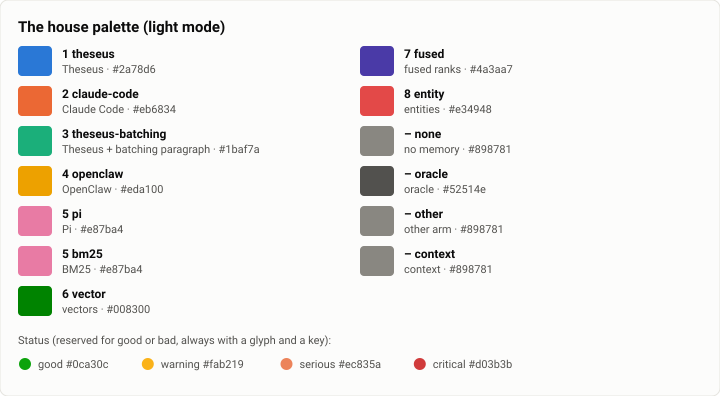

# Benchmarks

Every benchmark Theseus runs ends in a report here: a short research note that gives the answer first, then the
question the run asked, its setup, its results with their uncertainty and plots, what the run teaches, the threats to
its validity, what it cost, and the commands that run it again. Each report keeps its numbers in a data file beside
it, so every table and plot can be checked and redrawn. How a benchmark is set up and run is in
[`bench/README.md`](../../bench/README.md), which also holds the rule that every run gets its report.

## Every run, newest first

The first row is pinned: the omnibus review, the one undated page, is the living overview of every run below, and
its date is the day it was last brought up to date.

| Date | Suite | Arms | Headline | Report |
|---|---|---|---|---|
| 2026-10-23 | all | every arm | **Pinned: start here.** What all 46 runs say. Retest (Oct 23, Theseus at `fe56a164`): effort now applies below the model-switch line, so `xhigh` ran 35 times on the hard tasks (10 before) at 1.83× a trial for no gain (71.6% against 74.1% on the same 27 tasks), and still no turn ran at `max`; the 10-21 HIGH timeouts were mostly the tasks' own. After v1 (Oct 21, Theseus rerun at `6918e3c1`): 77.2% on all 89 Terminal-Bench tasks at high effort (v1 73.0%) at $0.155 a solve, 72.2% on the hard 30 at top effort; Jev still never ran `max`. At v1 (Oct 18): on all 89 Terminal-Bench 2.0 tasks at high effort Theseus as shipped is level with Claude Code (73.0% to 75.3%, paired −2.2 points [−7.9, +3.0]) and the cheapest per solve ($0.136); at top effort on the hard tasks Claude Code leads (75.6% to 67.8%) at 5× the cost a solve; it recalls across sessions (73.1% against 51% to 57%); killed mid-task it never did a step twice; a cold start is 18.5 ms. Open: the send path (51 ms), idle memory, the binary size, abstention. | [The benchmarks omnibus review: what every run says](omnibus.md) |
| 2026-10-27 | `terminal-bench` | Theseus as shipped, routed, frozen 1.0.3 `92e3dbed` | MAX tier, the hard 30 × 3 — **the pass rate did not move while the bill and the clock did.** 59 of 90 = **65.6%** [55.3, 74.6] against the v1 freeze's 67.8% on the same tasks: paired, 1.0.3 is better on 7 tasks, worse on 7, unchanged on 16, sign test **p = 1.000**. On one price table it costs **2.2–2.6× a trial** and takes **3.83× the wall clock**. `theseus-wf482` fires in **38.9% of trials** over 17 of 30 tasks and takes **71.3% of the cell's dollars** (at HIGH it was 27.0% and 64.2%) — every one `reasoning_extraction`, 813 of 1,861 calls on the fallback model. Ran on `92e3dbed`, **not** the wf482 build `d5a3f1ef`. | [Terminal-Bench 2.0, Theseus 1.0.3 at MAX](2026-10-27-terminal-bench-theseus-1.0.3-max-k3.md) |
| 2026-10-27 | `terminal-bench` | Codex on `openai/gpt-6-astra`, `reasoning_effort=high`, pinned | MAX tier, one trial on each of the hard 30 — **the cleanest cell in the gauntlet: zero exceptions in 30 trials.** 26 of 30 = **86.7%** [70.3, 94.7], the highest figure recorded on this task set, but k=1 over 30 trials makes the interval **24.4 points wide** and it overlaps every published MAX arm except OpenCode. The cost is the firmer finding: **$1.9737 a solve** against $0.3618 for the v1 freeze and $0.9357 for the 1.0.3 cell on the same 30 tasks. Bills no Sonnet, so the 10-25 cache-read move does not apply. | [Terminal-Bench 2.0, Codex at MAX](2026-10-27-terminal-bench-codex-astra-max-k1.md) |
| 2026-10-27 | `terminal-bench` | OpenClaw 2026.9.8 on `openai/gpt-6-astra`, pinned | HIGH tier, one trial on each of all 89 tasks — **the same harness as the Sonnet cell, same day, same host, model swapped.** 73 of 89 = **82.0%** [72.8, 88.6], the highest raw rate on all 89 tasks here, at a median **$1.2570** a trial against that cell's $0.1222 — **6.0× the dollars, 5.6× a solve**. Paired task-for-task the pass-rate gap does **not** hold up: 13 tasks `astra`-only, 6 `sonnet`-only, exact McNemar **p = 0.17**, and `astra` had the quieter host. Bills no Sonnet, so the 10-25 cache-read move does not apply. | [Terminal-Bench 2.0, OpenClaw on gpt-6-astra at HIGH](2026-10-27-terminal-bench-openclaw-astra-high-k1.md) |
| 2026-10-27 | `terminal-bench` | OpenClaw 2026.9.8 (`fc23bc8`) on `claude-sonnet-5-5`, pinned | HIGH tier, one trial on each of all 89 tasks — OpenClaw's **first `terminal-bench@2.0` row**. 66 of 89 = **74.2%** [64.2, 82.1], 4.1 points under the frozen 1.0.3 Theseus cell's 78.3% with intervals that overlap almost entirely, and a median trial at **$0.1222** against that cell's $0.1204 on the same price table: this run separates the two arms at neither end. Lowest error rate of the three rival cells (4 of 89), most model calls (median 9.5) and the busiest host (`cpu_some_avg10` 19.48 against c2's 5.46 and c3's 1.48), so the 74.2% is a conservative reading. | [Terminal-Bench 2.0, OpenClaw at HIGH](2026-10-27-terminal-bench-openclaw-sonnet-high-k1.md) |
| 2026-10-27 | `terminal-bench` | OpenHands 1.53.0 on `claude-sonnet-5-5`, pinned | HIGH tier, one trial on each of all 89 tasks — OpenHands' **first `terminal-bench@2.0` row**. 64 of 89 = **71.9%** [61.8, 80.2] at a median **$0.0616** a trial on today's price table. **It is billed on the OLD table** ($0.10/Mtok cache reads) two days after the catalog moved, because it prices itself out of the litellm build its arm pins — so its recorded $9.05 is not comparable with cell 4's as recorded, and $10.69 is. The cell's first run (10-26) is **invalid**, 89 of 89 import errors at $0.00, kept beside it and cited by nothing. | [Terminal-Bench 2.0, OpenHands at HIGH](2026-10-27-terminal-bench-openhands-high-k1.md) |
| 2026-10-26 | `terminal-bench` | Aider 0.86.2 on `claude-sonnet-5-5`, pinned as main, weak and editor model | HIGH tier, one trial on each of all 89 tasks — Aider's **first `terminal-bench@2.0` row**. 11 of 89 = **12.4%** [7.0, 20.8] at a median **$0.0092** a trial, $2.22 for the cell. **Aider is not an agentic loop here and this measures that:** it answers one message (median 1 model call, 12.5 s) and never runs a shell command, because it wants an explicit yes per command and `--yes-always` does not give one — so every task needing a build driven or a service started fails in Aider as shipped. Its median trial is 6.7× cheaper than OpenHands' and a solve costs 1.2× more. | [Terminal-Bench 2.0, Aider at HIGH](2026-10-26-terminal-bench-aider-high-k1.md) |
| 2026-10-26 | `terminal-bench` | Theseus as shipped, frozen 1.0.3 `92e3dbed` (the v1 freeze's trials reused) | HIGH tier, all 89 tasks × 3. **A pass rate that is better but not distinguishably so, for about twice the money a trial.** 209/267 = **78.3%** [72.9, 82.8] against the v1 freeze's 195/267 = 73.0% [67.4, 78.0] — the intervals overlap, so the 5.3-point gain is not established; on the agent-ran rule both move about two points (80.1% against 75.3%) and the gap is the same size. **Like for like on one price table the median trial costs 2.22× and the mean 2.79×** (as billed the run reads 2.45× / 3.13×, mixed basis, and that pairing must not be quoted: a cache-read price moved between the two runs). It is dearer because it takes more turns carrying more context — 12 model calls against 7, 20,455 context tokens against 14,292 — and the tail is new: four trials above $2 against v1's dearest of $1.252, so taking the $2 cap off was necessary rather than cosmetic. **A quarter of the run ran `claude-sonnet-5` after a refusal fallback** (61 of 229 clean trials, 65% of the dollars, `theseus-wf482`), so this is not a clean single-model arm. 33 trials ran beside a build gate; the paired check (0.96× agent time, 17/24 passed either way) says the windows did not move the measurement, so they are published marked rather than rerun. | [Terminal-Bench 2.0, the 1.0.3 build at HIGH](2026-10-26-terminal-bench-theseus-1.0.3-high-k3.md) |
| 2026-10-26 | `bughunt-rs` | Theseus as shipped, frozen 1.0.3 `92e3dbed` (round 1's rivals reused) | Three trials on 13 planted Rust bugs. The 1.0.3 stops rows **do less work for less money and fix no more bugs**: 3.33 of 13 a trial at **$7.59**, against 1.0.1's 4.33 at $21.66 on the same price table — cost down 65% like for like (the 52% first published crossed two price tables), model calls 22%, tool calls 29%, wall time 24%, and the bug count down one, which n=3 a side cannot separate from noise (Wilson over 39 bug-trials 25.6% [14.6, 41.1] against 33.3% [20.6, 49.0]). $ a bug improved $5.00 → $2.28 on one table, and Theseus is still last: OpenCode 10.33 bugs, Claude Code 9.67, Codex 7.67. Every Theseus trial in both runs fixes the same three easy bugs and reaches four distinct bugs of 13 where the rivals reach eleven — short of search, not of turns. Found here: **a quarter of the arm's trials silently run `claude-sonnet-5` instead of `claude-sonnet-5-5`** through the catalog's refusal fallback (`theseus-wf482`). | [Bug Hunt RS, the 1.0.3 build at k=3](2026-10-26-bughunt-rs-theseus-k3.md) |
| 2026-10-26 | `recall` | Theseus as shipped, frozen 1.0.3 `92e3dbed`, seeds 11 and 13 (the v1 rivals not rerun) | **How much of a published recall number is the seed?** Two fresh progressions on one build give **68.8%** and **77.8%**, straddling seed 7's 73.1% — a nine-point spread between draws, wider than any build-to-build gap this series has reported, and the published intervals (over probes within one progression) do not cover it. Cross-session moves 70.8% to 91.7% against seed 7's 58.7%. Robust at both seeds: **0 undelivered** (10-18 flagged 57 and left 10 unproven), **abstention worse** (51 and 56 of 60 gave a value, against 38, with confident-wrong 21 and 11 against 2), and **cost up ~3.2× on the whole run** ($37.17 and $35.10 against $11.44) on an unchanged 7,467-token prompt. Supersession is the weakest bucket at both seeds (29%, 42%). $72.27. | [Recall at two fresh seeds on the frozen 1.0.3 build](2026-10-26-recall-seeds-1.0.3.md) |
| 2026-10-25 | `terminal-bench` | Codex CLI 0.161.0 on GPT-6-Astra, high (the v1 arms' trials reused) | HIGH tier, one trial on each of all 89 tasks. Codex solved 76 (**85.4%** [76.6, 91.3]), the best score any arm has recorded here, against v1's Theseus 73.0%, Claude Code 75.3%, OpenCode 70.8% and Pi 70.4%; paired by task **all four gaps clear zero** (+12.4 [+3.7, +21.0] against Theseus, +10.1 against Claude Code), where the 31-task subset had them crossing it. It costs 13×: $1.31 a trial and $1.54 a solve against Theseus's $0.100 and $0.136, $116.68 for the run, with no spend cap and 18 trials past $2. Zero timeouts of any kind in 89 trials. Two refusals by OpenAI's safeguard, and two tasks (`qemu-alpine-ssh`, `qemu-startup`) whose images break agent install for every arm. | [Terminal-Bench 2.0, Codex CLI HIGH](2026-10-25-terminal-bench-codex-high.md) |
| 2026-10-23 | `terminal-bench` | Theseus as shipped `fe56a164` (the 10-21 and v1 trials reused) | Retest, MAX tier, 27 of the hard 30 × 3: Theseus 71.6% [61.0, 80.3] against `6918e3c1`'s 74.1% on the same tasks (paired −2.5 points [−13.6, +7.4]) at $0.470 a solve (1.9×). Effort now applies at its own bar: `xhigh` ran in 35 turns (10 before), costing 2.16× on those tasks for one more solve. Jev asked for `max` once (0.39): no turn ran at `max`. 0 China-origin calls. | [Terminal-Bench 2.0 retest, MAX tier](2026-10-23-terminal-bench-retest-max.md) |
| 2026-10-23 | `terminal-bench` | Theseus as shipped `fe56a164` (the 10-21 and v1 trials reused) | Retest, HIGH tier, the 6 tasks that timed out on 10-21 × 3, heavy tasks capped: 4 of 18 solved (10-21 0, v1 5); timeouts 11 → 8. `compile-compcert`, `make-doom-for-mips` and `caffe-cifar-10` timed out again with the host under 30% busy: the timeouts are the tasks', not load. The hosts' CPU pressure is the containers' quota throttling, not load. | [Terminal-Bench 2.0 retest, HIGH timeouts](2026-10-23-terminal-bench-retest-high-timeouts.md) |
| 2026-10-21 | `terminal-bench` | Theseus as shipped `6918e3c1` (the rivals' v1 trials reused) | Rerun, MAX tier, the 30 hard tasks × 3 at top effort: Theseus 72.2% [62.2, 80.4] (v1 67.8%; paired +4.4 points [−5.6, +15.6]) at $0.327 a solve, against Claude Code's v1 75.6% at $1.92. Jev asked for `max` 8 times, each under its confidence line: no turn ran at `max`. | [Terminal-Bench 2.0 rerun, MAX tier](2026-10-21-terminal-bench-rerun-max.md) |
| 2026-10-21 | `terminal-bench` | Theseus as shipped `6918e3c1` (the rivals' v1 trials reused) | Rerun, HIGH tier, 89 tasks × 3: Theseus 77.2% [71.8, 81.8] against its own v1 73.0% (paired +4.1 points [−1.9, +10.1]) and Claude Code's v1 75.3%; $0.155 a solve (v1 $0.136). Most of the gain is on the hard 30 (73.3% against 66.7%). route.v7: `private` data verdicts fell from 60% to 17% of turns. 0 China-origin calls. | [Terminal-Bench 2.0 rerun, HIGH tier](2026-10-21-terminal-bench-rerun-high.md) |
| 2026-10-18 | `terminal-bench` | Theseus as shipped `351159fc` · Claude Code 2.1.290 (max) · OpenCode 1.18.35 (max) · Pi 1.0.4 (xhigh) | v1, MAX tier, the 30 hard tasks × 3 at top effort: Claude Code 75.6%, Pi 71.1%, Theseus as shipped 67.8%, OpenCode 32.2% (timeouts); Theseus − Claude Code −7.8 points [−18.9, +1.1]. Claude Code's gain over its HIGH run costs 6.2× a solve ($1.92); Theseus pays $0.36: Jev never chose `max`. | [Terminal-Bench 2.0 at the v1 freeze, MAX tier](2026-10-18-terminal-bench-v1-max.md) |
| 2026-10-18 | `terminal-bench` | Theseus as shipped `351159fc` · Claude Code 2.1.290 · OpenCode 1.18.35 · Pi 1.0.4, all at high effort | v1, HIGH tier, 89 tasks × 3: Claude Code 75.3%, Theseus as shipped 73.0% [67.4, 78.0], OpenCode 70.8%, Pi 70.4%; paired by task Theseus is level with each. Theseus pays the least a solve ($0.136 against $0.150 to $0.173): Jev ran 59% of turns on Sonnet 5.5 high, 15% on Haiku. 0 China-origin calls; Jev calls open-source tasks private in 60% of turns. | [Terminal-Bench 2.0 at the v1 freeze, HIGH tier](2026-10-18-terminal-bench-v1-high.md) |
| 2026-10-18 | `recall` | Theseus `351159fc` · Claude Code 2.1.296 · Pi 1.0.4 | 600 turns, 204 probes: Theseus 73.1% [65.1, 79.9], Pi 56.9%, Claude Code 50.7% (McNemar p < 0.0001); across sessions 27 of 46 against 0 and 1. Its prompt fell from 15,835 to 7,335 tokens, its turns from $0.026 to $0.019. Abstention still weak (38 of 60 wrong). | [Recall: the full run at the v1 freeze](2026-10-18-recall-full-run.md) |
| 2026-10-18 | `async` | Theseus `351159fc` · Claude Code 2.1.290 | The kill -9 family: Theseus 0 duplicated effects and 0 redone steps in 12, resumed 10, one orphan (the `service` chore); Claude Code repeated an effect in 4 of 12, left 11 orphans. Pi and OpenCode still unmeasured (driver bugs). | [Async: the kill -9 family at the v1 freeze](2026-10-18-async-kill-family.md) |
| 2026-10-18 | `h2h` | Theseus `351159fc` · Claude Code 2.1.296 | Ahead on 22 of 25 rows: ready prompt 38.6 ms against 498, CPU a turn 10 ms against 1,655, idle 70 MB against 360. Against Oct 12 a typed prompt now takes 51 ms to leave (26), idle memory 72 MB (50), the first request 46 KB (39). | [Head-to-head speed at the v1 freeze](2026-10-18-head-to-head-speed.md) |
| 2026-10-18 | `gate-bench` | Theseus `351159fc` (release-thin), and Oct 12's `026dce3f` side by side | Side by side with Oct 12's build, the start path is unchanged (cold 18.5 ms, kill 23.7, swap 54.2), the clean stop 4 ms slower (41.2); a busier pass read 20% to 40% slower, the machine's doing. `status --short` passes its 5 ms check; `theseusd` 82.4 MB against 60. | [Gate bench: the v1 freeze's release build](2026-10-18-gate-bench-v1.md) |
| 2026-10-13 | `terminal-bench` | Theseus `026dce3f` · Claude Code 2.1.290 · Pi 1.0.4 · OpenCode 1.18.35 · Theseus as shipped (night set) | Four harnesses on all 89 tasks × 3 at medium effort: Theseus 74.5%, Claude Code and OpenCode 71.5%, Pi 71.2%; over Pi and OpenCode the lead is Theseus's refusal fallback (10 trials each). Pi $0.072 a trial and OpenCode $0.084 against Theseus's $0.120: the cached prompt each call carries times the calls. As shipped, Jev routing, 26 of 28 on the night set at $0.21 (Oct 10: $0.56). | [Terminal-Bench 2.0: four harnesses on all 89 tasks, and Theseus as shipped on the night set](2026-10-13-terminal-bench-harness-arms.md) |
| 2026-10-13 | `terminal-bench` | Theseus `026dce3f` · Claude Code 2.1.290 | R1, the parity test, 89 tasks × 5: Theseus 75.7% [71.5, 79.5], Claude Code 71.9%; +3.8 points by task [0.0, +8.1]: T1 and T2 pass, T4 fails by one malformed input, T5 by calls (1.11×) at fewer dollars a solve. Theseus solves 56 tasks every time, Claude Code 49. | [Terminal-Bench 2.0 R1: the parity claim, Theseus against Claude Code at five attempts](2026-10-13-terminal-bench-r1.md) |
| 2026-10-13 | `terminal-bench` | Theseus `026dce3f` · Claude Code 2.1.290 | R0 at the stopping point, 89 tasks × 3, both at medium effort on EC2: Theseus 74.5% [69.0, 79.4], Claude Code 71.5%; +3.0 points by task [−1.1, +7.5], 14 tasks to 9. Oct 4's −9.6 closed from both sides: Theseus +2.6 with its faults fixed, Claude Code −9.9 with its effort pinned. $0.12 a trial in both arms. | [Terminal-Bench 2.0 R0: Theseus against Claude Code on all 89 tasks, three attempts each, at the stopping point](2026-10-13-terminal-bench-r0.md) |
| 2026-10-12 | `async` | Theseus (grouped calls) · Claude Code 2.1.290 · Pi 1.0.4 · OpenCode 1.18.35 | Parallel tool calls, the first full run: on Layer 2's independent chores Theseus finished nearest the ideal (2.10× against 2.19 to 2.49×) and batched most (7.7% of responses), but lost both `service` controls by running a query grouped with the start it depends on; one response's calls run together up to 8, and 16 take two waves where Pi and Claude Code run 16 at once. | [Async: parallel tool calls, Theseus against Claude Code, Pi and OpenCode, the first full run](2026-10-12-asyncbench-parallel-calls.md) |
| 2026-10-12 | `async` | Theseus · Claude Code 2.1.290 · Pi · OpenCode (the kill -9 family) | Killed with SIGKILL mid-chore and restarted: Theseus resumed every measured trial with no duplicated effect, orphan or redone step (0 of 11), completing 8 of 11; Claude Code completed 12 of 12 but did an effect twice in 7 and left orphans in 10. Pi and OpenCode not measurable (driver bugs). | [Async: the kill -9 family, the first live run](2026-10-12-async-kill-family.md) |
| 2026-10-12 | `async` | Theseus · Claude Code 2.1.290 · the oracle | The six concurrency families, the first full run: both arms succeed in every measured trial; Theseus nearer the ideal on fan-out (3.55× against 5.25×) at a tenth of the harness CPU; but a mid-task question now waits 157 s (46 to 56 on Oct 6) because the model blocks on `job.wait` and a queued message waits for the turn. | [Async: the six concurrency families, Theseus against Claude Code, the first full run](2026-10-12-async-six-families.md) |
| 2026-10-12 | `f10` | Theseus `026dce3f` (stand-in) · Claude Code 2.1.296 | The first ten minutes, the first live run: Theseus 11 of 42 match checks and 5 of 5 beats (a 55 ms ready prompt, cost on every turn, a verified stop, work surviving its restart, a 5 MB client); Claude Code 25 of 42 (20 at 80x24) and no beat. Theseus's misses are the conversation itself: no conversation from a bare `theseus`, raw markdown, no diff before an edit. | [F10: the first ten minutes, Theseus against Claude Code, the first live run](2026-10-12-f10-first-live-run.md) |
| 2026-10-12 | `recall` | Theseus (memory `baseline`) · Claude Code 2.1.296 · Pi 1.0.4 | The first full run, 600 turns and 204 probes: Theseus 73.6% [65.9, 80.1], Pi 56.9%, Claude Code 50.7% (paired p < 0.001); all of the lead is across sessions (31 of 48 against 0 and 1), within a session the three are alike. Theseus abstains worst (42% against 60 to 63%, p = 0.01) and costs most ($0.026 a turn). $30.09. | [Recall: the recall bench's first full run, Theseus against Claude Code and Pi over 600 turns](2026-10-12-recall-full-run.md) |
| 2026-10-12 | `memory-exam` | none · bm25 · baseline (fused) · oracle | The recall pipeline's arms again (GLM-5.3 Flash, 72 items, 576 cells): none 30% [20, 40], BM25 and entities 69% [59, 79], fused 73% [63, 83], oracle 100%; BM25 gained 23 points since Oct 4 and closed the vectors' lead (+4 [−7, +14]). Recall hurts time questions (none 56%, fused 12%), and the fused arm repeats a DM detail in a private item BM25 now leaves out. | [Memory exam: the recall pipeline's arms at the stopping point](2026-10-12-memory-exam-arms.md) |
| 2026-10-12 | `retrieval` | BM25 + entities · vectors · weighted fusion | Ranking unchanged since Oct 1 to the item (held out, all gold in the top 6: BM25 14, vectors 22, equal fusion 16, the defaults 22 of 34); a query embedding now 183 ms and a fused query 100 ms, inside recall's 250 ms; no arm ranks a time item's gold in the top 6. | [Retrieval: BM25, entities, vectors and their fusion on the exam's items, at the stopping point](2026-10-12-retrieval-fusion.md) |
| 2026-10-12 | `context` | the shipped estimate · chars/4 | The compiler's estimate within 1% on later requests and on GLM, but Sonnet 5.5's first requests read +7% (+2 to +4% on Oct 1) as the tool set grew; chars/4 still a third short on Sonnet. | [Context: the token estimate against the provider's count, at the stopping point](2026-10-12-context-token-estimate.md) |
| 2026-10-12 | `harbor` | Theseus `026dce3f` · Claude Code 2.1.290 · Pi 1.0.4 · OpenCode 1.18.35 | Every arm solved `fix-git` twice; the harness's own cost still separates them: Theseus 31 ms of CPU a tool call and 40 MB, Pi 168 ms and 124 MB, Claude Code 225 ms and 256 MB, OpenCode about 4 s and 824 MB. Theseus's own rose since Oct 6 (16 to 25 ms, 24 to 28 MB); Pi was cheapest in model dollars ($0.018 a trial against Theseus's $0.051). | [Harbor: what each harness costs to run, apart from the model, at the stopping point](2026-10-12-harbor-efficiency.md) |
| 2026-10-12 | `gate-bench` | Theseus, release `026dce3f` (scale) | The north-star's scale rows again: at 200,000 sessions every person-facing read is a page (health 9 ms, was 682; `watch -i` ready in 39 ms, was 5,296); one daemon serves 3,000 watchers (it died at 1,017 on Oct 8); admission runs in order. Not fixed: a 10,000-node session's first turn after a start takes 21.8 s (20,000 nodes 96.7 s), and a turn's CPU and the daemon's memory grow with the session's length. | [Scale: the north-star's scale rows on the stopping point's release build](2026-10-12-scale.md) |
| 2026-10-12 | `h2h` | Theseus, release `026dce3f` · Claude Code 2.1.296 | The harness alone, the model a stand-in for both: Theseus faster or lighter on 22 of 25 rows, Claude Code on none: a ready prompt 39 ms against 516, the first text 0.9 ms after the model's first byte against 224, a tool call 37 to 44 ms against 71 to 145, CPU a turn 10 ms against 1,725, 49 MB idle against 337; a three-tool task end to end 7% to 13% faster. | [Head-to-head speed: Theseus and Claude Code on one stand-in model, the first published run](2026-10-12-head-to-head-speed.md) |
| 2026-10-12 | `gate-bench` | Theseus, release `026dce3f` | The stopping point's release build: every lifecycle budget holds at both store sizes (a cold start 18.1 ms against 50; 18.3 at 10,000 sessions, where a SIGKILL's restart halved since Oct 2 and the first board is 17× faster); reads stay under 10 ms on 470,000 ledger rows; on a 1.4 s-flush disk the model call starts 2.7 s sooner than Oct 5. Fails: `theseusd` 77.8 MB against §9's 60 (28.9 on Oct 2), and `status --short`'s p90 8.1 ms against 5. | [Gate bench: the stopping point's release build, every speed bench once more](2026-10-12-gate-bench-stop-point.md) |
| 2026-10-12 | `gate-bench` | Theseus on main (each gate's p95 and p50) | 127 gates from Oct 6 to Oct 12: every lifecycle median far inside its budget; the slowest of ten runs crossed a limit in 22 (17.3% [11.7, 24.8]), most often the new cancel round trip; turn-one-frame took a frame off every turn; the daemon's memory grew a fifth in six days, with no budget. | [Gate bench: FAST's history again, the gate's speed benches from Oct 6 to Oct 12](2026-10-12-gate-bench-fast-history.md) |
| 2026-10-10 | `terminal-bench` | Theseus (Sonnet 5.5) · Theseus as shipped (routed) · the Oct 7 arms | The night set again with Theseus's commands working: on one model 20 of 28 as recorded, 24 with four host-hit trials run again, at $0.21 a trial (Claude Code's dollars; Pi and OpenCode 25 at $0.15 to $0.16); as shipped 25 of 28 at $0.56, its table sending coding to Opus at high effort. A sixth of the one-model arm's dollars were cold-cache re-writes after long commands. | [Terminal-Bench 2.0: Theseus's arms again, with its commands working (the night set's rerun)](2026-10-10-terminal-bench-theseus-rerun.md) |
| 2026-10-07 | `terminal-bench` | Theseus · Claude Code 2.1.290 · OpenCode 1.18.35 · OpenHands 1.53.0 · OpenClaw 2026.9.8 · Codex CLI 0.161.0 · Aider 0.86.2 · Pi 1.0.4 | Eight harnesses on the same 14 tasks × 2: Pi and OpenCode solved the most (25 of 28, 89%) for the least ($0.15 to $0.16 a trial); Claude Code 23 at $0.21. Theseus's 20 at $0.36 is not a fair measure (every command failed to start, a bug since fixed; rerun follows), while its harness was the lightest: 36 MiB, 17 ms CPU a tool call, 1 s setup. | [Terminal-Bench 2.0: 8 harnesses on the same 14 tasks, the harness arms' first run](2026-10-07-terminal-bench-harness-arms.md) |
| 2026-10-06 | `harbor` | Theseus · Theseus + paragraph · Claude Code 2.1.288 · Pi 1.0.4 | The harness apart from the model: Theseus 24 to 28 MiB peak and 16 to 25 ms CPU per tool call; Claude Code 209 to 430 MiB and 175 to 394 ms; Pi 125 MiB and 108 ms. A `fix-git` trial costs about the same in each. | [Harbor: what each harness costs to run, apart from the model, the live efficiency checks](2026-10-06-harbor-efficiency-checks.md) |
| 2026-10-06 | `gate-bench` | Theseus on main (each gate's p95 and p50) | 240 gates on main: every lifecycle phase's median far inside its budget all week (a cold start's p50 22.6 ms against 50); the slowest of ten runs crossed a limit in 32 gates (13.3% [9.6, 18.2]), more often under load; four joins moved a number. | [Gate bench: FAST's history, the gate's speed benches from Oct 1 to Oct 6](2026-10-06-gate-bench-fast-history.md) |
| 2026-10-06 | `async` | Theseus · Claude Code 2.1.288 · the oracle | Smokes, not a run (six model trials): every trial earned its reward; Theseus acted on a mid-task message in 46 to 56 s, Claude Code in 147 and 163 s, at 5 and 8 more model calls. | [Async: the async bench's smokes, before its first full run](2026-10-06-async-smokes.md) |
| 2026-10-05 | `recall` | Theseus (memory arm `baseline`) | Three paid smokes, not the full run (30 turns and 8 probes each, $1.84 in all): each found a flaw in the bench (plan overage, strict abstention, the retracted-stale rule, overhead margins). The 600-turn run is still to come. | [Recall bench: the first three smokes on the Theseus arm](2026-10-05-recall-smokes.md) |
| 2026-10-05 | `gate-bench` | Theseus before · after three fixes | Three fixes: a reply's first words reached Discord 2 to 11 ms after the model's first token, not 255 to 514 (p = 0.0012); on a disk whose flushes stall 1.4 s, a whole reply 2 ms after the stream ended, not 5,403. | [Gate bench: a greeting's reply under IO stalls, before and after three fixes](2026-10-05-gate-bench-speed-io-stalls.md) |
| 2026-10-04 | `terminal-bench` | A. Theseus plain · B. Theseus + batching paragraph · C. Claude Code 2.1.288 | Claude Code 81.5% [75.1, 86.5], Theseus 71.9% [64.9, 78.0], Theseus + paragraph 73.6% (trials, Wilson 95%); by task Claude Code better on 16, Theseus on 5 (p = 0.027). 13 of Theseus's 21 trials that did not end on their own were harness faults since fixed; $71.60. | [Terminal-Bench 2.0: Theseus against Claude Code on all 89 tasks, the first full run](2026-10-04-terminal-bench-first-full-run.md) |
| 2026-10-04 | `memory-exam` | none · bm25 · baseline (fused) · oracle | Memory's arms through the real recall pipeline (GLM-5.3 Flash, 72 items): none 15% [7, 23], BM25 and entities 46% [35, 57], fused baseline 67% [56, 78], oracle 100%. | [Memory exam: the recall pipeline's arms against no memory and the oracle](2026-10-04-memory-exam-arms.md) |
| 2026-10-04 | `gate-bench` | main · lane linux-io | One sync per job: the daemon heard of a finished job 6.6 ms sooner (16.91 → 10.31 ms at L0) and a tool-call turn ran 19.0 ms faster (179.55 → 160.55 ms; 8 against 8, p = 0.0002); a plain turn did not move. | [Gate bench: a job's completion with one sync instead of two, an A/B](2026-10-04-gate-bench-one-sync-per-job.md) |
| 2026-10-03 | `harbor` | Theseus · Theseus + paragraph · Claude Code 2.1.288 | Theseus ran public benchmarks through Harbor: 11 of 11 trials solved on four tasks ($0.42). Its 1.55× call gap reproduced a day later on its three tasks but not across all 89 (1.05×). | [Harbor: can Theseus run public benchmarks at all? The worth spike](2026-10-03-harbor-worth-spike.md) |
| 2026-10-03 | `gate-bench` | main · the ledger-reads branch | A branch's two failed join gates (shutdown p50 88.0 and 70.8 ms) were the disk, not the branch: in one hold of the gate lock main and the branch stopped alike (45.8 against 39.6 ms). Found on the way: a 716 to 887 ms first stop after an install's build. | [Gate bench: the ledger-reads branch, its slow stop that was the disk, its first stop that was not, and its reads at 10,000 sessions](2026-10-03-gate-bench-ledger-reads.md) |
| 2026-10-02 | `gate-bench` | main · lane perf1 | On 10,000 parked sessions (release), a cold start's p50 119.1 → 21.5 ms, a SIGKILL's restart 149.9 → 48.0 ms, a binary swap 149.2 → 45.6 ms (each p = 0.00001); an idle daemon 5.05% of a core → 0.10%. | [Gate bench: the start path at 10,000 parked sessions, before and after the perf1 lane](2026-10-02-gate-bench-start-path-10k.md) |
| 2026-10-02 | `gate-bench` | release-thin glibc · release · static musl | Thin LTO: about 7% slower on CPU-bound work (8 of 10 pairs), rebuilds 1.7 and 5.7 times faster. Static musl: 28% to 67% more CPU in every pair (p = 0.008), 16% to 25% less memory; its faster lifecycle held only for the swap. | [Gate bench: the install's build profile and libc, measured](2026-10-02-gate-bench-install-builds.md) |
| 2026-10-01 | `retrieval` | BM25 + entities · vectors · weighted fusion | Held out, vectors alone found all the gold in the top 6 for 22 of 34 items, BM25 and entities 14 (p = 0.02), equal-weight fusion 16; a vector weight of 6, chosen by a rule written first, 22 (p = 0.03), no more than vectors alone. | [Retrieval: BM25, entities, vectors and their fusion on the exam's items](2026-10-01-retrieval-fusion.md) |
| 2026-10-01 | `retrieval` | candle 0.11 · tract 0.23.8 | candle at f32 embeds a 128-token chunk in 351 to 364 ms on one thread, 1.27 to 1.40 times faster than tract, and adds 1.6 MiB to the binary against 22.4. A real recall query is already past recall's 250 ms deadline. | [Retrieval: which engine embeds for the index, candle or tract?](2026-10-01-retrieval-embedding-engines.md) |
| 2026-10-01 | `gate-bench` | dependencies at opt-level 0 · 2 | Dependencies at opt-level 2: a cold start's median p50 25.6 → 21.7 ms (faster in 9 of 10 interleaved pairs, p = 0.021), the config-copy start 26.8 → 21.5 ms; the gate's misses unchanged (4 and 5 of 10 runs). | [Gate bench: dependencies at opt-level 2 in debug builds, an A/B of the lifecycle bench](2026-10-01-gate-bench-opt-level-2.md) |
| 2026-10-01 | `context` | chars/4 · the class estimate | chars/4 read Claude Sonnet 5.5's tool-carrying first requests at 65.6 to 70.6% of the provider's count (GLM 97.4 to 102.2%); the shipped estimate reads first requests at +1.9 to +4.3% and later ones within 1.7%. | [Context: how far off was the token estimate, and how close is it now?](2026-10-01-context-token-estimate.md) |
| 2026-09-30 | `memory-exam` | BM25 probe · none · oracle | On 32 retrieval-hard items BM25's top 6 holds all the gold for 1 (3.1% [0.6, 15.7]), against 33 of exam-v1's 36: paraphrase, scale, time and tool output each defeat it for their own reason. | [Memory exam v2: items built so that retrieval is hard](2026-09-30-memory-exam-v2.md) |
| 2026-09-30 | `memory-exam` | none · oracle · BM25 probe | GLM-5.3 Flash passed 26% of 40 items with no memory and 100% with the needed notes shown: +74 points [+61, +86] of headroom (held out +82). But BM25's top 6 already held the gold for 33 of 36 items, so exam-v1 cannot judge a retriever. | [Memory exam: how much does a cheap model gain from being shown its past?](2026-09-30-memory-exam-headroom.md) |

## The house palette

Every chart in these reports draws an arm in the same colour, so a reader who learns "Claude Code is orange" in one
report can trust it in the next. The colours are the categorical palette of the dataviz method these reports follow,
in its fixed order, with a light and a dark step for each slot; each chart is shipped in both modes and GitHub shows
the one that matches the reader's theme. `bench/report/charts.py` owns the palette: a report names arms by key, never
by colour.

<picture>
  <source media="(prefers-color-scheme: dark)" srcset="img/palette-dark.svg">
  
</picture>

| Slot | Arm key | Arm | Light | Dark |
|---|---|---|---|---|
| 1 | `theseus` | Theseus | `#2a78d6` | `#3987e5` |
| 2 | `claude-code` | Claude Code | `#eb6834` | `#d95926` |
| 3 | `theseus-batching` | Theseus + the batching paragraph (an ablation arm) | `#1baf7a` | `#199e70` |
| 4 | `openclaw` | OpenClaw (reserved: its arm is not built yet) | `#eda100` | `#c98500` |
| 5 | `pi` | Pi (a harness arm; shares slot 5 with `bm25`) | `#e87ba4` | `#d55181` |
| 5 | `bm25` | BM25, the lexical source | `#e87ba4` | `#d55181` |
| 6 | `vector` | vectors, the dense source | `#008300` | `#008300` |
| 7 | `fused` | fused ranks (BM25, entities and vectors) | `#4a3aa7` | `#9085e9` |
| 8 | `entity` | exact entities | `#e34948` | `#e66767` |

Harness arms hold slots 1 to 5; configurations inside Theseus (memory and retrieval arms) hold 5 to 8. Four neutrals
are not slots: `none` (a no-memory baseline) and `context` (the emphasis form's de-emphasised series: a second
statistic of an arm, or the rest beside the one that matters) in the gray `#898781`; `oracle` (a ceiling) in the
secondary ink; and `other` (an arm outside the registry) in the gray, with its name on the point. Status colours
(good `#0ca30c`, warning `#fab219`, serious `#ec835a`, critical `#d03b3b`) are reserved for what means good or bad,
such as a run over its budget, and always come with a glyph and a key. A new arm takes the next free slot here and
in `charts.ARMS`, and the palette is validated again. Pi, an arm since 2026-10-06 (`bench/harbor/pi_agent.py`), shares
slot 5 with `bm25` (theseus-3lqk): the method has eight hues and never generates a ninth, and a harness comparison
has no retrieval arm, nor a retrieval one a harness, so the two never meet in one figure (`charts.HARNESS_ARMS`,
`charts.MEMORY_ARMS`). The five harness slots pass the validator on their own, adjacent pairs, both modes.

**Validated** with the method's validator (OKLab ΔE × 100, Machado-Oliveira-Fernandes 2009 at severity 1), on the
chart surfaces `#fcfcfb` (light) and `#1a1a19` (dark):

| Set | Mode | Pairs | Worst CVD ΔE (target 8) | Worst normal-vision ΔE (floor 15) | Contrast against the surface |
|---|---|---|---|---|---|
| All eight slots | light | adjacent | 9.1 | 19.6 | 3 below 3:1: aqua 2.74, yellow 2.11, magenta 2.62 |
| All eight slots | dark | adjacent | 8.4 | 19.3 | all at least 3:1 |
| The three harness arms (slots 1 to 3) | light | all | 9.2 | 24.0 | aqua 2.74 |
| The three harness arms (slots 1 to 3) | dark | all | 9.4 | 20.9 | all at least 3:1 |
| Memory slots 5 to 8 | light | adjacent | 17.6 | 33.6 | magenta 2.62 |
| Memory slots 5 to 8 | dark | adjacent | 13.0 | 22.5 | all at least 3:1 |
| `bm25`, `vector`, `fused` | light / dark | all | 17.6 / 13.0 | 33.9 / 19.7 | magenta 2.62 (light) |
| A dumbbell's two steps (`theseus`) | light / dark | ordinal | monotone, ΔL ≥ 0.06 | – | light end 2.12:1 / 2.12:1 (floor 2:1) |

Every check passes. The three light-mode slots under 3:1 take the method's relief rule: no chart is the only way to
read its numbers, since each figure's values are in a table in its report and its marks are labelled or keyed. Text
is never drawn in a series colour: labels use the ink (`#0b0b0b`, 19.2:1) and the secondary ink (`#52514e`, 7.7:1;
dark `#c3c2b7`, 9.7:1). A scatter, whose points can sit beside any other, carries at most three arms: the harness
arms' three, or the three retrieval arms, each set validated over all its pairs.

## How a report is written

**Its name:** `<YYYY-MM-DD>-<suite>[-<slug>].md`, the date the run happened; its figures under `img/<same name>/`; its
data file `<same name>.json` beside it, and a per-trial (or per-task, per-probe, per-run) `<same name>.csv` when there
is one. Suites: `terminal-bench`, `swe-bench`, `harbor` (mixed samples), `gate-bench` (the gate's speed benches and
the A/Bs beside them), `memory-exam`, `retrieval`, `recall`, `async`, `context` (the context compiler against the
provider's own numbers).

**Its sections,** in order, each one there even when it is short:

1. **The answer first:** one paragraph, the headline with its numbers and their intervals.
2. A table at a glance: suite, arms, model, tasks × attempts, date and commit, cost, data.
3. **The question** the run asked, and why it mattered then.
4. **The setup:** each arm's harness and version; the model; the dataset and its task count; the limits (attempts,
   wall clock, spend and turn caps); the machine; the date and the commit.
5. **Results:** tables with uncertainty, and figures that each answer one question named in their caption.
6. **Analysis:** where each arm wins and loses, with a failure taxonomy and its examples (task ids, never
   transcripts); cost, tokens and time against success (a Pareto view where there are arms); what changed since the
   last comparable run.
7. **Threats to validity:** sample size, flaky tasks, spend parity, contamination, the harness's own bugs at the time.
8. **What it cost** to run.
9. **Reproduction:** the exact commands, from this repository, on public datasets.
10. **Data:** what the data file holds.

"Novel" means the insight, not the format: a report says what the run teaches that its tables don't, says plainly
where a run was flawed, and says so when a later look finds that an old conclusion doesn't hold.

**Its statistics** come from `bench/report/stats.py`, the same code for a past run and a future one:

- a pass rate with its Wilson 95% interval, saying whether the unit is the trial or the task;
- two arms compared on the same tasks by an exact McNemar test on the discordant pairs (a task and attempt that one
  arm passed and the other did not), with the counts beside the p;
- a mean cost or time with a seeded bootstrap 95% interval (10,000 resamples), or its range when there are fewer than
  ten values, and the median beside a skewed mean.

**Its figures** are SVG, drawn by `bench/report/charts.py` (the Python standard library, nothing to install) from
declarative specs kept in the data file's `figures`: `python3 bench/report/draft.py plot docs/benchmarks/<report>.json`
draws them again. The forms are chosen by the data's job: an interval per row for estimates (`intervals`), bars for
counts, lines and small multiples for a number over time against its budget, a scatter for a Pareto view, a strip for
a distribution of per-trial values, a matrix for each task's outcomes, and a dumbbell for before and after. One axis
per chart, recessive hairline grids, thin marks, a legend for two or more series and labels only where they carry the
story. Each figure is shipped twice, `<name>.svg` and `<name>-dark.svg`, each painting its own surface, and a report
shows them with a `<picture>` whose dark source GitHub picks for a reader in its dark theme. Every mark carries a
`<title>`, so opening a figure on its own shows each value on hover; in the report, the table beside each figure is
its readable twin. Before a figure ships, it is looked at, rendered, in both modes, and checked against the method's
list of what goes wrong (overlap, clipped labels, a dual axis, a number on every point).

**Its data** is the run's summary, never its raw outputs: numbers, task ids and figure specs. Trial transcripts stay
off this public repository.

**Its words** follow the repository's rules: no person's name (the owner is "the owner"), no private path, account,
key or address, and public datasets only.

## Drafting a report

`bench/report/draft.py` does the mechanical half of every report: it reads what a run left, computes the numbers with
their intervals, writes the data file, the CSV and both modes of every figure, and a skeleton with every section in
order, its tables filled and its figures placed. The run's lane writes the narrative into the skeleton.

```bash
# A Harbor run (Terminal-Bench, SWE-bench, the async families): one --arm per arm, KEY=JOBS.
python3 bench/report/draft.py harbor --suite terminal-bench@2.0 --date 2026-10-04 --slug first-full-run \
    --arm theseus=jobs/theseus-tb2 --arm claude-code=jobs/claude-tb2 --model anthropic/claude-sonnet-5-5

# The gate's speed benches over a span of the bench history ($THESEUS_BENCH_HISTORY).
python3 bench/report/draft.py history --since 2026-10-01 --branch main --date 2026-10-06

# The recall bench, from its scorer's scores.json; the async bench, from its Harbor jobs.
python3 bench/report/draft.py recall --scores <scores>/scores.json --date <day>
python3 bench/report/draft.py async --date <day> jobs/async-theseus jobs/async-claude

# Any report's figures again, after editing a spec.
python3 bench/report/draft.py plot docs/benchmarks/<report>.json
```

An existing report is never overwritten (`--force` rewrites its skeleton). `bench/report/efficiency.py`, the
efficiency report over Harbor jobs, draws its Pareto charts with the same renderer.

## What a Harbor run records

- The job's `result.json` from Harbor, and each trial's reward, time and spend.
- Since 2026-10-05 (the spec's Part III Item 167), each trial's efficiency record, `agent/efficiency.json`, one shape
  for every arm: tokens by class (input, cache read, cache write, output), dollars, model and tool calls, and the
  harness's own CPU and peak RSS apart from the commands it runs, sampled inside the task's container
  (`bench/harbor/sampler.py`). A job from before it, such as the first full run's, reads "not sampled" for CPU and
  RAM. Since 2026-10-06 (Items 199 and 200) the async harness's Theseus record counts a call a stop cut at its
  estimate apart (`cut_calls`, `cut_cost_usd` and `billed_usd`, with `cost_usd` their sum, what the kernel books as
  spent), its tool calls include its tasks' (`tool_calls_from`), and a trial whose ledger read hit its 1,000-row cap
  is marked `truncated`; a published async table shows `billed_usd` beside the dollars, notes that Claude Code's
  record carries no estimate for a request its interrupt cut, and footnotes a truncated trial. A recall progression
  records the overhead it was planned at, and the driver refuses a daemon more than 50 tokens over it
  (`--allow-overhead` runs on); a published run is generated at the measured overhead. `--stale retracted` binds a
  retracting phrase to the nearest value within four words in its clause; strict stays the published rule.
- Theseus's build (`theseus --version`) and the profile's settings (`THESEUS_BENCH_*`), so a run can be repeated.
- Trials that ended with an error, by Harbor's class for it: a timeout (`AgentTimeoutError`), a spend limit
  (`TheseusSpendLimitError`), a cut turn (`TheseusTurnCutError`), and so on (`bench/README.md`). Their rewards still
  count: the task's tests run after every trial.
