# Theseus's benchmarks as of 2026-10-18 (v1): the omnibus review

**The answer first.** At v1 (Oct 18), on the build frozen for v1 (`351159fc`), Theseus as shipped (Jev choosing
each message's model and effort) ran against the top three harnesses of the broad pass, each on its best model at high
effort. **On all 89 Terminal-Bench 2.0 tasks it is level with Claude Code and the cheapest per solve:**
- Theseus solved 73.0% at $0.136 a solved task;
- Claude Code solved 75.3% at $0.173 (paired by task −2.2 points, 95% −7.9 to +3.0);
- OpenCode solved 70.8% and Pi 70.4%.

**It still remembers across sessions where the others do not.** It answered 73.1% of 600 turns' recall probes, against
56.9% for Pi and 50.7% for Claude Code. Across sessions it answered 27 of 46, against 0 and 1 of 48.

**Killed mid-task it never did a step twice** (0 in 12), where Claude Code repeated an effect in 4 of 12. One trial
left a process running.

**It is as fast as at the stopping point.** A cold start takes 18.5 ms and a crash restart 23.7 ms, measured side by
side with Oct 12's build. Against Claude Code it is 13× faster to a ready prompt and uses a fifth of its idle memory.

**The run found regressions to fix:**
- a typed prompt now takes 51 ms to leave as a request (26 on Oct 12);
- idle memory rose from 50 to 72 MB;
- the first request rose from 39 to 46 KB;
- `theseusd` is 82.4 MB against a 60 MB budget.

At top effort on the hard tasks ([MAX](2026-10-18-terminal-bench-v1-max.md)), Claude Code leads (75.6% to Theseus's 67.8%), at
$1.92 a solve against $0.36: Jev never chose `max`. What follows the v1
section is the record up to Oct 13, kept as it was.

**As of Oct 13.** Thirty-six benchmark reports between Sep 30 and Oct 13, 2026, the last sixteen a full rerun on
the stopping point's build (`026dce3f`), say five things about Theseus. **It now solves real terminal tasks at least
as often as Claude Code on the same model.** On all 89 Terminal-Bench 2.0 tasks at five attempts, Theseus solved
75.7% of its trials and Claude Code 71.9%, both on Claude Sonnet 5.5 at medium effort: +3.8 points paired by task,
95% interval 0.0 to +8.1, so the coding plan's parity line (no worse than −5) is met and "better" sits at the edge.
Pi and OpenCode solve about as many (71%) for 60% to 70% of the dollars; the gap is the prompt each of Theseus's
calls carries. **It remembers across sessions, where the others do not.** Over 600 scripted turns it answered 73.6%
of recall probes against Pi's 56.9% and Claude Code's 50.7%, all of the lead from earlier sessions; it is worse than
they are at saying "I don't know". **It is light, fast, and survives a crash.** A release cold start takes 18.1 ms of
its 50 ms budget; its own process uses 31 ms of CPU a tool call and 40 MB against 168 to 3,994 ms and 124 to 824 MB
for the others; killed with SIGKILL mid-task, it resumed every measured trial without doing a step twice, where
Claude Code doubled an effect in 7 of 12. **Its weak spots are measured:** the first ten minutes of a conversation
(11 of 42 checks against Claude Code's 25), a long session's first turn after a restart (21.8 s at 10,000 nodes), the
daemon's size (77.8 MB against a 60 MB budget), and recall's sense of time. **Every run changed something:** eighteen
measured speed-ups from 1.2 to 2,700 times, and fixes that turned Oct 4's 9.6-point deficit into a lead. All the model
calls of every run cost $367.

<picture>
  <source media="(prefers-color-scheme: dark)" srcset="img/omnibus/headline-dark.svg">
  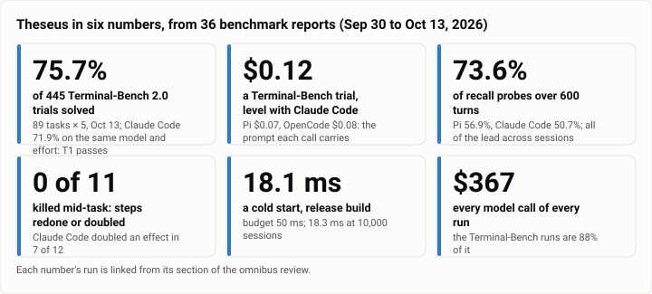
</picture>

*Figure 1. What do the benchmark runs say, in a sentence each? Six numbers; each section below links the runs they come from.*

| | |
|---|---|
| Runs | 36 reports, Sep 30 to Oct 13, 2026, all published; the stopping point's rerun (Oct 12 to 13) is 16 of them |
| Questions | Does it solve real tasks? Does it remember? Is it fast? What does it cost? |
| Harnesses compared | Theseus; Claude Code; Pi and OpenCode (Oct 7, Oct 12, Oct 13); OpenHands, OpenClaw, Codex CLI and Aider (Oct 7) |
| Models | Claude Sonnet 5.5 for the task runs (Codex CLI: GPT-5.6-Sol; Theseus as shipped: Jev's choice per message); GLM-5.3 Flash for the memory exams; a stand-in for the speed benches; none for the scale runs and the retrieval probes |
| Model spend | $367.36 at list prices, of which the Terminal-Bench runs are $324.04; the Oct 13 EC2 hosts (about $74) are not model spend |
| Data | [`omnibus.json`](omnibus.json): every figure's numbers, a row a mark, with the reports they come from |

This page is the overview. It is updated as runs land, and each run keeps its own full report, linked from every
section below and listed at the end.

## v1 at the freeze (2026-10-18)

Per the owner's plan for benchmarks, each row compares **Theseus as shipped** with the top three rivals of the broad
pass. Each rival runs on its best model, Claude Sonnet 5.5. The table gives solve rate, dollars per solved task and
wall time.

| Benchmark | Theseus as shipped | Claude Code | OpenCode | Pi | Report |
|---|---|---|---|---|---|
| Terminal-Bench 2.0, HIGH (89 × 3), solved | 73.0% [67.4, 78.0] | **75.3%** [69.8, 80.1] | 70.8% | 70.4% | [HIGH](2026-10-18-terminal-bench-v1-high.md) |
| ... dollars a solved task | **$0.136** | $0.173 | $0.168 | $0.150 | |
| ... agent seconds a trial (median) | **50** | 56 | 60 | 55 | |
| Terminal-Bench 2.0, MAX (hard 30 × 3, top effort), solved | 67.8% [57.6, 76.5] | **75.6%** [65.8, 83.3] | 32.2% | 71.1% | [MAX](2026-10-18-terminal-bench-v1-max.md) |
| ... dollars a solved task | **$0.362** | $1.923 | $4.508 | $0.749 | |
| Recall, 600 turns, probes right | **73.1%** [65.1, 79.9] | 50.7% | – | 56.9% | [recall](2026-10-18-recall-full-run.md) |
| ... across sessions | **27 of 46** | 0 of 48 | – | 1 of 48 | |
| Kill -9, trials with a step done twice | **0 of 12** | 4 of 12 | not measured | not measured | [kill](2026-10-18-async-kill-family.md) |
| Ready prompt / CPU a turn / idle memory (stand-in model) | **39 ms / 10 ms / 70 MB** | 498 ms / 1,655 ms / 360 MB | – | – | [h2h](2026-10-18-head-to-head-speed.md) |

The [gate bench](2026-10-18-gate-bench-v1.md) holds every lifecycle budget, side by side with Oct 12's build.

<picture>
  <source media="(prefers-color-scheme: dark)" srcset="img/omnibus/frontier-v1-high-dark.svg">
  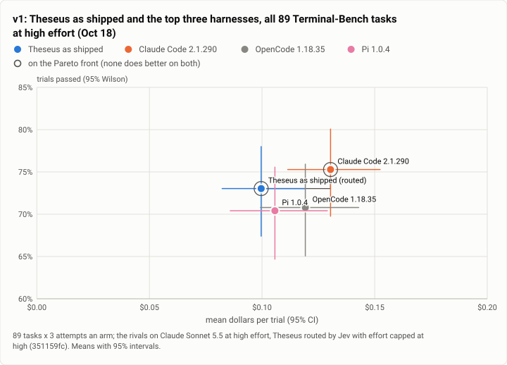
</picture>

*Figure 2. At the v1 freeze, which harness solves the most for the least? Claude Code solves the most (75.3%) and Theseus as shipped the most per dollar (73.0% at $0.100 a trial); paired by task the two are level, and OpenCode and Pi follow.*

## How to read this page

- **A harness** is the program around a language model: it gives the model tools (a shell, files, the web), runs
  them, keeps the session, and decides when to stop. Theseus is a harness. So are Claude Code, OpenCode and the others
  it was measured against. Where two harnesses drive the same model, the difference between them is the harness's.
- **A trial** is one attempt by one harness at one task. A task's own tests decide whether it passed.
- **A 95% interval**, written [low, high], is the range the true value likely sits in, given how few trials there
  were. Wide intervals mean small samples. Two intervals that overlap a lot do not show a difference.
- **p50 and p95** are the median and the slow end of a set of timings. In the speed gate, the p95 of ten runs is the
  slowest of the ten.
- **The oracle** is the memory exam's ceiling: the model is handed exactly the notes the task needs.
- **The gate** is the set of checks every change must pass before it joins the main line: tests, and the speed
  benches with their budgets.
- **The frontier** is the set of harnesses no other beats on both counts at once (more tasks solved for less).

Colours hold across every figure: Theseus is always blue and Claude Code orange, Pi pink where it has its own slot.
The other harnesses are gray, each named on its own mark.

## Does it solve real tasks?

Terminal-Bench 2.0 is 89 public tasks, each in its own container: build a ray tracer, repair a git history, make a
web server log its requests, crack a hash. A trial passes when the task's own tests pass. Six runs have measured
Theseus on it, the last three (Oct 13) the whole benchmark again at the stopping point.

**Can it run them at all? Yes ([the worth spike, Oct 3](2026-10-03-harbor-worth-spike.md)).** Through the public
Harbor runner, with a small adapter and two static binaries, Theseus solved four easy tasks as Claude Code did, 11 of
11 trials for $0.42. Its own work was 1.3% to 4.6% of a turn: the rest was the model. It made 1.55 times Claude
Code's model calls on those easy tasks, because its model split shell work into many small commands.

**How often does it succeed? 75.7% at the stopping point, against Claude Code's 71.9% ([R1, Oct 13](2026-10-13-terminal-bench-r1.md)); on Oct 4, 71.9% against 81.5% ([the first full run](2026-10-04-terminal-bench-first-full-run.md)).**
All 89 tasks, the same model (Claude Sonnet 5.5) and the same limits ($2.00 and 200 model calls a trial) in every arm.

<picture>
  <source media="(prefers-color-scheme: dark)" srcset="img/omnibus/tb-full-dark.svg">
  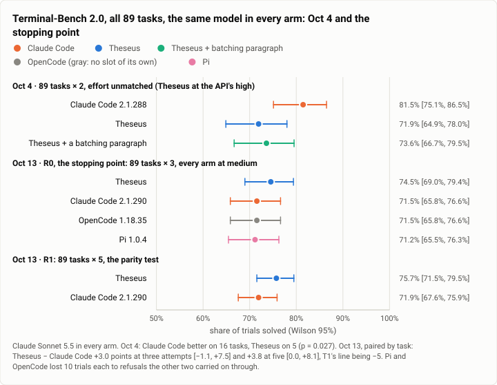
</picture>

*Figure 3. How often does Theseus solve a real terminal task, against the other harnesses? Oct 4's gap (71.9% against 81.5%) is gone: at the stopping point Theseus solved 74.5% at three attempts and 75.7% at five, Claude Code 71.5% and 71.9%, Pi and OpenCode about 71%.*

**The stopping point ([R0](2026-10-13-terminal-bench-r0.md), [R1](2026-10-13-terminal-bench-r1.md), Oct 13).** Every
arm at medium effort, versions pinned, on four EC2 hosts with each task's jobs on one host. At three attempts Theseus
solved 74.5% and Claude Code 71.5% (+3.0 points by task, −1.1 to +7.5); topped up to five, 75.7% and 71.9% (+3.8,
0.0 to +8.1; 17 tasks better against 7). The coding plan's T1 (lower bound ≥ −5 points) and T2 (the 30 hard tasks'
point estimate ≥ −3; here +1.3) pass. T4 fails by one malformed input in 445 trials (21 on Oct 4), and T5 by calls:
1.11 times Claude Code's a solve against a line of 1.1, at fewer dollars a solve ($0.112 against $0.114). Theseus is
also the steadier arm: 56 tasks solved in all five attempts against 49. The gap closed from both sides: Theseus gained
2.6 points on Oct 4 while thinking at medium effort instead of the API's high default, and the harness faults below
ended none of its trials; Claude Code lost 9.9 points (22 tasks worse, 6 better), most on the hard tasks, with its
effort now pinned to medium where Oct 4's was not recorded. A host comparison on 77 jobs run both on the old machine
and on EC2 found the host change moved neither outcomes nor time.

**What happened on Oct 4.** Paired task by task, Claude Code did better on 16 tasks and Theseus on 5 (exact sign test, p = 0.027). The run's
most useful finding was why. Of Theseus's 21 trials that did not end on their own, 13 ended on a fault of the
harness, not of the model's work:

- the model refused three security-flavoured tasks, and Theseus had no fallback (6 trials). Claude Code meets the
  same refusals by retrying on an older model, and finished all six of its trials that way;
- the bench capped the model's answer at 32,000 tokens where the model allows 128,000 (4 trials);
- an approval nobody could give, a provider timeout that was not retried, and one stop that overran (1 trial each).

All five are fixed, and on Oct 13 none of them ended a trial: Theseus finished its refused trials on Sonnet 5 as
Claude Code does (9 and 10 trials at three attempts). On Oct 4 the hard tasks went to Claude Code 9 to 1 (p = 0.021);
on Oct 13 they are level (4 to 4 at three attempts, 5 to 3 for Theseus at five). At full scale the call gap of the
spike almost vanished (8.35 against 7.98 calls a trial). One extra paragraph of instructions asking the model to
batch its shell steps (the green arm) cut calls by 11% and moved nothing else; the project gave the shell tool a
batch of steps instead, a tool rather than a prompt.

**Beside the other harnesses on all 89 tasks ([the harness arms, Oct 13](2026-10-13-terminal-bench-harness-arms.md)).**
Pi 1.0.4 and OpenCode 1.18.35 ran R0's 89 tasks × 3 beside Theseus and Claude Code, on the same model and effort.

<picture>
  <source media="(prefers-color-scheme: dark)" srcset="img/omnibus/frontier-89-dark.svg">
  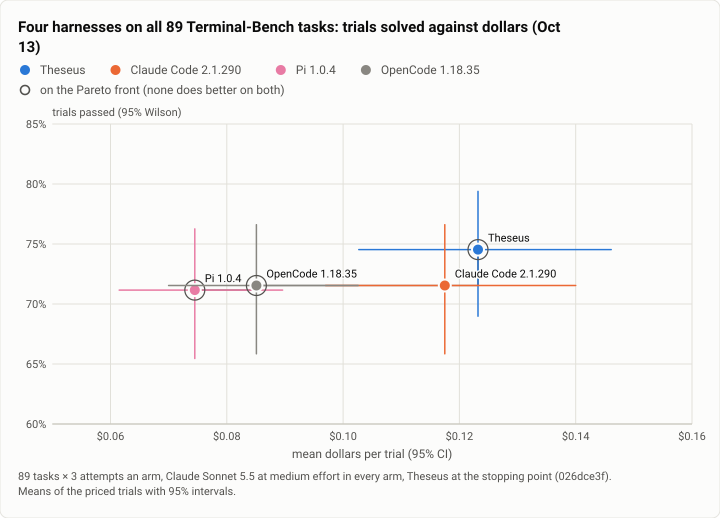
</picture>

*Figure 4. On the whole benchmark, which harness solves the most for the least? Theseus solves the most and Pi costs the least; Claude Code is off the front, since OpenCode solves as many trials for less.*

- **The four solve about the same share:** Theseus 74.5%, Claude Code and OpenCode 71.5%, Pi 71.2%; every interval
  overlaps. Over Pi and OpenCode, all of Theseus's lead is one feature: on four security-flavoured tasks Sonnet 5.5
  refused, and Theseus and Claude Code went on with another model while Pi and OpenCode stopped (10 trials each).
  Without those tasks Theseus, Pi and OpenCode are level.
- **The dollars separate them:** Pi $0.072 a trial, OpenCode $0.084, Claude Code $0.115, Theseus $0.120. Output a
  call is alike; Theseus's and Claude Code's calls each read about 25,000 tokens of cached prompt, Pi's 10,000, and
  Theseus makes the most calls (9.4 a trial against Pi's 6.7). A lighter prompt and fewer round trips are the fix,
  and both serve every user.
- **Theseus as shipped,** with Jev choosing the model per message, solved 26 of 28 on the Oct 7 night set at $0.21 a
  trial; Oct 10's table, sending deep coding to Opus, cost $0.56 for 25. The owner's change to Sonnet 5.5 at high
  effort cut it by 62% with no solve lost; on these 14 easy-to-medium tasks high effort bought nothing over the fixed
  arm's medium (38 of 42 at $0.16).

**Beside six more harnesses on 14 tasks ([the harness arms' run, Oct 7](2026-10-07-terminal-bench-harness-arms.md)).** Eight harnesses ran the same 14 tasks
twice each: the four tasks the fixes target, and ten tasks both of Oct 4's arms had solved. Every arm but one drove
Claude Sonnet 5.5 at medium effort; Codex CLI speaks only OpenAI's API, so it ran OpenAI's GPT-5.6-Sol.

<picture>
  <source media="(prefers-color-scheme: dark)" srcset="img/omnibus/frontier-dark.svg">
  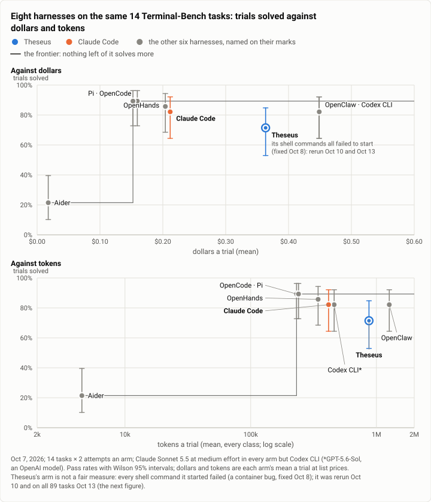
</picture>

*Figure 5. Which harnesses solve the most for the least, and where does Theseus sit? Pi and OpenCode solve the most (89%), at $0.15 to $0.16 a trial; Theseus's 71% at $0.36 is off the frontier, in a run where none of its shell commands could start.*

**Rerun with its commands working (Oct 10, Oct 13).** On the same 14 tasks, Theseus on one model solved 20 of 28 as recorded and 24 with four host-hit trials run again, at $0.21 a trial; as shipped, with Jev routing coding to Opus at high effort, 25 at $0.56 ([the rerun's report](2026-10-10-terminal-bench-theseus-rerun.md)). On Oct 13 the same 14 tasks went 38 of 42 at $0.16 on one model (Pi 38, OpenCode 37, Claude Code 34). The figure above keeps Oct 7's point as it was measured.

<picture>
  <source media="(prefers-color-scheme: dark)" srcset="img/omnibus/task-strip-dark.svg">
  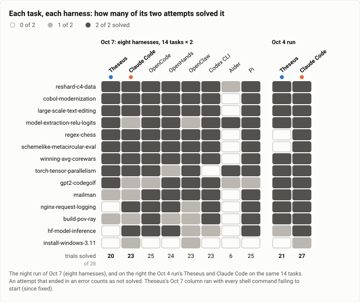
</picture>

*Figure 6. Where does each harness win and lose, task by task? Most tasks fall to nearly every harness; Aider misses most, and every harness misses install-windows-3.11 at least once. Theseus's Oct 7 column was earned without a working shell, and even so the two tasks the output-cap fix targeted went from 0 of 4 trials to 4 of 4.*

- **The field is close.** Pi and OpenCode solved 25 of 28 (89.3%), OpenHands 24, Claude Code, OpenClaw and Codex CLI
  23 each. Their intervals overlap almost entirely. Aider solved 6: under this runner it edits files but does not run
  commands.
- **Pi and OpenCode lead the frontier**: the most solved, at $0.15 to $0.16 a trial. Only Aider, which solved 6,
  spent less.
- **Theseus's 20 of 28 is not a fair measure, and is reported as measured.** Every shell command it started in this
  run failed. The task containers refuse a newer system call (`clone3`) that Theseus used to start processes, and it
  had no fallback. The model worked around it through Theseus's terminal tool, which is why it made about twice Claude
  Code's model calls (22.5 a trial against 11.9) and used about twice its tokens (873,000 a trial against 416,000). The fix (start a process the
  older way when the newer call is refused) joined the main line on Oct 8. Its live check solved
  `nginx-request-logging`, a task both of Theseus's Oct 7 trials had failed, for $0.06. Its arms were rerun on Oct 10
  and Oct 13 (above).
- **Even without a shell, the output-cap fix shows.** The two tasks it targeted, `regex-chess` and
  `schemelike-metacircular-eval`, went from 0 of 4 trials on Oct 4 to 4 of 4 on Oct 7, and 6 of 6 on Oct 13.

**The first ten minutes ([F10, Oct 12](2026-10-12-f10-first-live-run.md)).** Twelve steps a new user takes, read from
the screen: Theseus passed 11 of 42 match checks and all 5 beat checks, Claude Code 2.1.296 25 of 42 (20 at 80x24) and
none. Theseus's misses are the conversation itself: a bare `theseus` opens none, replies show raw markdown, and an edit
shows no diff before it lands. The rows that fix them were deferred until after the rerun.

## Does it remember?

Theseus keeps every session in a store and recalls from it: before the model answers, a recall step searches past
sessions and puts up to six notes in front of the model. The memory runs asked whether that helps, and when it fails,
whether retrieval or the model is to blame.

<picture>
  <source media="(prefers-color-scheme: dark)" srcset="img/omnibus/memory-dark.svg">
  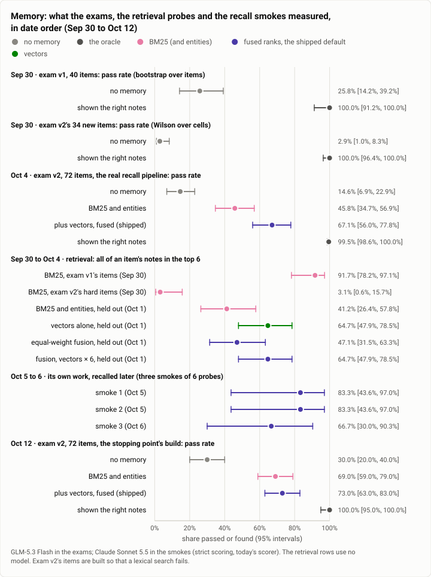
</picture>

*Figure 7. Does Theseus remember, and is the gap its retrieval or the model? Recall lifts a cheap model from 30% to 73% at the stopping point (15% to 67% on Oct 4); shown the right notes it passes 100%, so the gap is retrieval.*

- **Memory has a lot to give ([memory exam v1, Sep 30](2026-09-30-memory-exam-headroom.md)).** On 40 synthetic tasks
  that each need something from an earlier session, a cheap model (GLM-5.3 Flash) passed 26% with no memory and 100%
  when shown the right notes: 74 points of headroom [+61, +86], and 82 on the half nobody tuned on. The gain is in what
  no model can guess: a port, an ID, a correction, which of two near-identical projects. But a plain keyword search
  (BM25) already found the right notes for 33 of 36 items, so this exam could not tell a good retriever from a
  perfect one.
- **So a harder exam was written the same evening ([exam v2](2026-09-30-memory-exam-v2.md)).** Four new families
  defeat keyword search on purpose: the note is a paraphrase, a statement buried among near-duplicates, a value that was
  later corrected, or a command's output. Keyword search found the notes for 1 of 32 such items. The model passed none
  of them without memory and all of them with the notes.
- **Meaning-based search wins, if it is weighted right ([retrieval, Oct 1](2026-10-01-retrieval-fusion.md)).** On
  items held out from tuning, vectors (an embedding of each note's meaning) found 22 of 34 against keyword search's 14
  (p = 0.02). Mixing the sources with equal weights threw most of that away (16), because the hard items' decoys rank
  first by keyword. A weight of 6 on the vectors, chosen on the other half by a rule written before the test, gave
  22 back. The embedding engine was picked by its own run ([engines, Oct 1](2026-10-01-retrieval-embedding-engines.md)):
  candle, 1.27 to 1.43 times faster than tract on one thread and 1.6 MiB in the binary against 22.4.
- **Through the real pipeline, recall recovers most of the gap ([memory exam arms, Oct 4](2026-10-04-memory-exam-arms.md)).**
  No memory 15% [7, 23]; keyword search 46% [35, 57]; keyword search with vectors, as shipped, 67% [56, 78]; the
  oracle 100%. When the six notes held everything an item needed, the model passed 89% to 95% of the time; when they
  held none of it, 7% to 10%. The model is not the bottleneck: what reaches it is.
- **At the stopping point ([memory exam arms, Oct 12](2026-10-12-memory-exam-arms.md)).** The same 72 items: no memory
  30% [20, 40], keyword search 69% [59, 79], with vectors as shipped 73% [63, 83], the oracle 100%. Keyword search
  gained 23 points in a week and closed most of the vectors' lead (+4 points, inside the noise), though retrieval's own
  ranking did not move ([retrieval, Oct 12](2026-10-12-retrieval-fusion.md): every held-out count Oct 1's): the gain
  is in what recall packs and how it is rendered. On time questions recall now hurts: the model alone passes 56%,
  with keyword recall 25%, with vectors 12%, because recalled notes carry dates the model takes for the answer.
- **What is left.** The corrected-value family scored 0% for every retrieval arm: similarity cannot tell a stale
  statement from the later one that corrects it. That is a third of the remaining gap, and it needs a sense of time.
  And one private item failed in every retrieval run because the reply repeated a detail from a direct-message
  session beside the right public answer. In a private session the product's rule allowed it; the exam's check was
  written for a public place. Both are open.
- **Remembering its own work ([recall smokes, Oct 5 to 6](2026-10-05-recall-smokes.md); [the full run, Oct 12](2026-10-12-recall-full-run.md)).**
  A second bench replays scripted work and later asks about facts said once in passing. Three smokes (30 turns each,
  $1.84) each found a flaw in the bench before the full run could pay for it. The full run, 600 turns in three
  sessions on Sonnet 5.5: Theseus answered 73.6% of recall probes [65.9, 80.1], Pi 56.9% and Claude Code 50.7%
  (paired p < 0.001). All of the lead is across sessions (31 of 48 against 0 and 1); within a session the three are
  alike. Theseus is worse at abstaining (42% against 60% to 63%): asked about something never said, it offers the
  distractor beside it. It also costs the most a turn ($0.026), from the prompt it carries and 13 compactions.
- **Knowing how much it holds ([context, Oct 1](2026-10-01-context-token-estimate.md)).** Theseus estimates a
  request's size before sending it, to stay inside the model's window. The old rule (bytes over four) read Claude's
  tool-heavy requests at 66% to 71% of the provider's own count, because Claude's tokenizer reads JSON densely. The new
  estimate starts from the provider's count of the last request and is within 1.7% of it after the first call (+1.9% to
  +4.3% on a session's first request). At the stopping point ([Oct 12](2026-10-12-context-token-estimate.md)) a
  session's first request reads 7% high as the tool set grew; later ones within 0.3%. A recall query now fits its
  deadline: an embedding 183 ms and a fused query 100 ms, under 250.

## Is it fast?

Speed is the owner's first goal for Theseus, written as budgets that fail the gate the way a failing test does: a
cold start answers within 50 ms, a clean stop finishes within 100, a crash's restart within 150, and swapping in a new
binary within 200.

<picture>
  <source media="(prefers-color-scheme: dark)" srcset="img/omnibus/speed-budgets-dark.svg">
  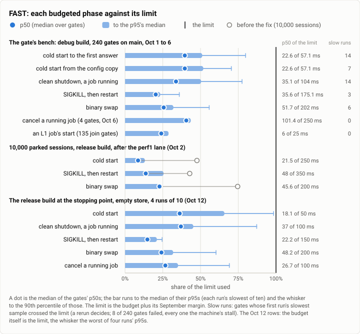
</picture>

*Figure 8. How much of each speed budget does Theseus use? Every phase's median uses a sixth to a half of its limit, on the debug gate and on the release build; only single stalled runs ever crossed one.*

- **The release build at the stopping point ([gate benches, Oct 12](2026-10-12-gate-bench-stop-point.md)).** Every
  lifecycle budget holds at both store sizes: a cold start 18.1 ms of 50 (18.3 at 10,000 sessions), a clean stop with
  a job running 37.0 of 100, a SIGKILL's restart 22.2 of 150 (twice as fast as Oct 2 at 10,000 sessions), a swap 48.2
  of 200; reads under 10 ms on 470,000 ledger rows. Two numbers fail what the spec asks: `theseusd` is 77.8 MB against
  §9's 60 (28.9 on Oct 2), and the prompt's `status --short` takes 8.1 ms at its p90 against 5.
- **The gate's second week ([FAST's history, Oct 6 to 12](2026-10-12-gate-bench-fast-history.md)).** 127 gates:
  medians far inside every budget; the slowest of ten runs crossed a limit in 17.3% [11.7, 24.8] of first runs, most
  often the cancel round trip; the daemon's memory grew a fifth in six days, with no budget.
- **Against Claude Code, the harness alone ([head-to-head, Oct 12](2026-10-12-head-to-head-speed.md)).** On one
  stand-in model Theseus was faster or lighter on 22 of 25 rows and slower on none: a ready prompt 39 ms against 516,
  the first words 0.9 ms after the model's first byte against 224, 10 ms of CPU a turn against 1,725, 49 MB idle
  against 337. Its weakest row is the shell call.
- **At ten times the load ([scale, Oct 12](2026-10-12-scale.md)).** At 200,000 parked sessions `health` takes 9 ms
  (682 on Oct 8) and `watch -i` is ready in 39 ms (5,296); one daemon served 3,000 watching connections (it died at
  1,017 on Oct 8). Not fixed: a long session's first turn after a start (21.8 s at 10,000 nodes, 96.7 s at 20,000),
  and a turn's CPU and memory that grow with its session (about 150 MB a thousand turns).

- **The budgets held all week ([FAST's history, Oct 1 to 6](2026-10-06-gate-bench-fast-history.md)).** Over 240 gates
  on the main line, a cold start's median was 22.6 ms against 50, a clean stop 35.1 against 100, a crash's restart
  35.6 against 150 and a swap 51.7 against 200.
- **The misses were the machine's.** The gate judges the slowest of ten runs, and in 32 of 240 gates (13.3% [9.6,
  18.2]) one slow run crossed a limit. The chance rose with the machine's load, from 2.9% under a load of 4 to 36% to
  40% above 12, and doubled on the day a Terminal-Bench run's containers shared the disk. 19 of those gates passed on a
  rerun, 5 on the busy machine's allowance, and 8 failed. Each failed commit, or the next one, passed a later gate with no change to
  the code the bench runs.
- **Two numbers grew with no budget to catch them.** Over Oct 4 a plain turn's median rose 8 ms and the daemon's
  resident memory grew from 45 to 68 MB. Neither has a budget yet.
- **At 10,000 sessions ([the start path, Oct 2](2026-10-02-gate-bench-start-path-10k.md)).** The gate benches an
  empty store, so a lane measured a big one. A cold start took 119 ms because the start read history that grows with
  use. Once it stopped doing that, it took 21.5 ms of its 250 ms budget, and an idle daemon went from 5.05% of a core
  to 0.10%. The stored reads that grow with history became 5.5 to 228 times faster
  ([ledger reads, Oct 3](2026-10-03-gate-bench-ledger-reads.md)).
- **A reply when the disk stalls ([IO stalls, Oct 5](2026-10-05-gate-bench-speed-io-stalls.md)).** A greeting once
  took 5.4 s to answer on the owner's machine. On a test rig, a reply's first words now reach the chat 3 ms after the
  model writes them, not 376 ms (p = 0.0012); on a disk whose every flush stalls 1.4 s, the whole reply arrives 2 ms
  after the model finishes, not 5.4 s. Still open: on that disk the model call itself starts about 10 s after the
  message, behind three writes that each wait for the disk.
- **Answering while it works ([async smokes, Oct 5 to 6](2026-10-06-async-smokes.md); [six families](2026-10-12-async-six-families.md) and [parallel calls](2026-10-12-asyncbench-parallel-calls.md), Oct 12).**
  In the smokes, a question sent during a long job was answered in 46 to 56 s, Claude Code's in 147 and 163 s. In the
  full run both arms succeeded in every measured trial; Theseus came nearest the ideal on fan-out (3.55 times against
  5.25) at a tenth of Claude Code's harness CPU, but the mid-task question now waits 157 s, because the model blocks
  on `job.wait` and a queued message waits for the turn. On parallel tool calls Theseus finished nearest the ideal
  (2.10 times against 2.19 to 2.49) but lost both `service` controls by running a query grouped with the start it
  depends on, and one response's calls run together only up to 8.
- **Killed mid-task ([the kill -9 family, Oct 12](2026-10-12-async-kill-family.md)).** SIGKILLed during a chore and
  restarted, Theseus resumed all 11 measured trials with no effect done twice, no orphan and no step redone, and
  completed 8 (3 failed at the task level after a clean resume). Claude Code completed 12 of 12 but doubled an effect
  in 7 and left orphans in 10. Pi's and OpenCode's arms were not measurable (driver bugs).
- **The build it ships ([install builds, Oct 2](2026-10-02-gate-bench-install-builds.md); [opt-level, Oct 1](2026-10-01-gate-bench-opt-level-2.md)).**
  A lighter link-time optimisation costs about 7% on CPU-bound work and rebuilds 1.7 to 5.7 times faster, so the
  install uses it. A fully static build cost 28% to 67% more CPU in every pair, so the install does not. Optimising the
  dependencies in test builds took a cold start from 25.6 to 21.7 ms, and did not stop the gate's misses.

## What does it cost?

<picture>
  <source media="(prefers-color-scheme: dark)" srcset="img/omnibus/cost-dark.svg">
  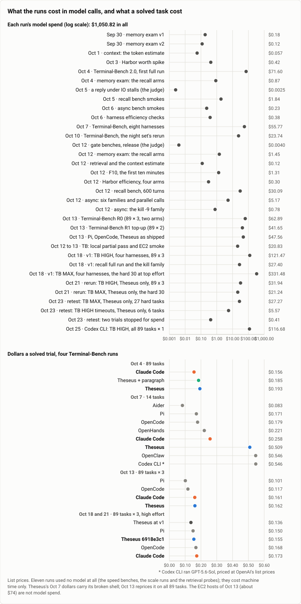
</picture>

*Figure 9. What does benchmarking Theseus cost, and what does Theseus cost a solved task? About $367 of model calls in all; on Oct 13 Theseus cost $0.16 a solved trial, as Claude Code did, Pi $0.10.*

- **v1 (Oct 18).**
  - The v1 run's model calls came to $480.35: Terminal-Bench HIGH $121.47 and MAX $331.48, recall $26.78 and the kill
    family $0.62.
    MAX added $331.48 (Claude Code $130.73, OpenCode $130.73, Pi $47.95, Theseus $22.07).
  - Its four EC2 hosts and their NAT data came to about $84 for both tiers.
  - A solved task cost Theseus as shipped $0.136, Pi $0.150, OpenCode $0.168 and Claude Code $0.173.
- **The runs to Oct 13.** All the model calls of every run came to $367.36, and the Terminal-Bench runs are 88% of it ($324.04).
  The memory exams cost cents to a dollar and a half each. Eleven runs called no model at all. The stopping point's
  rerun cost $212.33 of model calls, plus about $74 for the four EC2 hosts its Terminal-Bench pass ran on, more than
  half of that their NAT's data charges (917 GB of task images and installs).
- **A solved task.** On Oct 4, Theseus spent $0.193 per solved trial and Claude Code $0.156. Claude Code solved more
  for about the same spend a trial ($0.130 against $0.140), and the two intervals overlap: Claude Code is not dearer,
  but "cheaper" is not established. On Oct 7 Theseus's $0.51 a solved trial carries the cost of working around a
  broken shell. On Oct 13, on all 89 tasks, Theseus spent $0.162 a solved trial and Claude Code $0.161; Pi $0.101 and
  OpenCode $0.117. A trial cost Theseus $0.120, Claude Code $0.115.
- **A steady price for an easy task ([efficiency checks, Oct 3 to 6](2026-10-06-harbor-efficiency-checks.md)).** Seven
  Theseus trials of `fix-git`, across three builds, cost $0.045 to $0.055; Claude Code's six cost $0.034 to $0.054.
  That makes it a smoke check: a change that moves `fix-git` past about $0.06 is worth a look. Claude Code reads
  more of its input from the provider's cache (92.9% against 87.5% on Oct 4).

<picture>
  <source media="(prefers-color-scheme: dark)" srcset="img/omnibus/harness-weight-dark.svg">
  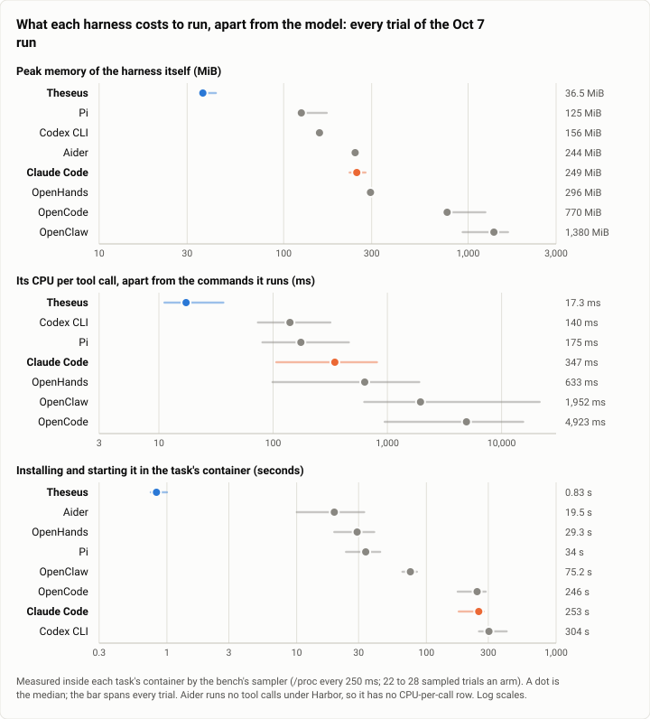
</picture>

*Figure 10. How heavy is Theseus itself, beside the other harnesses? The lightest by every measure: 36.5 MiB, 17 ms a tool call, under a second to set up.*

- **The harness itself is light.** Measured inside each task's container, Theseus held 36.5 MiB at its peak, the
  others 125 to 1,380 MiB. It spent 17 ms of CPU per tool call, the others 140 to 4,923 ms. It installed and started
  in 0.83 s, the others in 19.5 s to 5 minutes. None of this moves the model's bill. It matters where many sessions
  share one machine, which is what Theseus is for. On Oct 4, Claude Code's installs alone took 14.8 hours across its
  178 trials; Theseus's 356 trials spent 6 minutes. At the stopping point ([efficiency, Oct 12](2026-10-12-harbor-efficiency.md))
  Theseus spent 31 ms of CPU a tool call and held 40 MB, Pi 168 ms and 124 MB, Claude Code 225 ms and 256 MB,
  OpenCode about 4 s and 824 MB; Theseus's own rose since Oct 6 (16 to 25 ms, 24 to 28 MB).

## What we changed because of a run

Each run is meant to change something: a bench, a default, or the code. These are the changes, each with the
measurement that judged it.

<picture>
  <source media="(prefers-color-scheme: dark)" srcset="img/omnibus/fixes-dark.svg">
  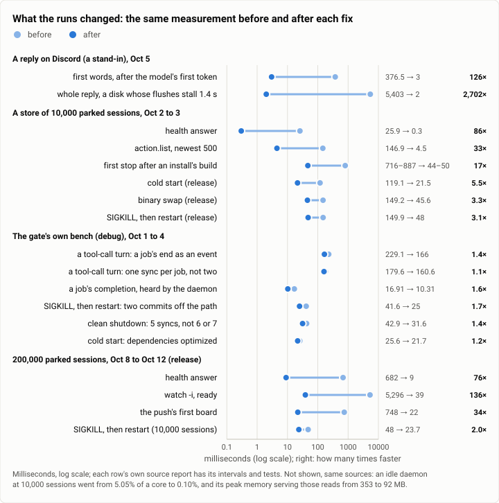
</picture>

*Figure 11. What did acting on a benchmark's finding buy? Eighteen measured speed-ups, 1.2 to 2,700 times, each from a finding a run made.*

| Run | What it found | What changed | What it bought |
|---|---|---|---|
| [Memory exam v1](2026-09-30-memory-exam-headroom.md) | keyword search already finds 33 of 36 notes: the exam cannot judge a retriever | exam v2, with items built so that keyword search fails | 1 of 32 found by keyword search: an exam that separates retrievers |
| [Retrieval](2026-10-01-retrieval-fusion.md) | equal weights let keyword decoys bury the vectors' finds | vectors weighted 6 to 1, chosen by a rule written first | 22 of 34 held-out items against 16 (p = 0.03) |
| [Embedding engines](2026-10-01-retrieval-embedding-engines.md) | candle is faster on one thread and far smaller | the index embeds with candle at full precision | 1.27 to 1.43 times faster; 1.6 MiB in the binary, not 22.4 |
| [Context estimate](2026-10-01-context-token-estimate.md) | bytes over four read Claude's requests a third low | count from the provider's own last count | within 1.7% of the provider after the first call |
| [Opt-level](2026-10-01-gate-bench-opt-level-2.md) | unoptimised dependencies cost the debug start about 15% | dependencies optimised in test builds | cold start 25.6 → 21.7 ms |
| [Start path at 10,000 sessions](2026-10-02-gate-bench-start-path-10k.md) | the start read history that grows with use | only queued work read before serving | cold start 119.1 → 21.5 ms; idle 5.05% → 0.10% of a core |
| [Install builds](2026-10-02-gate-bench-install-builds.md) | a fully static build costs 28% to 67% more CPU | the install ships the dynamic, lighter-optimised build | rebuilds 1.7 to 5.7 times faster, at about 7% CPU |
| [Ledger reads](2026-10-03-gate-bench-ledger-reads.md) | a branch's failed gate was the disk; the first stop after a build took 0.7 to 0.9 s | reads through the index; a checkpoint at the build's end | reads 5.5 to 228 times faster; that stop 44 to 50 ms |
| [Worth spike](2026-10-03-harbor-worth-spike.md) | 1.55 times the calls on easy tasks | a batching paragraph tried, then retired for a tool | the shell tool takes a batch of steps |
| [First full run](2026-10-04-terminal-bench-first-full-run.md) | 13 of 21 unfinished trials were harness faults | the full output length, a fallback model on refusal, private addresses open to the bench, a retried timeout | the two cap-cut tasks: 0 of 4 → 4 of 4 on Oct 7 |
| [First full run](2026-10-04-terminal-bench-first-full-run.md) | unequal effort and timeouts between arms | every arm at medium effort, versions pinned, a timed-out agent stopped | the Oct 7 run compares like with like |
| [One sync per job](2026-10-04-gate-bench-one-sync-per-job.md) | a job's result paid two disk flushes | one flush, then a rename | heard 6.6 ms sooner; a tool-call turn 19 ms faster |
| [IO stalls](2026-10-05-gate-bench-speed-io-stalls.md) | a reply waited on the edit timer and the disk | text shown as the model writes it; nothing written before the judge's call | first words 376.5 → 3 ms; a stalled reply 5.4 s → 2 ms |
| [Recall smokes](2026-10-05-recall-smokes.md) | the bench sized logs wrong and scored correct answers as wrong | the bench sizes text by Theseus's own rule; the scorer fixed | the next smoke compacted where its plan said |
| [Async smokes](2026-10-06-async-smokes.md) | the bench's driver never closed Claude Code's input | the driver fixed; cut calls counted | a trial that ran to its 900 s timeout now ends in 192 s |
| [FAST's history](2026-10-06-gate-bench-fast-history.md) | misses track the machine, not the code | the gate waits for a quiet machine, with a measured allowance | 5 gates passed that a stall would have failed |
| [Efficiency checks](2026-10-06-harbor-efficiency-checks.md) | a stopped turn's last call was missing from its record | the cut call recorded | spend agrees to the cent |
| Harness arms (Oct 7) | no shell command could start in the task containers | start a process the older way when the newer call is refused | the live check solved a task Theseus had failed |
| [Night-set rerun](2026-10-10-terminal-bench-theseus-rerun.md) | a sixth of the dollars were cold-cache re-writes after long commands; Opus for deep coding cost 4.8 times as much | `cache-fix`; the shipped 60 s command wait in the bench; deep coding routed to Sonnet 5.5 at high effort | cache writes 34% → 22% of Theseus's dollars; the as-shipped arm $0.56 → $0.21 a trial, 25 → 26 of 28 |
| [Scale](2026-10-12-scale.md) (Oct 8's run) | the CLI and the push read the whole session list; one daemon ran out of file handles | pages, not lists; the fd limit raised and soft-failed | health 682 → 9 ms at 200,000 sessions; 1,017 → 3,000 watchers |
| [Recall, full run](2026-10-12-recall-full-run.md) | the bench read one page of history and summed Claude Code's running cost twice | the driver pages and takes the cost's increase | 152 → 228 facts delivered; Claude Code's cost right |
| [The stopping point's rerun](2026-10-13-terminal-bench-r1.md) | Oct 4's faults, effort unmatched, no refusal fallback | every fix above, effort pinned, the refusal fallback | Terminal-Bench −9.6 → +3.8 points against Claude Code; malformed inputs 21 → 1 |

## What we don't know yet

- **Whether Theseus is better, not just as good, on Terminal-Bench.** At five attempts the 95% interval of its lead
  over Claude Code runs from 0.0 to +8.1 points. A rerun on the next build, or SWE-bench (T3, not yet run), decides it.
- **Its own price.** Pi and OpenCode solve as many trials for 60% to 70% of Theseus's dollars, and the difference is
  the prompt each call carries times the calls it makes; the census, deferred tool schemas and fewer round trips are
  the open work. T5's calls line (1.1 times Claude Code's) fails at 1.11.
- **The conversation itself.** F10's 11 of 42: the rows that open a conversation, render it and show an edit before
  it lands were deferred until after this rerun.
- **Recall's precision and sense of time.** Abstention (42% against 60% to 63%), time questions that recall makes
  worse (56% → 12%), a private item that repeats a direct message's detail, and corrected values no retrieval arm
  passes.
- **Long sessions.** A 10,000-node session's first turn after a start takes 21.8 s (20,000: 96.7 s), and a turn's CPU
  and memory grow with its session. `theseusd` is 77.8 MB against a 60 MB budget.
- **Concurrency's rough edges.** A question during a long job waits for the turn (157 s); grouped calls can run a step
  before the one it depends on; Pi's and OpenCode's kill-9 arms are not yet measurable.
- **Web search with only a model key.** Theseus offers search only with a search provider's key; Claude Code's
  server-side search solved a Terminal-Bench task Theseus never did.
- **Small samples where they remain.** The night set's 14 tasks, the async families' trials and the efficiency checks'
  sampled trials are shapes, not rankings.
- **Public tasks.** Terminal-Bench's tasks and solutions are public, so a model may have seen them. That lifts every
  arm alike.

## Every report

| Question | Report | Date |
|---|---|---|
| Real tasks | [Harbor: can Theseus run public benchmarks at all? The worth spike](2026-10-03-harbor-worth-spike.md) | Oct 3 |
| Real tasks | [Terminal-Bench 2.0: Theseus against Claude Code on all 89 tasks, the first full run](2026-10-04-terminal-bench-first-full-run.md) | Oct 4 |
| Real tasks | [Terminal-Bench 2.0: 8 harnesses on the same 14 tasks, the harness arms' first run](2026-10-07-terminal-bench-harness-arms.md) | Oct 7 |
| Real tasks | [Terminal-Bench 2.0: Theseus's arms again, with its commands working (the night set's rerun)](2026-10-10-terminal-bench-theseus-rerun.md) | Oct 10 |
| Real tasks | [F10: the first ten minutes, Theseus against Claude Code, the first live run](2026-10-12-f10-first-live-run.md) | Oct 12 |
| Real tasks | [Terminal-Bench 2.0 R0: Theseus against Claude Code on all 89 tasks, three attempts each, at the stopping point](2026-10-13-terminal-bench-r0.md) | Oct 13 |
| Real tasks | [Terminal-Bench 2.0 R1: the parity claim, Theseus against Claude Code at five attempts](2026-10-13-terminal-bench-r1.md) | Oct 13 |
| Real tasks | [Terminal-Bench 2.0: four harnesses on all 89 tasks, and Theseus as shipped on the night set](2026-10-13-terminal-bench-harness-arms.md) | Oct 13 |
| Real tasks | [Terminal-Bench 2.0 at the v1 freeze, HIGH tier: Theseus as shipped against Claude Code, OpenCode and Pi](2026-10-18-terminal-bench-v1-high.md) | Oct 18 |
| Real tasks | [Terminal-Bench 2.0 at the v1 freeze, MAX tier: the hard tasks, every harness at its top effort](2026-10-18-terminal-bench-v1-max.md) | Oct 18 |
| Memory | [Memory exam: how much does a cheap model gain from being shown its past?](2026-09-30-memory-exam-headroom.md) | Sep 30 |
| Memory | [Memory exam v2: items built so that retrieval is hard](2026-09-30-memory-exam-v2.md) | Sep 30 |
| Memory | [Retrieval: which engine embeds for the index, candle or tract?](2026-10-01-retrieval-embedding-engines.md) | Oct 1 |
| Memory | [Retrieval: BM25, entities, vectors and their fusion on the exam's items](2026-10-01-retrieval-fusion.md) | Oct 1 |
| Memory | [Context: how far off was the token estimate, and how close is it now?](2026-10-01-context-token-estimate.md) | Oct 1 |
| Memory | [Memory exam: the recall pipeline's arms against no memory and the oracle](2026-10-04-memory-exam-arms.md) | Oct 4 |
| Memory | [Recall bench: the first three smokes on the Theseus arm](2026-10-05-recall-smokes.md) | Oct 5 |
| Memory | [Memory exam: the recall pipeline's arms at the stopping point](2026-10-12-memory-exam-arms.md) | Oct 12 |
| Memory | [Retrieval: BM25, entities, vectors and their fusion on the exam's items, at the stopping point](2026-10-12-retrieval-fusion.md) | Oct 12 |
| Memory | [Context: the token estimate against the provider's count, at the stopping point](2026-10-12-context-token-estimate.md) | Oct 12 |
| Memory | [Recall: the recall bench's first full run, Theseus against Claude Code and Pi over 600 turns](2026-10-12-recall-full-run.md) | Oct 12 |
| Memory | [Recall: the full run at the v1 freeze, Theseus against Claude Code and Pi over 600 turns](2026-10-18-recall-full-run.md) | Oct 18 |
| Speed | [Gate bench: dependencies at opt-level 2 in debug builds](2026-10-01-gate-bench-opt-level-2.md) | Oct 1 |
| Speed | [Gate bench: the install's build profile and libc, measured](2026-10-02-gate-bench-install-builds.md) | Oct 2 |
| Speed | [Gate bench: the start path at 10,000 parked sessions](2026-10-02-gate-bench-start-path-10k.md) | Oct 2 |
| Speed | [Gate bench: the ledger-reads branch and its reads at 10,000 sessions](2026-10-03-gate-bench-ledger-reads.md) | Oct 3 |
| Speed | [Gate bench: a job's completion with one sync instead of two](2026-10-04-gate-bench-one-sync-per-job.md) | Oct 4 |
| Speed | [Gate bench: a greeting's reply under IO stalls, before and after three fixes](2026-10-05-gate-bench-speed-io-stalls.md) | Oct 5 |
| Speed | [Async: the async bench's smokes](2026-10-06-async-smokes.md) | Oct 6 |
| Speed | [Gate bench: FAST's history, Oct 1 to Oct 6](2026-10-06-gate-bench-fast-history.md) | Oct 6 |
| Speed | [Gate bench: the stopping point's release build, every speed bench once more](2026-10-12-gate-bench-stop-point.md) | Oct 12 |
| Speed | [Gate bench: FAST's history again, the gate's speed benches from Oct 6 to Oct 12](2026-10-12-gate-bench-fast-history.md) | Oct 12 |
| Speed | [Head-to-head speed: Theseus and Claude Code on one stand-in model, the first published run](2026-10-12-head-to-head-speed.md) | Oct 12 |
| Speed | [Scale: the north-star's scale rows on the stopping point's release build](2026-10-12-scale.md) | Oct 12 |
| Speed | [Async: the six concurrency families, Theseus against Claude Code, the first full run](2026-10-12-async-six-families.md) | Oct 12 |
| Speed | [Async: parallel tool calls, Theseus against Claude Code, Pi and OpenCode, the first full run](2026-10-12-asyncbench-parallel-calls.md) | Oct 12 |
| Speed | [Async: the kill -9 family, the first live run](2026-10-12-async-kill-family.md) | Oct 12 |
| Speed | [Gate bench: the v1 freeze's release build, every speed bench once more](2026-10-18-gate-bench-v1.md) | Oct 18 |
| Speed | [Head-to-head speed: Theseus and Claude Code on one stand-in model, at the v1 freeze](2026-10-18-head-to-head-speed.md) | Oct 18 |
| Speed | [Async: the kill -9 family at the v1 freeze](2026-10-18-async-kill-family.md) | Oct 18 |
| Cost | [Harbor: what each harness costs to run, apart from the model](2026-10-06-harbor-efficiency-checks.md) | Oct 6 |
| Cost | [Harbor: what each harness costs to run, apart from the model, at the stopping point](2026-10-12-harbor-efficiency.md) | Oct 12 |

How each report is written, and the house palette every figure here uses, are in the [index](README.md).
